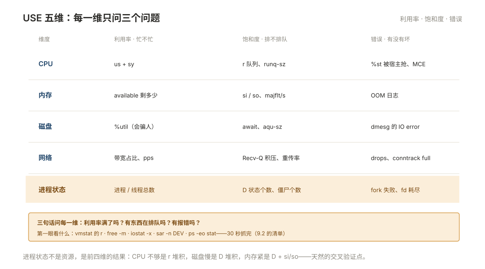
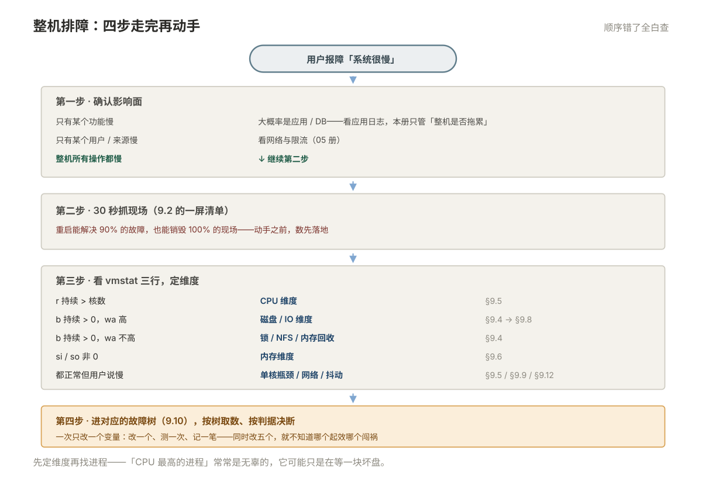

# 09 性能分析与故障排查

> **解决**：机器慢了、服务卡了、进程莫名其妙没了——这类「整机级」的故障，第一个数该看哪个，看完怎么判断，判断完改什么。  
> **范围**：排障的顺序 · 工具与读数 · 负载分析 · 负载高但 CPU 低 · CPU  
> **口径**：正文以 CentOS 7 / Ubuntu 22.04 / Ubuntu 20.04 举例；命令、路径与发行版差异在节内注记，不绑定单一版本。  
> **更新**：2026-11-06  
> **读完能做到**：用五维模型把「慢」定位到 CPU、内存、磁盘、网络、进程状态中的某一维；用 `vmstat` 三行数判断瓶颈方向；说清「负载 20 而 CPU 3%」到底怎么回事；把「内存一直涨」分成缓存、泄漏、真需求三种；从 OOM 日志和 `vmcore` 里取到证据；按五条故障树走完从现象到根因；按「一次只改一个变量」做调优，而不是抄一份 sysctl 脚本。
> **怎么读**：9.0 是知识点地图，标了**基础 / 进阶**。第一遍跳过带「进阶」的小节不影响主线。不认识的词查 [00 术语表](00-术语表.md)。
> **不在这里**：`top` 的按键、`ps` 的字段含义、`/proc/<pid>` 逐项解释 → [002 进程与资源](002-进程与资源.md)；`iostat` 每个字段、`dd`/`fio` 怎么测、IOPS 和吞吐的换算 → [004 §4.11](004-存储与文件系统.md)；「连不通」走哪一层、`tcpdump` 怎么抓 → [005 网络配置与排障](005-网络配置与排障.md)；采集、存储、告警规则 →「监控」文档集。

> **这一册的写法**：性能数字**没有绝对值，只有量级和关系**。文中输出是某台 8 核 16G 虚机上的样子，你的机器数字一定不同——要看的不是 `r=3` 这个数，而是「`r` 长期等于 3」与「核数是 4」之间的关系。所以每处判据都写成**比值或趋势**，不写「大于某个数就一定是故障」。
> 另外：本册所有「造压力」的命令**只在测试机执行**。生产上造压本身就叫事故。

---

## 目录

| 节 | 内容 |
|---|---|
| 9.0 | 本册知识点地图 |
| 9.1 | 排障的顺序：先看维度，再看进程 |
| 9.2 | 工具与读数 |
| 9.3 | 负载分析 |
| 9.4 | 负载高但 CPU 低 |
| 9.5 | CPU |
| 9.6 | 内存：从「够不够」到「谁在涨」 |
| 9.7 | 内存取证：OOM 之后与 kdump |
| 9.8 | 磁盘与 IO |
| 9.9 | 网络：从性能视角看 |
| 9.10 | 五条故障树 |
| 9.11 | 从分析到调优 |
| 9.12 | 事后：把数留下来 |
| 9.13 | 自测 |
| 9.14 | 命令与片段索引 |

---

## 9.0 本册知识点地图

复习时按这张表逐行自问「这个我能讲清吗」，讲不清的回对应节。**加粗的是日常最常用、也最容易判错的。**

| 知识点 | 层次 | 一句话要点 | 节 |
| --- | --- | --- | --- |
| **三条排障纪律** | 基础 | 先取数再动手、先整机再进程、一次只改一个变量 | 9.1 |
| **五维模型** | 基础 | CPU／内存／磁盘／网络／进程状态，每一维问利用率、饱和度、错误 | 9.1 |
| **「慢」的三种语义** | 基础 | 单次延迟高、整体吞吐低、时快时慢，三种指向不同维度 | 9.1 |
| **`vmstat` 第一行必须丢** | 基础 | 它是开机至今的平均值，不是当前状态 | 9.2 |
| **`vmstat` 六组列** | 基础 | 进程／内存／swap／IO／系统／CPU，一屏判方向 | 9.2 |
| **`sar` 是唯一能回看的工具** | 基础 | 故障过去两小时了，只有 `sar` 有数据 | 9.2 |
| **`top` 只看三处** | 基础 | 头部 load、`%Cpu(s)`、进程排序，其余别看 | 9.2 |
| **采样器本身的开销** | 进阶 | `pidstat -p ALL`、`perf record` 在故障时会加重问题 | 9.2 |
| **load average 是什么** | 基础 | `R` + `D` 的进程数，**不是 CPU 使用率** | 9.3 |
| **load 要除以核数才有意义** | 基础 | 8 核上 load 8 是满载，2 核上 load 8 是四倍过载 | 9.3 |
| **三个数是方向不是数值** | 基础 | 1 分钟 > 15 分钟 = 正在恶化 | 9.3 |
| **`r` 和 `b` 拆开看** | 基础 | `r` 高是缺 CPU，`b` 高是卡 IO，两者处置完全不同 | 9.3 |
| **容器里看 load 会看错** | 进阶 | `/proc/loadavg` 是宿主机的，除非挂了 lxcfs | 9.3 |
| **负载高但 CPU 低** | 基础 | Linux 的 load 含 `D` 状态，等 IO 也算负载 | 9.4 |
| **按 `wchan` 给 `D` 进程分类** | 基础 | 内核函数名直接告诉你它在等盘、等锁还是等 NFS | 9.4 |
| **`/proc/<pid>/syscall`** | 进阶 | 卡在哪个系统调用、参数是什么，比 `strace` 更快 | 9.4 |
| **锁竞争也是 `D` 状态** | 进阶 | IO 不忙、CPU 不忙，但 `D` 一大片 | 9.4 |
| **脏页回写打满 IO** | 进阶 | 一次大拷贝能把整机拖住十分钟 | 9.4 / 9.8 |
| **CPU 八个时间列各指什么** | 基础 | `us` `sy` `ni` `id` `wa` `hi` `si` `st` | 9.5 |
| **`sy` 高不是应用在算** | 基础 | 系统调用、上下文切换、中断、内核锁 | 9.5 |
| **单核打满 ≠ 全核高** | 基础 | 8 核 `us` 12% 也可能是某一线程跑满一核 | 9.5 |
| **`%st` 是你管不了的部分** | 基础 | 宿主机把 CPU 抢走了，本机调什么都没用 | 9.5 |
| **`top` 的 `%CPU` 是单核百分比** | 基础 | 400% 表示四个核，不是整机 400% | 9.5 |
| **自愿切换与非自愿切换** | 进阶 | 前者在等 IO／锁，后者是 CPU 不够被抢占 | 9.5 |
| **`available` 才是「够不够」** | 基础 | 口径见 002 §2.8，这里只用它判趋势 | 9.6 |
| **内存上涨的四种性质** | 基础 | 缓存／泄漏／预分配／业务增长，处置完全不同 | 9.6 |
| **`si`/`so` 非零是硬告警** | 基础 | 已经在换页了，性能一定掉 | 9.6 |
| **`swappiness` 不是「用多少 swap」** | 基础 | 它是回收匿名页与丢弃文件缓存的倾向比 | 9.6 |
| **容器里的 `/proc/meminfo` 是假的** | 进阶 | 显示宿主内存，`-Xmx` 按它设必被 OOM | 9.6 |
| **整机 OOM 与 cgroup OOM 是两件事** | 基础 | 日志、判据、处置都不同 | 9.7 |
| **systemd 怎么表示被 OOM** | 基础 | `Result=oom-kill`，`status=9/KILL` | 9.7 |
| **kdump 抓什么、抓不到什么** | 进阶 | 抓 panic 和硬锁死，**默认抓不到 OOM** | 9.7 |
| **`vmcore` 怎么看** | 进阶 | `crash` + debuginfo，`bt` 看调用栈 | 9.7 |
| **文件描述符耗尽的三个上限** | 基础 | `ulimit -n`、`fs.file-max`、`nr_open` | 9.8 |
| **软中断不均** | 进阶 | 多队列网卡的中断全落在 CPU0 | 9.9 |
| **conntrack 表满** | 进阶 | ping 通、新建连接随机失败 | 9.9 |
| **backlog 要改两处** | 基础 | 内核 `somaxconn` 与应用自身参数，取小的生效 | 9.9 |
| **调优三铁律** | 基础 | 有基线、单变量、可回滚 | 9.11 |
| **`tcp_tw_recycle` 不能开** | 基础 | 4.12 已移除，NAT 下随机丢 SYN | 9.11 |
| **故障时的数拿不到就只能猜** | 基础 | 所以要平时留 `sar` 和基线 | 9.12 |

### 动手前：先留一份基线，再学会造压力

**基线**：后面所有「变慢了」的判断都要靠它对比。开一台状态正常的机器，先把当前的样子存下来。

```bash
mkdir -p ~/perflab && cd ~/perflab
( date; uptime; nproc; free -m; vmstat 1 5; iostat -xz 1 3; ss -s ) > baseline.txt 2>&1
```

`iostat` 在 `sysstat` 包里，没装就先装：CentOS 7 `yum install -y sysstat`，Ubuntu `apt install -y sysstat`。

**造压力**：想学会看数，得先见过故障长什么样。下面四条按需选，全在测试机跑，跑完自动恢复。

```bash
# ① CPU：占满 2 个核，60 秒后自己退出
for i in 1 2; do timeout 60 bash -c 'while :; do :; done' & done; wait

# ② 内存：占 1G，用完立刻释放（tmpfs 最干净，不动业务盘）
sudo mkdir -p /mnt/ram
sudo mount -t tmpfs -o size=1G tmpfs /mnt/ram
sudo dd if=/dev/zero of=/mnt/ram/fill bs=1M count=1000 2>/dev/null
df -h /mnt/ram            # 看它确实占上了
sudo umount /mnt/ram      # 卸载即释放

# ③ 磁盘 IO：4K 随机写 30 秒（fio 在 EPEL：yum install -y fio）
sudo fio --name=io --rw=randwrite --bs=4k --iodepth=32 --ioengine=libaio \
  --direct=1 --size=1G --runtime=30 --time_based --filename=/data/fio.test
```

**④ 造一个 `D` 状态进程**——这是 9.4 的主角，也是最难凭空想象的状态。做法：在本机起一个 NFS 服务，挂到本机，然后把服务端「拔掉」。

```bash
# 起服务端（CentOS 7：yum install -y nfs-utils）
sudo mkdir -p /srv/nfs
echo '/srv/nfs *(rw,no_root_squash)' | sudo tee -a /etc/exports
sudo systemctl enable --now nfs-server && sudo exportfs -ra

# 挂到本机，此刻一切正常
sudo mkdir -p /mnt/hang
sudo mount -t nfs 127.0.0.1:/srv/nfs /mnt/hang
ls /mnt/hang                    # 能列出来，正常

# 现在把「存储端」断掉：停服务 + 丢弃 2049 的包
sudo systemctl stop nfs-server
sudo iptables -A INPUT -p tcp --dport 2049 -j DROP

ls /mnt/hang                    # ← 卡住不动了，这一个 ls 进程进入 D 状态
```

另开一个终端，就能看到那个 `D`：

```bash
ps -eo pid,stat,wchan:30,comm | awk '$2 ~ /^D/'
```

```plain
  PID STAT WCHAN                          COMMAND
 9412 D    rpc_wait_bit_killable          ls
```

**收尾（必须做）**：`hard` 挂载下 `umount` 也会卡，要用懒卸载：

```bash
sudo umount -f -l /mnt/hang
sudo iptables -D INPUT -p tcp --dport 2049 -j DROP
sudo systemctl start nfs-server
```

> `wchan` 显示的内核函数名随内核版本变（CentOS 7 的 3.10 与 Ubuntu 的 5.15 就不一样），**不要背具体名字，看前缀判断类别**——`rpc`／`nfs` 开头是网络文件系统，`io_schedule`／`blk` 开头是块设备，`rwsem`／`mutex` 是锁。

**本文占位符**：`<pid>` 进程号、`<网卡>` 如 `eth0`／`ens33`、`<设备>` 如 `sdb`、`<svc>` 服务名。

---

## 9.1 排障的顺序：先看维度，再看进程

前八册都是「一类东西怎么用」，从这一册起换视角：**东西都在，但整体不对劲**。这种时候最容易犯的错是打开 `top` 盯着进程列表翻——因为瓶颈可能根本不在进程上。

所以先立三条纪律，它们比任何命令都重要。

### 纪律一：先取数，再动手

重启能解决 90% 的故障，也能销毁 100% 的现场。**重启之后你永远不知道为什么。** 下次同样的条件，它还会挂。

所以要养成一个反射：**在碰任何东西之前，先把数抓下来**。9.2 末尾给了一份 30 秒抓完的清单一屏命令，平常就练熟。

### 纪律二：先整机，再进程

顺序是反直觉的：**不是先找哪个进程占得最多，而是先判断哪一维出了问题**。

因为「CPU 最高的那个进程」常常是无辜的——它可能是唯一活着的那个，正在艰难地等一块坏盘。先定位维度（CPU？内存？磁盘？网络？），再在该维度里找进程，能省掉一大半弯路。

### 纪律三：一次只改一个变量

调优最常见的失败不是改错了参数，是**同时改了五个参数**，然后不知道哪个起了作用、哪个把事弄坏了。改一个、测一次、记一笔，慢就是快。

### 五维模型：每一维问三个问题

把整机拆成五个可独立观测的部分。对每一维都问同样的三句话——**利用率满了吗？有东西在排队吗？有报错吗？**（这套问法叫 USE，出自 Brendan Gregg，不用记名字，记住三句话就够。）

| 维度 | 利用率（忙不忙） | 饱和度（排不排队） | 错误（有没有坏） | 第一眼看什么 |
| --- | --- | --- | --- | --- |
| **CPU** | `us`+`sy` | `r` 队列、`runq-sz` | `%st`（被宿主抢）、MCE | `vmstat` 的 `r`、`mpstat -P ALL` |
| **内存** | `available` 剩多少 | `si`/`so`、`majflt/s` | OOM 日志 | `free -m`、`vmstat` 的 `si`/`so` |
| **磁盘** | `%util`（会骗人） | `await`、`aqu-sz` | `dmesg` 里的 IO error | `iostat -x` |
| **网络** | 带宽占比、pps | `Recv-Q` 积压、重传率 | `drops`、`conntrack full` | `sar -n DEV`、`nstat` |
| **进程状态** | 进程/线程总数 | `D` 状态个数、僵尸个数 | fork 失败、fd 耗尽 | `ps -eo stat`、`vmstat` 的 `b` |



**注意最后一行**。「进程状态」不是资源，但它是前四维的**结果**：CPU 不够表现为 `r` 堆积，磁盘慢表现为 `D` 堆积，内存不够表现为 `D`（等回收）+ `si`/`so`。所以它是天然的交叉验证点。

### 用户说「慢」，先问是哪一种慢

这是排障里最容易被跳过、也最值钱的一步。同一句「系统很慢」，三种完全不同的病：

| 用户描述 | 实际含义 | 先看 | 典型根因 |
| --- | --- | --- | --- |
| 「点一下要等五秒」 | **单次延迟高**，吞吐可能没降 | `iostat` 的 `await`、`ss -tin` 的 `rtt` | 磁盘排队、网络 RTT、锁等待 |
| 「平时一分钟跑完，现在十分钟」 | **吞吐下降**，单次可能不慢 | `vmstat` 的 `r`/`b`、`mpstat` 的 `%st` | CPU 被抢、并发被限、下游变慢 |
| 「一阵一阵的，有时候好好的」 | **抖动**，平均值正常 | `sar` 看历史曲线、`vmstat 1` 连看 60 行 | 定时任务、备份窗口、脏页回写、GC |

第三种最难查，因为所有「当前值」都正常。**只有 `sar` 能救它**——这就是 9.2 里为什么把 `sar` 单独拎出来讲。

### 整体决策流程

```plain
用户报障
│
├─ 第一步：确认影响面 ─────────────────────────────
│   只有某个功能慢 ──────→ 大概率是应用/DB，不是整机 → 看应用日志，本册只看「整机是否拖累」
│   整机所有操作都慢 ────→ 继续
│   只有某个用户/来源慢 ─→ 看网络与限流（05）
│
├─ 第二步：30 秒抓现场（9.2 的清单）
│
├─ 第三步：看 vmstat 三行，定维度
│   r 持续 > 核数 ───────→ CPU 维度 ────→ 9.5
│   b 持续 > 0，wa 高 ───→ 磁盘/IO 维度 ─→ 9.4 → 9.8
│   b 持续 > 0，wa 不高 ─→ 锁/NFS/回收 ──→ 9.4
│   si/so 非 0 ─────────→ 内存维度 ─────→ 9.6
│   都正常但用户说慢 ────→ 单核瓶颈/网络/抖动 → 9.5 / 9.9 / 9.12
│
└─ 第四步：进对应的故障树（9.10），按树取数、按判据决断
```



---

## 9.2 工具与读数

9.1 说「先取数」，这一节就是取数的工具。**不是把参数列全**——那是附录 A 的事——而是讲清每个工具**回答哪个问题**，以及读数时最容易错的地方。

### 谁负责回答什么

| 工具 | 回答的问题 | 时间维度 | 开销 |
| --- | --- | --- | --- |
| `top` | 现在谁在占 CPU／内存 | 瞬时 | 低 |
| `vmstat` | 整机五个维度现在什么状态 | 区间（每秒一行） | 极低 |
| `mpstat` | 每个核分别怎么样，是否不均 | 区间 | 低 |
| `pidstat` | **每个进程**的 CPU／内存／IO／切换 | 区间 | 中（进程多时明显） |
| `iostat` | 每块盘忙不忙、等多久 | 区间 | 低 |
| `sar` | **过去某个时刻**是什么样 | 历史 | 采集时极低，查询时低 |
| `ss` / `nstat` | 连接、队列、重传、丢包计数 | 瞬时／累计 | 低 |
| `perf` | 时间花在哪个函数上 | 采样 | **高** |
| `/proc/pressure/*` | 任务实际被卡住了多久 | 累计＋滑动 | 极低 |

一句话选型：**现场用 `vmstat`，找进程用 `pidstat`，查历史用 `sar`，看代码用 `perf`。**

### `vmstat`：一屏判方向

如果一台机器你只能跑一个命令，就跑它。

```bash
vmstat 1 3        # 每秒一行，共三行
```

```plain
procs -----------memory---------- ---swap-- -----io---- -system-- ------cpu-----
 r  b   swpd   free   buff  cache   si   so    bi    bo   in   cs us sy id wa st
 2  0      0 812340  92140 9842100    0    0    12    38  412 1820  3  1 96  0  0
 3  0      0 790112  92140 9862004    0    0     0  1024 1180 6420 22  4 74  0  0
18  1      0 642008  92140 9901236    0    0     0 204800 2240 21400 61  7 18 13  1
```

**第一行必须丢**。它是**开机至今的平均值**，不是「第一秒」。上面这个例子里第一行看着岁月静好，真实状态在第三行：`r=18`、`wa=13`、`bo=204800`（约 100 MB/s 在往盘上写）。无数人栽在这一行上。

丢掉第一行之后，按六组读：

| 组 | 列 | 读法 |
| --- | --- | --- |
| **进程** | `r` | 正在跑 + 等着跑的进程数。**持续 > 核数 = CPU 不够**（9.3） |
| | `b` | 阻塞（不可中断睡眠）的进程数，基本就是 `D` 状态数。**> 0 且持续 = 在等 IO 或锁**（9.4） |
| **内存** | `swpd` | 已用 swap 总量（KB）。有值不代表有问题，**要看 `si`/`so`** |
| | `free` | 完全空闲的内存。**低是正常的**，缓存在用 |
| | `buff` / `cache` | 块设备缓存 / 文件缓存。高是好事 |
| **swap** | `si` / `so` | 每秒换入/换出（KB/s）。**非 0 = 已经在换页，硬告警**（9.6） |
| **IO** | `bi` / `bo` | 每秒从块设备读/写的块数。**`bo` 突然几千上万 = 正在猛写盘** |
| **系统** | `in` | 每秒中断数。网卡小包场景会很高（9.9） |
| | `cs` | 每秒上下文切换数。几万以上要查是谁（9.5） |
| **CPU** | `us` `sy` `id` `wa` `st` | 用户态／内核态／空闲／等 IO／被宿主抢走，百分比 |

> `vmstat` 的 CPU 列是**全核平均**（8 核上 `us=12` 表示 12%×8 核）。要看单核，用 `mpstat -P ALL 1`。

### `top`：只读三个地方

`top` 信息密度最高，所以最容易看花眼。实际只需要三处：

```plain
top - 15:22:41 up 12 days,  3:11,  2 users,  load average: 18.42, 15.20, 9.71
                                                   ↑ ① 三个负载数，看趋势
%Cpu(s): 61.2 us,  7.1 sy,  0.0 ni, 18.3 id, 13.1 wa,  0.0 hi,  0.3 si,  0.0 st
                       ↑ ② 八列时间，定维度
  PID USER      PR  NI    VIRT    RES  %CPU  %MEM     TIME+ COMMAND
 8123 app      20   0  8.2g   1.9g  612.3  12.1  1820:41 java
                                    ↑ ③ 612% 表示占了 6 个核，不是整机 612%
```

按键只用四个：`P` 按 CPU 排、`M` 按内存排、`1` 展开每个核、`H` 切到线程。其余交互功能不用记。

**`%CPU` 的口径一定要说清**，否则团队里必然吵架：

| 来源 | 口径 | 8 核满载时显示 |
| --- | --- | --- |
| `top` 进程列 `%CPU` | **单核百分比**，「一个核的 100%」= 1 | `800` |
| `top` 头部 `%Cpu(s)` | 全核平均，加起来 100 | `100` |
| `ps aux` 的 `%CPU` | **进程生命周期内的平均值**，不是当前 | 未必反映当下 |
| `vmstat` 的 `us` | 全核平均 | `100` |

### `pidstat`：把 top 变成「区间统计」

`top` 只给你「此刻」，`pidstat` 给你「这一分钟内平均」——后者更适合判断趋势，也能一次看四个维度。

```bash
pidstat -u -r -d -w -p <pid> 1 5    # 对一个进程，连看 5 秒
pidstat -u -t -p <pid> 1 5          # 按线程拆（找是哪个线程在跑）
pidstat -d 1 5                      # 全系统，只看谁在读写盘
pidstat -w 1 5                      # 全系统，只看上下文切换
```

`-w` 输出里的两列，含义完全不同：

| 列 | 含义 | 高说明 |
| --- | --- | --- |
| `cswch/s` | **自愿**切换：主动让出 CPU 去等东西 | 在等 IO／锁／信号，可能是阻塞（正常也可能是病） |
| `nvcswch/s` | **非自愿**切换：时间片用完被抢占 | **CPU 不够**，有别的进程在抢 |

### `sar`：唯一能回看的工具

前面所有工具都只看得见「现在」。故障发生在两小时前、用户下午才报，这时候只能靠 `sar`——它由 `sysstat` 的定时任务每 10 分钟采一次，存成二进制文件，可以回查任意一天任意时段。

**先确认它在采**，这一步经常被漏掉，等出事才发现没数据：

```bash
# CentOS 7
systemctl status sysstat            # 应为 active
ls /var/log/sa/                     # sa29 这种按日文件
cat /etc/cron.d/sysstat             # 默认 /10 分钟采一次

# Ubuntu
systemctl status sysstat
ls /var/log/sysstat/
grep ENABLED /etc/default/sysstat   # 必须是 ENABLED="true"，有的版本装完是 false
```

**回查历史**：

```bash
LC_ALL=C sar -u -f /var/log/sa/sa28                    # 28 号全天 CPU
LC_ALL=C sar -q -f /var/log/sa/sa28 -s 14:00:00 -e 15:00:00   # 只看 14 点到 15 点的负载
LC_ALL=C sar -r -f /var/log/sa/sa28                    # 内存
LC_ALL=C sar -b -f /var/log/sa/sa28                    # IO
LC_ALL=C sar -n DEV -f /var/log/sa/sa28                # 网卡
```

三个细节：

- **`LC_ALL=C` 一定要加**。不加的话 `sar` 会输出本地化的列名，中文环境下常见乱码或对不齐，很难读。
- `-f` 指定文件；不指定时 `sar` 默认读**今天**。
- CentOS 7 的路径是 `/var/log/sa/`，Ubuntu 是 `/var/log/sysstat/`。

`sar -q` 的六列正好补齐 `vmstat` 的历史：

| 列 | 含义 |
| --- | --- |
| `runq-sz` | 运行队列长度，等价于 `vmstat` 的 `r` |
| `plist-sz` | 进程总数 |
| `ldavg-1/5/15` | 三个负载值 |
| `blocked` | 阻塞进程数，等价于 `vmstat` 的 `b` |

> **保留天数**：CentOS 7 在 `/etc/sysconfig/sysstat` 里有 `HISTORY=28`（天）。Ubuntu 默认只留 7 天，而 `/etc/default/sysstat` 里可能压根没写 `HISTORY` 这一行（默认值在 sa2 脚本里），要留更久就自己加一行 `HISTORY=30` 再重启 sysstat。**7 天不够**——「上周三开始变慢」这种问题，7 天就查不到了。

### 采样的开销：故障时别再加重故障

这一点没人写在手册里，但真会出事。

| 动作 | 开销 | 什么时候别做 |
| --- | --- | --- |
| `vmstat 1` | 几乎为零 | 随时 |
| `top` | 低 | 随时 |
| `iostat -x 1` | 低 | 随时 |
| `pidstat -p ALL 1` | **中**，进程上千时明显 | 机器已经卡的时候 |
| `perf record -F 99 -g` | **高**，且要 debuginfo | 除非就是要看函数级热点 |
| `strace -f -p <pid>` | **很高**，能让进程慢十倍 | 只在单进程排查时短时开 |

所以顺序是：**先用低成本工具缩小范围，锁定了单个进程再用高成本工具。** 别一上来 `strace -f` 全系统。

### 30 秒抓现场

故障时按这个顺序粘，输出重定向到一个文件，之后慢慢看。这套要平常练熟，出事才不慌。

```bash
d=/tmp/snap-$(date +%Y%m%d-%H%M%S); mkdir -p "$d"

uptime > "$d/load.txt"
nproc >> "$d/load.txt"
free -m > "$d/free.txt"
vmstat 1 10 > "$d/vmstat.txt"
mpstat -P ALL 1 3 > "$d/mpstat.txt" 2>&1
iostat -xz 1 3 > "$d/iostat.txt" 2>&1
ps -eo pid,ppid,stat,pcpu,pmem,rss,wchan:24,comm --sort=-pcpu | head -30 > "$d/topcpu.txt"
ps -eo pid,ppid,stat,pcpu,pmem,rss,wchan:24,comm --sort=-rss | head -30 > "$d/topmem.txt"
ps -eo stat | awk '$1 ~ /^D/' | wc -l > "$d/dcount.txt"
ss -s > "$d/ss.txt" 2>&1
dmesg -T > "$d/dmesg.txt" 2>&1 || sudo dmesg -T > "$d/dmesg.txt" 2>&1
ls -l "$d"
```

十个文件，覆盖面刚好：负载趋势、内存口径、五维瞬时、CPU 分布、盘、进程、`D` 计数、连接、内核日志。**`dmesg` 一定要抓**——环形缓冲区会被后续日志冲掉，而 OOM 和 IO error 只在那里。

> 有权限限制的两处：`dmesg` 在 `kernel.dmesg_restrict=1` 的系统（Ubuntu 默认）上普通用户读不到，所以上面写了失败就 `sudo` 重试；`ps` 的 `wchan:24` 要 root 才准，普通用户看内核线程的 `wchan` 会是 `-`。**整段用 root 跑最省事**，但要知道你是在用 root 权限排查，别顺手改了东西。

---

## 9.3 负载分析

9.2 让你取到了数，从这一节开始判读。第一个数是 `load average`——它是最常被引用、也最常被误读的一个。

### 它到底是什么

```bash
cat /proc/loadavg
```

```plain
18.42 15.20 9.71 3/1247 8123
```

前三个数是 1、5、15 分钟的负载，后面是「正在跑的/总进程数」和最近创建的 PID。内核**每 5 秒**采样一次，统计当前处于 `R`（可运行）和 `D`（不可中断睡眠）的进程数，再做指数衰减平均。

关键就在这半句：**它统计的是 `R` + `D`，不是 CPU 使用率**。

这是 Linux 与其他 Unix 的重要差别。传统 Unix 的 load 只算 `R`（或者在跑、或者等 CPU），所以在那些系统上「load 高 ≈ CPU 忙」。Linux 把 `D` 也算进去了——于是**一堆进程卡在磁盘 IO 上，load 会飙升，而 CPU 完全空闲**。

> 这个设计是有道理的：对用户来说，「跑不动」和「在等盘」都是等。但对排障来说，这意味着 **load 本身不指向任何具体资源**，必须拆开看。

### 先除以核数

`load = 8` 这句话本身没有意义，要跟核数比：

```bash
nproc                    # 逻辑核数
grep -c processor /proc/cpuinfo   # 同上
```

| load / 核数 | 含义 | 判断 |
| --- | --- | --- |
| < 0.7 | 有余量 | 正常 |
| 0.7 – 1.0 | 接近饱和 | 关注，看趋势 |
| 1.0 – 2.0 | 有排队 | 已经影响响应时间 |
| > 2.0 | 严重过载 | 用户一定能感知 |

但**这只对 CPU 密集型负载成立**。如果瓶颈在磁盘，8 核机器 load 20 也可能只是「盘慢」，CPU 依旧闲着一半——这时按上表判断会得出「严重过载」的错误结论，然后你去加 CPU，白花钱。

### 三个数是方向，不是三个数值

很多人只念第一个数。实际上三个数的**关系**信息量更大：

| 形态 | 含义 | 该怎么查 |
| --- | --- | --- |
| 1 分钟 > 5 分钟 > 15 分钟 | **正在恶化**，刚发生 | 立刻抓现场，原因还在 |
| 1 分钟 < 5 分钟 < 15 分钟 | **正在恢复**，峰值已过 | 抓不到了，用 `sar -q` 回看 |
| 三个都高且接近 | **长期过载**，不是突发 | 是容量问题，不是故障 |
| 只有 15 分钟高、1 分钟正常 | 15 分钟前有过一次 | `sar -q` 回看那个时间窗 |

「正在恢复」这一行值得单独说：负载在降不代表问题解决了，只代表**触发条件消失了**。如果它是每天 3 点的备份任务，明天 3 点还会来。

### 关键一步：把 load 拆成 `r` 和 `b`

这是本节的结论，也是通往 9.4 的门。

```bash
vmstat 1 5        # 看 r 和 b 两列
```

```plain
 r  b   swpd   free   buff  cache   si   so    bi    bo   in   cs us sy id wa st
18  1      0 642008  92140 9901236    0    0     0 204800 2240 21400 61  7 18 13  1
16  2      0 638120  92140 9901500    0    0     0 217088 2310 22800 58  6 18 17  1
```

`load ≈ r + b`（近似，因为 load 还含少量其他不可中断任务）。所以：

| `r` | `b` | 结论 | 去哪 |
| --- | --- | --- | --- |
| 高 | 低 | **缺 CPU**。进程想跑但排不上队 | 9.5 |
| 低 | 高 | **缺 IO 或卡锁**。进程在等，不占 CPU | 9.4 |
| 高 | 高 | 两个问题同时存在，先解决 `b`（它通常也拖着 `r`） | 9.4 → 9.5 |
| 低 | 低 | load 高是别的来源（多为 NFS、容器、内核线程） | 9.4 |

**一句话记住：`r` 是「想跑跑不上」，`b` 是「想跑跑不动」。** 处置方向完全相反。

### 三个会让 load 判断失真的场景

这三条都是实战里踩出来的，不知道会得出反向结论。

**① 容器里看 load 是宿主机的**

`/proc/loadavg` 不隔离。容器里 `cat /proc/loadavg` 拿到的是**宿主机**的负载。于是在 64 核的宿主机上跑一个限了 2 核的容器，容器里看 load 是 40，你会以为自己的服务炸了——其实是邻居在忙。

```bash
# 容器里先确认自己真正能用几个核
cat /sys/fs/cgroup/cpu/cpu.cfs_quota_us   # v1，-1 表示不限
cat /sys/fs/cgroup/cpu.max                # v2，如 "200000 100000" = 2 核
```

要让容器看到自己的 load，得挂 lxcfs。**没有 lxcfs 时，容器内的 load 只能当参考，不能当判据。**

**② `%st` 不计入 load，但会让你慢**

虚拟机被宿主机抢走 CPU 时，guest 内的 load 可能很低、CPU 使用率也低，但业务就是慢。这个指标在 `top` 头部 `%Cpu(s)` 的最后一列 `st`，或 `mpstat` 的 `%steal`（9.5 细讲）。

**③ cgroup 限核后 `nproc` 不等于可用核数**

`nproc` 读的是 `/proc/cpuinfo`，也是宿主的。容器限了 2 核，`nproc` 依然显示 64——用它去除 load，除出来的比值毫无意义。用上面的 `cpu.max` 才是真限额。

---

## 9.4 负载高但 CPU 低

9.3 把 load 拆成了 `r` 和 `b`。这一节专门处理 `b` 高的那一半——**这是运维面试的经典题，也是实战里误判最多的一类**。

### 为什么会背离

一句话：**load 算 `R`+`D`，而 CPU 使用率只在 `R` 里的进程真正拿到 CPU 时才增长。**

一个进程调用 `read()` 读一块慢盘的扇区，内核把它置为 `D`（不可中断睡眠——注意是「不可中断」，连 `kill -9` 都杀不掉），然后等磁盘中断。这段时间里：

- 它算进 load（因为 `D` 计入）；
- 它**不**消耗 CPU（因为它在睡）；
- 它在 `ps` 里显示 `D`；
- 它在 `top` 的进程列表里 `%CPU` 接近 0。

十个这样的进程，load 就是 10，CPU 使用率还是 3%。**所以「负载高但 CPU 低」不是矛盾，是两个指标在量不同的东西。**

### 第一步：数出 `D` 进程

```bash
ps -eo pid,ppid,stat,wchan:30,etime,comm | awk '$3 ~ /^D/'
```

```plain
  PID  PPID STAT WCHAN                          ELAPSED COMMAND
 9412  9201 D    rpc_wait_bit_killable          02:14:33 ls
 9413  9201 D    rpc_wait_bit_killable          02:14:31 cat
 9480  9201 D    rpc_wait_bit_killable          01:52:10 tar
```

`wchan` 这一列是**内核函数名**，直接告诉你它在等什么。注意三点：

- `STAT` 是 `D` 开头就算，可能是 `D`、`D+`、`Ds`、`D<`；
- `wchan` 普通用户看内核线程是 `-`，要 root；
- 有些 `D` 进程是内核线程（`[kworker/...]`、`[jbd2/sdb1-8]`），它们不在 `ps` 的默认输出里，用 `ps -eLf` 或 `ps aux` 才看得到。

### 第二步：按 `wchan` 归类

不用背函数名，看前缀就能分四类：

| `wchan` 前缀／典型值 | 在等什么 | 下一步 |
| --- | --- | --- |
| `rpc_*`、`nfs_*`、`nfs4_*` | **NFS 服务端不响应** | `nfsstat -c`、检查存储端 |
| `io_schedule`、`blk_*`、`submit_bio*`、`wait_on_page_*` | **本地块设备**慢 | `iostat -x`、`pidstat -d` |
| `jbd2_log_wait_commit`、`xfs_log_force` | 文件系统日志提交慢 | 还是盘慢，看 `await` |
| `rwsem_down_*`、`mutex_lock*`、`down_*` | **锁竞争**，不是 IO | `cat /proc/<pid>/stack` 看是谁持锁 |
| `throttle_vm_writeout`、`balance_dirty_pages` | **脏页回写被限流** | `grep Dirty /proc/meminfo`（9.8） |
| `do_swap_page`、`swap_readpage` | 页面被换出去了，正在换回来 | 内存不够（9.6） |

`wchan` 只知道「在哪个函数等」，不知道「等谁」。要更细的两条路：

```bash
# ① 内核栈（最直观，需要 root 与 CONFIG_STACKTRACE）
sudo cat /proc/9412/stack
```

```plain
[<0>] rpc_wait_bit_killable+0x24/0x50 [sunrpc]
[<0>] __rpc_execute+0x1f5/0x4a0 [sunrpc]
[<0>] rpc_execute+0x5a/0x80 [sunrpc]
[<0>] rpc_run_task+0x75/0x90 [sunrpc]
[<0>] nfs_wait_on_request+0x1c/0x30 [nfs]
```

调用栈一路读下来，就知道是从 `ls` 走到 `nfs_wait_on_request`，卡在 RPC 上。

```bash
# ② 卡在哪个系统调用、参数是什么（比 strace 轻，不改变进程行为）
sudo cat /proc/9412/syscall
```

```plain
262 0x7f2a3c001000 0x7ffd2a1b3c40 0x1000 0x1 0x0 0x0 0x7ffd2a1b3c18 0x7f2a3d1e2f10
```

第一个数是**系统调用号**（262 在 x86_64 上是 `newfstatat`，即 `stat` 系列）。查号：

```bash
ausyscall --dump | grep '^262'        # 装 audit 包后有这个命令
# 或者查 /usr/include/asm/unistd_64.h
```

`syscall` 的好处是**只读、不挂进程**。`strace -p` 会让进程慢好几倍，在 `D` 状态下还会卡住不动——**对 `D` 进程不要用 `strace`**。

### 第三步：分清四种「负载高 CPU 低」

同样是 `D` 一大片，根因可能完全不同。用三个数分开：`iostat` 的 `await`、`vmstat` 的 `wa`、`vmstat` 的 `si`/`so`。

| 类型 | `D` 进程 | `iostat` `await` | CPU `wa` | `si`/`so` | 本质 | 去哪 |
| --- | --- | --- | --- | --- | --- | --- |
| **IO 等待型** | 多 | **高（>20ms）** | 高 | 0 | 盘慢或写太多 | 9.8 |
| **网络文件系统型** | 多 | **低（本地盘不忙）** | 低 | 0 | NFS／分布式存储失联 | 本节末尾 |
| **内存回收型** | 多 | 可能高 | 中 | **非 0** | 内存不够，在换页 | 9.6 |
| **锁竞争型** | 多 | 低 | 低 | 0 | 应用或内核锁 | 见下 |

第四行最容易误判成「IO 问题」，然后去查盘、查盘又是好的，最后卡住。

判据：**`iostat` 干净、`wa` 不高、`si`/`so` 为 0，但 `D` 一堆** → 一定是锁。这时 `pidstat -w` 会看到 `nvcswch/s` 不高而 `cswch/s` 很高（都在主动让人等），再往下查锁的持有者：

```bash
sudo pidstat -w -p <pid> 1 5           # 自愿切换暴增 = 在等锁
sudo cat /proc/locks | head            # 内核文件锁（flock/fcntl）
```

应用层的锁（Java 的 `synchronized`、Go 的 `mutex`、MySQL 的行锁）要看应用自己的工具：`jstack` 找 `BLOCKED`、`go tool pprof` 看 mutex profile、`SHOW ENGINE INNODB STATUS`。**内核只能证明「在等」，不能证明「谁该放」。**

### 另一种伪装：fork 风暴

还有一种「load 高、CPU 看着不高、但系统明显卡」，`D` 也不多。特征是：

- 进程总数（`ps -e --no-headers | wc -l`）在飞涨；
- `vmstat` 的 `cs` 极高（几万到几十万）；
- `us` 不高但 `sy` 明显；
- 系统整体响应慢，SSH 都进不去。

原因是**创建和销毁进程本身的开销全在内核态**，而且进程太多会撑爆 PID 表和内存。常见于：脚本里循环 `$(...)`、cron 重叠执行、容器里疯狂 fork、被攻击（fork bomb）。

```bash
ps -e --no-headers | wc -l                  # 进程总数，正常几百到几千
ps -eo comm | sort | uniq -c | sort -rn | head    # 谁在刷进程
cat /proc/sys/kernel/pid_max                # 上限，CentOS 7 默认 32768
```

⚠️ 处置 fork 风暴**不能靠 `kill`**——新进程立刻补上。要停掉源头（cron、服务、父进程），或 `kill -STOP` 父进程。

### 案例：NFS 挂死把 load 顶到 300

这是「负载高 CPU 低」最经典的形态，值得走一遍完整链路。

现象：一台应用机 load 从 3 涨到 300，CPU 使用率 4%，应用全面超时，重启机器后一切正常——**两周后复发**。

按本节走：

```bash
ps -eo pid,stat,wchan:30,comm | awk '$2 ~ /^D/' | head
```

```plain
   PID STAT WCHAN                          COMMAND
 14821 D    rpc_wait_bit_killable          java
 14822 D    rpc_wait_bit_killable          java
 14903 D    rpc_wait_bit_killable          cat
```

```bash
iostat -xz 1 3          # 本地盘全是 0.1 的 await，干净
nfsstat -c              # 客户端统计
```

```plain
Client rpc stats:
calls      retrans    authrefrsh
8412       1204       8412
```

`retrans` 占比 14%（正常应接近 0）。**结论：NFS 服务端不响应，客户端在无限重试。** `hard` 挂载的语义就是「一直重试到成功为止」，所以进程永远不退出，`D` 越积越多，load 就上去了。

处置顺序（注意，**不要重启机器**，重启只是把 `D` 清掉，挂载还在 `fstab` 里，下次访问还会卡）：

```bash
# ① 确认存储端是否恢复
showmount -e <nfs-server>          # 卡住或无响应 = 服务端有问题
# ② 确认是哪个挂载点
mount | grep nfs
# ③ 强制懒卸载（⚠️ 卸载后应用访问该路径会报 ENOENT，先通知业务）
sudo umount -f -l /mnt/data
```

`-f`（force）强制卸载，`-l`（lazy）先把挂载点从命名空间摘掉、等引用清零后再真正释放。**`-l` 是关键**——不加它，`umount` 自己也会卡在 `D` 状态。

根治要看存储端（服务是否挂了、网络是否断、`/etc/exports` 权限、`nfsd` 线程数）。如果业务能容忍短时失败，改用 `soft` 挂载加合理超时，进程会返回 `EIO` 而不是无限等：

```bash
mount -t nfs -o vers=3,soft,timeo=100,retrans=3 <server>:/path /mnt/data
```

⚠️ `soft` 的代价是**可能在数据不一致时返回错误**，数据库、邮件这类不能容忍静默数据损坏的场景仍应用 `hard`，改为在应用层加超时。

---

## 9.5 CPU

`b` 那一半讲完了，回到 `r` 高的情况：进程确实想跑，但 CPU 不够。这一节讲怎么把「CPU 不够」拆到具体的人和具体的原因。

### 八个时间列的判据

`top` 的 `%Cpu(s)` 有八列（`vmstat` 只给 `us sy id wa st` 五列），每一列高的含义完全不同，处置也完全不同：

| 列 | 含义 | 高说明 | 下一步 |
| --- | --- | --- | --- |
| `us` | 用户态 | 应用自己在算 | 找线程 → `top -H`（本节） |
| `sy` | 内核态 | 系统调用多、上下文切换多、中断处理、内核锁 | 看 `cs`、`in`；查小 IO、频繁 fork、容器网络 |
| `ni` | 被 `nice` 调整过的用户态 | 有人在跑低优先级任务 | 确认它该不该在跑（9.11 的 `nice`） |
| `id` | 空闲 | —— | —— |
| `wa` | 等 IO | 见 9.4，**本质不是 CPU 问题** | 9.8 |
| `hi` | 硬件中断 | 网卡／磁盘控制器中断风暴 | `/proc/interrupts` 是否集中在一核 |
| `si` | 软中断 | 网络收包处理（多队列不均） | 9.9 |
| `st` | 被宿主抢走 | 虚拟机超卖、邻居抢 CPU | 本节末 |

**`sy` 高是最容易被误判成「应用很忙」的。** 应用忙应该体现为 `us` 高。`sy` 高说明时间花在内核里，常见四种：

1. **大量小 IO**：每次 `read`/`write` 都进内核，`sy` 上去。典型是日志一行一 flush、数据库小事务。
2. **频繁 fork/exec**：进程创建全在内核。
3. **容器／虚拟网络**：veth 对、iptables 规则链、overlay 封装都是内核态开销。
4. **内核锁竞争**：`perf top` 里能看到 `_raw_spin_lock` 排在前列。

### 单核打满 ≠ 全核高

这是「CPU 不高但慢」的第二大原因（第一大是 9.4 的 `D`）。

一台 8 核机器，`top` 头部显示 `us 12.5%`——刚好是一个核跑满。业务是单线程的（或者有个全局锁让它退化成单线程），所以它只能用一个核，剩下七个闲着。

```bash
mpstat -P ALL 1 3
```

```plain
15:31:02  CPU    %usr   %sys  %iowait  %irq  %soft  %steal  %idle
15:31:03  all   12.48   0.61    0.02   0.00   0.10    0.00  86.79
15:31:03    0   99.80   0.20    0.00   0.00   0.00    0.00   0.00
15:31:03    1    0.20   0.10    0.00   0.00   0.00    0.00  99.70
```

CPU0 是 99.8%，其余全空。看 `all` 那一行永远看不出来——**必须 `-P ALL`**。

处置方向不是加 CPU（加了也用不上），而是：

- 找出为什么只能用一个核：全局锁、单线程模型、连接数不足、`GIL`；
- 如果是多进程模型，确认 worker 数配够了（`nginx worker_processes auto`）；
- 如果是 Java，看 GC 线程是否成为瓶颈、锁竞争（`jstack` 找 `BLOCKED`）。

### 找是哪个线程在跑

进程级的 `%CPU` 是多线程之和。要知道具体哪个线程，三种工具：

```bash
# ① top 切到线程视图
top -H -p <pid>                    # 或者在 top 里按 H

# ② pidstat 按线程
pidstat -t -p <pid> 1 5
```

```plain
UID   TGID   TID  %usr  %system  %CPU  CPU  Command
app   8123     -  620    12.0   632.0   3   java
app      -  8130  310     2.0   312.0   3   |__java
app      -  8131  308     2.0   310.0   6   |__java
```

```bash
# ③ 线程号转十六进制，去 jstack 里对
printf '%x\n' 8130                # 输出 1fc2
jstack <pid> | grep -A 20 'nid=0x1fc2'
```

第三步是 Java 排查的标准动作：`top -H` 找到吃 CPU 的线程号 → 转十六进制 → `jstack` 里搜 `nid` → 看到调用栈。

> 线程名在 `ps`/`top` 里只显示 15 个字符（内核 `TASK_COMM_LEN`）。线程名长于 15 字符会截断，找的时候按 TID 找，别按名字找。

### 上下文切换：`cs` 高了是谁

`vmstat` 的 `cs` 是每秒全系统切换次数。量级参考：**几万以内正常，十万以上要看**（不是绝对，跟核数和负载形态有关）。

```bash
pidstat -w 1 5
```

再回到 9.2 那张表：`cswch/s`（自愿）高是「在等」，`nvcswch/s`（非自愿）高是「被抢」。

- 非自愿高 + `r` 高 → 真的是 CPU 不够，扩容或降并发；
- 自愿高 + `wa` 高 → 在等 IO；
- 自愿高 + `wa` 低 + `D` 多 → 在等锁；
- 两者都极高 + 进程数暴涨 → fork 风暴（9.4）。

### `%st`：你管不了的那部分

虚拟机上 `st`（steal time）表示「物理 CPU 分给了别的虚拟机，本该给你的时间被拿走了」。

```bash
mpstat -P ALL 1 3 | grep -E 'CPU|all'
```

| `%st` | 判断 |
| --- | --- |
| < 1% | 正常 |
| 1% – 5% | 轻微，通常无感 |
| > 5% 持续 | 已经影响性能，业务会感觉「忽快忽慢」 |
| > 20% | 严重超卖，本机做什么都没用 |

**关键认识**：`st` 高的时候，guest 内部的 `us`、`sy` **都不高**——因为那段时间 guest 根本没在跑，什么时间都记不上。于是你看到的是「CPU 使用率很低、负载在涨、但机器就是慢」这种自相矛盾的形态。

所以判据要反过来用：**`r` 在涨、`us`+`sy` 却不高、`%st` 明显** → 宿主超卖。**如果 `%st` 接近 0 而现象相同**，就不是超卖，回去查 9.4 的 `D` 和 9.5 的单核瓶颈。

处置：找云厂商／虚拟化平台要说法，或者迁移到不超卖的宿主机、提升规格。**在 guest 里调任何参数都没有用**，这一点必须先跟业务方说清，否则会陷入「调了两周没效果」的坑。

### 进阶：`perf` 定位到函数

前面所有工具都只到「哪个进程／哪个线程」，`perf` 能到「哪个函数」。

```bash
# 装：CentOS 7  yum install -y perf
#     Ubuntu   apt install -y linux-tools-common linux-tools-generic
#              （部分版本要装 linux-tools-$(uname -r) 才有对应版本的 perf）

# ① 实时看热点（像 top，但单位是函数）
sudo perf top -p <pid>

# ② 采样 30 秒存下来，慢慢看
sudo perf record -F 99 -g -p <pid> -- sleep 30
sudo perf report
```

```plain
  32.14%  java  [kernel.kallsyms]  [k] _raw_spin_lock
  18.90%  java  libjvm.so         [.] SpinPause
  11.02%  java  [kernel.kallsyms]  [k] copy_user_enhanced_fast_string
```

`-F 99` 是采样频率（99Hz，避开 100 的整数倍以免与定时器共振），`-g` 记录调用栈。

**两个现实约束**：

- 看不到函数名、只显示地址 → 缺 debuginfo。CentOS 7 要装 `kernel-debuginfo`（需 debuginfo 源），Ubuntu 要 `linux-image-$(uname -r)-dbgsym`（需 ddebs 源）。
- 容器里常报 `permission denied` → `perf_event_paranoid` 太严，或容器没给 `CAP_PERFMON`／`--privileged`。检查 `cat /proc/sys/kernel/perf_event_paranoid`（值 ≤ 1 才允许大部分操作）。

⚠️ `perf record` 本身有开销（通常 1%–5%，高频率下更多），**不要在已经濒临崩溃的机器上长时间跑**。

### 进阶：PSI，比 load 更直接的指标

内核 4.20 起提供 Pressure Stall Information，直接回答「任务被卡住了多久」，而不是像 load 那样用排队长度间接推测。

```bash
cat /proc/pressure/cpu
```

```plain
some avg10=12.40 avg60=8.15 avg300=3.02 total=18203421
```

含义：**至少有一个任务在等 CPU 的时间占比**。`avg10=12.40` 就是「最近 10 秒里有 12.4% 的时间，有任务因为抢不到 CPU 而停着」。

| 文件 | 含义 |
| --- | --- |
| `/proc/pressure/cpu` | 只有 `some`，没有 `full`（CPU 不会被完全卡死） |
| `/proc/pressure/io` | `some` = 有任务等 IO；`full` = **所有**任务都在等 IO（这时系统等于停了） |
| `/proc/pressure/memory` | `some` = 有任务在等内存回收；`full` = 全在等 |

`full` 那一行价值很高：`io full avg10` 到 30，说明 30% 的时间里**整个系统没有一个任务能推进**——这比任何 load 数字都更能说明「用户为什么觉得卡」。

**版本差异**：CentOS 7（内核 3.10）**没有** PSI，访问会报 `No such file or directory`；Ubuntu 22.04（5.15）有。这不是配置问题，是内核版本问题。

---

## 9.6 内存：从「够不够」到「谁在涨」

`free` 每一列的含义、VSZ/RSS/PSS 的差别在 [002 §2.8](002-进程与资源.md) 已经讲透，这里不重复。本节只回答三个运维现场真正会问的问题：**够不够、涨不涨、换不换。**

### 够不够

**只看 `available`**，不看 `free`。

```bash
free -m | awk '/^Mem:/ {printf "可用 %.1f%%（%d MiB）\n", $7/$2*100, $7}'
```

```plain
可用 6.3%（1024 MiB）
```

低于 10% 且还在降，就是在走向 OOM。看趋势比看绝对值重要：

```bash
LC_ALL=C sar -r -f /var/log/sa/sa28 | head -5      # 先看表头有哪些列
LC_ALL=C sar -r -f /var/log/sa/sa28 | tail -30     # 再看当天最后几段
```

> **`sar -r` 的列随版本变**：`kbavail` 是 sysstat 11.5.3（2016-12）才加进去的，CentOS 7 的 10.1.5 **没有这一列**（只有 `kbmemfree` / `kbmemused` / `%memused`）。所以**先看表头再取列**，别照抄网上的 `awk '{print $5}'`——列号在版本之间会移位。

### 涨不涨：四种性质，处置完全不同

「内存一直涨」是最常见也最容易误判的现象。**不是所有上涨都是泄漏**，先分类再动手。

| 现象 | 性质 | 判据 | 处置 |
| --- | --- | --- | --- |
| `used` 涨，`buff/cache` 同步涨，`available` **稳定** | **正常缓存** | `available` 不降 | 不动。这是内核在利用空闲内存 |
| 业务进程 RSS **阶梯上升**，重启后归零再爬 | **泄漏** | RSS 单调不降，`available` 同步降 | 找泄漏点；先加定期重启兜底 |
| RSS 一上来就高，然后**平** | **预分配**（JVM 堆、连接池、共享内存） | 稳定即正常 | 按需调 `-Xmx`、池上限 |
| 随 QPS 涨，峰值后**回落** | **业务增长** | 与流量相关 | 扩容或优化 |

判「是不是泄漏」的关键是**趋势，不是数值**。定时采样算斜率：

```bash
# 每 60 秒记一次某进程的 RSS，看它在不在单调涨
while :; do
  printf '%s %s\n' "$(date +%H:%M:%S)" "$(ps -o rss= -p <pid>)"
  sleep 60
done | tee /tmp/rss-trend.log
```

**要连续看至少几个小时**。看五分钟得出的「一直在涨」往往是缓存预热。

Java 还有个专属陷阱：**堆内存不等于进程 RSS**。`-Xmx4g` 的进程 RSS 可能是 6G（堆外、Metaspace、线程栈、直接内存）。所以 `jmap -heap` 显示「才用了 2G」而 RSS 8G 是正常的，别急着报泄漏。

### 换不换：swap 的正确态度

`vmstat` 的 `si`/`so` 是每秒换入/换出量（KB/s）。**非 0 就是硬告警**——说明内存已经不够，内核在把页面挪到盘上。而盘比内存慢三到五个数量级，一旦开始换，响应时间会断崖式上升。

```bash
vmstat 1 5 | awk 'NR>3 && ($7!=0 || $8!=0) {print "正在换页! si="$7" so="$8}'
```

`swappiness` 是全网误解最多的参数之一：

| 误解 | 事实 |
| --- | --- |
| 「它控制用多少 swap」 | 不是。它是**回收匿名页（要 swap）与丢弃文件缓存（不用 swap）的倾向比** |
| 「设 0 就是禁用 swap」 | 不是。0 只是「尽量不用」，内存真不够时**仍然会 swap**（否则就 OOM 了） |
| 「一定要调到 10 以下」 | 要看场景。数据库希望内存里留热数据，调低合理；普通应用维持默认 60 没问题 |

真的要禁用，用 `swapoff -a`，不是改 `swappiness`。

```bash
# CentOS 7 / Ubuntu 都是 60
cat /proc/sys/vm/swappiness

# 临时调到 10
sudo sysctl -w vm.swappiness=10
```

⚠️ **`swapoff -a` 之前必须确认 `available` > swap 已用量**，否则内核要把所有 swap 内容塞回内存，塞不进去就直接触发 OOM，一路杀进程。

```bash
free -m | awk '/^Swap:/ {print "swap 已用 " $3 " MiB"}'
free -m | awk '/^Mem:/  {print "可回收 " $7 " MiB"}'
```

### 进阶：major fault

页面被换出去以后再访问，要读盘换回来，这叫 major page fault。它是「内存不够」的直接证据。

```bash
sar -B 1 3
```

```plain
pgpgin/s pgpgout/s fault/s majflt/s pgfree/s pgscank/s pgscand/s pgsteal/s %vmeff
    0.00   1024.00 12480.00    0.00  9820.00     0.00     0.00     0.00   0.00
```

| 列 | 含义 | 关注点 |
| --- | --- | --- |
| `majflt/s` | 每秒 major fault | **持续非 0 = 在从盘上换页**，内存不够 |
| `fault/s` | 总缺页（含 minor） | 高本身正常，程序启动时都会高 |
| `pgscank/s` | 每秒 kswapd 扫描页数 | 非 0 = 内核在主动回收 |
| `%vmeff` | 回收效率 | < 30% 说明回收很费劲，内存压力大 |

### 进阶：容器里的内存是假象

`/proc/meminfo` 和 `free` **不隔离**。容器里看到的是宿主机内存：

```bash
# 容器里
free -m
```

```plain
              total        used        free
Mem:          64310       41200       12000      ← 这是宿主机的 64G
```

而容器实际只限了 2G。真实限额：

```bash
cat /sys/fs/cgroup/memory/memory.limit_in_bytes    # cgroup v1，CentOS 7 / Ubuntu 20.04
cat /sys/fs/cgroup/memory.max                       # cgroup v2，Ubuntu 22.04
```

最容易出事的组合：**JVM 容器化**。旧版 JVM（8u131 之前）读 `/proc/meminfo` 的宿主内存，自动把 `-Xmx` 设成宿主的 1/4——在 64G 宿主、2G 限额的容器里，`-Xmx` 会是 16G，然后容器必然被 OOM。

```bash
# 确认 JVM 看到多少内存（Java 10+ 默认容器感知）
java -XX:+PrintFlagsFinal -version 2>/dev/null | grep -E 'MaxHeapSize'
```

修复：显式设 `-Xmx`，或开 `-XX:+UseContainerSupport`（8u191+ 默认开），或挂 lxcfs。

---

## 9.7 内存取证：OOM 之后与 kdump

9.6 讲「内存够不够」，这一节讲**内存已经出事之后**怎么取证。OOM 日志的逐行解读在 [002 §2.9](002-进程与资源.md)，这里补三件 02 没展开的事：cgroup OOM 怎么认、systemd 怎么表示、内核崩溃怎么抓现场。

### 先分清两种 OOM

同样是「进程被杀」，整机 OOM 和 cgroup OOM 的日志、判据、处置完全不同。

| | 整机 OOM | cgroup OOM |
| --- | --- | --- |
| 触发条件 | 物理内存 + swap 全部耗尽 | 某个 cgroup 到了自己的 `memory.limit` |
| 影响范围 | **整机**，可能连 sshd 都被杀 | **只有该 cgroup 内的进程** |
| 日志关键词 | `Out of memory: Killed process` | `Memory cgroup out of memory: Killed process` |
| 日志里的标记 | `oom_score_adj=0` | 多一行 `oom_memcg=/kubepods/...` |
| 容器里的表现 | 容器跟着死 | 只有容器内进程死，容器本身还在 |
| 处置 | 加内存／查泄漏 | 调 `limit`／查该服务用量 |

```bash
# 整机 OOM
dmesg -T | grep -iE 'out of memory: killed process'

# cgroup OOM（注意是 Memory cgroup out of memory）
dmesg -T | grep -i 'memory cgroup out of memory'
```

```plain
[Wed Oct 29 03:12:44 2026] Memory cgroup out of memory: Killed process 22187 (java)
  total-vm:8388608kB, anon-rss:2097152kB, file-rss:0kB, shmem-rss:0kB,
  oom_memcg=/kubepods/burstable/pod8a1f.../...
```

**cgroup OOM 有一个反直觉的特点**：整机明明还有大量空闲内存，容器却炸了。这时 `free -m` 完全正常，查内存「够不够」的所有指标都正常——**必须去看这个 cgroup 自己的限额和用量**，整机的数一个都不能用。

### systemd 怎么表示「被 OOM 杀了」

如果服务由 systemd 管，`systemctl status` 里看到的是这样：

```plain
● myapp.service - My Application
   Active: failed (Result: oom-kill) since Wed 2026-10-29 03:12:44 CST; 2s ago
  Process: 22187 ExecStart=/usr/local/bin/myapp (code=killed, signal=9)
```

三处信息，任意一处都足以定性质：

```bash
systemctl show -p Result myapp        # Result=oom-kill
systemctl status myapp | grep -E 'Result|code='
journalctl -u myapp --since '03:00' | grep -iE 'oom|killed'
```

`Result=oom-kill` 是 systemd 从 cgroup 的 OOM 事件里得知的，**比翻 `dmesg` 快**。注意 `signal=9` + `Result=oom-kill` 才是 OOM；只有 `signal=9` 可能是被 `kill -9` 或被人为杀掉。

查 cgroup 的内存事件（判断「历史上被杀过几次」）：

```bash
# cgroup v2（Ubuntu 22.04）：memory.events 里有累计计数
grep -E '^(max|oom|oom_kill)' /sys/fs/cgroup/<path>/memory.events

# cgroup v1（CentOS 7、Ubuntu 20.04）：只有状态，没有历史计数
cat /sys/fs/cgroup/memory/<path>/memory.oom_control
```

```plain
low 0
high 0
max 12
oom 3
oom_kill 3
```

v2 的 `oom_kill 3` = 这个 cgroup 历史上被 OOM 杀过 3 次，`max 12` = 触到内存上限 12 次。这两个数是判断「偶发还是反复」的好证据。

```plain
oom_kill_disable 0
under_oom 0
```

v1 的 `memory.oom_control` 只有两个字段：`under_oom`（当前是否正处于 OOM 状态）、`oom_kill_disable`（是否禁用了 OOM killer）。**它通常没有「历史被杀几次」的计数**（个别较新内核会额外报一个 `oom_kill`，但别指望每个版本都有）。

所以 **v1 上想知道「被杀过几次」，只能去 `dmesg` 和 `/var/log/messages` 里数**；v2 有 `memory.events` 可以直接读。这是两代 cgroup 的一个实际差别，排查时容易在这上面浪费半天。

### OOM 之后必做的四件事

进展到这一步，进程已经死了，能做的是**保住证据、防止复发**。

```bash
# ① 日志先落地——dmesg 环形缓冲区会被后续日志冲掉
dmesg -T > /tmp/oom-dmesg-$(date +%F-%H%M).log
grep -iE 'out of memory|killed process' /var/log/messages > /tmp/oom-messages.log 2>/dev/null

# ② 记当时的整体水位
free -m; cat /proc/meminfo | head -5

# ③ 记下大户（重启前！重启后全没了）
ps -eo pid,ppid,rss,pmem,comm --sort=-rss | head -20

# ④ 如果是 cgroup，记下该 cgroup 的限额与峰值
cat /sys/fs/cgroup/memory/<path>/memory.limit_in_bytes
cat /sys/fs/cgroup/memory/<path>/memory.max_usage_in_bytes    # v1 的峰值
```

⚠️ **第 ③ 步只有重启前有效**。OOM 之后最糟的操作是「先重启了再说」——重启完 `ps` 里什么都没有，你只知道「它被杀过」，不知道「当时谁占了 14G」。

Java 应用另外两件事：

```bash
# 下次出事时自动留堆快照（加到启动参数，不是现在跑）
-XX:+HeapDumpOnOutOfMemoryError -XX:HeapDumpPath=/data/dump
```

已经是 cgroup OOM 的话，容器内的 JVM 未必来得及写 dump 就被杀了。这时只能靠 `-Xmx` 留出余量（堆设为 limit 的 70%–80%），别让 JVM 顶到 cgroup 上限。

### kdump：抓内核崩溃的现场

前面所有手段都有一个前提：**系统还活着**。如果机器直接 panic、硬锁死、或者失联重启，日志里什么都留不下——这时候需要 kdump。

**它怎么工作**：启动时预留一小块内存（`crashkernel`），在里面装一个极简的第二内核。主内核 panic 时，用 `kexec` 跳到第二内核，由它把整机内存 dump 成 `vmcore` 文件，然后重启。因为 dump 是在「另一个内核」里做的，主内核已经挂了也能完成。

**先确认它在工作**（这一步很重要，很多人以为配了其实没生效）：

```bash
systemctl status kdump          # 应为 active
cat /sys/kernel/kexec_crash_loaded   # 必须是 1
```

`kexec_crash_loaded` 是 `0` 就说明没就绪，panic 时不会有 `vmcore`。

**配置**（两套发行版差别不小）：

```bash
# CentOS 7
yum install -y kexec-tools
grep crashkernel /proc/cmdline          # 应有 crashkernel=auto 或 crashkernel=512M
cat /etc/kdump.conf                     # path /var/crash（默认）
systemctl enable --now kdump

# Ubuntu 22.04
apt install -y linux-crashdump
cat /etc/default/kdump-tools            # USE_KDUMP=1
systemctl enable --now kdump-tools
```

`crashkernel=auto` 需要内存足够（一般 ≥ 2G），内存小于这个值时内核不会预留，kdump 永远不会就绪。这种情况要手工指定 `crashkernel=256M`（改 GRUB，见 001 §1.4）。

**触发之后**，`vmcore` 落在 `/var/crash/<ip>-<时间>/`：

```bash
ls /var/crash/*/
```

```plain
/var/crash/10.20.1.15-2026-10-29-03:12:44/
    vmcore  vmcore-dmesg.txt
```

`vmcore-dmesg.txt` 是**不用装任何工具就能看**的崩溃日志，先看它：

```bash
tail -50 /var/crash/*/vmcore-dmesg.txt
```

里面会有 panic 原因（如 `Kernel panic - not syncing: Fatal exception`）、出错的函数、以及全部寄存器状态。

**完整分析需要 `crash` 工具加 debuginfo**：

```bash
# CentOS 7：debuginfo 在单独的源里
yum install -y crash kernel-debuginfo-$(uname -r)
crash /usr/lib/debug/lib/modules/$(uname -r)/vmlinux /var/crash/*/vmcore

# Ubuntu：需要 ddebs 源
apt install -y crash linux-image-$(uname -r)-dbgsym
crash /usr/lib/debug/boot/vmlinux-$(uname -r) /var/crash/*/vmcore
```

进了 `crash` 交互界面，四个命令够用：

| 命令 | 看什么 |
| --- | --- |
| `bt` | 崩溃时的调用栈，**第一选择** |
| `log` | 崩溃前的内核日志（环形缓冲里剩下的） |
| `ps` | 崩溃瞬间的进程表（能看到当时谁在跑） |
| `sys` | 系统信息、panic 原因 |

```plain
crash> bt
PID: 0      TASK: ffff88003d4a8000  CPU: 3   COMMAND: "swapper/3"
 #0 [ffff88003ffc3a80] machine_kexec at ffffffff8105a4b0
 #1 [ffff88003ffc3ae0] __crash_kexec at ffffffff8110b1d2
 #2 [ffff88003ffc3ba0] panic at ffffffff8169a4d1
 #3 [ffff88003ffc3c20] oops_end at ffffffff8103f8e8
 #4 [ffff88003ffc3c50] no_context at ffffffff8168f5c4
```

从下往上读：`no_context` → `oops_end` → `panic`。再往上几层就能看到是哪个驱动／文件系统触发的。

**必须说清的一点**：**kdump 默认抓不到 OOM**。因为 OOM 只是**杀一个进程**，内核不 panic，不需要 kexec。想用 kdump 抓 OOM 现场，得让它在 OOM 时 panic：

```bash
sysctl -w vm.panic_on_oom=1     # ⚠️ 整机会直接挂掉重启，只在定位期临时开
```

这只适合「OOM 原因死活查不出来、必须拿现场」的极端情况，**绝不能长期开着**——一次正常的内存峰值就会把生产机器重启。

大多数性能问题不需要 kdump。它真正的用武之地是「机器莫名重启／完全失联」——那时与 [001 §1.3](001-系统与启动.md) 的硬件判断配合：先排除硬件，再看 `vmcore` 里的软件崩溃。

### 没有 kdump 时的补救

| 想要的信息 | 去哪找 |
| --- | --- |
| 崩溃前最后的内核日志 | `/var/log/messages`（RHEL 系）／`/var/log/kern.log`（Debian 系），搜 `panic`/`Oops`/`BUG:` |
| 硬件级日志 | `ipmitool sel list`（带外管理），能区分「OS 挂了」和「机器断电」 |
| 一份完整现场 | `sosreport`（CentOS）／`sos report`（Ubuntu），打包所有配置与日志 |
| 上一次启动的日志 | `journalctl -b -1`（如果 journal 是持久化的，见 006 §6.8） |

---

## 9.8 磁盘与 IO

`await`、`%util`、`aqu-sz` 这些字段怎么读，`dd`/`fio` 怎么测，都在 [004 §4.11](004-存储与文件系统.md)。本节换视角：**IO 慢了的时候，系统在别的地方长什么样。**

### IO 问题的三种表现

同一块慢盘，在不同负载形态下表现完全不同，认错形态会查错方向：

| 表现 | 你在哪看到 | 本质 | 典型场景 |
| --- | --- | --- | --- |
| 进程 `D` 状态、load 高、`wa` 高 | `ps`、`vmstat` | **同步 IO 阻塞** | 数据库刷盘、`fsync`、日志同步写 |
| 进程不 `D`、单次请求变慢 | 应用侧的慢日志 | 异步/写缓冲，延迟传给了用户 | 消息队列落盘、对象存储上传 |
| 全系统瞬间卡死（连 ssh 都卡） | 所有指标同时恶化 | **脏页回写打满 IO 队列** | 大文件拷贝、大日志、备份 |

第三种是最容易查不动的，单独展开。

### 脏页回写：最容易被忽略的一类

Linux 的写操作默认是**先写内存再慢慢刷盘**（writeback）。所以 `dd` 写完 10G 立刻返回，看起来很快——数据其实还在内存里，标记为「脏页」。

脏页攒到一定程度，内核开始回写。回写把磁盘队列打满时，**所有读写都要排队**，包括 `sshd` 读配置、`cron` 读脚本。于是「拷贝一个大文件导致整机卡死」就这么发生了。

四个参数控制这件事：

| 参数 | 默认 | 含义 |
| --- | --- | --- |
| `vm.dirty_background_ratio` | 10 | 脏页占内存超过这个比例，**后台**开始回写（不阻塞写入） |
| `vm.dirty_ratio` | 20 | 超过这个比例，**写入进程被阻塞**，同步回写 |
| `vm.dirty_expire_centisecs` | 3000 | 脏页超过 30 秒必须回写 |
| `vm.dirty_writeback_centisecs` | 500 | 回写线程每 5 秒醒一次 |

看当前脏页：

```bash
grep -E '^(Dirty|Writeback|MemTotal|MemFree)' /proc/meminfo
```

```plain
MemTotal:       16384000 kB
MemFree:          642008 kB
Dirty:          12480000 kB      ← 12G 脏页，早就越过了 16G 机器的 20% 线
Writeback:        512000 kB
```

`Dirty` 涨到 `dirty_ratio` 这条线时，写入进程会被内核卡住等回写——这就是那一瞬间「所有东西都停住」的原因。（这个比例按**可回收内存**算，量级上可以当作总内存的 20%。）

⚠️ **大内存机器必须改绝对值**。16G 机器上 20% 是 3.2G，还算合理；128G 机器上 20% 是 25G，一次写入 25G 才触发回写，触发时把盘打满十分钟。这种情况用字节参数替代比例参数：

```bash
# 假设想把背景回写阈值定在 512M、硬阈值定在 2G
sysctl -w vm.dirty_background_bytes=536870912
sysctl -w vm.dirty_bytes=2147483648
```

**注意**：设置 `dirty_bytes` 会自动把 `dirty_ratio` 归零，反之亦然，两组参数互斥。

⚠️ 调低阈值**不是提高性能**，是「削峰」：让回写更早、更平缓地发生，代价是正常写入时也带着磁盘负载。不要在 IO 本来就吃紧的机器上调低。

### 文件描述符耗尽：伪装成 IO 问题的另一类

现象：应用日志里刷 `Too many open files`，或者新建连接全部失败，看起来像「系统卡住了」。

三个层级的上限，改错了没用：

| 层级 | 在哪 | 默认 | 改法 |
| --- | --- | --- | --- |
| 进程级 | `ulimit -n` | 1024 | 改 `LimitNOFILE`（systemd 服务）或 `/etc/security/limits.conf`（登录会话） |
| 系统级 | `fs.file-max` | 很大（随内存） | `sysctl fs.file-max` |
| 内核硬上限 | `/proc/sys/fs/nr_open` | 1048576 | `sysctl fs.nr_open` |

```bash
# 看进程当前用了多少
ls /proc/<pid>/fd | wc -l
cat /proc/<pid>/limits | grep 'open files'

# 看系统总量
cat /proc/sys/fs/file-nr        # 已分配 / 未使用 / 上限
```

```plain
2176    0       1620132
```

第一列接近第三列就要处理了。**第二列在新内核上恒为 0**（历史上是「已分配但空闲」的数量，现在不再维护），别把它当成「没有空闲句柄了」。

**systemd 管的服务改 `ulimit` 有个坑**：`limits.conf` 对 systemd 启动的服务**不生效**——因为 systemd 不走 PAM 的 session 阶段。必须写在 unit 里：

```ini
[Service]
LimitNOFILE=65535
```

改完 `systemctl daemon-reload` + `restart`。验证：

```bash
systemctl show -p LimitNOFILE <svc>
cat /proc/$(systemctl show -p MainPID --value <svc>)/limits | grep 'open files'
```

### NFS 与分布式存储

本地盘 `iostat` 干干净净，但 `D` 一大片——检查是不是网络文件系统：

```bash
mount | grep -E 'nfs|cifs|fuse'
nfsstat -c                    # 客户端统计，重点看 retrans 占比
cat /proc/self/mountstats | head -40
```

`retrans / calls` 就是重传率，**正常情况下应该接近 0**。到 5% 以上，说明存储端或网络有问题，应用的所有 IO 都在等重试。

要按操作类型看延迟，用 `nfsiostat`（在 `nfs-utils` 包里，比裸读 `/proc/self/mountstats` 省事得多）：

```bash
nfsiostat <挂载点> 1 3
```

```plain
   read: ops/s   kB/s   kB/op  retrans  avg RTT(ms)  avg exe(ms)
         12.400  1024.0  84.2      0.0        0.812       1.204
```

`avg RTT` 是单次 RPC 的往返时间，`avg exe` 是含排队的总耗时。局域网内 `RTT` 应该是个位数毫秒；**上百就是链路或存储端有问题**，两者差距大说明在客户端排队。

> `/proc/self/mountstats` 的原始格式里每行有十几个字段，顺序随 nfs-utils 版本变过，硬编码 `awk '{print $8}'` 很容易取错列。要看就按表头取，或者直接用 `nfsiostat`。

---

## 9.9 网络：从性能视角看

「连不通」怎么查在 [005 网络配置与排障](005-网络配置与排障.md)，那一册讲五层排查、`tcpdump`、MTU、`ip -s link` 的 drop 计数。这一节只讲**通但慢、通但不满**的那一类。

### 四个量，四个方向

| 量 | 怎么看 | 满了会怎样 |
| --- | --- | --- |
| **带宽**（bytes/s） | `sar -n DEV 1` 的 `rxkB/s` `txkB/s` | 吞吐上不去，重传增加 |
| **包速率**（pps） | 同上，`rxpck/s` `txpck/s` | 小包场景带宽没满但 pps 到顶 |
| **连接数** | `ss -s` 的 `TCP: established` | 端口耗尽、conntrack 满 |
| **延迟／重传** | `ss -tin`、`nstat` | 单次请求慢，用户感知「卡」 |

### 带宽和 pps，哪个先满

```bash
sar -n DEV 1 3
```

```plain
IFACE   rxpck/s   txpck/s    rxkB/s    txkB/s   rxcmp/s   txcmp/s  rxmcst/s
eth0   148203.00  92104.00  18240.00  12048.00      0.00      0.00     0.00
```

对比网卡速率：

```bash
ethtool <网卡> | grep -E 'Speed|Duplex'
```

```plain
	Speed: 10000Mb/s
	Duplex: Full
```

10G = 1250 MB/s。上面的 `rxkB/s` 18240 ≈ 18 MB/s，带宽用了 1.5%——**但 `rxpck/s` 14.8 万已经很高了**。每包平均只有 123 字节，典型的「小包打满 pps 而带宽闲着」。

这个差别决定处置方向：带宽满 → 加带宽／压缩／CDN；pps 满 → 减少小包（合并请求、长连接替代短连接）、多队列网卡、增大 ring buffer。

⚠️ **云主机的带宽有两套限制**。`ethtool` 显示 `10000Mb/s` 是虚拟网卡的链路速率，实际能跑多少由云平台的「内网带宽」「公网带宽」配额决定，**两者分开计**。所以「`ethtool` 显示 10G 却只跑出 200M」在云上是正常的，不是故障。

### 软中断不均：多队列网卡的单核瓶颈

网卡收包的处理（软中断）默认可能全落在 CPU0 上。CPU0 到 100% 时，其他核闲着，整体吞吐上不去。

```bash
mpstat -P ALL 1 3          # 看 %soft 那一列
```

```plain
15:44:02  CPU   %soft ...
15:44:02  all    6.21
15:44:03    0   48.70      ← 全在 CPU0
15:44:03    1    0.10
15:44:03    2    0.08
```

三个地方确认：

```bash
# ① 中断是否集中在某个核（看 NET_RX 那几行）
grep -E 'NET_RX|eth0' /proc/interrupts

# ② 是否有丢包与 time_squeeze（十六进制，第 2、3 列）
cat /proc/net/softnet_stat | awk '{print NR-1": drop=0x"$2" squeeze=0x"$3}'

# ③ 网卡有几个队列
ls /sys/class/net/<网卡>/queues/ | grep rx-
```

`softnet_stat` 的第 2 列非 0 = **软中断来不及处理，包被丢了**；第 3 列非 0 = 拿到了 CPU 但时间用完还没处理完（`time_squeeze`）。两者都是「这个核扛不住了」的直接证据。

处置按顺序：

1. `systemctl status irqbalance` 确认在跑（多核机器必备）；
2. 打开 RPS，让收包分散到多核：

```bash
# 把 eth0 的 rx-0 软中断分散到 CPU0-7（掩码 ff）
echo ff | sudo tee /sys/class/net/<网卡>/queues/rx-0/rps_cpus
```

3. 增大 ring buffer（⚠️ 吃内存，且数值必须 ≤ `Pre-set maximums` 里的上限）：

```bash
ethtool -g <网卡>                 # 先看 Current 和 Pre-set maximums 两段
sudo ethtool -G <网卡> rx 4096    # 取值不要超过 maximums，虚机网卡常见上限只有 256/512
```

`ethtool -g` 报 `Cannot get device ring settings` 说明该驱动不支持调整（virtio 常见），这时只能靠 RPS 和加大 `netdev_max_backlog`。

### conntrack 表满

这个故障极易误判：**`ping` 通、`curl` 有时通有时不通、新建连接随机失败**。看起来像网络抖动，实际是防火墙的连接跟踪表满了。

```bash
dmesg -T | grep -i conntrack
```

```plain
[Wed Oct 29 15:51:02 2026] nf_conntrack: table full, dropping packet
```

```bash
cat /proc/sys/net/netfilter/nf_conntrack_count
cat /proc/sys/net/netfilter/nf_conntrack_max
```

```plain
65536
65536
```

两个数相等就是满了。为什么会满：短连接太多、`TIME_WAIT` 堆积、或者被扫描。

处置：

```bash
# 临时（⚠️ 每条约 300 字节内存，提到 26 万约需 80MB）
sysctl -w net.netfilter.nf_conntrack_max=262144
# 缩短已建立连接的跟踪超时
sysctl -w net.netfilter.nf_conntrack_tcp_timeout_established=3600
```

永久写进 `/etc/sysctl.d/`（9.11）。根治是减少短连接——用连接池、开 keepalive。

### backlog 溢出：要改两处

`accept` 队列溢出时，新连接会被内核丢弃或客户端收到 RST，表现为「高并发时偶发连接失败」。

```bash
nstat -az | grep -iE 'ListenOverflows|ListenDrops'
```

```plain
TcpExtListenOverflows           1204                 0.0
TcpExtListenDrops               1204                 0.0
```

非 0 且在涨就是溢出了。**两个 backlog 都要改，取小的生效**：

| 位置 | 参数 | 默认 |
| --- | --- | --- |
| 内核 | `net.core.somaxconn` | 128（CentOS 7）／4096（Ubuntu 22.04） |
| 应用 | nginx `listen ... backlog=`、Tomcat `acceptCount`、`gunicorn --backlog` | 各不同 |

只改内核、应用还写着 511，实际生效的就是 511。这是「明明调了却没效果」的经典原因。

### 重传率：单次请求慢的常见原因

```bash
nstat -az | grep -E 'TcpRetransSegs|TcpOutSegs'
```

```plain
TcpOutSegs                     8421033              0.0
TcpRetransSegs                   84210              0.0
```

重传率 = 84210 / 8421033 ≈ 1.0%。**经验判据：> 1% 要查，> 5% 一定有问题。**

单条连接的细节：

```bash
ss -tin state established '( dport = :443 )' | head -20
```

```plain
ESTAB 0 0 10.20.1.15:443 10.20.3.88:52104
	 cubic wscale:7,7 rto:204 rtt:1.204/0.301 ato:40 mss:1448 cwnd:10
	                ↑ 重传超时      ↑ 平滑 RTT/抖动        ↑ 拥塞窗口
```

`rtt` 是往返时延，`rto` 是重传超时，`retrans` 出现就说明这条连接丢过包。局域网 `rtt` 应在 1ms 内，跨机房几十毫秒正常，突然从 1ms 跳到 100ms 就要查链路。

---

## 9.10 五条故障树

前面九节把五个维度分别讲完了。这一节是**本册的排错路径**：把维度组织成五棵树，从用户的一句话走到一个具体动作。

用法：**先按现象选树，再按树上的分支取数，每走一步都要有一个「判据」才往下走。** 不要跳步。

### 树一：整机变慢

```plain
「机器慢了」
│
├─ ① 确认是不是真的慢（不是应用自己的问题）
│    vmstat 1 5，丢掉第一行
│    ├─ r > 核数 ──────────────→ 树二（CPU）
│    ├─ b > 0 且 wa 高 ────────→ 树四（IO）
│    ├─ b > 0 但 wa 不高 ──────→ 9.4 的锁／NFS 分支
│    ├─ si/so 非 0 ────────────→ 树三（内存）
│    └─ 全部正常 ──────────────→ ②
│
├─ ② 全部正常但确实慢，查三件事
│    ├─ mpstat -P ALL：单核 100%？ ──→ 单线程瓶颈（9.5）
│    ├─ mpstat：%st > 5%？ ─────────→ 宿主抢 CPU，本机无解（9.5）
│    └─ sar -q 回看时间窗：是不是一阵一阵？→ 抖动，回到 9.1 的第三种语义
│
└─ ③ 单核也正常、st 也正常
     ├─ 应用在等下游（DB／缓存／第三方）→ 看应用链路追踪，不在本册
     ├─ 进程在、端口在、不响应 ─────────→ 线程栈：jstack／pstack／gdb（002 §2.6）
     └─ 用户报的时间和实际不符 ─────────→ 先校时（001 §1.7）
```

**判据表**：

| 分叉 | 判据 | 阈值 |
| --- | --- | --- |
| CPU 不够 | `vmstat` 的 `r` | 持续 > 核数 |
| IO 等待 | `iostat` 的 `await`（取目标盘） | 持续 > 20ms |
| 内存压力 | `vmstat` 的 `si`+`so` | 非 0 |
| 单核瓶颈 | `mpstat -P ALL` 某一核 `%usr` | > 90% 而 `all` < 30% |
| 宿主机抢占 | `%steal` | 持续 > 5% |

### 树二：某个进程 CPU 高

```plain
「有个进程把 CPU 吃满了」
│
├─ ① 先分清是 us 还是 sy
│    ├─ us 高（应用在算）
│    │   ├─ 找线程：top -H -p <pid> 或 pidstat -t
│    │   ├─ 单线程打满 → 单线程模型／全局锁／GIL
│    │   ├─ 多线程都高 → 并发量真的大，或算法有热点
│    │   └─ perf top -p <pid> 看函数（9.5 进阶）
│    │
│    └─ sy 高（内核在忙）
│        ├─ cs 高 → 上下文切换：锁竞争／线程过多（9.5）
│        ├─ in 高 → 中断：网卡小包（9.9）／磁盘
│        ├─ 大量小 IO → 日志一行一 flush、小事务（9.8）
│        └─ 容器网络 → veth／iptables／overlay 开销
│
├─ ② 确认它「该不该」这么高
│    ├─ 是业务进程 → 看 QPS 是否同步上涨
│    ├─ 是定时任务 → 撞上业务高峰（9.11 错峰）
│    └─ 是监控 agent／日志采集 → 调采样频率
│
└─ ③ 处置顺序
     限流 > 降优先级（nice）> 限核（cgroup）> 加 CPU
     前三个都不改代码，先做
```

### 树三：内存涨／被 OOM 杀

```plain
「进程没了」或「内存一直涨」
│
├─ ① 先确认是不是 OOM 杀的
│    dmesg -T | grep -iE 'out of memory|killed process'
│    systemctl show -p Result <svc>        # oom-kill？
│    ├─ 是 → ②
│    └─ 否 → 查别的死因
│         ├─ signal=6 (ABRT) → 程序自己 abort，看应用日志
│         ├─ signal=11 (SEGV) → 段错误，看 core dump
│         ├─ signal=15 (TERM) → 有人 kill，查审计／发布系统
│         └─ 无任何日志、整机重启 → kdump（9.7）
│
├─ ② 分清整机 OOM 还是 cgroup OOM（9.7 的表）
│    ├─ 整机 → ③
│    └─ cgroup → ④
│
├─ ③ 整机 OOM
│    ├─ free -m：available 是不是早就低了 → 内存泄漏（9.6）
│    ├─ Swap used 很大 → 长期不够，早就该加
│    ├─ overcommit_memory=1 → 允许超卖，容易 OOM（9.11）
│    └─ 有没有进程疯狂增长 → ps --sort=-rss
│
└─ ④ cgroup OOM
     ├─ limit 设太小 → 调 limit（先看历史峰值 max_usage_in_bytes）
     ├─ JVM 没感知容器 → -Xmx 按宿主设的（9.6）
     └─ 泄漏 → 堆 dump：-XX:+HeapDumpOnOutOfMemoryError
```

**这张树的关键分叉在第 ① 步**。很多「服务挂了」的排查从「内存不够」猜起，猜错方向要绕很久。`Result=oom-kill` 一条命令就能定，先查它。

### 树四：IO 慢／写入卡

```plain
「写不进去」或「一到晚上就卡」
│
├─ ① 先分清「空间满」还是「速度慢」
│    df -h / df -i                    # 空间与 inode（004 §4.5–4.6）
│    ├─ 空间满 → 不在本册，去 04
│    └─ 空间和 inode 都不缺 → ②
│
├─ ② 定位到盘
│    iostat -xz 1 3
│    ├─ await 高、%util 高 → 盘真忙 → ③
│    ├─ await 高、%util 低 → 队列深但盘不忙，多为虚拟化/网络存储 → 看存储端
│    └─ await 低、%util 高 → 并行设备，没饱和（004 §4.11 的陷阱）
│
├─ ③ 定位到进程
│    pidstat -d 1 5 / iotop -o -P
│    ├─ 是业务进程 → 看它的写入模式（小 IO？同步写？）
│    ├─ 是备份／日志／cron → 错峰 + 限速（ionice／rsync --bwlimit）
│    └─ 找不到进程但盘很忙 → 内核线程：kswapd（内存）／
│                              jbd2（日志提交）／writeback（脏页）
│
└─ ④ 脏页型（全系统瞬间卡死）
     grep Dirty /proc/meminfo
     ├─ Dirty 接近 total×20% → 回写限流（9.8）
     └─ 调 dirty_bytes／错峰大写入
```

### 树五：网络吞吐低／延迟高

```plain
「传得慢」或「时延高」
│
├─ ① 先确认是不是网络（用 05 的五层法排除连通性）
│    ping / traceroute / telnet 端口
│    ├─ 不通 → 05，不在本册
│    └─ 通但慢 → ②
│
├─ ② 带宽满了还是 pps 满了
│    sar -n DEV 1 3 + ethtool <网卡>
│    ├─ 带宽接近链路速率 → 加带宽／压缩／CDN
│    ├─ pps 高但带宽低 → 小包问题（9.9）
│    └─ 两个都不高 → ③
│
├─ ③ 单核软中断瓶颈
│    mpstat -P ALL 的 %soft / softnet_stat 的 drop 与 squeeze
│    ├─ CPU0 的 %soft 高 → irqbalance／RPS（9.9）
│    └─ softnet drop 非 0 → 加 ring buffer
│
├─ ④ 连接层问题
│    ├─ dmesg 有 conntrack full → 9.9
│    ├─ nstat 有 ListenOverflows → backlog（9.9）
│    ├─ 重传率 > 1% → 链路丢包（9.9）
│    └─ ss -s 的 TIME_WAIT 上万 → 短连接太多（9.11）
│
└─ ⑤ 都正常但单次请求慢
     应用层在等下游 → 链路追踪，不在本册
```

### 一条保命的纪律

五棵树都有同一个隐含前提：**你还有时间慢慢查**。

如果业务正在流血（全站 5xx、订单丢失），顺序要反过来：

1. **先止血**（回滚、切流、扩容、限流），恢复可用性；
2. **再取证**（9.2 的 30 秒清单），留住现场；
3. **最后定位根因**。

反过来做的后果是：查了两小时，业务损失两百万，最后发现是半小时前的一次配置变更。**运维的第一职责是可用性，不是根因。**

---

## 9.11 从分析到调优

前面十节都在讲「看出问题」。这一节讲「动手改」，也是全册最需要克制的一节。

### 三条铁律

| 铁律 | 为什么 | 不遵守的后果 |
| --- | --- | --- |
| **有基线才能说「变慢了」** | 没有基线，「慢」只是感觉 | 调了半天，其实一直是这样 |
| **一次只改一个变量** | 否则不知道是谁起的作用 | 出问题时回不到一个已知良好的状态 |
| **每个改动都可回滚** | 生产上没有「改坏了再说」 | 想退退不回去，只能重启 |

第三条的具体做法：改之前把原值记下来。

```bash
sudo sysctl -a > /tmp/sysctl-$(date +%F-%H%M).before    # 全量快照
# 或单个
sysctl vm.swappiness > /tmp/swappiness.before
```

### 三层，从便宜到贵

调优不是一个动作，是三个层次。**永远先做第一层，因为它不改代码、不改架构、随时能退。**

#### 第一层：不改程序，先管住资源

| 手段 | 做什么 | 命令／位置 |
| --- | --- | --- |
| **限流** | 让进来的量不超过处理能力 | 应用层／网关，最有效 |
| **`nice` 降优先级** | 批处理让路给在线业务 | `nice -n 19 ./batch.sh`、`renice -n 19 -p <pid>` |
| **`ionice` 限 IO 优先级** | 备份不抢占业务 IO | `ionice -c2 -n7 ./backup.sh`（best-effort，最低） |
| **cgroup 限核／限内存** | 一个服务吃不掉整机 | systemd unit 的 `CPUQuota=` `MemoryMax=` |
| **错峰** | 定时任务挪开业务高峰 | `cron` 改时间（006 §6.11） |
| **降日志级别** | 减少同步写盘 | 应用配置，效果常被低估 |

cgroup 的两个参数在 systemd 里最实用：

```ini
[Service]
CPUQuota=200%          # 最多用 2 个核，超了被限流而不是拖垮整机
MemoryMax=4G           # 超过就 cgroup OOM，只杀这个服务
IOWeight=100           # 相对权重，默认 100
```

⚠️ `MemoryMax` 设了之后，超限是**在 cgroup 内 OOM**（9.7），不是「自动扩容」。所以它是个保险，不是解法——设之前先看历史峰值。

#### 第二层：内核参数

只在**已经定位到明确瓶颈**时改。下面这张表按「常见程度」排，每条都写了风险。

| 参数 | 默认 | 常见调法 | 解决什么 | 风险 |
| --- | --- | --- | --- | --- |
| `net.core.somaxconn` | 128 / 4096 | 4096 | accept 队列溢出 | 无（需配应用 backlog） |
| `net.ipv4.tcp_max_syn_backlog` | 1024 | 8192 | SYN 队列溢出 | 无 |
| `net.ipv4.ip_local_port_range` | 32768 60999 | 10240 65000 | 主动连接多、端口耗尽 | 与已有服务端口冲突 |
| `net.ipv4.tcp_tw_reuse` | 0 | 1 | TIME_WAIT 堆积 | **仅客户端侧有效**；须开 timestamps |
| `net.ipv4.tcp_fin_timeout` | 60 | 15 | TIME_WAIT 存活期 | 无 |
| `fs.file-max` | 随内存 | 2097152 | 系统级 fd 上限 | 无（进程级另配） |
| `vm.swappiness` | 60 | 1–10（数据库） | 减少换出 | 设 0 有 OOM 风险（旧内核） |
| `vm.dirty_bytes` | 0（用比例） | 2G（大内存机） | 回写打满 IO | 写入更频繁，轻微吞吐损失 |
| `vm.overcommit_memory` | 0 | 1（Redis fork） | fork 时分配失败 | **放大 OOM 风险** |
| `vm.max_map_count` | 65530 | 262144 | ES／大量 mmap 报错 | 无 |
| `net.netfilter.nf_conntrack_max` | 65536 | 262144 | conntrack 满 | 内存占用（约 300B/条） |
| `kernel.pid_max` | 32768 | 4194304 | 进程数打满 | 无 |

**必须单独说清三个**：

**① `tcp_tw_recycle` 绝对不要开。**

```bash
# ⚠️ 不要这样写
net.ipv4.tcp_tw_recycle = 1
```

它在 NAT 环境下会**随机丢弃 SYN 包**（因为同一 NAT 后面的多个客户端时间戳不同，服务端认为乱序）。表现为「有的用户能连、有的不能」，且极难排查。**内核 4.12 已经把它彻底删除了**，写了也不生效——CentOS 7（3.10）还留着，所以更危险。

要缓解 TIME_WAIT 堆积，用 `tcp_tw_reuse=1`（客户端侧）＋ `tcp_fin_timeout` 缩短 ＋ 应用层用长连接。

**② `overcommit_memory=1` 是双刃剑。**

它让内核「不管有没有物理内存都答应分配」，解决 Redis `fork` 做 RDB 时的 `Cannot allocate memory`。代价是**内存真用完时才发现，直接 OOM**，而且可能在最不该的时候。

**③ `swappiness=0` 不等于禁用 swap。**

见 9.6。旧内核（3.5 之前）在 `swappiness=0` 时几乎不回收匿名页，内存压力下会直接 OOM 而不是换出——所以老机器上「设 0 提高性能」反而会导致进程被杀。

#### 参数写在哪儿

**不要用 `sysctl -w` 做永久修改**（重启就没了）。永久改动写在 drop-in 目录，别去堆 `/etc/sysctl.conf`：

```bash
sudo tee /etc/sysctl.d/99-tune.conf > /dev/null <<'EOF'
# 高并发短连接服务，2026-10-29 加，原因：accept 队列溢出（9.9）
net.core.somaxconn = 4096
net.ipv4.tcp_max_syn_backlog = 8192
net.ipv4.tcp_tw_reuse = 1
fs.file-max = 2097152
EOF

sudo sysctl --system          # 重新加载全部（CentOS 7 / Ubuntu 都支持）
```

三个细节：

- `/etc/sysctl.d/` 里的文件**按文件名字典序加载，后面的覆盖前面的**，所以用 `99-` 开头保证最后生效；
- 每行都写注释：**改了哪个参数、什么时候、为什么、对应哪个故障**。三个月后你会感谢自己；
- CentOS 7 同时保留 `/etc/sysctl.conf`，它的加载顺序在 `sysctl.d` 之前，所以写在 `sysctl.d` 里能覆盖它。

回滚：

```bash
sudo sysctl -w vm.swappiness=60            # 单条临时回退
sudo rm /etc/sysctl.d/99-tune.conf && sudo sysctl --system   # 整份撤回
```

#### 三种不要抄的参数

| 不要抄的东西 | 为什么 |
| --- | --- |
| 「全网最全 Linux 优化脚本」 | 参数互相冲突，且针对的场景不明；`tcp_tw_recycle` 这类坑常在里面 |
| 从别的业务机型抄来的 | 数据库机、网关机、计算节点的最优参数完全不同 |
| 「关掉 SELinux 和防火墙提升性能」 | 提升的那点性能（通常 < 2%）远不值得牺牲安全边界；真有问题应该配规则而不是关掉 |

### 第三层：改架构

到这一层就不是 Linux 的事了，只列方向，不展开：

| 症状 | 架构层的解法 |
| --- | --- |
| 单核打满，业务是单线程 | 拆分成多实例 + 前面加负载均衡 |
| 数据库 IO 到顶 | 加缓存、读写分离、归档历史数据 |
| 内存一直涨 | 找出不释放的对象；分批处理代替全量加载 |
| 网络带宽满 | 压缩、CDN、就近接入 |
| 峰值扛不住、平时很闲 | 弹性伸缩（平时小、峰值扩） |

### 调优要有证据：前后对比

改完必须验证，否则你不知道是「改了有效」还是「它自己好了」。

```bash
# 改之前跑一次
vmstat 1 60 > /tmp/before.txt
# 改之后（同样的业务时段！）再跑一次
vmstat 1 60 > /tmp/after.txt
# 对比关键列的中位数
for f in before after; do
  echo "== $f =="
  awk 'NR>3 {r+=$1; b+=$2; wa+=$17; n++} END {printf "r=%.1f b=%.1f wa=%.1f\n", r/n, b/n, wa/n}' /tmp/$f.txt
done
```

**三个陷阱**：

- **业务时段不同，数据没有可比性**。上午十点和凌晨三点的数不能比。
- **page cache 会骗你**。第二次跑同样的读测试，数据都在缓存里，快得离谱——测 IO 要 `--direct`（004 §4.11）。
- **云盘的突发额度会用完**。持续压测第二遍会明显变慢，那不是你调坏了（004 §4.11）。

---

## 9.12 事后：把数留下来

9.2 说 `sar` 是唯一能回看的工具，9.11 说调优要有基线。这一节收尾：**怎么让下次排障时手上有数。**

### 故障时拿不到数，就只能靠猜

这是本册最想留下的一句话。前面所有方法都依赖「有数据」，而数据只有两种来源：

1. **平时采的**（`sar`、监控系统）——覆盖过去，粒度粗；
2. **现场抓的**（9.2 的 30 秒清单）——粒度细，但只在你在场时有效。

两者都缺，就只能「重启试试」。所以要在平时把第 1 种做扎实：

| 要做的事 | 具体动作 |
| --- | --- |
| `sar` 保留至少 30 天 | CentOS 7 改 `/etc/sysconfig/sysstat` 的 `HISTORY`；Ubuntu 改 `/etc/default/sysstat` |
| 确认它真在采 | 每天 `ls -l /var/log/sa/`（或 `/var/log/sysstat/`），文件应该在长 |
| 关键指标进监控 | CPU／内存／磁盘／网络的基础四项，其余按业务补（「监控」文档集） |
| 慢查询、慢请求有日志 | 应用侧，本册管不了但一定要有 |

### 基线：新机上架时留一份

[001 §1.9](001-系统与启动.md) 讲新机基线时列了 12 项配置。性能基线是它的补充——**同样一台机器，空载时是什么样**：

```bash
mkdir -p /var/log/perf-baseline && cd /var/log/perf-baseline
{
  date; uname -a; nproc; free -m
  vmstat 1 60
  iostat -xz 1 10
  sar -n DEV 1 10
} > baseline-$(hostname)-$(date +%F).txt 2>&1
```

三份时机各采一次，对比才有意义：

| 时机 | 用来回答 |
| --- | --- |
| 刚上架、无业务 | 这台机器的「底噪」是多少（空载 CPU 就该是 0.3% 吗） |
| 业务低峰 | 稳态是多少 |
| 业务高峰 | 峰值在哪一维、离上限还有多远 |

### 一份最小化的性能记录

排障结束后花五分钟填这张表，存进工单或文档。它的价值在于**下次同类故障能三分钟定位**。

| 项 | 记什么 |
| --- | --- |
| 现象与时间窗 | 「14:20–14:50 所有 API P99 从 200ms 涨到 3s」 |
| 判定的维度 | CPU／内存／磁盘／网络／进程状态，用哪个数判定的 |
| 关键读数 | `vmstat` 的 `r`/`b`/`wa`、`iostat` 的 `await`、`free` 的 `available` 当时的实际值 |
| 根因 | 一句话，要能指向具体的东西（哪块盘、哪个进程、哪个参数） |
| 处置与效果 | 做了什么，多久恢复 |
| 遗留 | 没解决的、加了临时兜底的、需要改架构的 |

第三行是重点：**记实际数值，不记形容词**。「内存有点紧张」三个月后毫无用处，「available 剩 480M / 16G，si/so 在 2000 左右」才是证据。

---

## 9.13 自测

先自己答，再对照下面的答案。

**1. `load average: 18.42, 15.20, 9.71`，机器 8 核，`top` 显示 `%Cpu(s): 4.1 us, 1.2 sy, 92.3 id, 2.4 wa`。第一个命令敲什么？**

<details>
<summary>答案</summary>

`ps -eo pid,stat,wchan:30,comm | awk '$2 ~ /^D/'`。

load 18 而 CPU 92% 空闲，`wa` 只有 2.4%——典型的高 `b` 低 `r`。数出 `D` 进程，看 `wchan` 判断在等什么。**不要先看 `top` 的进程列表**，那里按 CPU 排序，凶手根本不在上面。
</details>

**2. 为什么 `vmstat 1 3` 的第一行要丢掉？**

<details>
<summary>答案</summary>

第一行不是「第一秒」，而是**开机至今的平均值**（`vmstat` 的 `si`/`so`/`bi`/`bo`/`in`/`cs` 等列都是自启动以来的累计除以时间）。一台跑了 12 天的机器，第一行会把当前 10 秒的异常完全稀释掉。
</details>

**3. 8 核机器，`us` 只有 12%，但业务明显慢。可能是什么？**

<details>
<summary>答案</summary>

12% ≈ 1/8，很可能是**单核被打满**。用 `mpstat -P ALL 1 3` 确认某个核是不是 100%。根因通常是单线程模型、全局锁、GIL 或 worker 数没配够。这时候加 CPU 没有用，要用满多核才行。
</details>

**4. `free -m` 显示 `free` 只剩 200MiB，是不是要出事了？**

<details>
<summary>答案</summary>

不是。`free` 低是**健康的**——内核对空闲内存的处理是「全部拿去做缓存」。判断标准是 `available`（002 §2.8）：它低于总量 10% 且持续下降才需要担心。
</details>

**5. `vmstat` 的 `si` 和 `so` 都非 0 意味着什么？该看什么？**

<details>
<summary>答案</summary>

已经在换页了，内存不够——这是硬告警，因为盘比内存慢三到五个数量级。接下来看 `free` 的 `available`、`sar -B` 的 `majflt/s`，然后按 9.6 的四种性质分类（缓存／泄漏／预分配／业务增长）。
</details>

**6. `%st` 到 20%，你能做什么？**

<details>
<summary>答案</summary>

在 guest 内部几乎什么都做不了——`st` 是宿主机把 CPU 分给了别的虚拟机，guest 里的任何调优都影响不到它。只能：换不超卖的宿主机、提升规格、或找平台方。**关键是要能识别出来**，否则会陷进「调了两周没效果」的坑。
</details>

**7. 容器限了 2G 内存，容器里 `free -m` 显示 64G。为什么？后果是什么？**

<details>
<summary>答案</summary>

`/proc/meminfo` 不隔离，看到的是宿主机内存。后果最严重的是 JVM：旧版 JVM 按「宿主内存的 1/4」设默认 `-Xmx`，在 64G 宿主上会设成 16G，容器一跑就被 OOM。真实限额看 `/sys/fs/cgroup/memory/memory.limit_in_bytes`（v1）或 `memory.max`（v2）。
</details>

**8. 有人建议开 `net.ipv4.tcp_tw_recycle=1` 缓解 TIME_WAIT。为什么不能开？**

<details>
<summary>答案</summary>

它在 NAT 环境里会**随机丢弃 SYN**（同一 NAT 后不同客户端的时间戳不同，服务端判为乱序包），表现为「有的用户能连、有的不能」。内核 4.12 已彻底移除该参数。应改用 `tcp_tw_reuse=1`（客户端侧）＋ `tcp_fin_timeout` ＋ 应用层长连接。
</details>

**9. 一台机器 load 300，但 `iostat` 显示所有本地盘 `await` 都是 0.1ms、`%util` 都是 0。怎么解释？**

<details>
<summary>答案</summary>

本地盘干净而 `D` 一大堆，说明进程在等**别的东西**。两种常见：① NFS／分布式存储失联（`wchan` 是 `rpc_*`，`nfsstat -c` 的 `retrans` 占比高）；② 锁竞争（`wchan` 是 `rwsem`／`mutex`，`iostat` 和 `wa` 都低）。用 `ps -eo stat,wchan` 和 `nfsstat` 分开。
</details>

**10. 调完 sysctl，怎么证明它有效？**

<details>
<summary>答案</summary>

同一业务时段、同一份压测、改前改后各跑一次，对比同一组指标（如 `vmstat` 的 `r`/`b`/`wa` 中位数）。三个坑要避开：业务时段不同则没有可比性；page cache 会让第二次读测试快得离谱（要 `--direct`）；云盘突发额度用完会让第二遍变慢，那不是你调坏了。
</details>

---

## 9.14 命令与片段索引

「我想……」→ 直接抄。

| 我想 | 命令 | 节 |
| --- | --- | --- |
| 一屏看整机五维 | `vmstat 1 5`（**丢第一行**） | 9.2 |
| 看每个核分别怎么样 | `mpstat -P ALL 1 3` | 9.5 |
| 看谁在占 CPU | `ps -eo pid,stat,pcpu,pmem,rss,comm --sort=-pcpu \| head` | 9.2 |
| 看谁在占内存 | `ps -eo pid,rss,pmem,comm --sort=-rss \| head` | 9.2 |
| 数 `D` 状态进程 | `ps -eo pid,stat,wchan:30,comm \| awk '$2 ~ /^D/'` | 9.4 |
| 看某进程卡在哪个内核函数 | `sudo cat /proc/<pid>/stack` | 9.4 |
| 看某进程卡在哪个系统调用 | `sudo cat /proc/<pid>/syscall` | 9.4 |
| 看某进程实际读写了多少盘 | `grep -E 'read_bytes\|write_bytes' /proc/<pid>/io` | 9.8 |
| 按线程看 CPU | `top -H -p <pid>` / `pidstat -t -p <pid> 1 5` | 9.5 |
| 看上下文切换是谁 | `pidstat -w 1 5` | 9.5 |
| 看谁在读写盘 | `pidstat -d 1 5` / `iotop -o -P` | 9.8 |
| 看盘等多久 | `iostat -xz 1 3`（看 `await`） | 9.8 |
| 看内存够不够 | `free -m \| awk '/^Mem:/ {printf "%.1f%%\n", $7/$2*100}'` | 9.6 |
| 看脏页积压 | `grep -E '^(Dirty\|Writeback)' /proc/meminfo` | 9.8 |
| 看是不是在换页 | `vmstat 1 5`（看 `si`/`so`） | 9.6 |
| 看 major fault | `sar -B 1 3`（看 `majflt/s`） | 9.6 |
| 查历史某天的负载 | `LC_ALL=C sar -q -f /var/log/sa/sa28` | 9.2 |
| 查历史某时段 CPU | `LC_ALL=C sar -u -f /var/log/sa/sa28 -s 14:00 -e 15:00` | 9.2 |
| 确认 `sar` 在采 | `ls /var/log/sa/`（Ubuntu：`/var/log/sysstat/`） | 9.2 |
| 看被宿主抢了多少 CPU | `mpstat` 的 `%steal` | 9.5 |
| 看任务被卡了多久 | `cat /proc/pressure/io`（内核 4.20+） | 9.5 |
| 定位热点函数 | `sudo perf top -p <pid>` | 9.5 |
| 采样 30 秒存下来 | `sudo perf record -F 99 -g -p <pid> -- sleep 30` | 9.5 |
| 确认是不是 OOM 杀的 | `systemctl show -p Result <svc>` | 9.7 |
| 查 OOM 日志 | `dmesg -T \| grep -iE 'out of memory\|killed process'` | 9.7 |
| 查 cgroup OOM 计数 | `grep oom_kill /sys/fs/cgroup/<path>/memory.events`（v2；v1 只能翻 dmesg） | 9.7 |
| 确认 kdump 就绪 | `cat /sys/kernel/kexec_crash_loaded`（须为 1） | 9.7 |
| 看崩溃调用栈 | `crash vmlinux vmcore` 然后 `bt` | 9.7 |
| 看 fd 用了多少 | `ls /proc/<pid>/fd \| wc -l` | 9.8 |
| 看系统 fd 总量 | `cat /proc/sys/fs/file-nr` | 9.8 |
| 看带宽与 pps | `sar -n DEV 1 3` ＋ `ethtool <网卡> \| grep Speed` | 9.9 |
| 看软中断是否不均 | `mpstat -P ALL 1 3`（看 `%soft`） | 9.9 |
| 看软中断丢包 | `awk '{print $2,$3}' /proc/net/softnet_stat`（十六进制） | 9.9 |
| 看 conntrack 满没满 | `cat /proc/sys/net/netfilter/nf_conntrack_count` | 9.9 |
| 看 backlog 溢出 | `nstat -az \| grep -iE 'ListenOverflows\|ListenDrops'` | 9.9 |
| 看重传率 | `nstat -az \| grep -E 'TcpRetransSegs\|TcpOutSegs'` | 9.9 |
| 看单条连接 RTT | `ss -tin state established` | 9.9 |
| 看 NFS 重传 | `nfsstat -c`（重传占比应接近 0） | 9.8 |
| 抓一份完整现场 | 9.2 末尾的 30 秒清单 | 9.2 |
| 造 CPU 压力（测试机） | `for i in 1 2; do timeout 60 bash -c 'while :; do :; done' & done` | 9.0 |
| 造 `D` 状态（测试机） | 本地 NFS 挂载后停服务 + `iptables -A INPUT -p tcp --dport 2049 -j DROP` | 9.0 |
| 记下当前全部内核参数 | `sudo sysctl -a > /tmp/sysctl.before` | 9.11 |
| 永久改内核参数 | 写 `/etc/sysctl.d/99-tune.conf` 后 `sysctl --system` | 9.11 |

---

**上一篇**：[008 Shell 脚本](008-Shell脚本.md)　**下一篇**：[010 数据备份与共享](010-数据备份与共享.md)