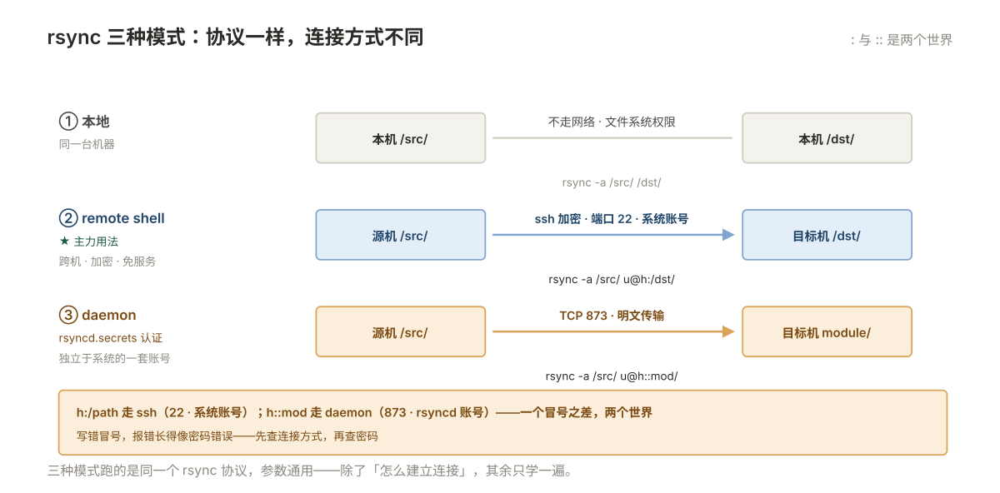

# 10 数据备份与共享

> **解决**：数据怎么备份才敢说「能恢复」，备份出来的东西怎么验证，以及一台机器上的目录怎么让另一台机器用上（NFS 与 SMB）。  
> **范围**：先把四个词分清 · rsync · 结尾斜杠、--delete、--exclude · 增量从哪来 · rsync daemon  
> **口径**：正文以 CentOS 7 / Ubuntu 22.04 / OpenSSL 1.1.1 举例；命令、路径与发行版差异在节内注记，不绑定单一版本。  
> **更新**：2026-11-06  
> **读完能做到**：按 RPO/RTO 反推出备份频率与方式，而不是「每天跑一次全量」；说清备份、归档、快照、高可用四件事各自防什么、都不防什么；用 `rsync` 做增量同步、用 `--link-dest` 做硬链接快照、用 `--delete` 而不至于删库；用 `inotify` + `rsync` 或 `lsyncd` 做单向实时同步；配出可用的 NFS 与 Samba 共享并排掉「挂上了但写不进」；给正在写的数据库做一致备份；设计一次真的能过的恢复演练；误删之后知道第一分钟该做什么。
> **怎么读**：10.0 是知识点地图，标了**基础 / 进阶**。第一遍跳过带「进阶」的小节不影响主线。不认识的词查 [00 术语表](00-术语表.md)。
> **不在这里**：`tar`/`zip` 的参数与压缩格式 → [007 §7.13](007-命令行与文本处理.md)；`scp` 与 `rsync` 传文件的基本用法、免密与跳板 → [006 §6.13](006-软件服务与任务.md)；LVM 快照怎么建、`lvs` 怎么看 → [004 §4.7](004-存储与文件系统.md)；NFS 卡住变成 `D` 状态怎么识别 → [009 §9.4](009-性能分析与排障.md)；目录权限与 SELinux → [03](003-用户权限与安全.md)。

> **这一册的写法**：备份领域最多的不是技术难题，是**「以为备了」**。所以每一节都尽量落到「你怎么验证它真的成立」。文中标「示意」的输出是按真实行为写的量级示例，不是某台机器的实测值——你的数字会不同，要看的是一行里各列的关系。

---

## 目录

| 节 | 内容 |
|---|---|
| 10.0 | 本册知识点地图 |
| 10.1 | 先把四个词分清：备份、归档、快照、高可用 |
| 10.2 | `rsync`：三种模式，以及 `-a` 到底保留了什么 |
| 10.3 | 结尾斜杠、`--delete`、`--exclude`：三个组合会删库 |
| 10.4 | 增量从哪来：quick check、`--checksum` 与硬链接快照 |
| 10.5 | rsync daemon：873 端口与独立的一套账号 |
| 10.6 | 实时同步：`inotify`、`lsyncd` 与 Sersync |
| 10.7 | `tar` 归档：一条命令里的六个隐患 |
| 10.8 | 加密与校验：备份出了门要不要带锁 |
| 10.9 | NFS 服务端：`exports` 里的六个选项 |
| 10.10 | NFS 客户端与「卡死」 |
| 10.11 | SMB / Samba：另一套密码 |
| 10.12 | 快照：能回滚，但不是备份 |
| 10.13 | 一致性：正在写的东西怎么备 |
| 10.14 | 恢复演练：怎么证明备份能用 |
| 10.15 | 误删恢复：第一分钟做什么 |
| 10.16 | 本册排错路径 |
| 10.17 | 自测 |
| 10.18 | 命令与片段索引 |

---

## 10.0 本册知识点地图

复习时按这张表逐行自问「这个我能讲清吗」，讲不清的回对应节。**加粗的是日常最常用、也最容易出事的。**

| 知识点 | 层次 | 一句话要点 | 节 |
| --- | --- | --- | --- |
| **备份 / 归档 / 快照 / 高可用 是四件事** | 基础 | 备份防误删与损坏，快照防短时回滚，高可用防停机，归档防合规缺失 | 10.1 |
| **RPO 决定频率，RTO 决定方式** | 基础 | 能丢多少 → 多久备一次；多久要活 → 决定是重装、镜像还是热备 | 10.1 |
| **3-2-1 是底线不是目标** | 基础 | 三份、两种介质、一份异地；再加「一份不可改、零错误已验证」 | 10.1 |
| **rsync 三种模式** | 基础 | 本地、remote shell（ssh）、daemon（873） | 10.2 |
| **`-a` 到底保留了什么** | 基础 | `-rlptgoD` 七项；**不含** ACL、xattr、硬链接 | 10.2 |
| **结尾斜杠决定「内容」还是「目录本身」** | 基础 | `/data/` 放内容，`/data` 建一层 | 10.3 |
| **`/data/*` 是错的** | 基础 | shell 先展开，隐藏文件全丢 | 10.3 |
| **`--delete` 的三条删库路径** | 基础 | 源是空挂载点、变量为空、源目标写反 | 10.3 |
| **`--max-delete` 是保险丝** | 基础 | 超过阈值直接中止，退出码 25 | 10.3 |
| **quick check 只看大小和 mtime** | 基础 | 内容变了但大小和秒级 mtime 没变，会漏 | 10.4 |
| **`--checksum` 准但慢** | 基础 | 两端全读一遍算校验和 | 10.4 |
| **`--link-dest` 做硬链接快照** | 进阶 | 每次看着像全量，实际只存变化 | 10.4 |
| **rsync 退出码 24 不是失败** | 基础 | 源文件传输中消失，活目录正常现象 | 10.4 |
| **rsyncd 的认证是独立的一套** | 基础 | `secrets file`，不是系统密码 | 10.5 |
| **`--bwlimit` 比 `ionice` 可靠** | 基础 | 现代 IO 调度器基本忽略 `ionice` 优先级 | 10.5 |
| **inotify 三个上限** | 基础 | `max_user_watches` / `max_user_instances` / `max_queued_events` | 10.6 |
| **报错是 `No space left on device`** | 基础 | 但盘没满——是 watch 用完了 | 10.6 |
| **实时同步不是备份** | 基础 | 删除会立刻同步过去，加密也会 | 10.6 |
| **`tar` 绝对路径与 `-C`** | 基础 | 解开时落到当前目录，用 `-C /` + 相对路径 | 10.7 |
| **`--one-file-system`** | 基础 | 备 `/` 不加它会把 `/proc`、`/dev`、NFS 全拉进来 | 10.7 |
| **备份文件不能放在被备份的目录里** | 基础 | 自我吞噬，越备越大 | 10.7 |
| **`--listed-incremental` 的链** | 进阶 | 链断一段，后面全废 | 10.7 |
| **加密备份的两个死法** | 基础 | 密码丢了；密钥和备份放一起 | 10.8 |
| **`gzip -t` 与 `tar -tzf` 验的不是一回事** | 基础 | 前者验压缩流，后者验归档结构 | 10.8 |
| **NFS 的权限靠 uid 信任** | 基础 | `sec=sys` 下服务端信客户端报的 uid | 10.9 |
| **`root_squash` 是默认，也是常见故障源** | 基础 | 客户端 root 写不进共享 | 10.9 |
| **NFSv4 只要 2049** | 基础 | v3 还要 111、mountd、statd | 10.9 |
| **`hard` 与 `soft` 的取舍** | 基础 | `hard` 卡成 `D`，`soft` 返回 EIO | 10.10 |
| **`intr` 已经没用了** | 基础 | 2.6.25 之后只有 SIGKILL 能中断 | 10.10 |
| **`_netdev` 与 `nofail`** | 基础 | 少了这两个，共享挂不上就开不了机 | 10.10 |
| **Samba 有自己的一套密码** | 基础 | 系统密码不通用，要 `smbpasswd -a` | 10.11 |
| **`vers=` 决定能不能挂上老 NAS** | 基础 | 报 `Host is down` 往往是协议不匹配 | 10.11 |
| **快照和原卷在同一份存储上** | 基础 | 盘坏、阵列坏，快照一起没 | 10.12 |
| **快照区写满即失效** | 基础 | `lvs` 的 `Attr` 变成 `O`/`X` | 10.12 |
| **一致性只对「正在写」的东西有意义** | 基础 | 数据库、虚拟机镜像、邮件队列 | 10.13 |
| **`fsfreeze` 忘了解冻就是事故** | 基础 | 用 `trap` 兜住 | 10.13 |
| **演练要抽最老的那份** | 基础 | 只测最新的一份，测不出增量链断 | 10.14 |
| **恢复耗时才是 RTO** | 基础 | 备份耗时没意义 | 10.14 |
| **误删第一分钟：停写入** | 基础 | 比任何恢复工具都重要 | 10.15 |
| **xfs 删了基本没救** | 基础 | 没有官方恢复工具 | 10.15 |
| **`lsof +L1` 能救回「删了但还开着」的文件** | 基础 | `cp /proc/<pid>/fd/<n>` | 10.15 |

### 动手前：准备两个目录和一套靶子

这一册所有命令都可以在**一台机器**上做完，不需要两台。共享部分用本机挂自己（`127.0.0.1`）就能验证，行为与真两台一致——这一点和 [009 §9.0](009-性能分析与排障.md) 造假 `D` 状态是同一个思路。

先建一套靶子数据：40 个文件、三个子目录、一个隐藏文件、一个硬链接、一个符号链接。有了这些，后面「`-a` 漏了什么」「`/data/*` 丢了什么」才看得见。

```bash
sudo mkdir -p /srv/lab/src/{conf,logs,cache}
cd /srv/lab/src
for i in $(seq 1 40); do echo "record $i" > "conf/f$i.txt"; done
head -c 200000 /dev/urandom > logs/big.bin
echo ".env=secret" > .env                        # 隐藏文件，专门用来验 /data/* 的错
ln conf/f1.txt conf/hardlink.txt                  # 硬链接：-a 不保留
ln -s /etc/hostname conf/softlink                 # 符号链接：-a 保留
chown -R nobody:nobody cache                      # 一个不同属主的目录
find /srv/lab/src | wc -l                         # 记下这个数
```

```plain
48
```

`48` 是这样凑出来的：根目录 `src` 本身 1 + 三个子目录 3 + `conf/` 下 40 个 `f*.txt` + `hardlink.txt` + `softlink` + `logs/big.bin` + `.env` = 48。注意 **`hardlink.txt` 与 `f1.txt` 是同一个 inode，但 `find` 会列两次**——这正是后面 `-a` 不带 `-H` 时会多占一份空间的原因。

记住这个数，后面每次验证「同步过去几个文件」都靠它对比。数字和这里不同不要紧，重要的是你自己的基准。

> 本册的占位符：`<src>` 源目录、`<dst>` 目标目录、`<nfs-server>` NFS 服务端地址、`<share>` SMB 共享名、`<host>` 任意主机。执行时替换成你的真实值。

---

## 10.1 先把四个词分清：备份、归档、快照、高可用

上一册解决的是「机器还活着但很慢」，这一册解决的是「数据没了」——这是两种完全不同性质的故障。而「数据没了」这件事上，最容易犯的错不是技术不够，是**用错了工具还以为自己防住了**。

### 四件事，四个不同的敌人

| | 备份 | 归档 | 快照 | 高可用 |
| --- | --- | --- | --- | --- |
| **防什么** | 误删、损坏、勒索、误覆盖 | 时间久了要查历史 | 短时间内的错误变更 | 硬件／进程故障导致的停机 |
| **出事怎么用** | 从备份恢复，分钟到小时 | 翻出来查，可能是天 | 秒级回滚 | 自动切换，秒级 |
| **存在哪** | 另一份独立介质，最好异地 | 低成本大容量，可以离线 | **和原卷同一份存储** | 另一台机器 |
| **保留多久** | 按 RPO 定，通常 7–90 天 | 按合规定，常见 1–10 年 | 小时到天 | 不保留，是实时状态 |
| **典型误用** | 备份到同一块盘 | 拿归档当备份（恢复太慢） | 拿快照当备份 | 拿高可用当备份 |


一句话概括这张表：**高可用不防误删，快照不防盘坏，备份不防停机。**

- 双机热备里手一抖 `rm -rf`，删除操作会**实时同步**到备机，两台一起没。这就是「高可用不防误删」。
- 快照和原卷在**同一个 LVM 卷组、同一台虚机的同一块存储**上。磁盘坏、阵列掉、虚机存储损坏，快照和原卷一起走。这是「快照不防盘坏」。
- 备份是「几小时前的一个副本」，切过去意味着丢掉最近几小时的数据，而且切的过程业务是停的。这是「备份不防停机」。

三者不是替代关系，是**同时都要有**。生产环境里这四件事通常对应四套不同的系统：备份软件、归档存储、存储快照、集群／负载均衡。

### RPO 与 RTO：把「备份多久一次」变成算术

这两个词是备份方案里唯一需要的两个数，不知道这两个数就没法谈方案。

| 指标 | 全称 | 问法 | 决定什么 |
| --- | --- | --- | --- |
| **RPO** | Recovery Point Objective | 出事时**最多能容忍丢多少数据**？ | 备份频率、是否要实时同步、是否要事务日志备份 |
| **RTO** | Recovery Time Objective | 出事到**业务恢复能用**，最多容忍多久？ | 恢复方式：重装+恢复、整机镜像、热备切换 |

用它们反推方案，逻辑是硬的：

| RPO | 只能这么做到 | 代价 |
| --- | --- | --- |
| 24 小时 | 每天一次全量或增量 | 最低，每天丢一天 |
| 1 小时 | 每小时增量 | 备份窗口、存储量 |
| 5 分钟 | 实时同步 + 每小时快照 | 需要专线或同机房，快照占存储 |
| 接近 0 | 数据库日志持续归档（binlog / WAL） | 运维复杂，只能按库做，不能按目录做 |

| RTO | 只能这么做到 | 代价 |
| --- | --- | --- |
| 4 小时以上 | 装系统 + 装软件 + 恢复数据 | 低，但要有人会用 |
| 1 小时 | 整机镜像／虚拟机模板 + 数据恢复 | 中，镜像要定期更新 |
| 10 分钟 | 预置的空环境 + 快速挂载备份 | 高，环境要常年养着 |
| 秒级 | 热备 / 集群 | 很高，且见上文「不防误删」 |

**最常见的错误是先选工具再定指标**——「我们有 rsync，那就每天 rsync 一次」。正确顺序是：业务方报 RPO/RTO → 反推频率与方式 → 才选工具。RPO 说要 5 分钟，rsync 每天一次就是不达标，跑得再成功也没用。

### 3-2-1：最低标准，以及它常被漏掉的两条

**3-2-1** = 3 份副本、2 种不同介质、1 份异地。

| 数 | 含义 | 常见的假做到 |
| --- | --- | --- |
| 3 份 | 原件 + 2 份备份 | 原件 + RAID 1 算成 3 份（RAID 是同一份数据的两块盘，不是两份副本） |
| 2 种介质 | 比如本地磁盘 + 磁带／对象存储 | 两块盘都在同一台机器的同一个 RAID 卡后面 |
| 1 份异地 | 另一栋楼、另一个可用区 | 「另一个机柜」在同一路市电、同一个交换机下 |

后来越来越多团队加了两条，很值得借鉴：

- **1 份不可改（immutable / offline）**。勒索软件会先加密能访问到的所有备份。只有**离线**（拔掉、磁带下架）或**WORM**（一次写多次读）的副本才拦得住。这是「3-2-1-1」里的那个 1。
- **0 错误（0 error）**。备份必须**验证过**，不是「跑完了」。这是「3-2-1-1-0」里的 0，落到操作上就是 **10.14 恢复演练**。

**RAID 不是备份**这件事值得单说一句：RAID 1／5／10 防的是「盘坏」，不防「文件被删」「被覆盖」「被加密」，因为这些操作会**同时写到所有盘上**。RAID 也不能回到「昨天」。它属于「高可用」那一列。

> 想要「删了还能拿出来」，必须有一份**历史版本**；而要历史版本，就必须有独立于原卷的副本，或者至少是独立于原卷的快照。这是判断「我这套方案到底算不算备份」的唯一标准。

---

## 10.2 `rsync`：三种模式，以及 `-a` 到底保留了什么

上一节定的是策略，这一节开始讲工具，而 Linux 上做文件级备份／同步，第一选择永远是 `rsync`。它比 `cp` 多出来的核心能力只有一个：**只传差异**。但围绕这一个能力，有一堆细节决定了你的备份是不是「完整的备份」。

### 三种模式：区别在「怎么连过去」

| 模式 | 写法 | 走什么 | 认证靠什么 | 什么时候用 |
| --- | --- | --- | --- | --- |
| 本地 | `rsync -a /src/ /dst/` | 无网络 | 文件系统权限 | 同一台机器上拷／同步目录 |
| remote shell | `rsync -a /src/ u@h:/dst/` | ssh（默认 22） | ssh 密钥／密码 | 主力用法，跨机器、加密、无需额外服务 |
| daemon | `rsync -a /src/ u@h::mod/` 或 `rsync://u@h/mod/` | TCP 873（明文） | `rsyncd.secrets` 里的独立账号 | 目标机不能给 ssh、或要对多个来源统一收口 |

三种模式的 **rsync 协议完全一样**，参数也通用，只是「怎么建立连接」不同。所以除连接方式外的东西只需要学一遍。



> **`::` 和 `:` 是两个世界**：`h:/path` 是 ssh 模式，走 22 端口、用系统账号；`h::module` 是 daemon 模式，走 873、用 rsyncd 自己的一套账号。写错一个冒号，报错会让人以为密码错了，其实是连接方式错了。

### `-a` 是七个开关，不是一个

`-a`（`--archive`）等价于 `-rlptgoD`。这七个字母一个都不能少理解：

| 字母 | 保留什么 | 不写会怎样 |
| --- | --- | --- |
| `-r` | 递归进目录 | 不加就只同步目录本身（空壳） |
| `-l` | 符号链接按链接复制 | 不加会把链接指向的目标拷成实体文件，体积暴涨 |
| `-p` | 权限位 | 不加全变成默认 umask 下的权限 |
| `-t` | 修改时间 | 不加所有文件变成「现在」，下次同步会**全量重传** |
| `-g` | 属组 | 不加属组变成运行 rsync 的用户 |
| `-o` | 属主 | 同上；**非 root 无法设属主** |
| `-D` | 设备文件 + 特殊文件（`--devices --specials`） | 不加则 `/dev` 下无法重建 |

而 `-a` **不包含**下面这几项，这是「备份恢复后不一样了」的主要原因：

| 要保留 | 参数 | 不写的后果 |
| --- | --- | --- |
| ACL | `-A` | `setfacl` 设的权限全丢，被授权的人访问被拒 |
| 扩展属性 xattr | `-X` | SELinux 上下文、文件 capabilities、部分备份软件的标记丢失 |
| 硬链接关系 | `-H` | 三个硬链接变成一个文件 + 两份副本，占三倍空间，改一个另一个不变 |
| 稀疏文件 | `-S` | 一个 100G 的稀疏文件被写成 100G 实体 |
| atime | `-U` | 一般不需要，反而增加写盘 |

所以系统级备份的**完整参数**通常是：

```bash
sudo rsync -aAXH --numeric-ids /srv/lab/src/ /srv/lab/dst/
```

`--numeric-ids` 的作用：不在两端做用户名映射，直接按 uid/gid 数字同步。**跨机器备份系统目录时必加**——否则目标机上 `nobody` 是 65534 而源机上可能是 99，恢复后属主全错。

⚠️ **`-H` 很吃内存**。它要维护整棵树的 inode 映射表，百万文件的目录上能吃掉几个 G。只在确实有硬链接的地方用（比如 `/usr`、Docker 的 `overlay2`）；纯数据目录不加。

### 非 root 跑 `-a` 会报一堆错

`-o` 和 `-D` 需要 root。普通用户跑 `-a`，会看到这类输出：

```plain
rsync: chgrp "/srv/lab/dst/conf" failed: Operation not permitted (1)
rsync: chown "/srv/lab/dst/conf/f1.txt" failed: Operation not permitted (1)
rsync error: some files/attrs were not transferred (see previous errors) (code 23)
```

**报错不等于没同步**——文件内容通常已经过去了，只是属性没设上。但退出码是 `23`，脚本里如果按退出码判失败，就会误报。普通用户同步自己目录的正确写法：

```bash
rsync -rlpt --no-owner --no-group /home/me/data/ /backup/me/data/
```

用 `-rlpt` 而不是 `-a`，去掉 `-o -g -D`，就不会有这类报错。

### 一次同步，rsync 在内部做了什么

理解这四步，后面所有「为什么没同步过去」「为什么这么慢」都能自己解释。

```plain
① 建连接，两端各自遍历目录，生成文件列表（路径、大小、mtime、权限、属主）
② 对每个文件做 quick check：大小相同 且 mtime 相同 → 认为没变，跳过
③ 认为变了的文件，两端各算滚动校验和，找出真正不同的「块」
④ 只传差异块，在目标侧写临时文件，完整后 rename 覆盖
```

两个推论：

- **第 ③ 步是 rsync 比 `cp` 省流量的原因**，也是它比 `cp` 吃 CPU 的原因。`--whole-file`（本地同步时默认开启）会跳过块比对，直接整文件复制——本地同步时这样更快。
- **第 ④ 步先写临时文件再 rename**，意味着：目标端需要**额外一份空间**放临时文件；且 rename 是原子的，所以**目标文件不会出现「写了一半」的状态**。这也是为什么硬链接快照能成立（见 10.4）——rsync 从不原地修改文件。
  - 反例是 `--inplace`：直接写进目标文件，省空间，但中途断了就是半个文件，且会**破坏硬链接快照**。大文件续传场景才考虑它。

---

## 10.3 结尾斜杠、`--delete`、`--exclude`：三个组合会删库

上一节讲了参数含义，这一节讲**参数之间怎么互相坑**。`rsync` 出的事故里，九成以上是这三件事组合出来的。

### 斜杠：决定「内容」还是「目录本身」

| 源写法 | 结果 | 用在哪 |
| --- | --- | --- |
| `/data/` | 把 `data` **里面**的东西放进目标 | 最常见，备份内容 |
| `/data` | 在目标下**新建** `data` 目录，再放内容 | 想把目录名一起带过去 |
| `/data/.` | 同 `/data/` | 老脚本常见写法，等价 |
| `/data/*` | ⚠️ shell 先展开，**隐藏文件全丢** | 不要用 |

`/data/*` 的错误特别隐蔽，因为第一次看是「同步成功了」：

```bash
rsync -av /srv/lab/src/* /srv/lab/dst2/
```

```plain
sending incremental file list
conf/
conf/f1.txt
conf/f2.txt
...
logs/big.bin
sent 200,912 bytes  received 890 bytes  134,534.67 bytes/sec
total size is 200,412  speedup is 0.99
```

一切正常，退出码 0，看着像同步成功了。但 `.env` 在 `src/` 顶层、以点开头，shell 展开 `*` 时被跳过，rsync 根本不知道它存在：

```bash
ls -a /srv/lab/dst2/
```

```plain
.  ..  cache  conf  logs
```

少了 `.env`。而这个文件往往是配置文件里的密码，`.git`、`.ssh` 这类目录同理——**最要紧的那些东西，恰是以点开头的**。判断规则只有一条：**只要用 `*`，就一定会漏隐藏文件。永远写 `/src/`。**

`--delete` 与斜杠叠加时更危险。假设 `dst2` 早先用 `/src/` 正确同步过一次（里面有 `.env`），这次换成 `/src/*` 再加 `--delete`：

```bash
rsync -av --delete /srv/lab/src/* /srv/lab/dst2/     # ⚠️
```

`--delete` 的逻辑是「目标端多出来的就删」，而 `*` 的列表里没有 `.env`，于是 `.env` 被判为「多出来的」：

```plain
deleting dst2/.env
```

一条命令，把对面唯一一份配置文件删了。这就是「同步」和「备份」的分界：**同步的目标是与源一致，包括「源里没有的，目标也不能有」。**

### `--delete` 的三条删库路径

`--delete` 是必要的——不加，目标端会无限堆积源端早已删除的垃圾。但它也是 rsync 最容易造成不可逆损失的地方。三个真实场景：

**路径一：源是没挂上的空目录。**

```bash
rsync -av --delete /mnt/usb/ /srv/lab/dst/     # ⚠️ /mnt/usb 没挂载
```

`/mnt/usb` 是个空目录（挂载点没挂上），rsync 认为「源是空的」，于是把 `dst` 里的东西**全删了**。这条路径在自动化脚本里极其常见：半夜 U 盘掉了、NFS 断了、云盘没挂上，脚本照跑。

防御：脚本里先判挂载点。

```bash
mountpoint -q /mnt/usb || { echo "/mnt/usb 未挂载，中止" >&2; exit 1; }
```

**路径二：变量为空。**

```bash
rsync -a --delete "$SRC/" "$DST/"          # ⚠️ SRC 未设置 → 变成 "//" → 整个根目录
```

`$SRC` 空时，`"$SRC/"` 就是 `/`。如果 `DST` 恰好在别的机器上，等于把源机的根往目标机推一遍，同时删掉目标机上一切「源机根目录里没有」的东西。

防御：`${VAR:?}`（[008 §8.3](008-Shell脚本.md) 讲过），让空值直接中止。

```bash
: "${SRC:?源目录未设置}"; : "${DST:?目标目录未设置}"
```

**路径三：源和目标的顺序写反。**

```bash
rsync -av --delete /backup/data/ /srv/app/data/   # 参数顺序反了
```

本意是「把 app 数据备份到 backup」，写反之后变成了「用旧备份覆盖现网数据，并删掉现网多出来的文件」。这种事故不会报错，只会在第二天早上被发现。

防御：`-n` 先看，见下文。

### 三道保险，都加上

```bash
# 1) 先干跑，看它要做什么
rsync -avn --delete /srv/lab/src/ /srv/lab/dst/

# 2) 真跑，但把删掉的东西挪进备份目录而不是真删
rsync -av --delete \
      --backup --backup-dir=/srv/lab/trash/$(date +%F_%H%M) \
      /srv/lab/src/ /srv/lab/dst/

# 3) 加保险丝：一次删超过 100 个就中止
rsync -av --delete --max-delete=100 /srv/lab/src/ /srv/lab/dst/
```

`--backup-dir` 是最值得养成的习惯：**`--delete` 删掉的文件进回收目录，而不是消失。** 配 `--suffix` 还能避免同名冲突。磁盘够的话，这几乎零成本地把「同步」变成了「有历史的同步」。

`--max-delete=100` 触发时的表现（示意）：

```plain
Deletions stopped due to --max-delete limit (100 skipped)
rsync error: some files/attrs were not transferred (see previous errors) (code 25)
```

**退出码 25 专门表示「删除被限制住了」**。脚本里必须把它当失败处理（而不是像 24 那样放过），因为它意味着「目标和源已经不一致了」。

`--delete` 还有三个变体，区别只在「什么时候删」：

| 参数 | 删除时机 | 差别 |
| --- | --- | --- |
| `--delete-during`（默认） | 边传边删 | 快，但传到一半出错时已有文件被删 |
| `--delete-after` | 全部传完再删 | 慢一点，**出错时目标端还完整**，推荐用在备份脚本里 |
| `--delete-before` | 先删后传 | 需要额外扫一遍，目标端会短暂「空」 |
| `--delete-excluded` | 把 `--exclude` 的文件也从目标端删掉 | 危险，除非你确实想「目标端只留这一个源的内容」 |
| `--delete-delay` | 传输中记录，结束时删 | 介于 during 和 after 之间，省内存 |

### `--exclude`：先排除，再删

`--delete` 和 `--exclude` 一起用时有个反直觉的点：**被排除的文件在目标端不会被删**（除非用 `--delete-excluded`）。这正好是我们想要的——比如目标端自己生成的 `.lock`、日志、`.pid`：

```bash
rsync -av --delete \
      --exclude='/cache/' --exclude='*.tmp' --exclude='.git/' \
      /srv/lab/src/ /srv/lab/dst/
```

三个实用规则：

1. **`/cache/` 开头的斜杠是「锚定到传输根」**，只排除根下的 `cache`；写 `cache/` 会排除任何层级的 `cache` 目录。
2. **目录要带结尾斜杠**（`/cache/`），否则可能只排除同名的文件。
3. **规则从文件里读**更可维护：`--exclude-from=/etc/backup.exclude`，一行一条，`#` 开头是注释。

```bash
cat /etc/backup.exclude
```

```plain
# 缓存与临时文件
/cache/
*.tmp
*.swp
# 版本库与大文件目录
/.git/
/swapfile
```

`--include` 与 `--exclude` 的**顺序有意义**：rsync 按出现顺序逐条匹配，第一条命中的生效。所以「只备份某几类，其它全排除」要写成先 include 再 exclude：

```bash
rsync -av --include='*/' --include='*.conf' --exclude='*' /etc/ /backup/etc/
```

`--include='*/'` 这一条不能少：不先放行目录，`--exclude='*'` 会把目录也排掉，rsync 根本不会进去找 `*.conf`。

---

## 10.4 增量从哪来：quick check、`--checksum` 与硬链接快照

上一节讲的是「别删错」，这一节讲「怎么判断该传什么」。判断错了，要么漏备份，要么每天全量重传。

### quick check：大小 + mtime，就这两项

rsync 默认判断「文件没变」的条件是**大小相同 且 修改时间相同**（精确到秒）。不看内容。

这意味着三种漏备：

| 场景 | 为什么会漏 |
| --- | --- |
| 内容变了，但大小和 mtime 都被还原 | 恢复备份、`touch -r`、某些同步工具会还原 mtime |
| 文件系统 mtime 精度不够 | FAT/exFAT 只有 2 秒精度，SMB 挂载也可能丢精度 |
| 应用原地改文件但不更新 mtime | 极少，但存在（某些数据库的数据文件） |

要确认「内容真的一样」，用 `--checksum`：

```bash
rsync -a --checksum /srv/lab/src/ /srv/lab/dst/
```

`--checksum` 会**两端全读一遍**算 MD5（rsync 3.2+ 可选 xxhash）。代价很直观：

- 本地两块 SSD，百 G 数据，从「秒级」变成「十几分钟」
- 网络备份，如果 CPU 是瓶颈，可能比直接传还慢

所以策略是：**日常增量用默认 quick check，每周一次 `--checksum` 校正**，或者只对关键目录用。这是「快」和「准」的折中，没有免费的选项。

还有两个相关参数，容易混：

| 参数 | 行为 | 用在哪 |
| --- | --- | --- |
| `-u` / `--update` | 目标端文件更新则跳过 | 单向汇总场景，防止旧数据覆盖新数据 |
| `--size-only` | 只看大小，不看时间 | mtime 不可信时（FAT、某些云存储） |
| `--modify-window=N` | mtime 差 N 秒内算相同 | 跨文件系统、跨时区时用 `--modify-window=2` |
| `--ignore-times` | 全传，不看 quick check | 强制刷新，慢 |
| `-c` | 同 `--checksum` | 简写 |

### 退出码：23 和 24 要区别对待

rsync 的退出码里，有两个在备份脚本里天天出现，但含义完全不同：

| 码 | 含义 | 备份脚本怎么处理 |
| --- | --- | --- |
| 0 | 全部成功 | 成功 |
| 23 | 部分文件／属性没传成功 | **失败，要告警**。常见于权限不足、磁盘满 |
| 24 | 传输中源文件消失 | **通常是正常的**。活目录（日志、缓存）在同步过程中被删是常态 |
| 25 | 触发了 `--max-delete` | **失败**，目标端已不一致 |
| 30 / 35 | 超时（socket／daemon 连接） | 失败，查网络 |
| 12 | 协议版本不匹配 | 两端 rsync 版本差太多 |
| 11 | 文件 IO 错误 | 查磁盘、查 `dmesg` |

写脚本时的典型处理：

```bash
rsync -a --delete "$SRC/" "$DST/"
rc=$?
case $rc in
  0)  echo "ok" ;;
  24) echo "warn: 有文件在传输中消失（活目录正常）" ;;
  *)  echo "fail: rsync 退出码 $rc" >&2; exit $rc ;;
esac
```

把 24 当成功，是唯一可以让脚本「不因为正常现象报警」的地方。但**不能把 24 一律忽略**——如果源目录挂在故障的 NFS 上，会出现大量 24，那其实是故障信号。判断办法：看 24 的量级，几千个就是有问题。

### `--link-dest`：看起来是全量，实际只存变化

这是备份里最漂亮的一个技巧，值得单独讲。

需求是：每天一份「完整的」备份，能直接 `cd` 进去翻任何一天的文件，但磁盘只承担「每天变化的那部分」。做法是**硬链接**——同一份数据在多个路径下出现，只占一份空间。

```bash
#!/bin/bash
# 每日快照式备份：/backup/daily/<日期>/ 每个目录看起来都是完整的
set -Eeuo pipefail

SRC=/srv/lab/src
BASE=/srv/lab/daily
TODAY=$(date +%F)
# 排除今天自己：同一天重跑时，--link-dest 不能指向目标目录本身
LATEST=$(ls -1 "$BASE" 2>/dev/null | grep -vx "$TODAY" | sort | tail -1 || true)

mkdir -p "$BASE/$TODAY"

if [ -n "$LATEST" ] && [ -d "$BASE/$LATEST" ]; then
  # --link-dest 的路径是相对「目标目录」的，所以写 ../<上一份>
  rsync -aAXH --numeric-ids --delete \
        --link-dest="../$LATEST" \
        "$SRC/" "$BASE/$TODAY/"
else
  # 第一份，没有参照
  rsync -aAXH --numeric-ids "$SRC/" "$BASE/$TODAY/"
fi

# 每个「快照」目录里都有一个隐藏文件，记录它是哪一天、从哪来
date '+%F %T' > "$BASE/$TODAY/.backup-meta"
echo "done: $BASE/$TODAY"
```

跑三天之后看磁盘：

```bash
du -sh /srv/lab/daily/*/
du -sh --total /srv/lab/daily/
```

```plain
412K    /srv/lab/daily/2026-10-27/
56K     /srv/lab/daily/2026-10-28/
8.0K    /srv/lab/daily/2026-10-29/
428K    total
```

**这里有个必须搞清的 `du` 行为**：`du` 在**一次调用内**按 inode 去重，所以同一条命令里列出的三个目录，第一份「吃掉」了共享的全部块，后两份只剩自己的增量。但如果分别对每个目录跑一次 `du -sh`（比如脚本里的 `for` 循环），每一份都会显示**全量**：

```bash
for d in /srv/lab/daily/*/; do du -sh "$d"; done
```

```plain
412K    /srv/lab/daily/2026-10-27/
412K    /srv/lab/daily/2026-10-28/
412K    /srv/lab/daily/2026-10-29/
```

三个 412K，加起来 1.2M，而实际只占 428K。**这不是备份失败了，是 `du` 的统计口径。** 要算真实占用，就用一次 `du -sh --total` 覆盖所有目录，或者看文件系统的 `df`。反过来说，如果这三个数字看起来「不是全量」，那要怀疑 `--link-dest` 没生效。

`--link-dest` 的四条硬性要求，缺一条就退化成全量：

1. **`--link-dest` 里的路径相对「目标目录」**，不是相对当前工作目录。上面写 `../$LATEST`，因为目标在 `$BASE/$TODAY/`。
2. **必须在同一个文件系统内**。硬链接不能跨文件系统，跨了就变成真拷贝，不报错，但空间没省。
3. **必须带 `--delete`**。否则旧文件会残留，且上一份里删掉的文件在新快照里「还活着」。
4. **不能加 `--inplace`**。原地写会改掉被硬链接的旧快照内容，**一次写坏所有历史版本**。

第 4 条是最容易犯的：`--inplace` 和 `--link-dest` 语义直接冲突，一个要求「新文件替换旧文件」，一个要求「旧文件永不修改」。放在一起就是静默的数据损坏。

### 硬链接快照的局限，必须说清

- **文件级，不是块级**。一个大文件改一个字节，整个文件要重传一遍，新快照多占一份文件大小的空间。数据库数据文件、虚拟机镜像这类「大且频繁小改」的文件，硬链接快照很浪费。
- **不能压缩、不能加密整个快照**。硬链接是文件系统层的，压缩成 tar 就失去意义了。
- **`rsync` 之外的任何工具都不能原地改快照目录里的文件**。有人为了「清理一下」在旧快照里 `sed -i`，所有引用同一 inode 的快照一起被改。
- **备份不能被 `chattr +i` 保护**（`chattr` 只对文件有效，硬链接多路径共享 inode，锁一个路径等于锁全部，但也会阻止新的 `--link-dest` 建立链接）。要防篡改，还是得靠离线副本或 WORM 存储。

---

## 10.5 rsync daemon：873 端口与独立的一套账号

上一节的三种模式里，daemon 模式平时用不上，但它有两个场合非用不可：目标机**不能开 ssh**（比如只允许单向推送的备份区），或者要**给多个来源统一收口**（一台备份服务器收 30 台机器的数据）。

### 服务端配置

`/etc/rsyncd.conf`：

```ini
# 全局部分：守护进程自己的身份与日志
uid = rsync
gid = rsync
use chroot = yes
max connections = 20
pid file = /var/run/rsyncd.pid
log file = /var/log/rsyncd.log
transfer logging = yes
timeout = 600

# 一个「模块」，客户端用 h::backup 访问它
[backup]
    path = /srv/rsync/backup
    comment = backup area
    read only = no
    list = yes
    auth users = bak
    secrets file = /etc/rsyncd.secrets
    hosts allow = 10.0.0.0/24
    hosts deny = 0.0.0.0/0
```

几个要点：

- **`uid`/`gid` 决定写入文件的属主**。要建这个用户：`useradd -r -s /sbin/nologin -M rsync`。
- **`use chroot = yes`** 把进程限制在 `path` 下，路径穿越出不去。代价是需要 root 才能 chroot——所以 rsyncd 以 root 启动，再切到 `uid`。
- **`auth users` + `secrets file`** 是 rsync 自己的账号体系，**和系统用户完全无关**。`/etc/rsyncd.secrets` 格式：

```plain
bak:一个足够长的密码
```

```bash
chmod 600 /etc/rsyncd.secrets && chown root:root /etc/rsyncd.secrets
```

权限不是 600 时，rsyncd 会**拒绝启动**或认证一律失败，日志里理由不明显——这是配置完连不上的第一检查点。

- **`hosts allow` 一定要写**。不写等于对所有能连到的地址开放，而 rsync daemon 的密码是**明文传输**的（协议本身不加密，除非走 ssh 隧道）。

启动：

```bash
# CentOS 7（rsync 包自带 rsyncd.service）
systemctl enable --now rsyncd
systemctl status rsyncd

# Ubuntu 22.04（同一个包，服务名不同）
systemctl enable --now rsync
```

Ubuntu 上是 `rsync.service`，读的仍是 `/etc/rsyncd.conf`，这一点两个发行版一致，只是服务名不同（见 [附录 B](B-发行版差异.md)）。

防火墙放 873：

```bash
# CentOS 7
firewall-cmd --permanent --add-port=873/tcp && firewall-cmd --reload
# Ubuntu
ufw allow from 10.0.0.0/24 to any port 873 proto tcp
```

### 客户端用法

```bash
# 列出服务端有哪些模块（不需要密码）
rsync rsync://10.0.0.20/

# 列模块内容
rsync rsync://bak@10.0.0.20/backup/

# 推
rsync -av --password-file=/etc/rsync.pass /srv/lab/src/ bak@10.0.0.20::backup/lab/

# 拉
rsync -av bak@10.0.0.20::backup/lab/ /srv/lab/restore/
```

`--password-file` 的格式是**只有密码、没有用户名**，权限必须 600：

```bash
echo '一个足够长的密码' > /etc/rsync.pass
chmod 600 /etc/rsync.pass
```

写成 `bak:密码` 会认证失败，这是最常见的错。

### 限速：`--bwlimit` 才是有效手段

备份跑满带宽，会把同机房的业务连接挤掉。限速这件事 [002 §2.11](002-进程与资源.md) 里讲 `nice`/`ionice` 时给过结论：`ionice` 在现代 IO 调度器（`mq-deadline`、`none`）下**基本被忽略**，SSD/NVMe 上更没效果。有效的是在应用层限速：

```bash
rsync -av --bwlimit=51200 /srv/lab/src/ /srv/lab/dst/     # 51200 KB/s ≈ 50 MB/s
```

`--bwlimit` 的单位是 **KB/s**（不是 bit，也不是 MB）。rsync 3.1+ 支持后缀 `--bwlimit=50m`，但老版本（CentOS 7 自带 3.1.2）行为一致，写数字最保险。

还有一个更细的参数：`--bwlimit` 限的是**整体平均**，rsync 用令牌桶实现，短时间可以略超。要更平滑用 `--bwlimit=50m --no-compress`（关掉压缩，减少 CPU 抖动对速率的影响）。

---

## 10.6 实时同步：`inotify`、`lsyncd` 与 Sersync

上一节的 rsync 是「定时拉／推」，最短也是分钟级。RPO 要求到秒级时，就要让文件系统变化**主动触发**同步。这一节讲这套机制，以及它为什么不能替代备份。

### 原理：inotify 是内核提供的「文件变化通知」

应用向内核注册 watch（关注某个路径的某类事件），内核在事件发生时把事件塞进队列，应用读队列。`inotifywait` 就是把这套 API 变成命令行的工具。

```bash
# CentOS 7 需 EPEL
sudo yum install -y epel-release && sudo yum install -y inotify-tools
# Ubuntu
sudo apt install -y inotify-tools

inotifywait -m -r -e modify,create,delete,move,attrib \
            --timefmt '%F %T' --format '%T %w%f %e' \
            /srv/lab/src
```

```plain
2026-10-29 15:02:11 /srv/lab/src/conf/f7.txt MODIFY
2026-10-29 15:02:11 /srv/lab/src/conf/ CREATE f41.txt
2026-10-29 15:02:12 /srv/lab/src/conf/f41.txt CLOSE_WRITE,CLOSE
2026-10-29 15:02:15 /srv/lab/src/logs/ DELETE big.bin
```

注意 `CREATE` 之后紧跟 `CLOSE_WRITE`：文件创建时是空的，写完才关。**如果按 `CREATE` 就立刻触发同步，会同步到一个空文件**——所以实时同步工具都要做「延迟合并」（`delay` / `maxDelays`），等一小段时间再动手。这是所有 inotify 方案的共同设计，不是某个工具的特性。

### 三个上限：`No space left on device` 但盘是空的

这是 inotify 最经典的坑。报错长这样：

```plain
inotifywait: failed to watch /srv/lab/src/logs: No space left on device
```

`df -h` 一看盘还有 80%。原因是 **inotify 的 watch 数量用完了**，内核返回的错误码恰好是 `ENOSPC`。

| 参数 | 默认值（常见） | 谁吃掉了 | 调法 |
| --- | --- | --- | --- |
| `fs.inotify.max_user_watches` | 8192（老内核）/ 65536+ | 每个被监听的**目录**占一个 | 增大 |
| `fs.inotify.max_user_instances` | 128 | 每个 `inotifywait` 进程占一个 | 多实例时增大 |
| `fs.inotify.max_queued_events` | 16384 | 事件产生速度 > 消费速度时堆积 | 增大，防丢事件 |

先看当前值和用量：

```bash
cat /proc/sys/fs/inotify/max_user_watches
sysctl fs.inotify.max_user_watches fs.inotify.max_user_instances fs.inotify.max_queued_events
```

```plain
fs.inotify.max_user_watches = 65536
fs.inotify.max_user_instances = 128
fs.inotify.max_queued_events = 16384
```

永久调整（不要 `sysctl -w`，重启就没了；理由见 [009 §9.11](009-性能分析与排障.md)）：

```bash
sudo tee /etc/sysctl.d/99-inotify.conf >/dev/null <<'EOF'
fs.inotify.max_user_watches = 524288
fs.inotify.max_user_instances = 1024
fs.inotify.max_queued_events = 65536
EOF
sudo sysctl --system
```

⚠️ **每个 watch 大约占 1KB 内核内存**。`max_user_watches` 调到 100 万，理论上限就是 1GB 内核内存——小内存机器（2G）调太大会把内存吃紧。`524288`（50 万）够覆盖绝大多数场景（约 500MB 上限，实际按需分配）。

**队列溢出是更隐蔽的问题**：`max_queued_events` 不够时，内核只报一个 `IN_Q_OVERFLOW`，**具体丢了哪些事件不知道**。表现是「同步偶尔少几个文件，重跑一次又好了」。所以：

- 事件产生速率极高（批量解压、大量小文件写入）时，必然溢出；
- 正确姿势不是「把队列调到无穷大」，而是**叠加一个定期全量 rsync 兜底**（比如每小时一次 `--checksum` 或普通增量）。实时同步负责「快」，定期 rsync 负责「全」。

### `lsyncd`：Lua 配置，一行一规则

`lsyncd` 把 inotify 和 rsync 包在一起，是现在最省事的方案。

```bash
# CentOS 7（EPEL）
sudo yum install -y lsyncd
# Ubuntu
sudo apt install -y lsyncd
```

`/etc/lsyncd.conf`（注意 **Lua 语法**，等号两边有空格，字符串用引号，结尾有逗号）：

```lua
settings {
    logfile      = "/var/log/lsyncd/lsyncd.log",
    statusFile   = "/var/log/lsyncd/lsyncd-status.log",
    statusInterval = 20,
    maxDelays    = 5,
    nodaemon     = false,
}

sync {
    default.rsyncssh,
    source    = "/srv/lab/src/",
    host      = "10.0.0.21",
    targetdir = "/srv/lab/dst/",
    delay     = 2,
    exclude   = { "*.tmp", "/cache/" },
    rsync     = {
        binary   = "/usr/bin/rsync",
        archive  = true,
        compress = false,
        _extra   = {"--delete", "--numeric-ids"},
    },
}
```

几个参数的实际含义：

| 参数 | 作用 |
| --- | --- |
| `delay` | 事件后等几秒再同步，**合并同一批变化**。太小会频繁启 rsync，太大 RPO 变长 |
| `maxDelays` | 即使一直有新事件，最多攒几轮也要同步一次，防「永远在等」 |
| `compress = false` | 同机房、万兆内网时关压缩更快（压缩是 CPU 换带宽） |
| `_extra` | 透传给 rsync 的额外参数 |
| `default.rsyncssh` | 走 ssh；同机器或不需要 ssh 时用 `default.rsync` + `target = "h:/path"` |

改完必须验配置：

```bash
sudo lsyncd -nodaemon /etc/lsyncd.conf      # 前台跑，日志直接打屏，Ctrl+C 退出
sudo systemctl restart lsyncd
tail -f /var/log/lsyncd/lsyncd.log
```

```plain
Mon Oct 29 15:10:02 2026 Normal: --- Startup, daemonizing ---
Mon Oct 29 15:10:04 2026 Normal: recursive startup rsync: /srv/lab/src/ -> 10.0.0.21:/srv/lab/dst/
Mon Oct 29 15:10:06 2026 Normal: Startup of "/srv/lab/src/" finished: 0
Mon Oct 29 15:10:20 2026 Normal: Calling rsync with filter-list of new/modified files/dirs
```

`Startup ... finished: 0` 里的 0 是「待同步队列剩余数」，不是错误。

### Sersync：国内项目里更常见的那个

`lsyncd` 之外，国内运维环境里出现频率最高的是 **Sersync**（周洋开源，Java 实现，inotify + rsync）。

它的定位与 `lsyncd` 相同，差别在：

| | lsyncd | Sersync |
| --- | --- | --- |
| 实现 | C + Lua | Java（需 JDK） |
| 配置 | Lua 文件 | `confxml.xml`，XML 较长 |
| 失败重传 | 靠 rsync 自身重试 | **自带失败队列，会重试** |
| 过滤规则 | `exclude` 列表 | 支持正则、按文件类型、按目录多层规则 |
| 维护状态 | 活跃 | 项目基本停更（2011 年前后为主） |
| 常见来源 | 各发行版仓库 | 手工下载解包，放 `/usr/local/sersync/` |

判断标准很简单：

- **新上的就用 `lsyncd`**：仓库里有，systemd 单元现成，出问题能查到文档。
- **环境里已经有 Sersync 的，别急着换**：它自带失败重传这一点，在跨机房弱网环境下确实比 lsyncd 省心。要换就整批换，别半套。
- **两边都不想引入的**：`inotifywait -m` 加 30 行 shell 也能做（见 [008 §8.11](008-Shell脚本.md) 的风格），代价是没有合并、没有重试、没有状态。

### 实时同步的三条铁律

这一节的标题是「同步」，不是「备份」。三件事必须同时成立，否则实时同步会变成事故放大器：

**第一，删除会立刻同步过去。** 源端 `rm -rf /srv/lab/src/*`，2 秒后目标端也没了。定时备份至少有「上一次的时间点」可回退，实时同步没有。

**第二，只做单向。** 双向同步要用 `unison`，而双向同步的本质问题是**冲突无法自动解决**：两边都改了同一个文件，任何「以新为准」的策略都必然丢掉一边的修改。真要双向，必须业务层面能接受冲突（比如两边写不同文件），否则不要做。

**第三，必须叠加一个「慢一步」的备份。** 标准组合是：

```plain
实时同步（秒级，RPO≈0） + 每小时硬链接快照（10.4） + 每天异地复制（10.5）
```

这样勒索软件加密文件时：实时同步把加密文件也传过去了（坏），但每小时的硬链接快照里还留着加密前的版本（好），异地那份再慢一步（更好）。

---

## 10.7 `tar` 归档：一条命令里的六个隐患

`rsync` 适合「目录同步」，`tar` 适合「打成一个文件带走」。后者的场景是：备份要存到对象存储、要交给别人、要长期归档、要加密。`tar` 的参数细节在 [007 §7.13](007-命令行与文本处理.md)，这一节只讲**备份场景下会出事的地方**。

### 隐患一：绝对路径

```bash
tar -czf /backup/etc.tar.gz /etc        # ⚠️
```

```plain
tar: Removing leading `/' from member names
```

tar 会自动去掉开头的 `/`，所以解开时**落在当前目录**：在 `/tmp` 下解开，得到 `/tmp/etc/...`，而不是覆盖 `/etc`。这个设计是保护，但也意味着**恢复时的「解到哪」完全由你 `cd` 到哪决定**。

正确写法是用 `-C` 指定根，再给相对路径：

```bash
tar -czf /backup/etc.tar.gz -C / etc
tar -xzf /backup/etc.tar.gz -C /          # 恢复到原位
```

### 隐患二：备份文件放进被备份的目录

```bash
tar -czf /srv/lab/src/backup.tar.gz /srv/lab/src     # ⚠️
```

tar 一边读一边写，读到自己刚写出的那个文件，于是：

```plain
tar: /srv/lab/src/backup.tar.gz: file changed as we read it
tar: Exiting with failure status due to previous errors
```

包是坏的（或至少不完整），退出码 1。**备份文件必须放在被备份的目录之外**，这是一条没有例外的规则。

同类错误在 `rsync` 里：`rsync -a /data/ /data/backup/` 会把 `backup` 目录往自己里面拷，越拷越深，直到磁盘满。

### 隐患三：备 `/` 时不排除虚拟文件系统

```bash
tar -czf /backup/root.tar.gz -C / .      # ⚠️ 会把 /proc /sys /dev 全拉进来
```

后果：

- `/proc/kcore` 是个「看起来有 128T」的伪文件，tar 会一直读
- `/dev` 下的设备文件被归档，恢复时如果不在 root 下解，报一堆 `mknod` 错误
- `/sys`、`/run` 是内核接口，存下来毫无意义
- 挂载的 NFS、云盘会被**顺着挂载点走进去**，可能把整个远端都备下来

正确写法：

```bash
tar -czf /backup/root-$(date +%F).tar.gz \
    --one-file-system \
    --exclude=/proc --exclude=/sys --exclude=/dev \
    --exclude=/run --exclude=/tmp --exclude=/backup \
    --exclude=/var/lib/docker \
    -C / .
```

`--one-file-system` 是关键：**不跨文件系统**，遇到挂载点就跳过。加了它，`/proc`、`/sys` 这类挂载点自然被跳过，`--exclude` 只是额外的明确声明。

`--exclude=/var/lib/docker` 这条视情况：容器数据通常另外备份，塞进系统归档会让包大到没法用。

### 隐患四：稀疏文件、设备文件与 xattr

| 情况 | 不加参数会怎样 | 参数 |
| --- | --- | --- |
| 稀疏文件（虚拟机镜像、数据库预分配文件） | 100G 的稀疏文件被写成 100G 实体，包大到不可收拾 | `-S` / `--sparse` |
| xattr / ACL / SELinux 上下文 | 恢复后 `getfacl` 为空、SELinux 拒绝、capabilities 丢失 | `--xattrs --acls --selinux` |
| 大文件与小文件混杂 | 单纯 `-z` 压缩比不高，CPU 却吃满 | 视情况，或用 `--use-compress-program='zstd -T0'` |

`tar` 作为 root 运行时，GNU tar **默认会保存 SELinux 上下文**；但为了明确，恢复系统时建议显式加上，并且在恢复后跑一次：

```bash
sudo restorecon -Rv /etc /usr /var
```

不做这一步，`sshd` 之类会因上下文不对被 SELinux 拦住——症状见 [003 §3.11](003-用户权限与安全.md)。

### 隐患五：`--listed-incremental` 的链会断

`tar` 的增量靠一个「快照文件」记录每个目录的 mtime 与文件清单：

```bash
# 第一次：level 0（全量）
tar -czf /backup/full-$(date +%F).tar.gz -g /backup/snap.file -C / srv/lab

# 之后每次：level 1（只含变化）
tar -czf /backup/inc-$(date +%F).tar.gz -g /backup/snap.file -C / srv/lab
```

恢复必须**按顺序**，且解开时要用 `-g /dev/null`，**避免解包过程改动快照文件**：

```bash
mkdir -p /restore
tar -xzf /backup/full-2026-10-27.tar.gz -g /dev/null -C /restore
tar -xzf /backup/inc-2026-10-28.tar.gz  -g /dev/null -C /restore
tar -xzf /backup/inc-2026-10-29.tar.gz  -g /dev/null -C /restore
```

链的脆弱点：

- **丢了 `snap.file`，后面的增量全部作废**——它们只记录了「相对上一次的变化」，没有基线就无从还原。
- **丢中间任意一个增量包，后面的全部作废**，同理。
- **`snap.file` 必须和被备份的数据一起备份**，而且要单独留一份。这是最容易忘的一步。
- 每次恢复都要重新建立快照文件，否则下一次增量会基于旧的基线，产生「重复包含已删除文件」的怪现象。

所以实践上：**增量链不要做太长**。每周一次新的 level 0，链长度不超过 7 段。或者干脆用 10.4 的 `--link-dest`，它没有链的概念，任何一份都能独立恢复——这是硬链接快照在可靠性上明显优于 tar 增量的地方。

### 隐患六：`tar` 不管「文件正在被写」

`tar` 读文件时不会加锁。一个正在被追加写的日志，打出来的包可能是半截的；一个正在被数据库写的文件，打出来的包可能是逻辑上不一致的。这不是 `tar` 的 bug，是它的设计边界。处置办法在 **10.13 一致性**。

### 归档格式怎么选

| 需求 | 用什么 | 说明 |
| --- | --- | --- |
| 最通用、谁都能解 | `tar.gz` | 压缩比一般，CPU 低，工具到处都有 |
| 压缩比优先、能等 | `tar.xz`（`-J`） | 慢，内存占用高（解压也要几百 MB） |
| 快、压缩比好 | `zstd` | CentOS 7 的 tar 1.26 不认 `--zstd`，用管道 `tar -cf - <dir> \| zstd -T0 > x.tar.zst` |
| 不压缩，只打包 | `tar`（无 `-z`） | 备份后自己再压，或者数据本身已压缩（图片、视频） |
| 要能单独取一个文件 | 不打包，用目录 + `rsync` | tar 取单文件要先扫全包，G 级很慢 |

`tar` 加压缩的一个隐含事实：**压缩包不能随机访问**。要从一个 50G 的 `tar.gz` 里取一个 1KB 的文件，得从头解压到那个位置。所以「归档」用 tar 合理，「经常要取单个文件」的场景应该用目录形式。

---

## 10.8 加密与校验：备份出了门要不要带锁

上一节把数据打成了包，这一节讲两件事：**包能不能安全地离开机房**，以及**你怎么知道这个包是好的**。

### 什么时候必须加密

| 场景 | 要不要加密 | 理由 |
| --- | --- | --- |
| 备份留在自己机房、自己存储 | 可选 | 物理边界已经有一层 |
| 传到对象存储、云盘、第三方 | **必须** | 存储方有权限、链路可能被看 |
| 备份介质随人带出（U 盘、移动硬盘） | **必须** | 丢了就是数据泄露 |
| 跨公司交付、给外包 | **必须** | 合规要求 |
| 数据库备份（含个人信息） | **强烈建议** | 泄露成本远高于加密成本 |

### 用 `openssl` 对称加密

```bash
# 加密：tar 流直接进 openssl，不落地中间文件
tar -czf - -C /srv/lab src \
  | openssl enc -aes-256-cbc -pbkdf2 -iter 200000 -salt \
      -out /srv/lab/data-$(date +%F).tar.gz.enc

# 解密并解开
openssl enc -d -aes-256-cbc -pbkdf2 -iter 200000 \
      -in /srv/lab/data-2026-10-29.tar.gz.enc \
  | tar -xzf - -C /srv/lab/restore
```

三个参数不能省：

- **`-aes-256-cbc`**（或 `-aes-256-ctr`）：明确算法。不写算法时 openssl 会用默认值，跨版本可能不一致。
- **`-pbkdf2 -iter 200000`**：口令转密钥的迭代次数。**不加 `-pbkdf2` 时 openssl 用的是老的 `EVP_BytesToKey`，一轮 MD5，弱到可以暴力破解**（OpenSSL 1.1.1 起会警告）。这是加密备份最常见的「假加密」。
- **`-salt`**：加盐。虽然默认就加，显式写出来防止有人为了「可复现」关掉它。

> **版本差异**：`-iter` 需要较新的 OpenSSL（1.1.1 及以上）。CentOS 7 自带的是 1.0.2，很可能不认这个参数。如果报 `unknown option '-iter'`，就退一步只写 `-pbkdf2`（迭代次数由 openssl 内部决定，比 20 万次弱），或者干脆用下一节的 `gpg`。**加解密两端用同一条命令**——参数不一致会解不开，且报错只有一句 `bad decrypt`。

### 用 `gpg` 非对称加密

对称加密的死穴是「口令怎么传」。非对称加密没有这个问题：

```bash
# 有对方的公钥就能加密，只有对方私钥能解
gpg --batch --yes --trust-model always \
    --recipient backup@example.com \
    --output /srv/lab/data-$(date +%F).tar.gz.gpg \
    --encrypt /srv/lab/data-2026-10-29.tar.gz

# 解密
gpg --batch --yes --output - --decrypt data-2026-10-29.tar.gz.gpg | tar -xzf - -C /restore
```

非对称加密的代价：**私钥丢了，数据永久打不开**，而且没有任何「找回」手段。所以私钥本身必须有备份，并且和备份数据**分开存放**——放一起就等于没加密。

### 加密备份的两个死法

**死法一：密码丢了。** 没有后门，没有重置，数据等于不存在。所以密钥管理必须落到流程：

- 口令/私钥存进密码管理系统（Vault、KeePass、纸质封存柜），不能只在某个人的脑子里
- **至少两人能取到**（防止单点离职），且取用有记录
- 定期做「只有密钥、没有其他信息」的恢复演练，验证密钥确实可用

**死法二：密钥和备份放在一起。** 备份盘旁边贴张纸写着密码、`/backup/keys/` 和 `/backup/data/` 在同一块盘上——加密就只剩「防自己」的作用了。

### 校验：三种「验证」验的不是同一件事

| 命令 | 验证什么 | 不能验证什么 | 快慢 |
| --- | --- | --- | --- |
| `gzip -t file.tar.gz` | 压缩流完整、CRC 对 | 里面的 tar 结构对不对 | 快（要解压整个流，但不算 CRC 之外的东西） |
| `tar -tzf file.tar.gz` | 能完整列出成员（tar 结构可解析） | 内容与源是否一致 | 中（解压整个流） |
| `tar -dzf file.tar.gz -C /` | 包内文件与**当前文件系统**逐项比对 | 只能比现有的，删掉的文件无从比 | 慢 |
| `sha256sum -c MANIFEST` | 文件字节级完整、传输没损坏 | 内容是否是最新的 | 快 |

所以完整的检查是三层：

```bash
# 1) 传输层完整（对端拿到的是不是原样）
sha256sum /srv/lab/data-2026-10-29.tar.gz
# 与源端记录的哈希比对，或在源端就生成清单：
# find /backup -name '*.tar.gz' -exec sha256sum {} + > /backup/MANIFEST.sha256

# 2) 压缩流完整
gzip -t /srv/lab/data-2026-10-29.tar.gz && echo "gzip ok"

# 3) 归档结构完整
tar -tzf /srv/lab/data-2026-10-29.tar.gz > /dev/null && echo "tar ok"
```

生成清单并校验：

```bash
cd /backup
sha256sum *.tar.gz > MANIFEST.sha256
sha256sum -c MANIFEST.sha256
```

```plain
data-2026-10-27.tar.gz: OK
data-2026-10-28.tar.gz: OK
data-2026-10-29.tar.gz: FAILED
sha256sum: WARNING: 1 computed checksum did NOT match
```

`FAILED` 意味着这个包在传输或存储中坏了，**必须重传，不能抱侥幸**。这是 [008 §8.11](008-Shell脚本.md) 那个备份校验脚本在做的事——但注意它在第 08 册只保证「包是好的」，**「能不能恢复」是另一件事**，见 10.14。

> 一个容易忽略的点：`sha256sum` 只能证明「文件没变」，不能证明「这个文件本身是好的」。如果生成时就写坏了（磁盘满、`tar` 报警告没人看），哈希会忠实地记录一个坏文件。所以**源端必须先验，再记录哈希**。

---

## 10.9 NFS 服务端：`exports` 里的六个选项

数据在本机备好了，接下来是「让另一台机器用上」。Linux 之间共享目录，第一选择是 NFS——它是内核态实现，性能和语义都最接近本地文件系统。

### 装与起

```bash
# CentOS 7
sudo yum install -y nfs-utils
sudo systemctl enable --now nfs-server        # 会自动拉起 rpcbind
sudo systemctl status nfs-server

# Ubuntu 22.04
sudo apt install -y nfs-kernel-server
sudo systemctl enable --now nfs-kernel-server
```

服务名不同（`nfs-server` / `nfs-kernel-server`），配置文件与命令完全一样（见 [附录 B](B-发行版差异.md)）。

### `/etc/exports`：一行一个共享

```plain
# 目录                 允许的客户端(选项)
/srv/nfs/data          10.0.0.0/24(rw,sync,no_subtree_check)
/srv/nfs/public        10.0.0.0/24(ro,sync,all_squash,anonuid=65534,anongid=65534)
/srv/nfs/backup        10.0.0.21(rw,sync,no_subtree_check,no_root_squash)
```

**目录和客户端之间、客户端和括号之间都不能有空格**。`10.0.0.0/24 (rw)` 这种写法会让 NFS 把 `(rw)` 当成另一个客户端主机名，结果是「配置看起来对，但挂不上」。

改完必须让它生效：

```bash
sudo exportfs -rav        # -r 重新导出、-a 全部、-v 显示结果
sudo exportfs -v          # 看当前生效的导出列表
```

```plain
/srv/nfs/data    10.0.0.0/24(sync,wdelay,hide,no_subtree_check,sec=sys,rw,secure,root_squash,no_all_squash)
```

`exportfs -v` 的输出就是**真正生效的选项**——它可能和你写的不一样（默认值会被展开）。排查权限问题时先看这一行，比看 `/etc/exports` 有用。

### 六个选项，各自在管什么

| 选项 | 默认 | 作用 | 什么时候改 |
| --- | --- | --- | --- |
| `rw` / `ro` | `ro` | 可写 / 只读 | 只读共享用 `ro`，别用 `rw` 加权限去管 |
| `sync` / `async` | `sync`（新版本） | 写入是否等落盘再返回 | **不要改成 `async`**，掉电可能丢已确认的写 |
| `root_squash` | **开启** | 客户端 root 被映射成匿名用户 | 需要客户端 root 写时改 `no_root_squash`（⚠️ 等于给它 root） |
| `all_squash` | 关闭 | 所有用户都映射成匿名 | 公共只读共享 |
| `no_subtree_check` | 新版默认开启 | 不校验子目录是否在导出的树内 | 建议显式写，减少一次路径检查 |
| `sec=sys` | 默认 | 用 AUTH_SYS：**服务端信任客户端报的 uid/gid** | 高安全场景用 `sec=krb5`（要配 Kerberos） |

外加一个 `fsid=0`，它只在一种情况下必须写：**要让 NFSv4 客户端能把一堆导出当成一棵树来挂。**

NFSv4 与传统 v3 的一个区别是「伪文件系统」：v4 客户端看到的是一个以某个导出为根的目录树，而不是一个个独立的挂载点。

| 你的需求 | 要不要 `fsid=0` | 客户端怎么写 |
| --- | --- | --- |
| 就一个共享，挂它的完整路径 | **不用**（上面那个例子就属于这种） | `mount server:/srv/nfs/data /mnt` |
| 多个共享要挂在同一棵 v4 树下，客户端能 `cd` 过去 | 要，给根导出写 | `mount server:/ /mnt`，再 `cd /mnt/data` |
| 想支持 `server:/` 这种根挂载 | 要 | `mount server:/ /mnt` |

```plain
/srv/nfs        *(ro,fsid=0,no_subtree_check)          # v4 伪根
/srv/nfs/data   10.0.0.0/24(rw,sync,no_subtree_check)  # 挂在伪根下
```

配了伪根之后，`server:/srv/nfs/data` 和 `server:/data` **两种写法都能挂**：后者是相对伪根的路径，前者是完整路径。前者更直观，建议统一用它，省得以后分不清。

反过来，如果按 `server:/` 或 `server:/data` 去挂一个**没配 `fsid=0`** 的服务端，会得到 `mount.nfs: No such file or directory`——而 `exportfs -v` 显示一切正常。这是 v4 最容易踩的一脚。

### `root_squash`：默认值，也是最常见的「写不进」

现象：客户端上 `ls` 能看，`cat` 能读，但 `touch` 报 `Permission denied`，即使目录是 `777`。

原因：客户端以 root 操作，服务端把 root（uid 0）**映射成 `nobody`（65534）**。目录属主是服务端的 `app`（uid 1000），`nobody` 没有写权限。

三种处置，按推荐顺序：

1. **对好 uid**（最干净）：让客户端和服务端用同一个 uid 跑应用。跨机器部署时应该统一 uid，而不是靠 `no_root_squash` 绕。
2. **共享目录给 `nobody` 写权限**：`chown nobody:nobody /srv/nfs/data` 或 `chmod 777`（不推荐，但没有更好的办法时是可行的）。
3. **`no_root_squash`**：只在「这台客户端就是受信任的备份机，且 exports 只允许它的 IP」时用。它意味着对方的 root 在你这里也是 root，能改任何文件。

第 3 条的风险值得说透：NFS 在 `sec=sys` 下**没有真正的认证**，uid 是客户端自己报的。客户端上随便 `setuid` 就能变成任何 uid。所以 `no_root_squash` 不是「多给一点权限」，是「把这一份目录的 root 交给对方」——包括删你的文件、改你的配置、在共享目录里放一个 SUID 程序让别人执行。

### SELinux 与防火墙

CentOS 7 默认开 SELinux，NFS 导出目录会被拦（详见 [003 §3.11](003-用户权限与安全.md)）：

```bash
# 最省事：打开 NFS 导出的布尔值
sudo setsebool -P nfs_export_all_rw on

# 更精确：只给这个目录打标签
sudo semanage fcontext -a -t public_content_rw_t "/srv/nfs(/.*)?"
sudo restorecon -Rv /srv/nfs
```

Ubuntu 走 AppArmor，默认策略对 NFS 导出较宽松，一般不需要额外动作。

防火墙（语法细节见 [005 §5.7](005-网络配置与排障.md)）：

```bash
# CentOS 7：nfs=2049，mountd 和 rpc-bind 是 v3 客户端需要的
sudo firewall-cmd --permanent --add-service=nfs
sudo firewall-cmd --permanent --add-service=mountd
sudo firewall-cmd --permanent --add-service=rpc-bind
sudo firewall-cmd --reload

# Ubuntu
sudo ufw allow from 10.0.0.0/24 to any port nfs proto tcp
sudo ufw allow from 10.0.0.0/24 to any port nfs proto udp
```

端口这点值得记住：

| 版本 | 需要放通的端口 |
| --- | --- |
| **NFSv4** | **只有 2049/tcp**（内核态，固定端口） |
| NFSv3 | 111（rpcbind）、2049、mountd（默认随机）、statd/lockd（随机） |

所以「只放 2049 就能挂上」是 v4 的特征。v3 因为 mountd 端口随机，防火墙经常配不对——解决办法是在 `/etc/sysconfig/nfs` 里把 `MOUNTD_PORT=20048`、`STATD_PORT=662` 等固定下来（CentOS 6 时代的标准操作，见 [附录 B](B-发行版差异.md)）。

现代系统默认协商 v4，**新部署一律用 v4**，别为了兼容去开一堆端口。

### 验证服务端

```bash
# 本机看导出列表
sudo exportfs -v
# 从客户端看（v3 有效，v4-only 时可能报错，因为 showmount 走 mountd/rpcbind）
showmount -e 10.0.0.20
```

```plain
Export list for 10.0.0.20:
/srv/nfs/data   10.0.0.0/24
/srv/nfs/public 10.0.0.0/24
```

`showmount` 在 v4-only 的服务端上失败是**正常现象**，不代表配置错。判断 v4 是否可用，直接挂载就知道了。

---

## 10.10 NFS 客户端与「卡死」

上一节配好了服务端，这一节是客户端。NFS 客户端的所有麻烦，最后都会归结为一个问题：**服务端不响应时，客户端会怎么样**。

### 挂载

```bash
# CentOS 7
sudo yum install -y nfs-utils
# Ubuntu（客户端包名不同！）
sudo apt install -y nfs-common

sudo mkdir -p /mnt/nfs
sudo mount -t nfs -o vers=4.2,rw,hard,noatime,nosuid,nodev \
      10.0.0.20:/srv/nfs/data /mnt/nfs
```

**Ubuntu 的客户端包叫 `nfs-common`，不是 `nfs-utils`**，装错了会得到「`mount: unknown filesystem type 'nfs'`」。

挂上之后第一件事是看**真正生效的选项**：

```bash
nfsstat -m
```

```plain
/mnt/nfs from 10.0.0.20:/srv/nfs/data
 Flags: rw,relatime,vers=4.2,rsize=1048576,wsize=1048576,namlen=255,hard,
        proto=tcp,timeo=600,retrans=2,sec=sys,clientaddr=10.0.0.21,
        local_lock=none,addr=10.0.0.20
```

`timeo=600` 意味着 **60 秒**（单位是 0.1 秒），`retrans=2` 意味着重试 2 次。两者乘起来，是最短 180 秒才报错。

### `hard` 与 `soft`：一个必须做的选择

| | `hard`（默认） | `soft` |
| --- | --- | --- |
| 服务端不响应时 | **无限重试**，进程卡在 `D` 状态 | 超过 `timeo × retrans` 返回 `EIO` |
| 数据一致性 | 好，不会读到半截数据 | 差，应用可能拿到错误却以为成功 |
| 故障表现 | 机器「假死」，`ls` 卡住，`Ctrl+C` 无效，`kill -9` 无效 | 应用报 IO 错误，可能写出残缺文件 |
| 用在哪 | **数据读写**，默认就该用它 | 只读挂载、可容忍失败的场景 |

`hard` 卡死的机理和 [009 §9.4](009-性能分析与排障.md) 里「负载高但 CPU 低」是同一件事：进程进入不可中断睡眠（`D` 状态），等内核把 NFS 请求重试完。**`D` 状态的进程连 `kill -9` 都杀不掉**，只能等服务端恢复或重启。

所以 `hard` 的代价是「整机可能假死」，收益是「不会静默丢数据」。**生产上默认选 `hard`**，然后用别的手段降低假死风险：

- `timeo=100`（10 秒）、`retrans=2` → 缩短单次超时，让重试更频繁（更快感知恢复），但整体仍然是无限重试
- 关键路径不要直接读写 NFS（先落本地，异步同步）
- 服务端做高可用，别做单点

### `intr` 已经没用了

很多人记得「加 `intr` 就能 Ctrl+C 中断卡住的 NFS」。这个认知已经过期：

**内核 2.6.25 之后 `intr`/`nointr` 被废弃**，挂载时会被接受但不起作用。现在唯一能中断挂起 NFS 调用的是 `SIGKILL`，而且**只是让进程从系统调用返回，底层请求仍可能在后台继续**，甚至之后重新进入等待。

所以正确的认知是：**NFS 卡住时，`kill -9` 也救不了你。** 能做的是：

```bash
# 1) 确认是 NFS 卡住（而不是别的原因）
mount | grep nfs
ps -eo pid,stat,wchan:30,comm | awk '$2 ~ /^D/'
# wchan 显示 rpc_wait_bit_killable / rpc_wait_reserve / nfs_ 开头 → 就是它

# 2) 试强制卸载
sudo umount -f /mnt/nfs      # 强制，可能自己也卡住

# 3) 试懒惰卸载：立刻返回，等引用全部释放后真正卸载
sudo umount -l /mnt/nfs

# 4) 都不行
#    重启。这是唯一确定的方式，没有更好的办法。
```

`umount -l`（lazy）是应急首选：它把挂载点从命名空间里摘掉，**已经打开的 fd 继续用旧连接，新访问看不到它**。这样至少新进程不会再卡，被卡住的进程仍然卡着。真要彻底恢复，只能重启。

> 这条经验值得记住：**NFS 挂死是少数「重启才是标准操作」的故障**。所以在设计上就要避免单点 NFS——一旦它挂了，所有依赖它的机器都要重启。

### `fstab`：`_netdev` 与 `nofail` 少一个就开不了机

```plain
10.0.0.20:/srv/nfs/data  /mnt/nfs  nfs4  defaults,_netdev,nofail,noatime,nosuid,nodev  0 0
```

两个参数不是可选项：

| 参数 | 不加会怎样 |
| --- | --- |
| `_netdev` | 系统认为这是本地设备，在网络起来**之前**就去挂载 → 失败 |
| `nofail` | 挂载失败即启动失败 → **机器停在 emergency mode**，远端也进不去 |

生产上 NFS 服务端可能有几秒钟不可用（重启、网络抖动），这时代码里应该「起得来但共享没挂上」，而不是「整机进不去」。所以 `nofail` 必须加。

再配一个超时，避免开机时干等：

```plain
10.0.0.20:/srv/nfs/data  /mnt/nfs  nfs4  defaults,_netdev,nofail,noatime,x-systemd.device-timeout=10s  0 0
```

验证 `fstab` 语法，**不重启**：

```bash
sudo mount -a          # 按 fstab 挂全部，报错就说明有问题
sudo systemctl daemon-reload
```

⚠️ 改完 `fstab` 一定要跑 `mount -a` 验证。写错的 `fstab` 会让下一次重启进救援模式——恢复方法见 [001 §1.6](001-系统与启动.md)。

### NFS 排错的四个高频报错

| 报错 | 原因 | 处置 |
| --- | --- | --- |
| `mount.nfs: access denied by server while mounting` | exports 没包含这个客户端 IP；或改了 exports 没 `exportfs -ra`；或防火墙拦了 | `exportfs -v` 对照客户端 IP；`exportfs -rav` |
| `mount.nfs: No such file or directory` | 导出路径写错；或 NFSv4 缺 `fsid=0` | 服务端 `ls -d <path>`；v4 加伪根 |
| `mount.nfs: Connection timed out` | 网络不通、2049 被拦、服务端没起 | `ss -lntp \| grep 2049`；`firewall-cmd --list-all` |
| `Stale file handle` | 服务端导出变了（重启、换了后端、目录被重建），客户端手里的句柄失效 | 卸载重挂；长期方案是服务端别随意改导出 |
| `ls` 能看，写报 `Permission denied` | `root_squash`；或 uid/gid 不匹配 | `ls -ln` 比对数字 uid；对 uid 或改 squash 策略 |
| 挂上了但极慢 | `rsize`/`wsize` 被协商成很小；网络丢包；服务端磁盘慢 | `nfsstat -m` 看 rsize；`nfsiostat` 看 RTT（见 [009 §9.8](009-性能分析与排障.md)） |

`Stale file handle` 有个容易忽略的来源：**服务端把导出目录删了又建**。inode 变了，客户端手里的旧句柄指向一个不存在的对象。所以导出目录不要重建，要重建就必须让所有客户端重挂。

---

## 10.11 SMB / Samba：另一套密码

上一节的 NFS 是 Linux 之间的通行做法。但只要客户端里有 Windows，或者要对接网络存储、打印机、某些只支持 SMB 的设备，就得用 Samba。它比 NFS 多一层东西：**自己的账号体系**——这也是新手最卡的地方。

### Samba 的密码不是系统密码

这是必须最先记住的一条。Samba 用独立的密码数据库（默认 `tdbsam`，存在 `/var/lib/samba/private/passdb.tdb`），系统密码改了不影响 SMB 登录，反之亦然。

所以流程永远是两步：

```bash
# 1) 系统用户必须先存在（Samba 只是给它加一个 SMB 密码）
sudo useradd -M -s /sbin/nologin alice
# 2) 再设 SMB 密码（会提示输两遍）
sudo smbpasswd -a alice

# 看 SMB 账号列表（不显示密码，只显示存在与否）
sudo pdbedit -L
```

```plain
alice:1001:
```

跳过第 1 步直接 `smbpasswd -a`，报 `Failed to add entry for user alice`——因为 Samba 找不到对应的系统 uid。

### 装与配

```bash
# CentOS 7
sudo yum install -y samba samba-client
sudo systemctl enable --now smb nmb

# Ubuntu 22.04
sudo apt install -y samba
sudo systemctl enable --now smbd nmbd
```

服务名：CentOS 是 `smb`/`nmb`，Ubuntu 是 `smbd`/`nmbd`（多个 `d`）。这是两个发行版最容易搞混的一处。

`/etc/samba/smb.conf`：

```ini
[global]
   workgroup = WORKGROUP
   server string = %h file server
   security = user
   map to guest = bad user
   server min protocol = SMB2_10
   log file = /var/log/samba/log.%m
   max log size = 1000

[share]
   comment = shared area
   path = /srv/smb/share
   browseable = yes
   read only = no
   valid users = alice, @smbusers
   create mask = 0664
   directory mask = 0775
   force group = smbusers
```

几个关键项：

| 项 | 作用 | 说明 |
| --- | --- | --- |
| `security = user` | 用 SMB 自己的账号验证 | 默认值，别改 |
| `server min protocol = SMB2_10` | 拒绝 SMB1 | SMB1 有严重漏洞（永恒之蓝），现代系统应禁 |
| `valid users` | 白名单 | `@组名` 表示组；不写等于「所有能认证的人」 |
| `create mask` / `directory mask` | 新建文件的权限 | 与 `force group` 配合，保证同组可写 |
| `force group` | 所有写入强制这个组 | 多人协作共享目录必备 |

改完**必须跑 `testparm`**，它会把语法错误、无效参数全列出来：

```bash
sudo testparm -s
```

```plain
Load smb config files from /etc/samba/smb.conf
Loaded services file OK.
Server role: ROLE_STANDALONE
```

`Loaded services file OK` 才是配置语法没问题。它同时会把**不认识的参数**列出来（`Unknown parameter encountered`），这一类不会让服务起不来，但会被静默忽略——所以看到就改，别放着。

```bash
sudo mkdir -p /srv/smb/share
sudo chown alice:smbusers /srv/smb/share
sudo chmod 2775 /srv/smb/share          # 2 = SGID，新建文件继承组
sudo systemctl reload smb
```

### 从 Linux 客户端访问

```bash
# 列共享（不需要密码，匿名列举）
smbclient -L //10.0.0.20 -U alice

# 交互式进去（像 ftp）
smbclient //10.0.0.20/share -U alice

# 挂载
sudo mount -t cifs //10.0.0.20/share /mnt/smb \
     -o username=alice,uid=1000,gid=1000,vers=3.0,iocharset=utf8
```

`uid=1000,gid=1000` 很重要：CIFS 挂载后，所有文件在本地看起来都属于这个 uid/gid（因为 SMB 的 ACL 无法映射成 Linux 权限）。不写就是 root，普通用户读不了。

`iocharset=utf8` 是给老内核用的：CentOS 7 的内核 3.10 上不写它，中文文件名会显示成问号或乱码；较新的内核默认就按 UTF-8 处理，写不写都行。所以这条不是「必须」，而是「老系统必须」。

不想每次输入密码：

```bash
cat /etc/smb.cred
```

```plain
username=alice
password=一个密码
domain=WORKGROUP
```

```bash
sudo chmod 600 /etc/smb.cred
sudo mount -t cifs //10.0.0.20/share /mnt/smb -o credentials=/etc/smb.cred,uid=1000,gid=1000
```

### `vers=` 决定能不能挂上

SMB 协议版本这块的兼容性坑，比 NFS 深得多：

| `vers=` | 对应协议 | 什么时候用 |
| --- | --- | --- |
| `1.0` | SMB1（CIFS） | 老 NAS、老 Windows XP/2003。**有漏洞，默认应禁** |
| `2.0` / `2.1` | SMB2 | Vista/2008 之后 |
| `3.0` | SMB3 | Windows 8/2012 之后，支持加密 |
| `3.1.1` | SMB3.1.1 | 现代默认，推荐 |

两个高频误判：

- **`mount error(112): Host is down`** —— 不一定是主机挂了。老 NAS 只支持 SMB1，而客户端/服务端禁了 SMB1，协商失败就报这个。加 `vers=1.0` 试（仅限内网可信设备）。
- **`mount error(13): Permission denied`** —— 密码错、`domain` 没写对，或者 `sec=` 方式不匹配（`sec=ntlmssp` / `sec=krb5`）。
- **`mount error(115): Operation now in progress`** —— 网络层不通，445 端口被拦。

CentOS 7 的内核（3.10）对 SMB3.1.1 支持有限，实际常用 `vers=3.0`；Ubuntu 22.04（内核 5.15）可以用 `vers=3.1.1`。

### SELinux、防火墙与排错

```bash
# SELinux 放行
sudo setsebool -P samba_export_all_rw on
# 或者只给这个目录打标签
sudo semanage fcontext -a -t samba_share_t "/srv/smb(/.*)?"
sudo restorecon -Rv /srv/smb

# 防火墙
sudo firewall-cmd --permanent --add-service=samba     # 137/138 udp + 139/445 tcp
sudo firewall-cmd --reload
```

Samba 的排错顺序与 NFS 不同，因为它有更多层：

| 现象 | 先查什么 | 命令 |
| --- | --- | --- |
| `smbclient -L` 就连不上 | 服务起没起、445 通不通 | `systemctl status smb`；`ss -lntp \| grep 445` |
| 能连上，看不到共享 | `browseable`、`valid users` | `testparm -s`；`smbclient -L //ip -U user` |
| 能看到，进不去 | 密码库、路径权限 | `pdbedit -L`；`ls -ld /srv/smb/share` |
| 能进，不能写 | `read only`、目录权限、SELinux | `testparm -s \| grep -i "read only"`；`ls -Z` |
| 能写，Windows 打不开文件 | 共享锁、`.~lock` 文件 | `smbstatus` 看锁 |
| 中文文件名乱码 | `unix charset` / `iocharset` | `testparm -s \| grep charset` |

`smbstatus` 是 Samba 独有的好东西——它能看到**谁连着、打开了哪些文件、谁锁了哪个文件**：

```bash
sudo smbstatus
```

```plain
Samba version 4.10.16
PID     Username  Group    Machine      Protocol Version  Encryption  Signing
12345   alice     smbusers 10.0.0.31    SMB3_11           -           partial(AES-128-CMAC)

Locked files:
Pid    User(ID)  DenyMode  Access  R/W  Oplock  SharePath  Name
12345  alice(1001) DENY_NONE 0x12019f RDWR NONE  /srv/smb/share  report.xlsx
```

「文件被占用、别人改不了」这类问题，`smbstatus` 一眼能看出是谁锁的。这是 NFS 那边没有的能力（NFS 的锁要看 `rpc.statd` 或 `nfsstat`）。

> `nmb`（NetBIOS 名解析）只对「用主机名而不是 IP 访问」的老客户端有用。用 `//10.0.0.20/share` 这种 IP 形式访问时完全不需要它。现代环境用 DNS，`nmb` 可以停；但 CentOS 7 的 `samba` 包会一并装上它，默认也在跑，停掉不影响共享访问。

---

## 10.12 快照：能回滚，但不是备份

上一节的共享解决「多台机器用同一份数据」，这一节回到「数据坏了怎么回去」。快照是恢复速度最快的方案——秒级，但它有三个绕不过的边界。

### 四种快照，一次说清

| 类型 | 怎么做 | 粒度 | 边界 |
| --- | --- | --- | --- |
| **LVM 快照** | `lvcreate -s`，写时复制 | 整个逻辑卷 | 与原卷同一卷组；快照区写满即失效（见 [004 §4.7](004-存储与文件系统.md)） |
| **文件系统快照** | `btrfs subvolume snapshot`；`zfs snapshot` | 子卷／数据集 | 需要文件系统支持；ext4/xfs 没有 |
| **虚拟机快照** | VMware / PVE 控制台 | 整台虚机 | delta 文件与磁盘同存储；快照链越长越慢 |
| **存储阵列快照** | 阵列管理界面 | 整个 LUN | 最可靠，但也最贵；需要存储侧配合 |

它们共同的技术基础是**写时复制（COW）**：创建瞬间不复制数据，之后每次要改一个块，先把旧块存到快照区，再改原位置。所以创建快、初始占用近零、随时间增长。

### 三条边界，每条都能让「快照当备份」失败

**边界一：同一份存储。**

LVM 快照在同一个卷组，虚机快照在同一块数据存储，阵列快照在同一个阵列。**存储坏了，原卷和快照一起没。** 这一点和 RAID 不能当备份是同一个道理：它们防的是「逻辑错误」，不防「物理损毁」。

**边界二：容量有限。**

快照区写满的瞬间，快照**立刻失效**——不是「变成旧的」，是不可用。

```bash
sudo lvs -a -o name,attr,lv_size,data_percent,snap_percent
```

```plain
  LV        Attr       LSize   Data%  Snap%
  data      owi-aos--- 100.00g
  data-snap swi-a-s---   5.00g       87.20
```

`Snap%` 到 100% 时，`Attr` 的第一个字符会变成 `O`（overflow）或 `X`（inactive）。这时：

- 不能回滚（数据已经不完整）
- 也不能删原卷（还有依赖）
- 只能先删快照，损失这个回滚点

所以快照区大小要按「备份窗口内的变化量」估，并且**监控 `Snap%`**。这是快照最容易出事的地方：创建时觉得 5G 够了，业务量一涨，三天就满。

**边界三：只能整卷回滚。**

LVM 快照回滚是整个卷回到过去，**中间的所有变更全部丢失**。想「只恢复昨天误删的那一个文件」，LVM 快照做不到——只能把快照挂到一个临时目录，从里面把文件拷出来：

```bash
sudo mkdir -p /mnt/snap
sudo mount -o ro /dev/vg/data-snap /mnt/snap
ls /mnt/snap/lost+found 2>/dev/null; cp /mnt/snap/path/to/file /srv/app/
sudo umount /mnt/snap
```

这个用法（挂只读、捞文件）**比回滚更常用，也更安全**——它不动原卷。只有确认「整卷都要回去」时才用 `lvconvert --merge`。

Btrfs 和 ZFS 支持**单文件**从快照恢复（`cp /snap/.../file /dest/`），这是文件系统级快照相对块级快照的实际优势。

### 快照与备份的正确关系

| 场景 | 快照够不够 | 还需要什么 |
| --- | --- | --- |
| 升级前留一个回滚点 | **够** | 无 |
| 误删单个文件 | 够（挂只读捞） | 无 |
| 磁盘损坏 | **不够** | 异地备份 |
| 阵列损坏／机房事故 | **不够** | 异地备份 |
| 勒索软件 | **不够**（快照也可能被加密，取决于权限） | 离线／不可改备份 |
| 合规留存 6 个月 | **不够** | 归档 |

一句话：**快照是「时间机器」，备份是「另一份存在」。** 时间机器很爽，但它和原件住在同一栋房子里。

所以标准组合是：快照做「分钟级回滚」，备份做「天级恢复」，异地做「灾难恢复」。三个时间尺度，三套东西。

---

## 10.13 一致性：正在写的东西怎么备

前面所有方法都有一个隐含前提：**备份期间文件不变**。这个前提对 `/etc`、`/usr` 基本成立，对数据库、邮件队列、虚拟机镜像完全不成立。这一节讲怎么让「正在写的东西」也能备出一份能用的副本。

### 三种一致性，代价递增

| 方式 | 做法 | 一致性 | 停机 | 用在哪 |
| --- | --- | --- | --- | --- |
| **冷备** | 停服务 → 备份 → 起服务 | 完美 | 有，等于备份耗时 | 小库、能停机维护 |
| **温备** | 冻结写入 → 快照／拷贝 → 解冻 | 好（冻结瞬间一致） | 秒级 | 文件系统级、虚拟机 |
| **热备** | 用应用自己的备份接口 | 好（应用保证） | 无 | 数据库、消息队列 |

顺序很重要：**能用冷备就别用温备，能用温备就别自己拼热备。** 自己拼的热备（比如「一边 `tar` 一边让应用继续写」）得到的是概率上能恢复的包，不是保证能恢复的包。

### 温备：`fsfreeze` + 快照

`fsfreeze` 让内核把这个文件系统的写操作**挂起**，直到解冻。中间的瞬间就是「一致点」。

```bash
#!/bin/bash
# 冻住 → 建快照 → 解冻。⚠️ 中间任何失败都必须解冻
set -Eeuo pipefail

MNT=/srv/app/data
VG=vg0
LV=data
SNAP=data-$(date +%Y%m%d%H%M)

# 无论怎么退出，都解冻。008 §8.8 讲过 trap 的写法
cleanup() { fsfreeze -u "$MNT" 2>/dev/null || true; }
trap cleanup EXIT INT TERM

fsfreeze -f "$MNT"                       # -f 冻结
lvcreate -s -L 5G -n "$SNAP" "/dev/$VG/$LV"
fsfreeze -u "$MNT"                       # -u 解冻
trap - EXIT

echo "snapshot: /dev/$VG/$SNAP"
```

四条必须知道的：

1. **`fsfreeze -f` 之后所有写操作阻塞**。不只是备份进程，是**整台机器上所有访问这个文件系统的进程**。所以冻结窗口要尽可能短——只冻「建快照」那一秒，不要冻整个备份过程。
2. **忘了解冻就是事故**。文件系统会一直卡着，表现为「所有写操作都 `D` 状态」。`trap` 不是可选项。
3. **不要 `fsfreeze -f /`**。根文件系统冻结会让日志写不进去、`systemd` 卡住，通常直接失去响应。要备根，用「只读挂载」或「从救援模式备」。
4. **只对支持它的文件系统有效**。ext4、xfs、btrfs 支持；NFS、FUSE 一般不支持（`fsfreeze` 会返回 `Operation not supported`）。

### 数据库：用它自己的接口

数据库不会因为「文件被 `tar` 了」而一致。必须用它提供的备份方式，因为只有它知道「哪些页是有效的」。

**MySQL / MariaDB**：

```bash
# 逻辑备份：InnoDB 用一致性快照读，不锁表
mysqldump --single-transaction --master-data=2 --routines --triggers \
          --all-databases > /backup/mysql-$(date +%F).sql

# 物理备份（大库首选，需装 percona-xtrabackup）
xtrabackup --backup --target-dir=/backup/mysql-$(date +%F)/
```

`--single-transaction` 只对 **InnoDB** 有效；MyISAM 表仍然会锁。`--master-data=2` 会把 binlog 位置写进注释，用于「恢复到某个时间点」。

**PostgreSQL**：

```bash
# 逻辑
pg_dumpall -U postgres > /backup/pg-$(date +%F).sql
# 物理（需要开 WAL 归档，能做到 PITR）
pg_basebackup -D /backup/pg-$(date +%F) -Ft -z -Xs -P
```

**Redis**：`BGSAVE` 生成的 `dump.rdb` 是一致快照；直接 `cp` 正在写的 `dump.rdb` 可能是半截的。

```bash
redis-cli BGSAVE
while [ "$(redis-cli INFO persistence | grep -c 'rdb_bgsave_in_progress:0')" = "0" ]; do sleep 1; done
cp /var/lib/redis/dump.rdb /backup/
```

### 虚拟机：quiesce 不是可选项

虚机快照如果不开 quiesce（静默），本质上是「对着一个正在写的磁盘拍照片」，得到的是崩溃一致性（crash-consistent）——相当于「拔电源那一刻的磁盘状态」。文件系统通常能靠 journal 恢复，但**应用层的数据（数据库、邮件）可能逻辑不一致**。

所以虚机备份必须：

- 装了 VMware Tools / qemu-guest-agent，并在备份任务里勾选 quiesce / 静默
- 或者虚机内部先停应用，再让平台打快照

### 哪些目录需要一致性，哪些不需要

这个判断能省掉大量无谓的停机：

| 目录 | 需要吗 | 理由 |
| --- | --- | --- |
| `/etc` `/usr` `/bin` | 不需要 | 基本不变，变化也是原子替换 |
| `/var/log` | 不需要 | 日志丢几行没关系；一般是轮转后打包 |
| `/home` | 一般不需要 | 用户在写文档，最多备到「写了一半」的版本 |
| 数据库数据目录 | **必须** | 逻辑一致性，最严格 |
| 虚拟机镜像 | **必须** | 同上 |
| 邮件队列（`/var/spool/postfix`） | **必须** | 丢一封就是业务事故 |
| `/var/lib/docker` | 看情况 | 运行中的容器数据不一致；能停容器就停 |

判断标准：**这份数据如果恢复到「某个中间状态」，程序还能不能自己修好？** 能（日志、缓存、可重建的索引）就不需要一致性；不能（数据库页、邮件队列）就必须。

---

## 10.14 恢复演练：怎么证明备份能用

前面十三节都在讲「怎么备」。这一节讲唯一真正重要的问题：**你凭什么说这份备份能恢复？**

答案只有一个：**你恢复过。**

### 为什么「备份成功」不等于「能恢复」

| 假象 | 真相 |
| --- | --- |
| 备份脚本退出码 0 | 可能是 0 字节（磁盘满时 `tar` 也可能返回 0 写空包） |
| 备份文件存在、大小正常 | 可能是上一次的（这次写失败了但没删旧的） |
| `rsync` 每天成功 | `--delete` 已经把源端删掉的东西也删了，**没有历史版本可回** |
| 有 7 天的增量 | 中间第 3 天那个包坏了，第 4–7 天全部作废 |
| 加密了，很安全 | 密钥在同一个备份目录里；或者根本没人记得密码 |
| 文件都在 | 恢复出来属主全错、SELinux 上下文不对、ACL 丢了，服务起不来 |
| 能恢复 | 恢复用了 6 小时，而 RTO 是 1 小时 |

### 演练清单：七项，缺一项都算没演练

| 项目 | 怎么验 | 合格标准 |
| --- | --- | --- |
| **1. 完整性** | `sha256sum -c MANIFEST.sha256` | 全部 OK |
| **2. 可解性** | `tar -tzf` / `gzip -t` / `rsync -n` | 无报错 |
| **3. 内容正确** | 随机抽 10 个文件，两端 `sha256sum` 对比 | 全部一致 |
| **4. 属主与权限** | 恢复后 `ls -ln`、`getfacl`、`ls -Z` | uid/gid/ACL/SELinux 与源一致 |
| **5. 真能跑** | 恢复到**另一台机器**（不同 IP／主机名），启动服务 | 服务起来、能读写、数据条数对得上 |
| **6. 耗时** | 计时：从「决定恢复」到「业务可用」 | ≤ RTO |
| **7. 最老的一份** | 抽**最老**的那份备份做一次恢复 | 成功（检验增量链没断） |

第 5 项和第 7 项最容易被跳过，也最能暴露问题：

- **恢复到另一台机器**才发现「备份里没有 `/etc` 的对应配置」「证书私钥没在备份范围里」「应用版本和备份的数据格式不匹配」。在原地恢复永远发现不了这些。
- **抽最老的那份**才发现「增量链第 3 天就断了，后面 4 天全是坏的」。只测最新一份，永远是好的。

### 一次完整演练的样子

```bash
# 0) 准备：一台空机器（或一个干净目录），与生产不同的 IP
ssh bak-test

# 1) 完整性
cd /backup && sha256sum -c MANIFEST.sha256
#   data-2026-10-29.tar.gz: OK

# 2) 结构
tar -tzf /backup/data-2026-10-29.tar.gz | head
#   srv/lab/src/
#   srv/lab/src/conf/
#   ...

# 3) 恢复
sudo mkdir -p /restore && sudo tar -xzf /backup/data-2026-10-29.tar.gz -g /dev/null -C /restore

# 4) 内容比对（抽 10 个）
cd /restore/srv/lab/src
find . -type f | shuf -n 10 | xargs sha256sum > /tmp/restore.hash
# 在生产机上对同一批文件算一遍，对比
#   diff <(...) <(...)  → 无输出才算过

# 5) 属主与权限
ls -ln /restore/srv/lab/src/conf | head -3
#   与源端 ls -ln 对比 uid/gid 数字，不是名字

# 6) 真能跑
sudo systemctl start app          # 或 docker compose up
curl -s localhost:8080/healthz

# 7) 计时
#   从第 3 步开始到第 6 步通过，记下分钟数，与 RTO 比
```

### 演练记录表：要有，而且要能查

```plain
日期        2026-10-29
备份源      /srv/lab/src（生产 app-01）
备份文件    data-2026-10-29.tar.gz（2.1G）
恢复目标    bak-test（10.0.0.99，与生产同发行版）
结果        成功
耗时        23 分钟（RTO 要求 60 分钟）
发现的问题  1) /etc/app/secrets.conf 不在备份范围内，需加进排除列表的反向
            2) 恢复后 SELinux 上下文不对，需跑 restorecon
            3) 增量链 10-26 那份损坏，已重做 level 0
责任人      张三
下次演练    2027-01-29
```

这张表的价值不在「记录」，在**「发现的问题」那一栏**。每次演练都应该挖出几件「原来没备到」的东西，挖不出来说明演练做得太浅。

### 把演练变成自动的

人做的演练会偷懒，所以最低限度要把「完整性和可解性」自动化——[008 §8.11](008-Shell脚本.md) 的第三个脚本就是干这个的。加到 cron 里（定时语法见 [006 §6.11](006-软件服务与任务.md)）：

```bash
# 每天 06:10 验证前一天的所有备份包，失败发邮件
10 6 * * * /usr/local/bin/verify-backup.sh >> /var/log/backup-verify.log 2>&1
```

但**「真能跑」这一项没法完全自动化**，因为要启动真实业务。折中方案是每月一次「恢复到一台预置的空虚机 + 启动服务 + 跑健康检查」，用脚本串起来，失败告警。这一项做了，才算真的有备份能力。

---

## 10.15 误删恢复：第一分钟做什么

上一节的演练是「提前防」，这一节是「已经删了」。这一节的结论有点扫兴，但必须说：**误删恢复成功率最高的手段是备份，不是工具。** 工具是最后的挣扎。

### 第一分钟：三件事，顺序不能错

**第一件：停止一切写入。**

不是「别再删了」，是**停掉所有会写这块盘的东西**：应用、数据库、`cron`、日志、甚至 `syslog`。因为文件系统删除只是把 inode 标记为空闲，**数据块还在**；每写一个新文件，就可能覆盖掉那些块。

```bash
# 最彻底：把文件系统重新挂成只读（如果还挂得上）
sudo mount -o remount,ro /srv/data

# 或者：停掉相关服务（至少停掉会大量写的）
sudo systemctl stop app nginx mysql
sudo systemctl stop cron
```

`remount,ro` 是最干净的做法，但如果文件系统上还有进程在写，remount 会失败（`mount: /srv/data: cannot remount read-only`），那就得先停服务。

**第二件：别再往这块盘上写任何东西。**

包括：不要 `cp` 备份文件到这台机器、不要 `apt install` 恢复工具（会写 `/usr`，如果根分区就是出事的分区，这是在覆盖数据）、不要 `tar` 打包现场。工具装在**另一台机器**上，或者用 Live USB。

**第三件：先找更快的路。**

顺序是：

```plain
备份（10.2–10.8） → 快照（10.12） → .Trash / 回收站 → 文件系统恢复工具
```

前两条走通了就别碰第三条。工具恢复的代价是：文件名基本找不回来（只剩 inode 或文件签名）、目录结构全丢、成功率随写入量快速下降。

### 如果文件「删了但还开着」

这是唯一能 100% 救回的场景。进程还持有 fd 时，inode 和数据块都没释放：

```bash
sudo lsof +L1 | grep deleted
```

```plain
nginx  1234  www-data  5w  REG  253,0  10485760  0  1234567 /var/log/app/access.log (deleted)
```

`NLINK` 为 0 且带 `(deleted)` 的就是。直接从 `/proc` 拷出来：

```bash
sudo cp /proc/1234/fd/5 /recover/access.log
```

这个办法的关键是**快**：进程退出（或重启服务）时，fd 关闭，数据块立刻释放。所以发现误删后，第一反应应该是「有没有进程还开着它」，而不是「去找恢复工具」。

[004 §4.5](004-存储与文件系统.md) 讲 `df`/`du` 对不上时提过这个现象（空间没释放），那里是「怎么让空间回来」，这里是「怎么把文件捞回来」——同一件事的两个方向。

### 工具：能做什么，不能做什么

| 文件系统 | 工具 | 能做什么 | 现实成功率 |
| --- | --- | --- | --- |
| ext3 | `extundelete` | 按 inode 恢复，能恢复目录结构 | 中等，但要**卸载或只读挂载** |
| ext4 | `extundelete` | 部分场景可用 | **低**。ext4 用 extents，`lsdel` 列表不再维护 |
| ext4 | `debugfs` | `lsdel` 列已删 inode | 基本无效（同上） |
| xfs | — | **没有官方恢复工具** | 极低。第三方 `xfs_undelete` 只覆盖部分情况 |
| 任意 | `photorec`（testdisk 套件） | 按**文件签名**扫描，捞出文件 | 中高，但**文件名、目录结构全丢**，捞出来是一堆 `f0001234.jpg` |
| btrfs / zfs | 快照 | 秒级回到删除前 | 100%（前提是建了快照） |

两条硬事实：

1. **xfs 删了基本就是没了。** CentOS 7 默认 xfs，这是很多人在 CentOS 上误删后「查了半天没工具」的原因。所以 CentOS 7 上「有没有备份」这件事比 Ubuntu 更关键。
2. **ext4 的 `extundelete` 也不太行**。网上教程大多是 ext3 时代的，照做会得到「0 files recovered」。

所以工具这条路的正确用法是：

```bash
# 1) 先做整盘镜像（在另一台机器上，或在 Live 环境里，目标盘要等大或更大）
sudo dd if=/dev/sdb of=/backup/sdb.img bs=4M conv=noerror,sync status=progress

# 2) 对镜像做恢复（可以反复试，不破坏原盘）
sudo photorec /backup/sdb.img

# 3) 捞出来的文件按类型分类，人工认领
```

⚠️ `dd` 整盘镜像需要**等大或更大的空间**，500G 的盘就要 500G。而且 `dd` 会读整盘，坏盘上会很慢（`conv=noerror,sync` 保证遇到坏道不中断）。这一步不是「顺手做的」，要有预案。

### 真正该记住的顺序

```plain
删了 → ①挂只读 / 停写 → ②lsof +L1 看有没有进程开着
     → ③有备份？从备份恢复（选最近的一份，别选最新的一份——最新那份可能已经同步了删除）
     → ④有快照？挂只读从快照捞
     → ⑤都没有 → 整盘镜像 + photorec，接受「文件名丢了」
```

第 ③ 步有个反直觉的细节：**如果用实时同步做「备份」，最新那份往往已经把删除操作同步过去了**，所以要往前找一份（这就是 10.4 硬链接快照、10.6 结尾「慢一步」的价值）。

---

## 10.16 本册排错路径

前面十五节是「怎么做对」，这一节是「出错了从哪查」。按现象分四组。

### 一、`rsync` 有问题

```plain
rsync 报错或结果不对
├─ 退出码 23
│   ├─ 是不是用非 root 跑了 -a？ → 用 -rlpt --no-owner --no-group（10.2）
│   ├─ 目标盘满？ → df -h <dst>
│   └─ 目标目录不可写？ → ls -ld <dst>
├─ 退出码 24
│   ├─ 活目录（日志/缓存）正常现象 → 忽略或降级为 warn（10.4）
│   └─ 量级很大（几千） → 源目录可能挂在故障 NFS 上
├─ 退出码 25 → 触发了 --max-delete，目标已不一致，人工确认（10.3）
├─ 退出码 30/35 → 网络超时，查网络与 daemon 状态
├─ 「同步过去了，但少文件」
│   ├─ 源写成了 /data/*？ → 隐藏文件全丢（10.3）
│   ├─ --exclude 规则把它排掉了？ → rsync -avn 加 --dry-run 看列表
│   └─ 名字里有特殊字符/中文乱码？ → 两端 locale 不同（07）
├─ 「每次都全量重传」
│   ├─ 没加 -t（时间没保留） → mtime 每次都变（10.2）
│   └─ 跨文件系统 mtime 精度不同 → --modify-window=2
├─ 「目标端多了很多旧文件」
│   └─ 没加 --delete，或加了 --exclude 挡住了删除
└─ 「同步完空间不够」
    ├─ 硬链接没生效 → --link-dest 不在同一文件系统（10.4）
    └─ 是 --inplace + --link-dest 互相冲突
```

### 二、实时同步不生效

```plain
改了文件，对端没变
├─ lsyncd / sersync 进程在吗？ → systemctl status lsyncd
├─ 日志报 No space left on device 但盘没满？
│   └─ inotify watch 用完了 → 调 max_user_watches（10.6）
├─ 日志有 IN_Q_OVERFLOW？
│   └─ 事件队列溢出，丢了事件 → 调 max_queued_events + 加定期兜底（10.6）
├─ 事件触发了但 rsync 失败？
│   └─ 看 lsyncd.log 里 rsync 的 stderr 原话，按上面第一组查
├─ 目录层级很深、文件极多？
│   └─ watch 数量不够，或 delay 太短导致 rsync 进程堆积
└─ 只同步了一部分
    └─ exclude 规则写错，或路径不在监听的根下
```

### 三、NFS 有问题

```plain
挂不上 / 用不了
├─ mount 报 access denied by server
│   ├─ exportfs -v 里有这个客户端 IP 吗？（10.9）
│   ├─ 改了 /etc/exports 但没 exportfs -ra
│   └─ 防火墙拦了 2049？ → ss -lntp | grep 2049
├─ mount 报 No such file or directory
│   ├─ 导出路径写错 → 服务端 ls -d <path>
│   └─ NFSv4 缺 fsid=0 伪根（10.9）
├─ mount 报 Connection timed out
│   ├─ 网络不通 → ping / nc -zv <ip> 2049
│   └─ 服务端没起 → systemctl status nfs-server
├─ 挂上了但写不进（Permission denied）
│   ├─ ls -ln 看数字 uid，客户端与服务端 uid 不一致（10.9）
│   ├─ root_squash 把 root 压成 nobody（默认行为）
│   └─ SELinux → setsebool -P nfs_export_all_rw on
├─ 访问报 Stale file handle
│   └─ 服务端导出变过（重启/重建目录）→ 卸载重挂
├─ 整机卡死、ls 不动、kill -9 无效
│   ├─ ps -eo stat,wchan 看是不是一片 D（009 §9.4）
│   ├─ umount -l 摘掉挂载点，救新进程（10.10）
│   └─ 最终只能重启
└─ 能挂但极慢
    ├─ nfsstat -m 看 rsize/wsize 是否被协商成很小
    └─ nfsiostat 看 RTT，判断是网络还是服务端磁盘（009 §9.8）
```

### 四、SMB 有问题

```plain
连不上 / 进不去
├─ smbclient -L 都失败
│   ├─ 服务没起 → systemctl status smb（CentOS）/ smbd（Ubuntu）
│   └─ 445 不通 → ss -lntp | grep 445；防火墙 samba 服务
├─ 密码明明对，报 NT_STATUS_LOGON_FAILURE
│   ├─ 没 smbpasswd -a → pdbedit -L 看有没有这个账号（10.11）
│   └─ 系统用户不存在 → id alice
├─ 能看到共享，进不去
│   ├─ valid users 不含这个用户 → testparm -s 看
│   └─ 目录权限/SELinux → ls -ld、ls -Z
├─ 能进不能写
│   ├─ read only = yes → testparm -s | grep -i "read only"
│   ├─ 目录属主不对 → chown、chmod 2775
│   └─ SELinux → setsebool -P samba_export_all_rw on
├─ mount -t cifs 报 Host is down（error 112）
│   └─ 协议不匹配，试 vers=1.0 / 3.0（10.11）
├─ mount error(13) Permission denied
│   └─ 密码/domain/sec= 不对
├─ 中文文件名乱码
│   └─ 客户端 iocharset=utf8（老内核）；服务端 unix charset
└─ 文件被占用改不了
    └─ smbstatus 看谁锁了（10.11）
```

---

## 10.17 自测

闭卷做，做完再看答案。答不出来的回对应节。

**1.** 老板说「我们的 RPO 是 5 分钟」，你现在每天凌晨 2 点跑一次 `rsync` 全量。这个方案达标吗？为什么？

**2.** `rsync -a /data /backup/` 和 `rsync -a /data/ /backup/` 结果差在哪？

**3.** `-a` 保留了哪七项？它**不**保留的三项是什么，各用什么参数补？

**4.** 一条 `rsync --delete` 把生产目录清空了，可能的原因有三个，分别是什么？各自的防御手段？

**5.** `--link-dest` 做出来的备份「看起来是全量」，为什么不占全量空间？它有什么硬性前提？

**6.** `rsync` 退出码 23 和 24 分别是什么意思？在备份脚本里该怎么区别对待？

**7.** `inotifywait` 报 `No space left on device`，但 `df -h` 显示还有 80% 空间。原因是什么？怎么改？

**8.** NFS 客户端 `ls` 能看、`touch` 报 `Permission denied`，目录是 `777`。最可能的原因是什么？三种处置方式按推荐顺序是什么？

**9.** `fstab` 里 NFS 挂载只写 `defaults`，不加 `_netdev` 和 `nofail`，最坏会怎样？

**10.** Samba 里为什么改了系统密码还是登不上？正确的加账号流程是什么？

**11.** LVM 快照的 `Snap%` 到了 100%，会发生什么？为什么不能靠快照当备份？

**12.** 用 `fsfreeze` 做温备，为什么必须配 `trap`？不配会怎样？

**13.** 恢复演练七项里，哪两项最容易被跳过、又最能暴露问题？为什么？

**14.** CentOS 7 上 `rm -rf` 删了 `/srv/data` 下的文件，第一分钟应该做哪三件事？

---

### 答案

**1.** 不达标。RPO 5 分钟意味着最多丢 5 分钟数据，而每天一次全量，最坏丢 24 小时。要达标只能：实时同步（秒级）或每 5 分钟增量 + 数据库日志持续归档。参见 10.1 的 RPO 反推表。

**2.** `/data` 会在 `/backup` 下**新建** `data` 目录（得到 `/backup/data/...`）；`/data/` 是把 `data` **里面**的内容直接放进 `/backup`（得到 `/backup/...`）。差一层目录。见 10.3。

**3.** `-rlptgoD`：递归、符号链接、权限、时间、属组、属主、设备与特殊文件。不保留：ACL（`-A`）、xattr（`-X`）、硬链接（`-H`）。见 10.2。

**4.** ①源是没挂上的空挂载点（防御：`mountpoint -q`）；②变量为空，`"$SRC/"` 变成 `/`（防御：`${VAR:?}`）；③源和目标写反（防御：`-n` 先干跑、`--backup-dir` 留退路）。见 10.3。

**5.** 未变化的文件在目标端是指向上一份备份同一 inode 的**硬链接**，多个路径共享一份数据，只占一份空间。硬性前提：`--link-dest` 路径相对**目标目录**、必须在**同一文件系统**、必须带 `--delete`、**不能加 `--inplace`**。见 10.4。

**6.** 23 = 部分文件/属性没传成功，**要当失败告警**（权限不足、磁盘满）。24 = 传输中源文件消失，活目录里是正常现象，可降级为 warn；但如果量大（几千），说明源有问题。见 10.4。

**7.** inotify 的 **watch 数量用完**了，内核返回的正是 `ENOSPC`。改 `/proc/sys/fs/inotify/max_user_watches`（持久化写 `/etc/sysctl.d/`），必要时也调 `max_user_instances` 和 `max_queued_events`。注意每个 watch 约占 1KB 内核内存。见 10.6。

**8.** `root_squash`（默认开启）把客户端 root 压成 `nobody`，所以虽然有 `777`，实际身份是 `nobody`，而目录属主是别人。处置按推荐顺序：①两端统一 uid；②共享目录给 `nobody` 写权限；③`no_root_squash`（⚠️ 等于把这份目录的 root 交给对方）。见 10.9。

**9.** 系统认为它是本地设备，在网络就绪前就去挂载 → 失败 → 因为不是 `nofail`，启动过程判定失败 → 机器停在 emergency mode，**远端也进不去**。见 10.10。

**10.** Samba 有**独立的密码数据库**（`tdbsam`），系统密码改了不影响 SMB。正确流程：①`useradd` 建系统用户（Samba 只是给它加 SMB 密码）；②`smbpasswd -a` 设 SMB 密码；③`pdbedit -L` 验证。见 10.11。

**11.** 快照**立刻失效**（不可回滚、也不可删原卷），`lvs` 的 `Attr` 变成 `O`/`X`。不能当备份的原因有三：与原件**同一份存储**（盘坏一起没）、容量有限（写满即失效）、只能整卷回滚。见 10.12。

**12.** `fsfreeze -f` 之后所有写操作阻塞，中间任何一步失败（`lvcreate` 报错、脚本被 `Ctrl+C`、`set -e` 退出）都会让文件系统**永久卡在冻结状态**，全机写操作变 `D`。`trap cleanup EXIT INT TERM` 保证任何退出路径都解冻。见 10.13。

**13.** 第 5 项「恢复到另一台机器」和第 7 项「抽最老的一份」。前者能暴露「备份范围不对（缺配置、缺私钥）」「版本不匹配」；后者能暴露「增量链早就断了，只有最新那份是好的」。在原地恢复、只测最新一份，这两类问题永远发现不了。见 10.14。

**14.** ①停止一切写入（`mount -o remount,ro` 或停服务/停 `cron`）；②别往这块盘写任何东西（工具装到别的机器，别 `apt install`）；③先找更快的路——`lsof +L1 | grep deleted` 看有没有进程还开着 fd，有就直接 `cp /proc/<pid>/fd/<n>`；没有就走备份/快照。见 10.15。

---

## 10.18 命令与片段索引

按「我要做什么」查，参数细节见 [附录 A](A-命令速查.md)。

### 策略与判断

| 我要 | 命令或做法 | 节 |
| --- | --- | --- |
| 算清 RPO/RTO 反推方案 | 见 10.1 的两张反推表 | 10.1 |
| 判断「这算不算备份」 | 有独立副本 + 有历史版本；同盘/同阵列的快照不算 | 10.1 |
| 判断 RAID 能不能当备份 | 不能，它只防盘坏，不防误删 | 10.1 |
| 判断哪些目录需要一致性 | 问「恢复到中间状态程序能不能自愈」 | 10.13 |

### `rsync`

| 我要 | 命令 | 节 |
| --- | --- | --- |
| 本地同步（保留权限时间属主） | `rsync -aAXH --numeric-ids <src>/ <dst>/` | 10.2 |
| 走 ssh 同步 | `rsync -avP <src>/ u@<host>:<dst>/` | 10.2 |
| 非 root 同步（不报 chown 错） | `rsync -rlpt --no-owner --no-group <src>/ <dst>/` | 10.2 |
| 干跑看要做什么 | `rsync -avn --delete <src>/ <dst>/` | 10.3 |
| 删除的文件进回收目录 | `--backup --backup-dir=/backup/trash/$(date +%F)` | 10.3 |
| 限制一次删除的数量 | `--max-delete=100`（触发时退出码 25） | 10.3 |
| 排除规则文件 | `--exclude-from=/etc/backup.exclude` | 10.3 |
| 只备份某几类文件 | `--include='*/' --include='*.conf' --exclude='*'` | 10.3 |
| 严格比对内容 | `--checksum`（慢，两端全读） | 10.4 |
| mtime 精度不一致 | `--modify-window=2` | 10.4 |
| 硬链接快照备份 | `--link-dest=../<上一份>` + `--delete` | 10.4 |
| 限速 | `--bwlimit=51200`（KB/s） | 10.5 |
| 看每份快照真实占用 | `du -sh --total /backup/daily/`（硬链接只在一次统计内去重） | 10.4 |
| 判断挂载点是否真的挂着 | `mountpoint -q <dir> \|\| exit 1` | 10.3 |

### rsync daemon

| 我要 | 命令 | 节 |
| --- | --- | --- |
| 配服务端 | `/etc/rsyncd.conf` + `/etc/rsyncd.secrets`（600） | 10.5 |
| 启动 | CentOS `systemctl enable --now rsyncd`；Ubuntu `rsync` | 10.5 |
| 列出模块 | `rsync rsync://<host>/` | 10.5 |
| 用密码文件推送 | `rsync -av --password-file=/etc/rsync.pass ... bak@<host>::backup/` | 10.5 |
| 放通端口 | 873/tcp | 10.5 |

### 实时同步

| 我要 | 命令 | 节 |
| --- | --- | --- |
| 装工具 | CentOS `yum install -y inotify-tools lsyncd`；Ubuntu `apt install -y inotify-tools lsyncd` | 10.6 |
| 手动观察事件 | `inotifywait -m -r -e modify,create,delete,move --format '%T %w%f %e' --timefmt '%F %T' <dir>` | 10.6 |
| 看 inotify 上限 | `sysctl fs.inotify.max_user_watches fs.inotify.max_user_instances fs.inotify.max_queued_events` | 10.6 |
| 永久调大 | 写 `/etc/sysctl.d/99-inotify.conf` 后 `sysctl --system` | 10.6 |
| lsyncd 前台调试 | `lsyncd -nodaemon /etc/lsyncd.conf` | 10.6 |
| 看同步日志 | `tail -f /var/log/lsyncd/lsyncd.log` | 10.6 |

### `tar`

| 我要 | 命令 | 节 |
| --- | --- | --- |
| 打包一个目录（恢复回原位） | `tar -czf /backup/etc.tar.gz -C / etc` | 10.7 |
| 备根分区（正确姿势） | `tar -czf ... --one-file-system --exclude=/proc --exclude=/sys --exclude=/dev --exclude=/run -C / .` | 10.7 |
| 保留 xattr/ACL/SELinux | `--xattrs --acls --selinux`（或 `--xattrs-include='*'`） | 10.7 |
| 稀疏文件不吃满 | `-S` | 10.7 |
| 用 zstd 压缩 | `tar -cf - <dir> \| zstd -T0 > x.tar.zst`（tar 1.31+ 可直接 `--zstd`） | 10.7 |
| 增量备份 | `tar -czf inc.tar.gz -g /backup/snap.file -C / <dir>` | 10.7 |
| 恢复增量（按顺序） | `tar -xzf inc.tar.gz -g /dev/null -C /restore` | 10.7 |
| 只列内容 | `tar -tzf x.tar.gz \| head` | 10.7 |
| 与现有文件比对 | `tar -dzf x.tar.gz -C /` | 10.8 |

### 加密与校验

| 我要 | 命令 | 节 |
| --- | --- | --- |
| 加密归档（对称） | `tar -czf - -C / <dir> \| openssl enc -aes-256-cbc -pbkdf2 -iter 200000 -salt -out x.enc` | 10.8 |
| 解密 | `openssl enc -d -aes-256-cbc -pbkdf2 -iter 200000 -in x.enc \| tar -xzf - -C /restore` | 10.8 |
| 用公钥加密 | `gpg --batch --yes --recipient <key> --encrypt -o x.gpg x.tar.gz` | 10.8 |
| 解密（gpg） | `gpg --batch --yes --decrypt x.gpg \| tar -xzf - -C /restore` | 10.8 |
| 验压缩流 | `gzip -t x.tar.gz` | 10.8 |
| 生成校验清单 | `sha256sum *.tar.gz > MANIFEST.sha256` | 10.8 |
| 校验清单 | `sha256sum -c MANIFEST.sha256` | 10.8 |

### NFS

| 我要 | 命令 | 节 |
| --- | --- | --- |
| 装服务端 | CentOS `yum install -y nfs-utils`；Ubuntu `apt install -y nfs-kernel-server` | 10.9 |
| 起服务 | CentOS `systemctl enable --now nfs-server`；Ubuntu `nfs-kernel-server` | 10.9 |
| 改导出后生效 | `exportfs -rav` | 10.9 |
| 看真正生效的选项 | `exportfs -v` | 10.9 |
| 看导出列表（v3） | `showmount -e <host>` | 10.9 |
| NFSv4 伪根 | `/etc/exports` 里写 `fsid=0` | 10.9 |
| SELinux 放行 | `setsebool -P nfs_export_all_rw on` | 10.9 |
| 防火墙 | CentOS `--add-service=nfs`/`mountd`/`rpc-bind`；Ubuntu `ufw allow ... port nfs` | 10.9 |
| 装客户端 | CentOS `nfs-utils`；**Ubuntu `nfs-common`** | 10.10 |
| 挂载 | `mount -t nfs -o vers=4.2,rw,hard,noatime 10.0.0.20:/srv/nfs/data /mnt/nfs` | 10.10 |
| 看生效参数 | `nfsstat -m` | 10.10 |
| 卸载卡住的挂载 | `umount -f`，再不行 `umount -l` | 10.10 |
| fstab 正确写法 | `... nfs4 defaults,_netdev,nofail,noatime 0 0` | 10.10 |
| 改完 fstab 验证 | `mount -a` | 10.10 |
| 比对数字 uid | `ls -ln` | 10.9 |

### SMB / Samba

| 我要 | 命令 | 节 |
| --- | --- | --- |
| 装 | CentOS `yum install -y samba samba-client`；Ubuntu `apt install -y samba` | 10.11 |
| 起服务 | CentOS `smb`/`nmb`；Ubuntu `smbd`/`nmbd` | 10.11 |
| 加 SMB 账号 | `useradd -M -s /sbin/nologin <u>` + `smbpasswd -a <u>` | 10.11 |
| 看 SMB 账号 | `pdbedit -L` | 10.11 |
| 验配置 | `testparm -s` | 10.11 |
| 列共享 | `smbclient -L //<host> -U <u>` | 10.11 |
| 进入共享 | `smbclient //<host>/<share> -U <u>` | 10.11 |
| 挂载（Linux 客户端） | `mount -t cifs //<host>/<share> /mnt/smb -o username=<u>,uid=1000,gid=1000,vers=3.0` | 10.11 |
| 用凭据文件 | `-o credentials=/etc/smb.cred`（600） | 10.11 |
| 看谁连着、谁锁了文件 | `smbstatus` | 10.11 |
| SELinux 放行 | `setsebool -P samba_export_all_rw on` | 10.11 |
| 防火墙 | `firewall-cmd --permanent --add-service=samba` | 10.11 |

### 快照与一致性

| 我要 | 命令 | 节 |
| --- | --- | --- |
| 看快照使用率与状态 | `lvs -a -o name,attr,lv_size,data_percent,snap_percent` | 10.12 |
| 从快照里捞单个文件 | `mount -o ro /dev/vg/<snap> /mnt/snap` 后 `cp` | 10.12 |
| 冻住文件系统建快照 | `fsfreeze -f <mnt>` → `lvcreate -s` → `fsfreeze -u <mnt>` | 10.13 |
| 看是否被冻住 | `fsfreeze <mnt>`（不带 `-f`/`-u` 就显示 Frozen/Unfrozen）；`ps -eo stat,wchan \| grep D` | 10.13 |
| MySQL 一致性逻辑备份 | `mysqldump --single-transaction --master-data=2 --all-databases` | 10.13 |
| MySQL 物理备份 | `xtrabackup --backup --target-dir=<dir>` | 10.13 |
| PostgreSQL 全库 | `pg_dumpall -U postgres > <file>` | 10.13 |
| Redis 快照 | `redis-cli BGSAVE` 后拷 `dump.rdb` | 10.13 |

### 恢复与抢救

| 我要 | 命令 | 节 |
| --- | --- | --- |
| 恢复到原位 | `tar -xzf x.tar.gz -g /dev/null -C /` | 10.7 |
| 恢复后修 SELinux | `restorecon -Rv /etc /usr /var` | 10.7 |
| 校验备份是否完整 | `sha256sum -c MANIFEST.sha256` | 10.14 |
| 找「删了但还开着」的文件 | `lsof +L1 \| grep deleted` | 10.15 |
| 从 fd 捞回文件 | `cp /proc/<pid>/fd/<n> /recover/` | 10.15 |
| 立刻阻止继续写入 | `mount -o remount,ro <mnt>` | 10.15 |
| 整盘镜像（抢救前） | `dd if=/dev/sdb of=/backup/sdb.img bs=4M conv=noerror,sync status=progress` | 10.15 |
| 按文件签名捞文件 | `photorec /backup/sdb.img` | 10.15 |

---

**上一篇**：[009 性能分析与故障排查](009-性能分析与排障.md)　**下一篇**：[A 命令速查](A-命令速查.md)