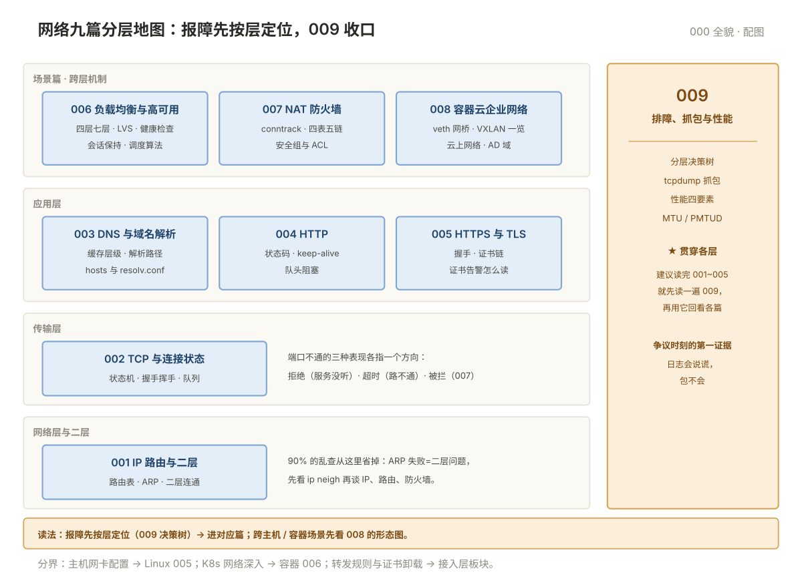

# 000 网络全貌

> **这一册回答**：网络板块管什么、九篇怎么分工、遇到网络问题从哪篇进、什么问题不归网络管。10 分钟读完，把九篇装进一张地图。  
> **给谁读**：会 ping 会配 IP，但"网络不通"时不知道先查什么的运维新人；以及需要系统复习的在职运维。本板块位于五阶段第一段（地基）。

## 板块地图

九篇一条主线：**包从 A 到 B，每一跳都可能出问题**——按问题的位置分篇。

| 篇 | 一句话 | 回答的问题 |
|---|---|---|
| [001 IP 路由与二层](001-IP路由与二层.md) | 包先在二层走通，再按路由表转发 | 地址与 MAC 是什么关系，路由表怎么读，ARP 失败说明什么 |
| [002 TCP 与连接状态](002-TCP与连接状态.md) | 三次握手、状态机、队列溢出 | 连接建不建得起来，TIME_WAIT/CLOSE_WAIT 多说明什么 |
| [003 DNS 与域名解析](003-DNS与域名解析.md) | 名字怎么变成 IP，缓存层级 | 解析慢/解析错的排查路径，hosts 与 resolv.conf 谁说了算 |
| [004 HTTP](004-HTTP.md) | 应用层协议的请求、状态码、连接复用 | 4xx/5xx 谁的锅，keep-alive 与队头阻塞 |
| [005 HTTPS 与 TLS 证书](005-HTTPS与TLS证书.md) | 握手、证书链、常见证书故障 | 证书告警怎么读，TLS 握手慢在哪一步 |
| [006 负载均衡与高可用](006-负载均衡与高可用.md) | 流量怎么分摊，节点挂了谁顶上 | 四层七层之别，LVS 四模式，健康检查与会话保持 |
| [007 NAT、防火墙与访问控制](007-NAT防火墙与访问控制.md) | 包为什么被拦，地址怎么转换 | conntrack、四表五链、规则顺序，安全组与 ACL |
| [008 容器、云与企业网络](008-容器云与企业网络.md) | 环境变了，网络形态跟着变 | veth/网桥、K8s 与 VXLAN 一览、云上网络、AD 域 |
| [009 排障、抓包与性能](009-排障抓包与性能.md) | 都查不动了，怎么一层层拆 | 分层决策树、tcpdump、性能四要素、MTU/PMTUD |
| [00 术语表](00-术语表.md) | 这个词是什么意思，这俩差在哪 | 按篇分组 · 缩写速查 · 症状反查 |

九篇的分层位置一张图看清——报障时先在这张图上找到层，再进对应篇：

## 核心概念速览

只立直觉，原理与命令都在对应篇。

- **分层定位**：链路层 → IP → TCP/UDP → 应用，逐层向下，问题在哪一层就进哪一篇——网络 009 的决策树是这套分层的实操版。
- **连接是有状态的**：TCP 状态机里每个异常状态对应一类病根（002）；端口不通先分"拒绝、超时、被拦"三种表现，指向三个不同方向。
- **名字先于连接**：绝大多数"连不上"应先验 DNS（003），再验路由（001）与端口（002）——顺序反了会浪费大量时间。
- **证书是信任链**：浏览器/客户端报证书错，看的是整条链（005），不是服务器那张证书本身。
- **包是可以被抓下来看的**：tcpdump 是网络排障的"最终证据"（009），比任何猜测都可靠。

## 与相邻板块的分界

| 问题 | 去哪 |
|---|---|
| 网卡怎么配、bond、VLAN 子接口（主机侧） | 「Linux」005 网络配置与排障 |
| K8s 网络深入（CNI、NetworkPolicy 实操） | 「容器」006 K8s 网络——本板块 008 只讲形态与原理概览 |
| Nginx/HAProxy 转发规则、证书卸载配置 | 「接入层」板块——本板块 006 讲负载均衡的通用机制 |
| 应用请求参数、业务接口 5xx 的业务逻辑 | 不归网络——应用侧问题 |

## 学习路径

- **顺序读**：001 → 002 → 003 → 004 → 005 是协议主线；006~008 是场景篇；009 是收口的排障方法论，**建议读完 001~005 就先读一遍 009**，再用它回看前面各篇。
- **按症状进**：解析错 → 003；握手失败 → 002；证书告警 → 005；间歇性丢包 → 009；更多入口见各篇检查清单与本板块 [README](README.md)。
- **复习**：术语表的症状反查是快速定位入口；每篇末尾的"下一篇"链可从头走到尾。

## 误解澄清

| # | 误解 | 事实 |
|---|---|---|
| 1 | OSI 七层要背下来才有用 | 排障用的是 TCP/IP 四层的**定位思想**，不是层数本身 |
| 2 | ping 通 = 网络没问题 | ping 只证明 ICMP 通；端口、DNS、TLS 任何一层坏了业务照样挂 |
| 3 | 能上网 = DNS 没问题 | 解析走的路径和 HTTP 不一样，解析慢是常见的"上网慢"根因 |
| 4 | TLS 就是个加密开关 | 握手、证书链、SNI、会话复用，每一步都可能成为性能与故障点 |
| 5 | 负载均衡就是轮询 | 算法、健康检查、会话保持、四层七层是四件独立的事 |
| 6 | 防火墙 = iptables 一个东西 | netfilter 四表五链、conntrack、云安全组是三层不同机制 |
| 7 | 容器网络是黑盒没法查 | veth/网桥/NAT 都在主机上，用常规工具就能看（008） |
| 8 | 抓包是最后才用的绝招 | 争议时刻它是**第一证据**——日志会说谎，包不会 |

---

**下一篇**：[001 IP 路由与二层](001-IP路由与二层.md) —— 从包的第一跳讲起。
