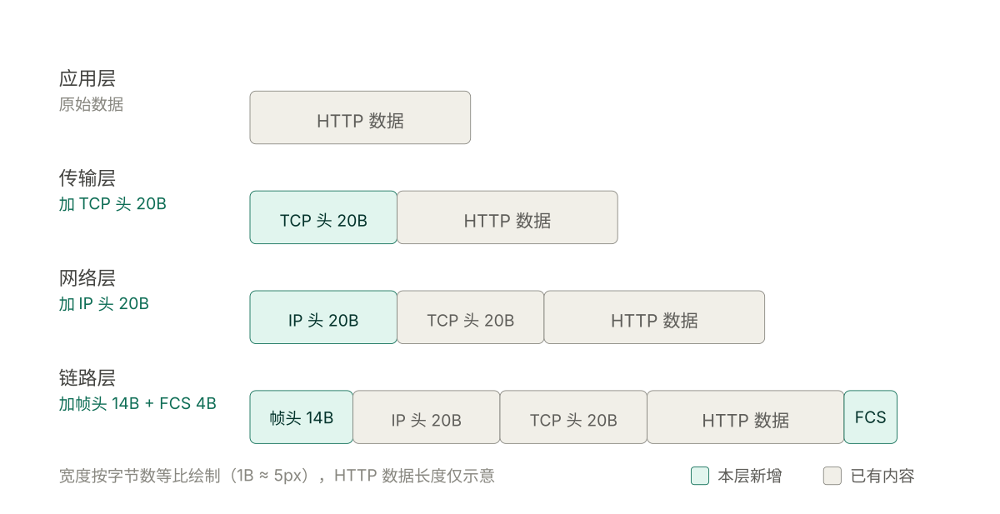
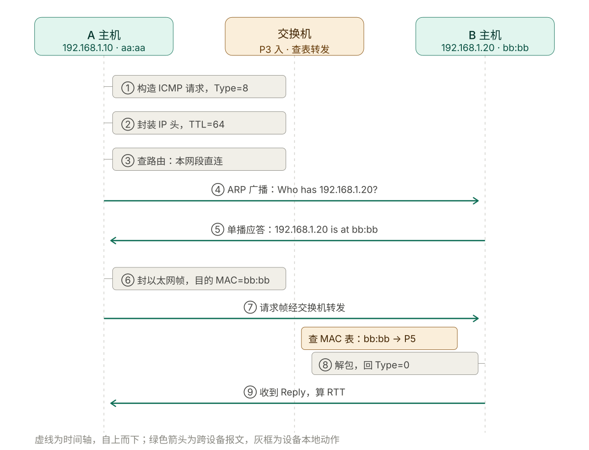
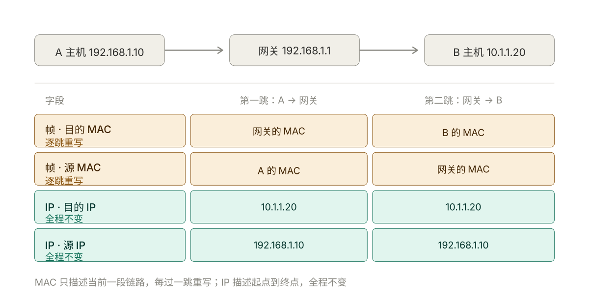

# 001 IP、路由与二层

> **解决**：包能不能出得去、能不能到。
> **范围**：分层模型、IP 与子网、路由、ARP、交换与 VLAN、ping 全过程。
> **口径**：Linux `iproute2`（`ip` 命令），不用已废弃的 `ifconfig` / `route`。
> **更新**：2026-10-28

---

## 1.1 分层模型：一套提问顺序

### 1.1.1 五层与各自的数据单位

模型的价值不在于背得出名字，而在于**给你一个从下往上问的顺序**。线上说"打不开"，你按这个顺序问，五步之内一定定位到某一层。

| 层 | 数据单位 | 典型协议 | 运维关心什么 | 排查命令 |
|---|---|---|---|---|
| 应用层 | 报文 Message | HTTP、DNS、TLS | 状态码、证书、解析结果 | `curl`、`dig` |
| 传输层 | 段 Segment | TCP、UDP | 端口、连接状态、队列 | `ss`、`nc` |
| 网络层 | 包 Packet | IP、ICMP | 地址、路由、TTL | `ip route`、`ping` |
| 链路层 | 帧 Frame | Ethernet、ARP | MAC、VLAN、双工 | `ip neigh`、`arping` |
| 物理层 | 比特 Bit | 网线、光模块 | 速率、误码、光衰 | `ethtool` |

记住三句话就够了：**IP 是端到端的，MAC 是逐跳的，端口是进程的。**

### 1.1.2 封装：每往下一层，加一个信封

分层模型落在字节上就是封装——每往下一层加一个信封：



发一个 HTTP 请求，实际在网线上跑的是这样一坨：

<svg viewBox="0 0 680 350" width="100%" xmlns="http://www.w3.org/2000/svg" font-family="system-ui, -apple-system, 'Segoe UI', 'Microsoft YaHei', sans-serif" role="img">
<title>封装：每往下一层，加一个信封</title>
<desc>从应用层到链路层逐层添加头部：TCP 头 20 字节、IP 头 20 字节、以太网帧头 14 字节与帧尾 FCS 4 字节。各段宽度按字节数等比绘制。</desc>

<text x="40" y="58" font-size="13" font-weight="500" fill="#444441">应用层</text>
<text x="40" y="75" font-size="11" fill="#888780">原始数据</text>
<rect x="170" y="62" width="150" height="36" rx="4" fill="#F1EFE8" stroke="#888780" stroke-width="0.5"/>
<text x="245" y="80" font-size="12" fill="#5F5E5A" text-anchor="middle" dominant-baseline="central">HTTP 数据</text>

<text x="40" y="126" font-size="13" font-weight="500" fill="#444441">传输层</text>
<text x="40" y="143" font-size="11" fill="#0F6E56">加 TCP 头 20B</text>
<rect x="170" y="130" width="100" height="36" rx="4" fill="#E1F5EE" stroke="#0F6E56" stroke-width="0.5"/>
<text x="220" y="148" font-size="11" fill="#04342C" text-anchor="middle" dominant-baseline="central">TCP 头 20B</text>
<rect x="270" y="130" width="150" height="36" rx="4" fill="#F1EFE8" stroke="#888780" stroke-width="0.5"/>
<text x="345" y="148" font-size="12" fill="#5F5E5A" text-anchor="middle" dominant-baseline="central">HTTP 数据</text>

<text x="40" y="194" font-size="13" font-weight="500" fill="#444441">网络层</text>
<text x="40" y="211" font-size="11" fill="#0F6E56">加 IP 头 20B</text>
<rect x="170" y="198" width="100" height="36" rx="4" fill="#E1F5EE" stroke="#0F6E56" stroke-width="0.5"/>
<text x="220" y="216" font-size="11" fill="#04342C" text-anchor="middle" dominant-baseline="central">IP 头 20B</text>
<rect x="270" y="198" width="100" height="36" rx="4" fill="#F1EFE8" stroke="#888780" stroke-width="0.5"/>
<text x="320" y="216" font-size="11" fill="#5F5E5A" text-anchor="middle" dominant-baseline="central">TCP 头 20B</text>
<rect x="370" y="198" width="150" height="36" rx="4" fill="#F1EFE8" stroke="#888780" stroke-width="0.5"/>
<text x="445" y="216" font-size="12" fill="#5F5E5A" text-anchor="middle" dominant-baseline="central">HTTP 数据</text>

<text x="40" y="262" font-size="13" font-weight="500" fill="#444441">链路层</text>
<text x="40" y="279" font-size="11" fill="#0F6E56">加帧头 14B + FCS 4B</text>
<rect x="170" y="266" width="70" height="36" rx="4" fill="#E1F5EE" stroke="#0F6E56" stroke-width="0.5"/>
<text x="205" y="284" font-size="11" fill="#04342C" text-anchor="middle" dominant-baseline="central">帧头 14B</text>
<rect x="240" y="266" width="100" height="36" rx="4" fill="#F1EFE8" stroke="#888780" stroke-width="0.5"/>
<text x="290" y="284" font-size="11" fill="#5F5E5A" text-anchor="middle" dominant-baseline="central">IP 头 20B</text>
<rect x="340" y="266" width="100" height="36" rx="4" fill="#F1EFE8" stroke="#888780" stroke-width="0.5"/>
<text x="390" y="284" font-size="11" fill="#5F5E5A" text-anchor="middle" dominant-baseline="central">TCP 头 20B</text>
<rect x="440" y="266" width="134" height="36" rx="4" fill="#F1EFE8" stroke="#888780" stroke-width="0.5"/>
<text x="507" y="284" font-size="12" fill="#5F5E5A" text-anchor="middle" dominant-baseline="central">HTTP 数据</text>
<rect x="574" y="266" width="36" height="36" rx="4" fill="#E1F5EE" stroke="#0F6E56" stroke-width="0.5"/>
<text x="592" y="284" font-size="11" fill="#04342C" text-anchor="middle" dominant-baseline="central">FCS</text>

<text x="40" y="328" font-size="11" fill="#888780">宽度按字节数等比绘制（1B ≈ 5px），HTTP 数据长度仅示意</text>
<rect x="470" y="318" width="12" height="12" rx="2" fill="#E1F5EE" stroke="#0F6E56" stroke-width="0.5"/>
<text x="488" y="328" font-size="11" fill="#5F5E5A">本层新增</text>
<rect x="560" y="318" width="12" height="12" rx="2" fill="#F1EFE8" stroke="#888780" stroke-width="0.5"/>
<text x="578" y="328" font-size="11" fill="#5F5E5A">已有内容</text>
</svg>

用寄快递比喻：信纸是 HTTP 数据，装进信封是 TCP 头（写上"第几封、要不要回执"），再套快递袋是 IP 头（写上收发件地址），最后贴上运单是帧头（写上"这一站交给谁"）。

**运单（MAC）每经过一个中转站就换一张，信封上的收发件地址（IP）全程不变。** 这就是"MAC 逐跳重写、IP 端到端不变"的由来。

### 1.1.3 每层坏了长什么样

这张表用来反查：看到某个现象，就知道该往哪一层查、别再往下瞎试。

| 层 | 坏了的现象 | 一票否决的命令 |
|---|---|---|
| 物理 | 网卡 `NO-CARRIER`、速率协商成 100M | `ethtool eth0` |
| 链路 | 同网段不通、ARP 解析不到 | `ip neigh show 目标IP` |
| 网络 | `No route to host`、`Network unreachable` | `ip route get 目标IP` |
| 传输 | `Connection refused` / `timed out` | `nc -vz IP 端口` |
| 应用 | 状态码 4xx / 5xx、证书报错 | `curl -v` |

---

## 1.2 IP 地址与子网

### 1.2.1 一个地址由两部分组成

`192.168.1.10/24` 里，`/24` 是**掩码长度**，它把地址切成两段：

```text
192.168.1.10 / 24
└─────┬─────┘ └┬┘
   网络部分   主机部分
  （前 24 位）（后 8 位）
```

- 网络部分相同 → 同一网段，直接靠 MAC 通信，**不经过网关**。
- 网络部分不同 → 必须交给网关转发。

`/24` 与掩码 `255.255.255.0` 是同一件事的两种写法。

### 1.2.2 每个网段都有三个特殊地址

以 `192.168.1.0/24` 为例：

| 地址 | 值 | 含义 | 能配给主机吗 |
|---|---|---|---|
| 网络地址 | `192.168.1.0` | 代表整个网段 | 不能 |
| 可用范围 | `192.168.1.1` – `192.168.1.254` | 可分配 | 能 |
| 广播地址 | `192.168.1.255` | 发给本网段所有主机 | 不能 |
| 网关 | 通常是 `.1` 或 `.254` | 出口 | 是可用地址之一 |

`/24` 有 256 个地址，**可用 254 个**。

### 1.2.3 速算表

| 掩码 | 掩码值 | 总地址 | 可用主机 | 网段步长 |
|---|---|---|---|---|
| /24 | 255.255.255.0 | 256 | 254 | 256 |
| /25 | 255.255.255.128 | 128 | 126 | 128 |
| /26 | 255.255.255.192 | 64 | 62 | 64 |
| /27 | 255.255.255.224 | 32 | 30 | 32 |
| /28 | 255.255.255.240 | 16 | 14 | 16 |
| /29 | 255.255.255.248 | 8 | 6 | 8 |
| /30 | 255.255.255.252 | 4 | 2 | 4 |
| /31 | 255.255.255.254 | 2 | 2（点对点专用） | 2 |
| /32 | 255.255.255.255 | 1 | 1（单主机路由） | 1 |

**速算技巧**：看掩码最后一段。`255.255.255.192` 里的 `192`，用 `256 - 192 = 64` 得到步长。所以 `/26` 的网段永远从 `.0`、`.64`、`.128`、`.192` 开始。`/25` 是 `256-128=128`，网段从 `.0`、`.128` 开始。

### 1.2.4 判断两个 IP 是否同网段

**算法**：两个 IP 分别与掩码按位与（AND），结果相同就是同网段。

例：`10.0.0.5/26` 与 `10.0.0.70/26`：

```text
掩码 /26 = 255.255.255.192

10.0.0.5  AND 255.255.255.192 = 10.0.0.0
10.0.0.70 AND 255.255.255.192 = 10.0.0.64
```

`10.0.0.0 ≠ 10.0.0.64` → **不同网段**。前三个字节一样，但它们不通，中间隔着路由器。

这是最常见的配置错误：**以为 `10.0.0.x` 都是一个段，改成 `/26` 之后 `.70` 就跑到隔壁段去了。**

用命令算，别用眼算：

```bash
ipcalc 10.0.0.5/26                    # 需要 ipcalc 包
python3 -c "import ipaddress as i; n=i.ip_network('10.0.0.5/26'); print(n, n.network_address, n.broadcast_address)"
```

### 1.2.5 特殊地址段

| 网段 | 用途 | 运维注意 |
|---|---|---|
| `10.0.0.0/8` | 私有 | 企业内网最常见 |
| `172.16.0.0/12` | 私有（172.16–172.31） | 只到 31，`172.32.x.x` 是公网 |
| `192.168.0.0/16` | 私有 | 家庭与小办公 |
| `127.0.0.0/8` | 回环 | `127.0.0.1` 出不了本机网卡 |
| `169.254.0.0/16` | 链路本地 | **看到这个 = DHCP 没拿到地址** |
| `100.64.0.0/10` | 运营商级 NAT | 云内网、K8s 常用 |
| `224.0.0.0/4` | 组播 | VRRP、OSPF |
| `0.0.0.0` | 未指定 | 监听时表示所有网卡；路由里表示默认路由 |
| `255.255.255.255` | 受限广播 | 不出本网段 |

**实战**：机器 IP 显示 `169.254.x.x`，别查别的，直接查 DHCP 和网线。

---

## 1.3 路由：包从哪个口出去

### 1.3.1 路由表怎么读

```bash
ip route
```

```text
default via 192.168.1.1 dev eth0 proto dhcp src 192.168.1.10 metric 100
192.168.1.0/24 dev eth0 proto kernel scope link src 192.168.1.10
10.0.0.0/8 via 192.168.1.254 dev eth0
```

| 字段 | 含义 | 说明 |
|---|---|---|
| `default` | 默认路由，等于 `0.0.0.0/0` | 所有匹配不上的目标走这里 |
| `192.168.1.0/24` | 目标网段 | 目标落在段内才匹配 |
| `via 192.168.1.1` | 下一跳 | 交给谁；没有 `via` 说明目标在本网段，直接 ARP |
| `dev eth0` | 出接口 | 从哪块网卡发 |
| `proto kernel` | 来源 | `kernel` 配 IP 时自动生成，`static` 手工加，`dhcp` 自动获取 |
| `scope link` | 作用域 | 目标直接可达，不需网关 |
| `src 192.168.1.10` | 优选源地址 | 从这块网卡发包时用的源 IP |
| `metric 100` | 优先级 | **越小越优先** |

### 1.3.2 最长前缀匹配

一个目标可能同时匹配多条路由，**选前缀最长的那条**，与配置顺序无关。

目标 `10.1.2.3`，表里有：

```text
default via 192.168.1.1       前缀长度 0
10.0.0.0/8   via 192.168.1.254 前缀长度 8
10.1.0.0/16  via 192.168.1.253 前缀长度 16
```

走 `/16`。**越具体越优先。**

这解释了一个常见困惑：加了一条更宽的路由，流量却还走老路——因为老的那条更具体。

### 1.3.3 一条命令看清出口

```bash
ip route get 8.8.8.8
```

```text
8.8.8.8 via 192.168.1.1 dev eth0 src 192.168.1.10 uid 0
```

**排查"出包走错网卡"最快的一条命令**，比对着路由表肉眼匹配可靠得多。多网卡机器、双默认路由、VPN 场景必用。

### 1.3.4 多网卡与双默认路由

一台机器两块网卡、两条默认路由时会出现：

- 出包走 eth0，回包从 eth1 回来 → 对端看到源 IP 不对 → 连接被拒。
- 内核 `rp_filter`（反向路径过滤）发现回包路径与进包路径不一致 → **静默丢包，日志里什么都没有**。

```bash
ip route                                # 看是不是有两条 default
ip route get 8.8.8.8                    # 确认实际出口
sysctl net.ipv4.conf.all.rp_filter      # 1=严格 2=松散 0=关闭
```

生产上：**不要配两条等价默认路由。** 要么只留一条默认 + 明细路由，要么用策略路由明确分流。

### 1.3.5 metric：同前缀时的优先级

前缀长度相同再比 metric，小的优先。

```bash
# 临时插一条更高优先级（metric 更小）的默认路由
ip route add default via 192.168.1.1 dev eth0 metric 50
```

### 1.3.6 策略路由：按源地址或端口分流

普通路由只看**目的地址**。策略路由（`ip rule`）可以按源地址、端口、mark 决定走哪张表——多出口（一条专线跑业务、一条宽带跑备份）、双 ISP 分流都靠它。

规则从上往下匹配，`0` 优先级最高：

```bash
ip rule                                # 看规则列表
# 0:      from all lookup local
# 32766:  from all lookup main
# 32767:  from all lookup default

# 需求：来自 10.0.1.0/24 的流量走第二张表（eth1 出口）
echo "200 custom" >> /etc/iproute2/rt_tables
ip route add default via 192.168.2.1 dev eth1 table custom
ip rule add from 10.0.1.0/24 lookup custom priority 100

ip route get 8.8.8.8 from 10.0.1.5    # 验证：指定源地址看走哪条
```

**坑**：策略路由配完必须用 `ip route get ... from ...` 验证，直接 `ip route get` 看不到策略表的结果，容易误判成"没生效"。

---

## 1.4 ARP：IP 到 MAC 的翻译

### 1.4.1 为什么需要 ARP

IP 是逻辑地址，管跨网段寻址；网线上真正跑的是以太网帧，帧头填的是 **MAC**。所以每次发包前内核都要问一句：**这个 IP 的 MAC 是多少？**

规则只有两条，但决定了整条路径：

- 目标**同网段** → ARP 解析**目标主机**的 MAC。
- 目标**跨网段** → ARP 解析**网关**的 MAC。

跨网段时帧头目的 MAC 是网关、IP 头目的 IP 还是最终目标——这一句理解透了，后面所有二层问题都好推。

### 1.4.2 查 ARP 缓存

```bash
ip neigh                # 推荐
arp -n                  # 老命令，仍可用
```

```text
192.168.1.1  dev eth0 lladdr aa:bb:cc:dd:ee:ff REACHABLE
192.168.1.20 dev eth0 lladdr 11:22:33:44:55:66 STALE
192.168.1.99 dev eth0  FAILED
```

| 状态 | 含义 | 该做什么 |
|---|---|---|
| `REACHABLE` | 最近确认过 | 正常 |
| `STALE` | 有过记录但已过期 | 正常，下次发包会确认，**不是问题** |
| `DELAY` | 等待确认 | 正常过渡态 |
| `PROBE` | 正在探测 | 长期停留 = 对端不响应 |
| `FAILED` | 解析失败 | **对端不在线 / 二层隔离 / VLAN 不通** |
| `INCOMPLETE` | 已发请求无回应 | 同 FAILED |
| `PERMANENT` | 静态绑定 | 手工配置，不过期 |

**`STALE` 不是故障。** 很多人看到 STALE 就去清缓存，纯属白干。

### 1.4.3 ARP 相关高频故障

| 现象 | 原因 | 处置 |
|---|---|---|
| 换机/换网卡后同网段短时不稳 | 旧 MAC 还在别人缓存里 | 等老化，或关键设备清 ARP |
| 同网段 ping 不通、`ip neigh` 显示 FAILED | 对端关机、IP 冲突、VLAN 隔离、端口封禁 | 先 `arping` 确认二层 |
| 时通时断，网关 MAC 会变 | ARP 欺骗 / IP 冲突 | 网关静态绑定、开 DAI |
| 虚机迁移后短暂不通 | MAC 变了，上游交换机表未更新 | `arping -U` 主动通告 |

```bash
# 二层可达性测试：绕过 IP 层，直接看 ARP 有没有回应
arping -I eth0 192.168.1.20 -c 3

# 迁移后主动通告自己的 MAC（免费 ARP）
arping -U -I eth0 192.168.1.10
```

### 1.4.4 免费 ARP 与 ARP 欺骗

**免费 ARP（Gratuitous ARP）** 是不问自答的 ARP：主机主动广播"我的 IP 对应这个 MAC"。正常用途是迁移、切换、VIP 漂移后刷新全网缓存。**同一个机制被滥用就是 ARP 欺骗**——攻击者广播"网关的 IP 对应我的 MAC"，全网流量就流向他。

判断有没有被欺骗，看网关 MAC 是否异常：

```bash
ip neigh show 192.168.1.1          # 记下网关 MAC
# 隔几分钟再看，如果 MAC 变了且不是设备更换，基本可以确定
```

---

## 1.5 二层与 VLAN

### 1.5.1 MAC 地址

48 位，写成 `aa:bb:cc:dd:ee:ff`。前三字节是厂商代码（OUI），后三字节是序列号。

| 类型 | 特征 | 用途 |
|---|---|---|
| 单播 | 第一字节最低位为 0 | 一对一 |
| 广播 | `ff:ff:ff:ff:ff:ff` | ARP 请求、DHCP 发现 |
| 组播 | 第一字节最低位为 1 | VRRP、OSPF、IPTV |

### 1.5.2 交换机怎么转发

交换机维护 **MAC 地址表**（MAC ↔ 端口）：

1. **学习**：收到帧，把「源 MAC + 入端口」记进表。
2. **查表转发**：查到目的 MAC 的端口，只从那个口发。
3. **查不到则泛洪**：除入端口外所有端口都发一遍——这就是「广播域」的物理来源。
4. **老化**：约 300 秒没活动就删。

**运维含义**：一个 VLAN = 一个广播域。广播域越大，泛洪越多，一台机器发的广播风暴能瘫痪整个域。这是 VLAN 存在的根本原因。

### 1.5.3 VLAN

**核心价值只有两条**，网上列的那七八条都是这两条的衍生：

1. **隔离广播域** —— 控制泛洪与故障影响范围。
2. **隔离访问** —— 不同 VLAN 默认不通，必须过三层设备，这才有地方施加访问控制。

实现是 **802.1Q 标签**：在帧里插 4 字节，其中 12 位是 VLAN ID（可用 1–4094）。

| 端口类型 | 行为 | 接什么 |
|---|---|---|
| Access | 属于单个 VLAN，收发都不带标签 | 终端、服务器 |
| Trunk | 承载多个 VLAN，帧带标签 | 交换机之间、虚拟化宿主机 |
| Hybrid | 按 VLAN 决定是否打标签 | 特定场景 |

高频坑：

- 服务器要收多个 VLAN → 宿主机配子接口（`eth0.100`），交换机侧配 Trunk。
- **两端 VLAN ID 不一致，现象是完全不通且没有任何报错。** 这是二层最难查的问题。
- 跨交换机时中间链路必须是 Trunk 且放行该 VLAN，否则包在中间被静默丢弃。

```bash
# Linux 上配 VLAN 子接口
ip link add link eth0 name eth0.100 type vlan id 100
ip addr add 10.0.100.10/24 dev eth0.100
ip link set eth0.100 up

ip -d link show eth0.100        # 确认 VLAN 配置
```

### 1.5.4 链路聚合（bond / LACP）

两条网线接同一台交换机做冗余，但**不能各配一个 IP**——那会变成双默认路由那堆问题。正确做法是聚合（Linux 叫 bond，交换机侧叫 Eth-Trunk / 链路聚合组）。

| 模式 | 交换机要求 | 用途 |
|---|---|---|
| `balance-rr` / `active-backup` | 不需要配置 | 简单冗余，主备切换 |
| `802.3ad`（LACP） | 交换机必须配 LACP | 带宽叠加 + 冗余，生产标准做法 |

```bash
# 查看 bond 状态
cat /proc/net/bonding/bond0        # 当前活动网卡、聚合模式、链路状态
```

**坑**：`802.3ad` 两端模式必须一致。交换机侧没配 LACP 而服务器配了，表现是链路起不来或只能跑一半——比完全不通更难查。

### 1.5.5 STP：防环

交换机之间多条链路会成环，广播帧在环里无限循环 → 广播风暴 → 全网瘫痪。**STP** 通过阻塞部分端口，把环形拓扑剪成树形。

运维只需记住两条：

- 接交换机时不要随手把两根网线插成环，除非确认开了 STP。
- 服务器双网卡做冗余要用 bond，不要两根线各自独立接同一交换机。

### 1.5.6 物理层：最容易被跳过的一层

所有排查都从 `ping` 开始，但真正该先看的是网卡状态：

```bash
ethtool eth0
# Speed: 1000Mb/s          ← 应该是 1000 或 10000
# Duplex: Full              ← Half 是严重问题
# Link detected: yes        ← no 说明物理链路没通
```

| 现象 | 含义 |
|---|---|
| `Link detected: no` | 网线没插好、光模块坏、对端端口关 |
| `Speed: 100Mb/s`（本该千兆） | 网线老化、水晶头接触不良、协商失败 |
| `Duplex: Half` | **双工不匹配**，表现为"能通但极慢、丢包严重" |
| `ethtool -S eth0` 里 RX errors 持续增长 | 物理层误码，换线换模块 |

**双工不匹配是最典型的"网络慢"陷阱**：能 ping 通、能连上，但吞吐只有正常值的十分之一。

---

## 1.6 A ping B 的完整过程

### 1.6.1 ping 与 ICMP

ping 用 **ICMP**（网络层，**没有端口**）：

- 请求 `ICMP Echo Request`，Type=8
- 应答 `ICMP Echo Reply`，Type=0

**运维第一课**：ping 通不代表服务正常，ping 不通也不代表网络坏了。ICMP 和 TCP 是两套东西，云厂商默认常禁 ICMP。

### 1.6.2 同网段（A: 192.168.1.10 → B: 192.168.1.20）

ping 同网段的全过程，九步拆解：



```text
A 主机
 │ ① 构造 ICMP Echo Request
 │    Type=8, Identifier（区分进程）, Sequence（序号）, Checksum, Data
 │
 │ ② 封装 IP 头
 │    源IP=192.168.1.10  目标IP=192.168.1.20  TTL=64  Protocol=1(ICMP)
 │
 │ ③ 查路由表：192.168.1.20 属于 192.168.1.0/24 → 直连，不走网关
 │
 │ ④ 查 ARP 缓存，要 192.168.1.20 的 MAC
 │    无记录 → 广播：Who has 192.168.1.20? Tell 192.168.1.10
 │             （目的 MAC = ff:ff:ff:ff:ff:ff）
 │
 │ ⑤ B 单播回应：192.168.1.20 is at bb:bb:bb:bb:bb:bb
 │
 │ ⑥ 封装以太网帧
 │    目的MAC=bb:bb:...  源MAC=aa:aa:...  类型=0x0800(IPv4)
 │
 交换机
 │ ⑦ 学习：源 MAC aa:aa → 入端口 P3，写入 MAC 表
 │    转发：查 bb:bb 对应 P5，只从 P5 发出
 │
B 主机
 │ ⑧ 目的 MAC 是自己 → 逐层解包（帧 → IP → ICMP）
 │    识别 Type=8，回 Type=0，复用 Identifier/Sequence/Data
 │    源/目的 IP 对调，重新 ARP 拿 A 的 MAC，封装发回
 │
A 主机
 │ ⑨ 收到应答，用「接收时间 - 发送时间」算出 RTT
```

### 1.6.3 跨网段（A: 192.168.1.10 → B: 10.1.1.20）

跨网段时的转发——帧头逐跳重写，IP 头端到端不变：



差异只有五处，但每处都是考点：

| 环节 | 同网段 | 跨网段 |
|---|---|---|
| 路由判断 | 命中直连路由 | 命中默认或明细路由 |
| **ARP 对象** | 目标主机 | **网关** |
| 帧的目的 MAC | 目标主机 MAC | **网关 MAC** |
| IP 的目的 IP | 目标主机 IP | 目标主机 IP（**不变**） |
| 转发方式 | 交换机二层转发 | 路由器逐跳转发，每跳重写帧头 |

**最容易记混的**：跨网段时帧头目的 MAC 是网关，但 IP 头目的 IP 还是最终目标。MAC 只管当前这一段链路，IP 管全程。

### 1.6.4 输出怎么读

```text
64 bytes from 192.168.1.20: icmp_seq=1 ttl=64 time=0.4 ms
```

| 字段 | 含义 | 用途 |
|---|---|---|
| `64 bytes` | 56 字节数据 + 8 字节 ICMP 头 | 改大小可测 MTU |
| `icmp_seq` | 第几个包 | 看是否连续丢包 |
| `ttl` | 剩余跳数 | **推断对端系统**：64≈Linux/Unix，128≈Windows，255≈网络设备 |
| `time` | RTT | 同机房应 < 1ms |

**TTL 的实战用法**：`ttl=52` → 经过约 12 跳（64-52），可粗判网络层级和物理距离。TTL 明显跳跃说明链路绕行。

### 1.6.5 ping 不通的六种原因

| # | 原因 | 判据 |
|---|---|---|
| 1 | 防火墙禁 ICMP | 同网段通、跨网段不通，但端口探测正常 |
| 2 | 目标不在线 | `ip neigh` 显示 FAILED |
| 3 | IP 配错（掩码/网关） | 同网段通、跨网段不通 |
| 4 | VLAN 隔离 / 端口封禁 | `arping` 也失败 |
| 5 | 回程路由缺失 | 去程通、回程不通（单向） |
| 6 | TTL 耗尽 | 返回 `Time to live exceeded` |

**回程路由缺失最隐蔽**：包能到，回不来。表现为一直超时，但抓包能看到请求确实到达了对端。

---

## 1.7 命令速查

```bash
# 地址与网段
ip addr show                          # 所有网卡地址
ip -4 addr show dev eth0              # 只看 IPv4
ipcalc 10.0.0.5/26                    # 算网段

# 路由
ip route                              # 路由表
ip route get 8.8.8.8                  # 这个目标从哪出去（最常用）
ip route get 8.8.8.8 from 10.0.1.5    # 策略路由场景必须带 from
ip route add 10.1.0.0/16 via 192.168.1.254

# ARP / 邻居
ip neigh                              # ARP 缓存与状态
ip neigh show 192.168.1.1             # 只看某个地址
arping -I eth0 192.168.1.20 -c 3      # 二层可达性

# 连通性
ping -c 4 192.168.1.20
ping -M do -s 1472 8.8.8.8            # 探测 MTU（1472+28=1500）
traceroute -n 8.8.8.8                 # 逐跳
mtr -rw -c 20 8.8.8.8                 # 逐跳 + 丢包统计，比 traceroute 好用

# 接口与物理层
ethtool eth0                          # 速率、双工、链路状态
ethtool -S eth0 | grep -i err         # 网卡错误计数
ip -s link show eth0                  # 收发统计、丢包
cat /proc/net/bonding/bond0           # bond 状态

# VLAN
ip link add link eth0 name eth0.100 type vlan id 100
ip -d link show eth0.100
```

---

## 1.8 七个坑

| # | 坑 | 现象 | 处置 |
|---|---|---|---|
| 1 | 掩码配错 | "明明是同一个 192.168.1.x 却不通" | `ipcalc` 核对，别用眼算 |
| 2 | 网关不在本网段 | 路由表里有网关但完全不通 | 网关必须与主机同网段，否则路由无效 |
| 3 | 双默认路由 | 时通时不通、连上就断 | `ip route get` 确认出口，只留一条默认 |
| 4 | `rp_filter` 静默丢包 | 多网卡时回包被内核丢弃，日志无记录 | `sysctl net.ipv4.conf.all.rp_filter`，必要时设 2 |
| 5 | VLAN ID 两端不一致 | 完全不通，无任何报错 | 核对两侧配置，纯二层问题 |
| 6 | ARP 缓存未更新 | 换机后短时不通 | `arping -U` 主动通告 |
| 7 | 双工不匹配 | 能通但极慢、丢包 | `ethtool eth0` 看 Duplex，换线换模块 |

---

## 1.9 同网段不通的检查顺序

同网段 ping 不通时，正确顺序是：

```bash
ip addr                  # ① 我自己的 IP/掩码配对了吗
ip neigh show 目标IP     # ② 二层能解析到吗（FAILED = 二层不通，别再往上查）
arping -I eth0 目标IP    # ③ 真的发不出去？（收到应答说明是 IP 层配置问题）
```

**90% 的人从 `ping` 开始反复重试，正确做法是先看 `ip neigh`。** ARP 失败意味着问题在二层，跟 IP、路由、防火墙都没关系——这一条判断能省掉大量乱试。

---

**下一篇**：[002-TCP与连接状态](002-TCP与连接状态.md) —— 二层通了，看连接建不建得起来。
