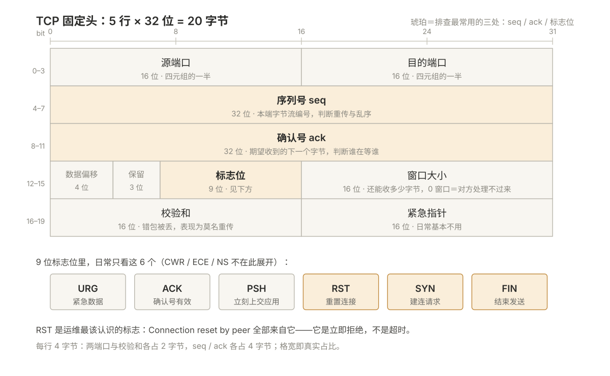
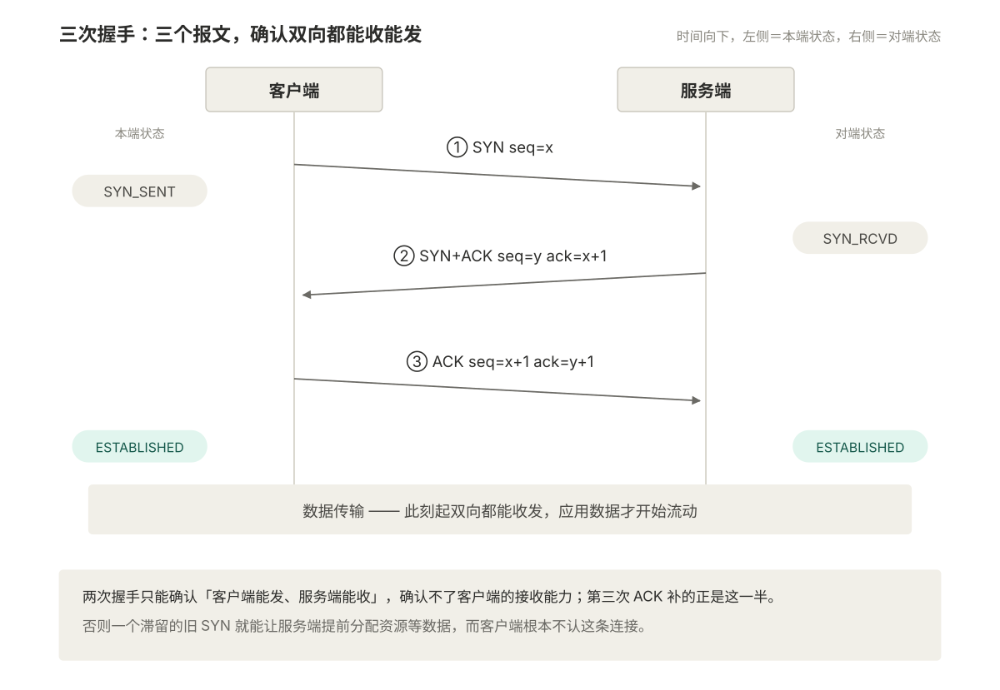
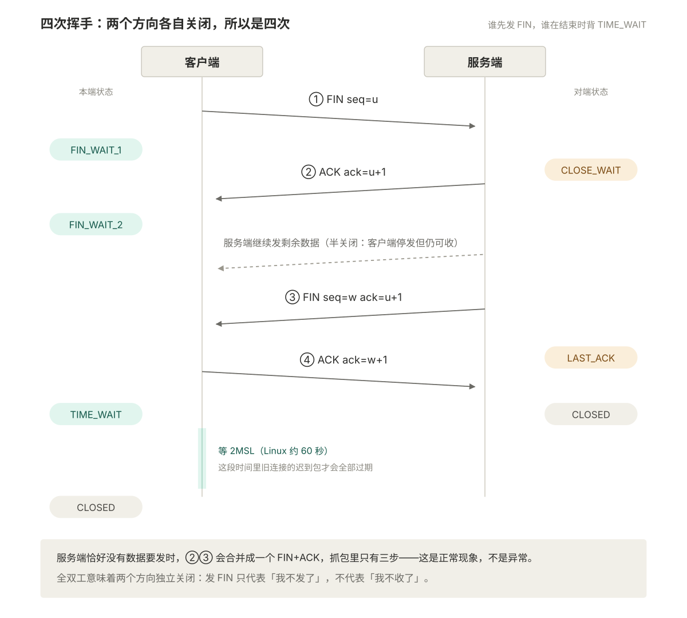
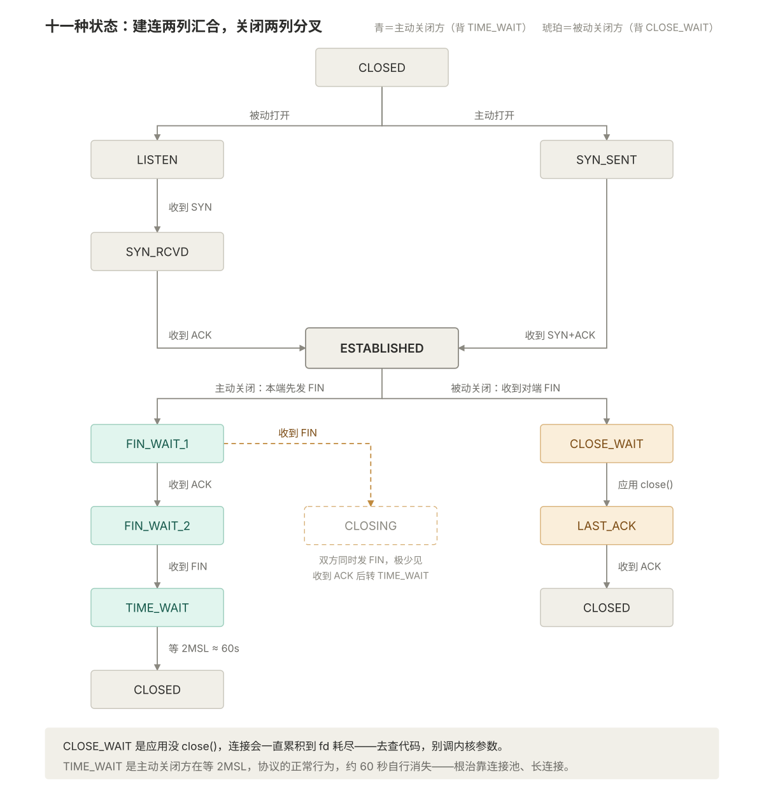
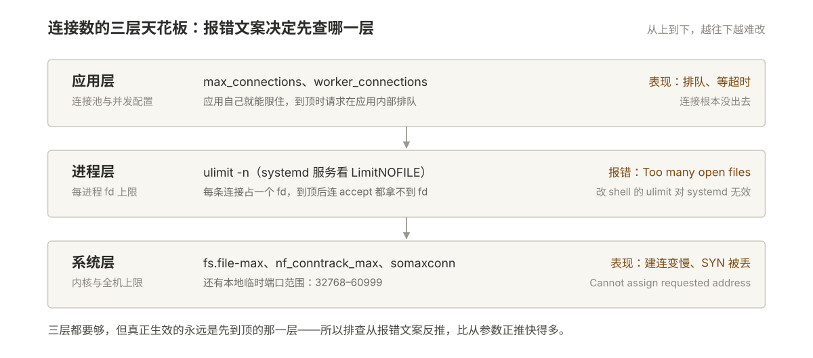
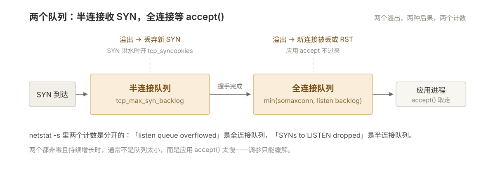

# 002 TCP、UDP 与连接状态

> **解决**：连接能不能建起来、为什么建不起来、为什么建得慢、状态堆积说明什么。
> **范围**：端口与四元组、TCP 报文头、三次握手、四次挥手、十一种状态、TIME_WAIT、UDP/QUIC、连接数上限、`ss` 与抓包。
> **口径**：Linux 内核 5.x/6.x。`tcp_tw_recycle` 已在 4.12 移除，不再讨论。
> **更新**：2026-10-28

---

## 目录

| 节 | 内容 |
|---|---|
| 2.1 | 端口与四元组 |
| 2.2 | TCP 报文头：只需要关心六个字段 |
| 2.3 | 三次握手 |
| 2.4 | 四次挥手 |
| 2.5 | 十一种状态与诊断 |
| 2.6 | TIME_WAIT 深入 |
| 2.7 | UDP 与 QUIC |
| 2.8 | 连接数与资源上限 |
| 2.9 | 命令与抓包 |
| 2.10 | 七个坑 |

---

## 2.1 端口与四元组

### 2.1.1 端口范围

| 范围 | 类型 | 说明 |
|---|---|---|
| 0–1023 | 知名端口 | 绑定需 root |
| 1024–49151 | 注册端口 | 3306 MySQL、6379 Redis、8080 |
| 49152–65535 | 动态端口 | 作为客户端时的源端口 |

Linux 实际默认临时端口是 `32768–60999`（约 2.8 万个）。**这就是单机对外连接数的理论上限**——每个出向连接占一个源端口。

```bash
sysctl net.ipv4.ip_local_port_range      # 看当前范围
ss -s | head -3                          # 已用多少、还剩多少
```

### 2.1.2 四元组

一条 TCP 连接由四个值唯一确定：

```text
源 IP + 源端口 + 目的 IP + 目的端口
```

这解释了三件平时想不通的事：

| 现象 | 原因 |
|---|---|
| 一台服务器同一个 80 端口能同时服务上万客户端 | 四元组不同，是上万条独立连接 |
| `Cannot assign requested address` | 本地源端口被占满（TIME_WAIT 堆积时高发） |
| `Too many open files` | 每条连接占一个 fd，`ulimit -n` 是硬上限 |

SSH、MySQL、Redis、Nginx、Docker、K8s，本质上都是**监听一个端口，按四元组区分连接**。

### 2.1.3 一个容易混的点

**`0.0.0.0:80` 和 `127.0.0.1:80` 不是一回事。**

```bash
ss -lntp | grep :80
# LISTEN 0 128 0.0.0.0:80    ← 所有网卡都能访问，外部可连
# LISTEN 0 128 127.0.0.1:80  ← 只有本机能连，外部连会 refused
```

服务起在 `127.0.0.1` 上，从外面连就是 `Connection refused`——这时网络完全正常，问题在监听地址。

---

## 2.2 TCP 报文头：只需要关心六个字段

TCP 固定头 20 字节的字段布局：



```text
 0                   1                   2                   3
 0 1 2 3 4 5 6 7 8 9 0 1 2 3 4 5 6 7 8 9 0 1 2 3 4 5 6 7 8 9 0 1
┌───────────────────────────────┬───────────────────────────────┐
│          源端口 (16)           │         目的端口 (16)          │
├───────────────────────────────┴───────────────────────────────┤
│                      序列号 seq (32)                          │
├───────────────────────────────────────────────────────────────┤
│                    确认号 ack (32)                            │
├──────┬────────┬─┬─┬─┬─┬─┬─┬───────────────────────────────────┤
│数据偏移│ 保留   │U│A│P│R│S│F│        窗口大小 (16)            │
│ (4)  │  (3)   │R│C│S│S│Y│I│                                  │
│      │        │G│K│H│T│N│N│                                  │
├──────┴────────┴─┴─┴─┴─┴─┴─┴───────────────────────────────────┤
│        校验和 (16)            │        紧急指针 (16)           │
└───────────────────────────────┴───────────────────────────────┘
```

| 字段 | 作用 | 为什么关心 |
|---|---|---|
| 源/目的端口 | 定位进程 | 四元组的一半 |
| **seq** | 本端字节流编号 | 抓包判断重传、乱序 |
| **ack** | 期望收到的下一个字节 | 抓包判断谁在等谁 |
| **SYN / FIN / RST** | 建连 / 关闭 / 重置 | 状态机的驱动信号 |
| **窗口大小** | 还能收多少字节 | 窗口为 0 = 接收方处理不过来，发送方会停 |
| 校验和 | 完整性 | 错包被丢，表现为「莫名重传」 |

**`RST` 是运维最该认识的标志。** 收到 RST 意味着对端**直接拒绝或中止**，不是超时。所有 `Connection reset by peer` 都来自 RST。

---

## 2.3 三次握手

### 2.3.1 时序

三次握手的过程与每一步解决的确认问题：



```text
客户端                                    服务端
  │                                         │
  │  ① SYN  seq=x                           │   客户端 SYN_SENT
  │ ──────────────────────────────────────> │
  │                                         │   服务端 SYN_RCVD
  │  ② SYN+ACK  seq=y  ack=x+1              │
  │ <────────────────────────────────────── │
  │                                         │
  │  ③ ACK  seq=x+1  ack=y+1                │   双方 ESTABLISHED
  │ ──────────────────────────────────────> │
  │                                         │
  │ ══════════ 数据传输开始 ═══════════════> │
```

三次握手实际交换了四样东西：

| 交换内容 | 目的 |
|---|---|
| 双方初始序列号（x、y） | 后续数据按序编号、确认、重传的基础 |
| 双方接收窗口 | 流量控制 |
| MSS（最大段大小） | 协商单段上限，避免 IP 分片 |
| 收发能力确认 | 见下 |

### 2.3.2 为什么是三次不是两次

两次握手只能确认**客户端能发、服务端能收**，无法确认**客户端的接收能力**。

经典场景：一个早已失效的旧 SYN 在网络里滞留，突然到达服务端。如果两次就建连，服务端立刻分配资源等数据，而客户端根本不认这条连接——资源被白白占用。

第三次 ACK 让服务端确认「客户端确实收到了我的 SYN+ACK，且此刻确实想建连」。

**一句话**：三次让双方都确认对方能收能发，两次只能确认单向。

### 2.3.3 建连失败的四类报错

| 报错 | 触发条件 | 含义 | 排查方向 |
|---|---|---|---|
| `Connection refused` | 收到 **RST** | 包到了主机，但**该端口没进程监听** | 服务没起 / 监听地址错 / 端口配错 |
| `Connection timed out` | 无任何回应 | 包**到不了**或被**静默丢弃** | 防火墙 DROP / 安全组 / 路由 / 对端宕机 |
| `No route to host` | 收到 ICMP 不可达 | 路由层就不通 | `ip route`、网关 |
| 卡很久后成功 | SYN 被丢、重传后成功 | 链路丢包或队列满 | `netstat -s` 的重传计数 |

这个区分极其重要：

- **`refused` 是好消息**——网络是通的，只是服务没起，排查范围缩到「进程」。
- **`timed out` 才是网络问题**——要一路查防火墙和路由。

很多人把 `refused` 当网络问题查半天，纯属浪费时间。

```bash
ss -lntp | grep :80        # 十秒确认：端口到底有没有在听
```

---

## 2.4 四次挥手

### 2.4.1 时序

四次挥手：两个方向各自关闭：



```text
客户端                                    服务端
  │  ① FIN  seq=u                          │  客户端 FIN_WAIT_1
  │ ──────────────────────────────────────> │
  │                                         │  服务端 CLOSE_WAIT
  │  ② ACK  ack=u+1                         │
  │ <────────────────────────────────────── │
  │                                         │（服务端继续发剩余数据）
  │  ③ FIN  seq=w  ack=u+1                  │  服务端 LAST_ACK
  │ <────────────────────────────────────── │
  │  ④ ACK  ack=w+1                         │  客户端 TIME_WAIT
  │ ──────────────────────────────────────> │  服务端 CLOSED
  │                                         │
  │  等 2MSL（Linux 约 60 秒）               │
  │  客户端 CLOSED                           │
```

### 2.4.2 为什么是四次不是三次

TCP 是**全双工**的，两个方向的数据流独立关闭。

客户端发 FIN 只表示「我没有数据要发了」，**不代表我不收了**。服务端收到 FIN 后可能还有数据要发完，所以先回 ACK 表示收到，等自己数据发完再单独发一个 FIN。

这就是**半关闭（half-close）**：客户端已停发，但仍能收。

如果服务端正好没有数据要发，第 ②③ 步会合并成一个 `FIN+ACK`，看起来只有三次——这是抓包里常见的正常现象，不是异常。

### 2.4.3 谁主动关，谁背 TIME_WAIT

| 角色 | 发起 FIN | 结束时状态 |
|---|---|---|
| 主动关闭方 | 先发 FIN | **TIME_WAIT**（等 2MSL） |
| 被动关闭方 | 后发 FIN | CLOSED（不用等） |

运维含义：

- Nginx 反代时若 `keepalive_timeout` 比后端短，Nginx 主动关连接 → **Nginx 上堆 TIME_WAIT**。
- 客户端短连接高频调接口 → **客户端上堆 TIME_WAIT**，严重时本地端口耗尽。

---

## 2.5 十一种状态与诊断

### 2.5.1 状态流转

TCP 状态机全图——建连两列汇合，关闭两列分叉：



```text
                     ┌──────────┐
                     │  CLOSED  │
                     └────┬─────┘
        被动打开 ┌─────────┴─────────┐ 主动打开
                 ▼                   ▼
            ┌─────────┐        ┌───────────┐
            │ LISTEN  │        │ SYN_SENT  │
            └────┬────┘        └─────┬─────┘
     收到 SYN    │              收到 SYN+ACK
                 ▼                   │
            ┌──────────┐             │
            │ SYN_RCVD │             │
            └────┬─────┘             │
        收到 ACK  └────────┬──────────┘
                           ▼
                    ┌──────────────┐
                    │ ESTABLISHED  │
                    └──────┬───────┘
            ┌──────────────┴──────────────┐
     主动关闭▼                             ▼被动关闭（收到 FIN）
      ┌───────────┐                   ┌────────────┐
      │FIN_WAIT_1 │                   │ CLOSE_WAIT │
      └─────┬─────┘                   └──────┬─────┘
      收到 ACK│                        应用 close()
            ▼                                ▼
      ┌───────────┐                    ┌──────────┐
      │FIN_WAIT_2 │                    │ LAST_ACK │
      └─────┬─────┘                    └────┬─────┘
      收到 FIN│                        收到 ACK
            ▼                                ▼
      ┌───────────┐                      CLOSED
      │ TIME_WAIT │
      └─────┬─────┘
      2MSL  ▼
          CLOSED
```

### 2.5.2 诊断表（最值得背的一张）

`ss -tan` 里某个状态数量异常，对应的根因完全不同。这张表是排查的起点。

| 状态 | 正常含义 | 大量堆积说明 | 查什么 |
|---|---|---|---|
| `LISTEN` | 正在监听 | 通常正常（多进程/多端口） | 不用管 |
| `ESTABLISHED` | 已建立 | 业务量；持续上涨警惕连接泄漏 | 和 QPS 是否匹配 |
| **`CLOSE_WAIT`** | 收到对端 FIN，**等本端应用 `close()`** | **应用有 bug，没关连接**；或应用卡死走不到关闭逻辑 | **代码 / 线程栈 / 下游是否阻塞** |
| **`TIME_WAIT`** | 主动关闭后等 2MSL | **短连接太多**，或本端频繁主动关 | 连接池、keepalive、`tcp_tw_reuse` |
| `SYN_SENT` | 已发 SYN 等回应 | 连不上对端：被 DROP、路由不通、对端队列满 | `tcpdump` 看 SYN 有没有回 |
| `SYN_RCVD` | 收到 SYN 等最后 ACK | **SYN Flood**，或客户端异常断开 | 看来源 IP 分布，开 syncookies |
| `FIN_WAIT_1` | 已发 FIN 等 ACK | 短时正常；持续说明对端不响应 | 对端是否存活 |
| **`FIN_WAIT_2`** | 已收 ACK，等对端 FIN | **对端不关连接**（对端应用没 close） | 查对端；`tcp_fin_timeout` 控制回收 |
| `LAST_ACK` | 已发 FIN 等最后 ACK | 最后 ACK 丢了或对端消失 | 通常自动消失 |
| `CLOSING` | 双方同时发 FIN | 极少，短时正常 | 不用管 |
| `CLOSED` | 已关闭 | 瞬时态 | 不用管 |

### 2.5.3 CLOSE_WAIT 与 TIME_WAIT 的根本区别

这是实战与面试的双高频点，**混淆这两个，排查方向直接错**。

| 维度 | CLOSE_WAIT | TIME_WAIT |
|---|---|---|
| 谁的问题 | **被动关闭方**（收到 FIN 的） | **主动关闭方**（先发 FIN 的） |
| 卡在哪 | 等**本端应用**调 `close()` | 等**时间**走完 2MSL |
| 本质 | **应用 bug** | **协议正常行为** |
| 会自己消失吗 | **不会**，会一直累积到 fd 耗尽 | 会，约 60 秒后消失 |
| 危险程度 | **高**（连接泄漏，最终服务不可用） | 低（除非端口耗尽） |
| 处置 | 改代码 / 重启 / 查为什么卡住 | 连接池、长连接、`tcp_tw_reuse` |

> **`CLOSE_WAIT` 是代码问题，`TIME_WAIT` 是架构问题。**

看到 `CLOSE_WAIT` 上千，别去调内核参数——去查应用为什么没 `close()`，常见是线程池打满、下游阻塞、异常分支漏了 `finally` 里的关闭。

```bash
# 各状态数量统计（最常用的一条）
ss -tan | awk 'NR>1 {++s[$1]} END {for (k in s) print k, s[k]}' | sort -k2 -rn

# 只看 CLOSE_WAIT，并追到进程
ss -tanp state close-wait | head -20

# 只看 TIME_WAIT 数量
ss -tan state time-wait | wc -l
```

---

## 2.6 TIME_WAIT 深入

### 2.6.1 为什么必须存在

两个原因，缺一不可：

**① 保证最后一个 ACK 能送达。** 客户端发完最后的 ACK 就消失，如果这个 ACK 丢了，服务端会重发 FIN，此时客户端已不存在 → 服务端卡在 `LAST_ACK` 关不掉。等 2MSL 就是让客户端保留「可重传 ACK」的能力。

**② 让旧连接的残留包消散。** 若源端口被复用、新连接的四元组恰好与旧连接相同，旧连接的迟到包会被新连接当成有效数据。2MSL 保证旧包全部过期。

**比喻**：挂电话后不要立刻重拨同一个号码，等几秒——万一对方的「再见」还在路上，你重拨会把它当成新通话的开场白。

### 2.6.2 为什么会堆积

| 场景 | 原因 | 典型位置 |
|---|---|---|
| 短连接高频调用 | 每次请求新建连接、用完即关 | 客户端 / API 网关 |
| HTTP 没开 keep-alive | 每个请求都是独立连接 | 应用侧 |
| 代理的 keepalive 比后端短 | 代理主动关闭 | Nginx / LB |
| 健康检查太频繁 | 每次探测新建连接 | LB → 后端 |

### 2.6.3 处置手段分级

| 手段 | 做法 | 风险 | 评价 |
|---|---|---|---|
| **① 连接池 / 长连接** | 应用层改 | 无 | **首选**，根治 |
| ② 扩本地端口范围 | `ip_local_port_range = 10240 65000` | 无 | 缓解端口耗尽 |
| ③ 减少主动关闭 | 让对端先关（调 keepalive 顺序） | 需协调 | 有效，但要理清谁该主动关 |
| ④ `tcp_tw_reuse=1` | 允许复用 TIME_WAIT 套接字做**出向**连接 | 低（需 timestamps） | 可用，只影响主动连接方 |
| ⑤ 调小 `tcp_fin_timeout` | 缩短 FIN_WAIT_2 | 无 | 治 FIN_WAIT_2，**不是** TIME_WAIT |
| ⑥ ~~`tcp_tw_recycle`~~ | 内核 4.12 已移除 | NAT 环境下大量连接失败 | **绝对不要碰** |

```bash
# 临时调整
sysctl -w net.ipv4.tcp_tw_reuse=1
sysctl -w net.ipv4.ip_local_port_range="10240 65000"

# 看当前值
sysctl net.ipv4.tcp_tw_reuse net.ipv4.ip_local_port_range net.ipv4.tcp_max_tw_buckets
```

**关于 `tcp_tw_reuse` 的正确理解**：只对**主动发起连接**一方生效（出向），且要求开启时间戳。它不会减少服务端的 TIME_WAIT，也不破坏 TIME_WAIT 的安全语义。

---

## 2.7 UDP 与 QUIC

### 2.7.1 UDP 的定位

| 对比项 | TCP | UDP |
|---|---|---|
| 连接 | 面向连接 | 无连接 |
| 可靠性 | 确认 + 重传 | 不保证送达 |
| 顺序 | 保证有序 | 不保证 |
| 头部开销 | 20 字节起 | **8 字节** |
| 速度 | 慢（握手、拥塞控制） | 快 |
| 典型应用 | HTTP、SSH、MySQL | DNS、DHCP、SNMP、视频、**QUIC/HTTP3** |

**UDP 没有「连接」**，所以没有 `CLOSE_WAIT`，`ss -uan` 里看到的全是 `UNCONN`。排查 UDP 只能靠抓包。

### 2.7.2 QUIC / HTTP3 为什么基于 UDP

QUIC 在 UDP 之上**重新实现了**可靠传输、拥塞控制和多路复用，目的是摆脱 TCP 的两个限制：

1. **TCP 层的队头阻塞**：TCP 丢一个包，整条连接的所有流都要等重传；QUIC 每条流独立，互不影响。
2. **握手延迟**：QUIC 把传输握手和 TLS 1.3 合并，1-RTT 建连，重连可 0-RTT。

运维影响：

```bash
tcpdump -i any port 443          # ✗ 抓不到 QUIC
tcpdump -i any udp port 443      # ✓ 正确
```

防火墙要放行 **UDP 443**，否则浏览器回退到 HTTP/2——表现为「能用但没享受到 HTTP/3」，属于隐性降级，很难发现。

---

## 2.8 连接数与资源上限

### 2.8.1 三层限制

连接数的三层天花板：



```text
应用层：连接池大小（max_connections、worker_connections）
  ↓
进程层：ulimit -n（每个进程的 fd 上限）
  ↓
系统层：fs.file-max、nf_conntrack_max、somaxconn
```

| 报错 | 卡在哪 | 处置 |
|---|---|---|
| `Too many open files` | `ulimit -n` | 调大 `nofile`；systemd 服务要改 unit 的 `LimitNOFILE` |
| `Cannot assign requested address` | 本地端口耗尽（TIME_WAIT 占满） | 扩端口范围 / 连接池 / `tcp_tw_reuse` |
| `Connection reset by peer` | 对端主动 RST | 对端崩溃、超时、或中间设备重置 |
| 建连很慢但能成功 | 全连接队列溢出 | 调 `somaxconn` 与 listen backlog |

### 2.8.2 两个队列

半连接队列收 SYN，全连接队列等 accept——溢出表现各不同：



```text
SYN 到达 → [半连接队列] → 握手完成 → [全连接队列] → 应用 accept()
```

| 队列 | 内核参数 | 溢出表现 |
|---|---|---|
| 半连接队列 | `net.ipv4.tcp_max_syn_backlog` | 丢弃新 SYN；洪水时开 `tcp_syncookies` |
| 全连接队列 | `min(somaxconn, listen backlog)` | 应用 accept 不过来，新连接被丢或 RST |

```bash
netstat -s | grep -Ei "listen|overflow|SYN"
#   "... times the listen queue of a socket overflowed"  → 全连接队列溢出
#   "... SYNs to LISTEN sockets dropped"                 → 半连接队列溢出
```

**这两个计数非零且持续增长，说明应用 accept 太慢或队列太小。** 调参只能缓解，根因通常是应用处理能力不足。

---

## 2.9 命令与抓包

### 2.9.1 ss 的常用姿势

```bash
ss -tan                  # 所有 TCP 连接（不看进程，最快）
ss -tanp                 # 带进程名（需 root）
ss -lntp                 # 只看监听端口 ★最常用
ss -tunap                # TCP + UDP 全部
ss -s                    # 汇总统计 ★救火首选

ss -tan state established        # 按状态过滤
ss -tan state time-wait | wc -l
ss -tan state close-wait

ss -tn dst 10.0.0.11     # 按目标过滤
ss -tn sport = :80       # 按源端口过滤

ss -tin                  # 每条连接的 RTT、拥塞窗口、重传 ★深度排查
```

`ss -i` 的关键字段：

| 字段 | 含义 |
|---|---|
| `rtt` | 往返时延 |
| `cwnd` | 拥塞窗口（能发多少未确认数据） |
| `retrans` | 重传次数（**非零要警惕**） |
| `unacked` | 已发未确认的段数 |

### 2.9.2 抓握手与挥手

```bash
# 只看 SYN / FIN / RST
tcpdump -i any -nn 'tcp[tcpflags] & (tcp-syn|tcp-fin|tcp-rst) != 0 and host 10.0.0.11'

# 完整握手过程（-S 绝对序列号，-tttt 带时间戳）
tcpdump -i any -nn -S -tttt 'host 10.0.0.11 and port 80' -c 20
```

读包速记：

| 抓到的现象 | 结论 |
|---|---|
| 只有 `[S]`，没有 `[S.]` | SYN 被丢：防火墙 / 路由 / 对端不在 |
| `[S]` 后立刻 `[R]` | 端口没监听 |
| `[S.]` 后没有 `[.]` | 客户端异常；或服务端半连接队列满 |
| 传输中大量重复 seq | 丢包导致重传 |
| 数据发完后 `[F]` 只走一半 | 一方应用异常退出 |

### 2.9.3 一条命令定位「问题在哪一段」

```bash
ss -lntp | grep :80 ; ss -s ; netstat -s | grep -Ei "overflow|drop"
```

三行输出分别回答：**服务在不在**、**连接多不多**、**队列堵没堵**。

---

## 2.10 七个坑

| # | 坑 | 现象 | 处置 |
|---|---|---|---|
| 1 | 把 `refused` 当网络问题查 | 查半天防火墙，其实是服务没起 | 先 `ss -lntp` 看端口在不在 |
| 2 | 把 CLOSE_WAIT 当内核问题 | 调参数完全无效，连接继续涨 | 这是应用没 `close()`，去查代码 |
| 3 | 盲目开 `tcp_tw_recycle` | NAT 下大量连接失败 | 内核 4.12 已移除；用连接池根治 |
| 4 | 只调 `somaxconn` 不调应用 backlog | 队列照样溢出 | 两处都调，取较小值生效 |
| 5 | 抓 HTTP/3 用 `tcpdump port 443` | 什么都抓不到 | QUIC 走 UDP，用 `udp port 443` |
| 6 | 防火墙只放 TCP 443 | 网站能开但慢（降级到 HTTP/2） | 同时放行 UDP 443 |
| 7 | 改了 `ulimit -n` 服务仍报错 | systemd 服务不读 shell 的 ulimit | 改 unit 的 `LimitNOFILE=` 后 `daemon-reload` |

---

**下一篇**：[003-DNS与域名解析](003-DNS与域名解析.md) —— 连接建起来了，再核域名解析。