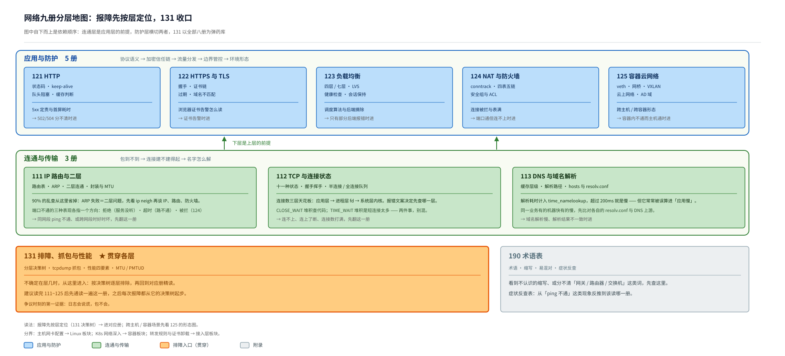

# 网络全景图

> **这一册回答**：网络板块九册的分层关系，一张图看清。
> **怎么用**：看图定篇，再回 [001-网络全貌](001-网络全貌.md) 按模块选册。

## 体系一张图

## 图例说明

| 分组 | 册 | 一句话 |
| --- | --- | --- |
| 连通与传输 | 111 / 112 / 113 | 包到不到、连接建不建得起、名字怎么解 |
| 应用与防护 | 121 / 122 / 123 / 124 / 125 | HTTP 语义、加密信任链、流量分发、边界管控、环境形态 |
| 排障取证 | 131 | 分层决策树 + tcpdump + 四要素 |
| 附录 | 190 | 术语 · 缩写 · 易混对 · 症状反查 |

图中自下而上是**依赖顺序**：连通层是应用层的前提，防护层横切连通与应用，排障取证层以全部六册为弹药库——不确定在层几时，从 131 的决策树进入。

---

**上一篇**：[002-网络方法论](002-网络方法论.md)　**下一篇**：进模块 [110-连通与传输/111-IP路由与二层](110-连通与传输/111-IP路由与二层.md)
