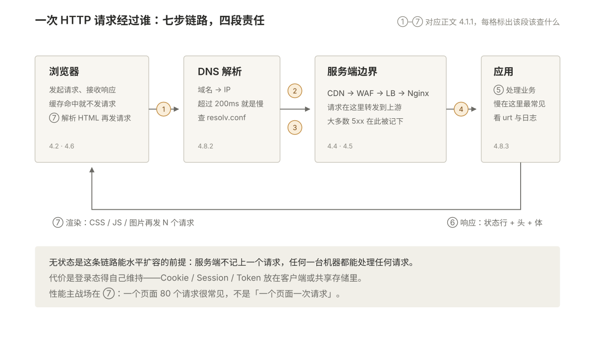
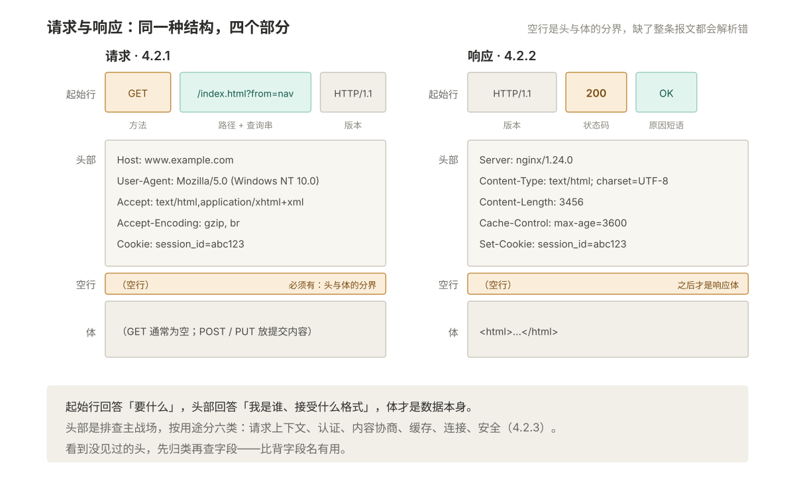
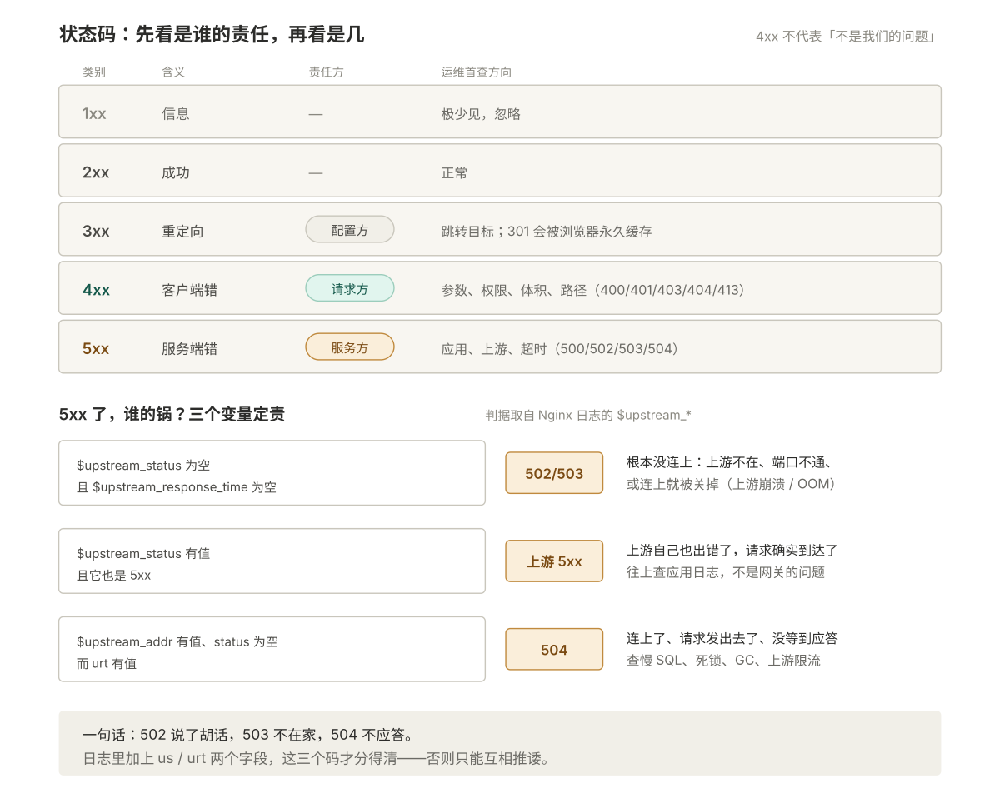
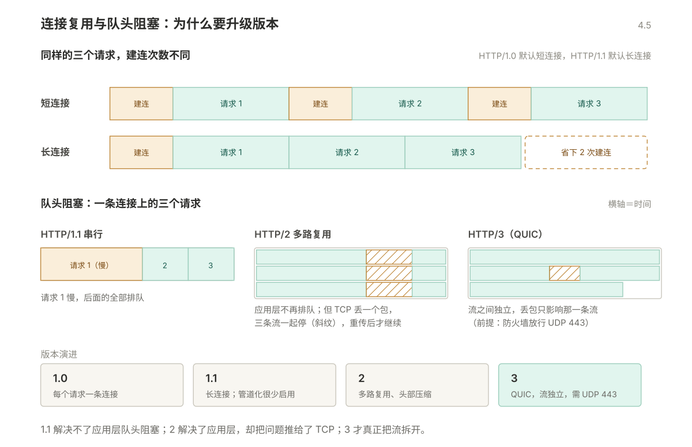
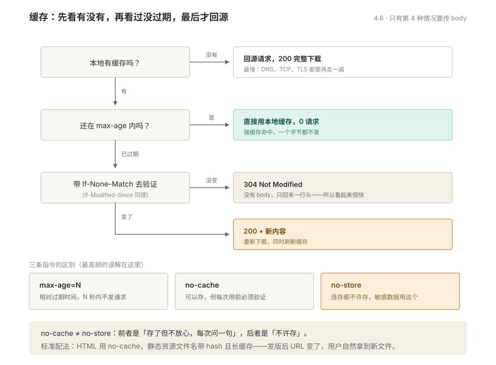
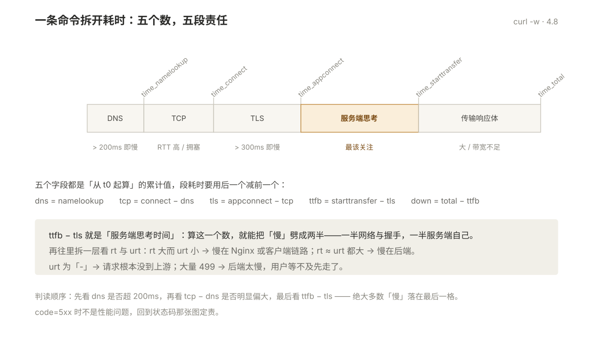

# 004 HTTP

> **解决**：请求返回什么、状态码是谁的责任、为什么慢、连接怎么复用。
> **范围**：报文结构、方法与语义、状态码、关键头部、连接管理、版本演进、缓存、耗时拆解。
> **口径**：以正文标注的协议、报文与命令为准；不绑定单一实现版本。
> **更新**：2026-10-28

---

## 目录

| 节 | 内容 |
|---|---|
| 4.1 | HTTP 是什么 |
| 4.2 | 报文结构 |
| 4.3 | 方法与语义 |
| 4.4 | 状态码 |
| 4.5 | 连接管理 |
| 4.6 | 缓存 |
| 4.7 | 压缩 |
| 4.8 | 访问慢的定位 |
| 4.9 | 命令与坑 |
| 4.10 | 本章检查清单 |

---

## 4.1 HTTP 是什么

HTTP 是**请求 - 响应**模型的应用层协议：客户端发一个请求，服务端回一个响应，一问一答，没有别的。

**无状态**：每个请求独立，服务端不记得上一个请求是谁发的。所以登录态要靠 Cookie / Session / Token 自己维持。

这个特性带来一个运维后果，也是好的那面：**服务端可以随便水平扩容**。任何一台机器都能处理任何请求，因为服务端本身不保存会话状态——只要会话信息放在共享存储（Redis）或客户端（Cookie）里。

### 4.1.1 一次 HTTP 通信的完整过程

一次 HTTP 请求经过谁——七步链路与四段责任：



```text
① 解析域名          DNS → IP
② 建立 TCP 连接     三次握手
③ TLS 握手          HTTPS 才有
④ 发送请求          请求行 + 请求头 + 请求体
⑤ 服务端处理        可能经过 CDN、WAF、LB、Nginx、应用
⑥ 返回响应          状态行 + 响应头 + 响应体
⑦ 浏览器渲染        解析 HTML，遇到 CSS/JS/图片再发 N 个请求
```

第 ⑦ 步是性能优化的主战场——一个页面发 80 个请求很常见，不是"一个页面一次请求"。

---

## 4.2 报文结构

请求与响应：同一种结构，四个部分：



### 4.2.1 请求

```http
GET /index.html?from=nav HTTP/1.1
Host: www.example.com
User-Agent: Mozilla/5.0 (Windows NT 10.0; Win64; x64)
Accept: text/html,application/xhtml+xml
Accept-Encoding: gzip, br
Cookie: session_id=abc123

（空行，之后是请求体）
```

| 部分 | 内容 | 说明 |
|---|---|---|
| 请求行 | 方法 + 路径 + 版本 | 三部分用空格分隔 |
| 请求头 | `Key: Value` 若干行 | 描述这个请求的上下文 |
| 空行 | — | **必须有**，是头和体的分界 |
| 请求体 | 数据 | GET 通常为空，POST 放提交内容 |

### 4.2.2 响应

```http
HTTP/1.1 200 OK
Server: nginx/1.24.0
Content-Type: text/html; charset=UTF-8
Content-Length: 3456
Cache-Control: max-age=3600
Set-Cookie: session_id=abc123; Path=/; HttpOnly; Secure

（空行）
<html>...</html>
```

| 部分 | 内容 |
|---|---|
| 状态行 | 版本 + 状态码 + 原因短语 |
| 响应头 | 描述响应本身：类型、长度、缓存、Cookie |
| 响应体 | 真正的数据 |

### 4.2.3 头部字段的几类

理解分类比背字段有用，因为看到没见过的头也知道它属于哪一类：

| 类别 | 作用 | 例子 |
|---|---|---|
| 请求上下文 | 我是谁、我要什么 | `Host`、`User-Agent`、`Accept`、`Referer` |
| 认证 | 凭证 | `Authorization`、`Cookie` |
| 内容协商 | 编码、语言、类型 | `Content-Type`、`Accept-Encoding`、`Content-Encoding` |
| 缓存 | 能不能缓存、缓存多久 | `Cache-Control`、`ETag`、`Last-Modified`、`Age` |
| 连接 | 连接管理、代理 | `Connection`、`Keep-Alive`、`X-Forwarded-For`、`Via` |
| 安全 | 浏览器侧防护 | `Strict-Transport-Security`、`Content-Security-Policy` |

---

## 4.3 方法与语义

| 方法 | 用途 | 安全（不改数据） | 幂等（重复执行结果相同） | 可缓存 |
|---|---|---|---|---|
| GET | 获取资源 | ✅ | ✅ | ✅ |
| HEAD | 只要头，不要体 | ✅ | ✅ | ✅ |
| OPTIONS | 查询支持的方法 | ✅ | ✅ | ❌ |
| POST | 提交数据 / 创建 | ❌ | ❌ | 极少 |
| PUT | 全量替换 | ❌ | ✅ | ❌ |
| PATCH | 局部修改 | ❌ | ❌ | ❌ |
| DELETE | 删除 | ❌ | ✅ | ❌ |

**这张表不是背概念用的，是决定网关能不能自动重试的依据。**

如果一个接口是幂等的，网关在超时后可以安全重试；非幂等的方法（POST、PATCH）自动重试会导致重复下单、重复扣款。所以 Nginx 的 `proxy_next_upstream` 默认只在特定条件下才重试，而且默认不含 `non_idempotent`。

### 4.3.1 GET 与 POST 的五个常见误解

| 说法 | 真相 |
|---|---|
| "GET 长度有限制" | 协议本身没限制。限制来自浏览器（约 2KB）和服务器（`large_client_header_buffers`） |
| "POST 更安全" | 都不加密。POST 的 body 一样能被抓包看到，安全靠 HTTPS |
| "GET 不能带 body" | 能带，但**语义上无定义**，RFC 9110 规定服务器**应当忽略** |
| "POST 不能被缓存" | 能被缓存，只是默认不缓存，需要显式声明 |
| "GET 只用于读，POST 只用于写" | 是约定不是强制，但违反约定的接口在网关、CDN 上会出现意外行为 |

### 4.3.2 重定向：301 / 302 / 307 / 308 的区别

| 状态码 | 含义 | 方法会变吗 |
|---|---|---|
| 301 | 永久重定向 | 可能把 POST 改成 GET |
| 302 | 临时重定向 | 可能把 POST 改成 GET |
| 307 | 临时重定向 | **严格保持原方法** |
| 308 | 永久重定向 | **严格保持原方法** |

**这是最容易踩的坑**：把该用 307 的地方写成 302，后端会收到一个没有参数的 GET——因为 body 在跳转时被浏览器直接丢了。

判断标准：**跳转前后的方法要一致，就用 307/308；只关心 GET 的跳转，301/302 就行。**

---

## 4.4 状态码

### 4.4.1 五类速记

| 类别 | 含义 | 责任方 | 运维动作 |
|---|---|---|---|
| 1xx | 信息 | — | 极少见，忽略 |
| 2xx | 成功 | — | 正常 |
| 3xx | 重定向 | **配置方** | 检查跳转目标 |
| 4xx | 客户端错 | **请求方** | 查参数、权限、体积、路径 |
| 5xx | 服务端错 | **服务方** | 查应用、上游、超时 |

**4xx 不代表"不是我们的问题"。** 用户看到一个 4xx，体验就是"你们网站坏了"。运维的责任是搞清楚这个 4xx 是用户传错了，还是我们返回错了。

### 4.4.2 高频码与首查方向

| 码 | 含义 | 首查 |
|---|---|---|
| 200 | 成功 | — |
| 301 / 302 | 永久 / 临时重定向 | 跳转目标、浏览器是否永久缓存了 301 |
| 304 | 未修改（走缓存） | 正常，检查缓存策略是否符合预期 |
| 400 | 请求格式错 | Host 缺失、请求头超限 |
| 401 | 未认证 | token 过期、认证头未透传 |
| 403 | 无权限 | 权限配置、WAF 拦截、目录禁止访问 |
| 404 | 不存在 | 路径、`location` 匹配、后端路由 |
| 405 | 方法不允许 | 接口只允许 POST 却用了 GET |
| 413 | 请求体过大 | `client_max_body_size` |
| 414 | URI 过长 | URL 或 Cookie 过大 |
| 429 | 被限流 | **限流生效，不是故障** |
| 499 | 客户端提前断开（Nginx 特有） | **后端太慢，用户等不及走了** |
| 500 | 应用异常 | 应用日志、堆栈 |
| 502 | 网关收到上游无效响应 | 上游崩溃、返回非法内容、被 OOM |
| 503 | 服务不可用 | 上游不在、健康检查全失败、过载 |
| 504 | 网关等上游超时 | 上游卡住（慢 SQL、死锁、GC） |

### 4.4.3 502 / 503 / 504 的判据

状态码的责任划分与 502/503/504 判据：



```text
$upstream_status 为空 且 $upstream_response_time 为空  →  根本没连上（502 / 503）
$upstream_status 有值 且也是 5xx                      →  上游自己也出错了
$upstream_addr 有值、$upstream_status 为空、urt 有值    →  连上了、发了、超时了（504）
```

一句话：**502 是上游说了胡话，503 是上游不在家，504 是上游不应答。**

这三个码是最容易被互相推诿的——前端说后端，后端说网关，网关说网络。判据就在 `$upstream_*` 这几个变量里，配好日志能一眼定责。

```nginx
log_format detail '$remote_addr "$request" $status '
                  'rt=$request_time urt=$upstream_response_time '
                  'ua=$upstream_addr us=$upstream_status';
```

---

## 4.5 连接管理

### 4.5.1 短连接与长连接

连接复用、队头阻塞与版本演进：



| 模式 | 行为 | 代价 |
|---|---|---|
| 短连接 | 每个请求建一次 TCP（+ TLS） | 每次多 1–2 个 RTT，服务端堆 TIME_WAIT |
| 长连接（keep-alive） | 复用同一条 TCP 发多个请求 | 空闲连接占资源，需要超时回收 |

HTTP/1.0 默认短连接（要显式 `Connection: keep-alive`），**HTTP/1.1 默认长连接**（要显式 `Connection: close` 才关）。

```nginx
# Nginx 侧的两个参数
keepalive_timeout 65;          # 客户端连接空闲多久关
keepalive_requests 1000;       # 一条连接最多处理多少个请求

# 到后端的连接池（关键，不配就是每条请求新建连接）
upstream backend {
    server 10.0.0.11:8080;
    keepalive 32;              # 保持 32 条空闲长连接到后端
}
```

**最常见的配置事故**：只配了 `keepalive_timeout`（管客户端那一侧），没配 upstream 的 `keepalive`（管后端那一侧）。结果是客户端到 Nginx 是长连接，Nginx 到后端还是短连接，后端照样堆 TIME_WAIT。

### 4.5.2 队头阻塞

```text
HTTP/1.1：一条连接串行处理
  [请求1 ............][请求2 ............][请求3 .............]
         ↑ 请求1 慢，后面的全部排队

HTTP/2：一条连接多路复用
  [请求1 ......]
  [请求2 ..]
  [请求3 ........]
         ↑ 并发，互不阻塞（应用层）
         但 TCP 层丢一个包，所有流都要等重传
```

| 版本 | 解决什么 | 没解决什么 |
|---|---|---|
| HTTP/1.0 | — | 每个请求一条连接 |
| HTTP/1.1 | 长连接、管道化 | 应用层队头阻塞（管道化实际很少启用） |
| HTTP/2 | 多路复用、头部压缩、服务端推送 | **TCP 层队头阻塞** |
| HTTP/3 | 基于 QUIC（UDP），流之间独立 | 需要 UDP 443 放行 |

### 4.5.3 版本怎么判断

```bash
curl -sI https://www.example.com/ | head -1
# HTTP/2 200

curl -sI --http1.1 https://www.example.com/ | head -1
# HTTP/1.1 200

# 看是否支持 HTTP/3（需要 curl 带 HTTP/3 支持）
curl -sI --http3 https://www.example.com/ | head -1
```

Nginx 开 HTTP/2 只需在 listen 上加 `http2`：

```nginx
listen 443 ssl;
http2 on;                      # 1.25.1 之后的新写法
```

---

## 4.6 缓存

### 4.6.1 两类缓存头

| 头 | 作用 | 谁在用 |
|---|---|---|
| `Cache-Control: max-age=N` | 相对过期时间，N 秒内直接用缓存不发请求 | 浏览器、CDN、代理 |
| `Cache-Control: no-cache` | **可以缓存，但每次用前必须验证** | — |
| `Cache-Control: no-store` | **完全不许缓存** | 敏感数据 |
| `ETag` | 内容的指纹 | 配合 304 |
| `Last-Modified` | 最后修改时间 | 配合 304 |
| `Age` | 已被缓存了多少秒 | 判断 CDN 是否命中 |

**`no-cache` 和 `no-store` 不是一回事**，这是最高频的误解：

- `no-cache` = 可以存，但每次要用之前必须问服务端"变了没"（走 304 协商）。
- `no-store` = 连存都不许存。

### 4.6.2 缓存验证流程

HTTP 缓存的三级判断：



```text
浏览器有缓存 → 带 If-None-Match: <etag> 问服务端
                    ↓
        服务端比对 ETag
        ├─ 没变 → 304 Not Modified（不传 body，省带宽）
        └─ 变了 → 200 + 新内容
```

`304` 响应没有 body，所以流量很小。这就是为什么"强缓存过期后"的请求看起来很快——它只是验证了一下。

### 4.6.3 静态资源的标准配法

```nginx
# 带 hash 的静态资源，可以长期缓存
location ~* \.(js|css|png|jpg|woff2)$ {
    expires 1y;
    add_header Cache-Control "public, immutable";
}

# HTML 不缓存，保证用户总是拿到最新版本
location ~* \.html$ {
    add_header Cache-Control "no-cache";
}
```

逻辑是：**HTML 不缓存（或只协商缓存），静态资源文件名带 hash 且长缓存。** 发布新版本时 HTML 变了，引用的资源 URL 也变了，用户自然拿到新文件，不需要手动刷 CDN。

---

## 4.7 压缩

| 算法 | 压缩率 | CPU 开销 | 说明 |
|---|---|---|---|
| gzip | 中 | 中 | 通用，兼容性最好 |
| brotli | 高 15–20% | 高（静态） | 现代浏览器都支持，静态资源预压缩最划算 |
| zstd | 高 | 低 | 较新，Nginx 需第三方模块 |

```nginx
gzip on;
gzip_min_length 1k;              # 太小的文件压缩没意义
gzip_comp_level 5;               # 1-9，5 是性价比拐点
gzip_types text/plain text/css application/json application/javascript;
```

**两个坑**：

- 已经压缩过的格式（jpg、png、mp4、woff2）不要再用 gzip，白费 CPU 还可能变大。
- 开了 gzip 但响应头里同时有 `Content-Length` 和 `Transfer-Encoding: chunked` 会冲突，Nginx 会自动处理成 chunked，此时 `Content-Length` 消失，某些老旧客户端会异常。

---

## 4.8 访问慢的定位

### 4.8.1 一条命令拆开耗时

用 curl 的五个时间字段拆开一次请求的耗时：



```bash
curl -sS -o /dev/null -w '
dns=%{time_namelookup}
tcp=%{time_connect}
tls=%{time_appconnect}
ttfb=%{time_starttransfer}
total=%{time_total}
code=%{http_code}
' https://www.example.com/
```

### 4.8.2 判读表

| 观察 | 结论 | 下一步 |
|---|---|---|
| `dns` > 200ms | DNS 慢 | 换 DNS、查 resolv.conf 超时 |
| `tcp - dns` 大 | 网络 RTT 高或拥塞 | `mtr` 看逐跳 |
| `tls - tcp` > 300ms | TLS 握手慢 | 证书链过长、没开 OCSP stapling、CPU 不够 |
| **`ttfb - tls` 大** | **服务端处理慢（最该关注）** | 看 Nginx `$upstream_response_time`、应用日志 |
| `total - ttfb` 大 | 传输慢（响应体大或带宽不足） | 看响应大小、开 gzip |
| `code=5xx` | 服务端错误 | 按 4.4.3 判断责任段 |

**`ttfb - tls` 就是「服务端思考时间」。** 用户说慢，先算这个数，能立刻把责任劈成两半——一半是网络和握手，一半是服务端自己。

### 4.8.3 服务端内部再拆一层

```bash
# Nginx 侧：请求总耗时 vs 上游耗时
# rt 大 + urt 小  → 慢在 Nginx 自己或客户端网络
# rt ≈ urt 且都大  → 慢在后端
```

| 组合 | 含义 |
|---|---|
| `rt` 大、`urt` 小 | 慢在 Nginx（磁盘、CPU）或客户端→Nginx 的链路 |
| `rt` ≈ `urt`，都大 | 慢在后端应用 |
| `rt` 大、`urt` 为 `-` | 请求根本没到上游（Nginx 自己返回的） |
| 大量 499 | 后端慢，用户等不及主动断开 |

---

## 4.9 命令与坑

```bash
# 看完整交互（含请求头、响应头）
curl -v https://www.example.com/

# 只看响应头
curl -sI https://www.example.com/

# 跟随重定向，并显示每一跳
curl -sIL https://www.example.com/

# 指定方法和 body
curl -X POST -d 'user=test&pwd=123' https://www.example.com/login

# 指定 Host（测试后端配置，绕过 DNS 和 LB）
curl -H 'Host: www.example.com' http://10.0.0.11/

# 跳过证书校验（仅测试，不要写进脚本）
curl -k https://www.example.com/

# 只看状态码
curl -s -o /dev/null -w '%{http_code}\n' https://www.example.com/
```

### 4.9.1 七个坑

| # | 坑 | 现象 | 处置 |
|---|---|---|---|
| 1 | 用 302 做 POST 跳转 | 后端收到没有 body 的 GET | 改用 307/308 |
| 2 | 把 `no-cache` 当 `no-store` 用 | 敏感数据仍被缓存 | 敏感数据用 `no-store` |
| 3 | upstream 没配 `keepalive` | 后端堆 TIME_WAIT | `upstream { keepalive 32; }` |
| 4 | 开了 gzip 但没配类型 | 只有 HTML 被压缩，JSON 没压 | 显式写 `gzip_types` |
| 5 | 静态资源没带 hash 却长缓存 | 发布后用户看到旧页面 | 文件名加 hash，HTML 不缓存 |
| 6 | 301 被浏览器永久缓存 | 改回原地址用户仍跳走 | 301 慎用，测试期用 302 |
| 7 | 只看状态码不看 `$upstream_*` | 502 定不了责 | 日志加 `us`、`urt` 字段 |

---

## 4.10 本章检查清单

读完能回答这六个问题，这一章就过了：

| # | 问题 |
|---|---|
| 1 | 一次 HTTP 报文由哪几部分组成？方法语义与状态码分别在哪一段承载？ |
| 2 | 用 302 转发 POST 为什么会丢 body？该改用哪两个状态码？ |
| 3 | `no-cache` 与 `no-store` 的分界？敏感数据仍被缓存通常错在哪一行配置？ |
| 4 | upstream 没配 `keepalive` 为什么后端堆 TIME_WAIT？配了却复用不了要清哪个头？ |
| 5 | 开了 gzip 却只有 HTML 被压缩，缺的是哪个指令？静态资源长缓存为什么要带 hash？ |
| 6 | 502 定不了责时日志里要补哪两个变量？`curl -v` 定位「访问慢」分别看哪几段？ |

---

**下一篇**：[005-HTTPS与TLS证书](005-HTTPS与TLS证书.md) —— 明文通了，上 HTTPS 与证书。