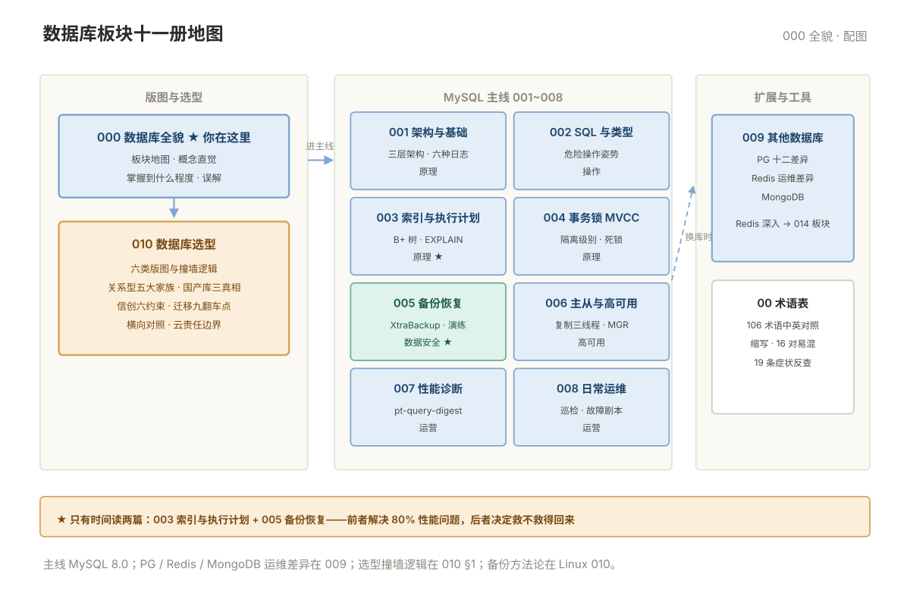

# 000 数据库全貌

> **这一册回答**：数据库板块管什么、十一册怎么分工、什么样的数据库问题从哪册进。10 分钟读完，把板块装进一张地图。  
> **给谁读**：会写 SQL、但出事时不知道先看哪个日志的运维；需要系统复习的在职运维。本板块位于五阶段第二段（操作与数据）。

## 板块地图

**主线是 MySQL**：001~008 讲怎么管好一个 MySQL，009 讲换了库差别在哪，010 讲选型与换库决策。

| 册 | 一句话 | 回答的问题 |
|---|---|---|
| 本册 000 | 板块地图 | 各册分工、核心概念直觉、掌握到什么程度 |
| [001 MySQL 架构与基础](001-MySQL架构与基础.md) | 一条 SQL 从进来到落盘经过什么 | 三层架构、InnoDB、六种日志、核心参数 |
| [002 SQL 与数据类型](002-SQL与数据类型.md) | 运维要会写哪些 SQL，怎么改才安全 | 四个基本语句、危险操作姿势、类型选型 |
| [003 索引与执行计划](003-索引与执行计划.md) | 查询为什么慢，索引为什么没用 | B+ 树、最左前缀、失效八种、EXPLAIN |
| [004 事务锁与 MVCC](004-事务锁与MVCC.md) | 并发为什么互相卡 | 隔离级别、MVCC、死锁、MDL、长事务 |
| [005 备份恢复与数据迁移](005-备份恢复与数据迁移.md) | 出事怎么救得回来 | mysqldump/XtraBackup、时间点恢复、演练、误删找回 |
| [006 主从复制与高可用](006-主从复制与高可用.md) | 一台挂了怎么办，延迟怎么治 | 复制三线程、半同步/MGR、延迟六因、切换 |
| [007 性能诊断与优化](007-性能诊断与优化.md) | 从「慢」到根因的完整路径 | 诊断顺序、pt-query-digest、SQL 改写、参数调优 |
| [008 日常运维与故障处理](008-日常运维与故障处理.md) | 日常做什么，出事按什么剧本 | 巡检、变更规范、十个故障剧本、容量规划 |
| [009 其他数据库](009-其他数据库.md) | 换了库，经验哪些能平移 | PG 十二差异与 VACUUM、Redis 运维差异、MongoDB |
| [010 数据库选型](010-数据库选型.md) | 该用什么库、换库怎么不死人 | 六类版图、国产库、信创约束、迁移翻车点、云责任边界 |
| [00 术语表](00-术语表.md) | 这个词是什么意思，这俩差在哪 | 按册分组 · 缩写速查 · 易混对 · 症状反查 |

十一册的位置关系一张图看清——版图选型在前，MySQL 主线居中，扩展与工具在侧：

## 核心概念速览

只立直觉，原理与命令都在对应册。

- **六类版图**：关系型（默认选择，运维 80% 时间）· 缓存/键值 · 文档型 · 分析型 MPP · HTAP · 检索与时序——每类都是上一类撞墙后的产物，完整版图与选型见 010。
- **关系型的共同内核**：B+ 树 + WAL + MVCC + 事务——所以索引（003）、事务（004）、备份（005）的方法论在任何关系型上都能平移，只是命令不同。
- **Redis 的故障模式和关系型完全不同**：关系型的问题是"慢"，Redis 的问题是"瞬间全崩"（内存打满、大 key 阻塞）——接手系统先搞清 Redis 里存的是"可丢的"还是"不能丢的"。
- **大量"数据库慢"根因在应用**：缺索引的查询、N+1、长事务、连接池太小——这些和库无关（007 的诊断路径会带你确认）。
- **备份文件存在 ≠ 可恢复**：必须做恢复演练，RTO/RPO 是承诺不是口号（005）。

## 与相邻板块的分界

| 问题 | 去哪 |
|---|---|
| Redis 深入（持久化/哨兵/集群/缓存三件套） | 「Redis」板块（014，建设中——009 只讲运维差异） |
| 备份方法论（RPO/RTO、3-2-1、恢复演练的意义） | 「Linux」010——本板块 005 只讲数据库工具与命令 |
| 系统层性能排查（CPU/内存/IO） | 「Linux」009 |
| Elasticsearch 在日志场景的深入（分片/ILM/Kibana） | 「日志」002~003——本板块 010 只讲它作为检索型数据库的位置 |
| 消息队列选型（RabbitMQ/Kafka） | 「消息队列」000——010 §3 只讲它们与数据库的关系 |
| 数据库指标的采集落点 | 「监控」007（mysqld_exporter） |

## 学习路径

- **顺序读**：000 → 010（知道版图再进主线）→ 001~008 → 009。
- **只有时间读两篇**：003（索引与执行计划）+ 005（备份恢复）——前者决定你能不能解决 80% 的性能问题，后者决定出事时救不救得回来。
- **第一档（必须独立负责）**：MySQL 或 PostgreSQL 选一深入到备份恢复/索引/主从/故障全套；Redis 到内存管理/持久化/大 key/主从哨兵。第二档（公司用什么学什么）：信创库重点学备份与巡检、分析库学建表与资源组、ES 学分片与 ILM。第三档：知道存在、能对话。
- **按问题学，不按库学**：备份、高可用、性能诊断的方法论跨库通用，换库只查命令（005 的方法论部分是范例）。

## 误解澄清

| # | 误解 | 事实 |
|---|---|---|
| 1 | MySQL 够用，其他不用学 | 公司换库不会提前通知运维——换库冲击最大的就是运维 |
| 2 | NoSQL 比关系型先进 | NoSQL 是为特定约束而生，不是升级版；多数业务关系型更省事 |
| 3 | 分布式数据库一定比单机强 | 单机 MySQL 合理索引下 5000~10000 QPS 很常见；没撞墙上分布式只是增加故障面 |
| 4 | Redis 只是缓存，丢了没关系 | 大量系统拿它当会话/锁/排行榜的主存储 |
| 5 | PostgreSQL 就是开源版 Oracle | 大小写规则、事务行为、VACUUM 差异足以出事故（009） |
| 6 | 上云了就不用运维数据库 | RDS 接管机器，不接管你的 SQL 质量、索引、容量与误删（010 §8） |
| 7 | 国产库性能不行只能忍 | 真正差距在优化器成熟度与生态，把问题归给"性能"会掩盖真根因（010 §5） |
| 8 | 兼容度 95% 就能平滑迁移 | 指常用语法兼容；存储过程、系统视图、执行计划仍要重做（010 §6） |
| 9 | 备份做了就安全了 | 没演练过的备份不算备份（005） |
| 10 | 数据库问题都是 DBA 的事 | 大量"慢"的根因在应用侧 SQL（007 帮你定位后推动修复） |

---

**下一篇**：[010 数据库选型](010-数据库选型.md) —— 六类版图、国产库与信创、换库怎么不死人。
