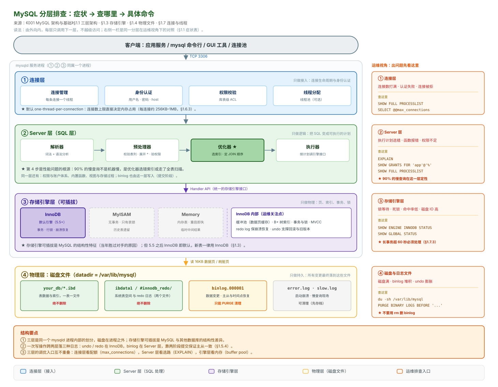

# 001 MySQL 架构与基础

> 运维视角的 MySQL，不铺概念史。读完能说清"一条 SQL 从进来到落盘经过了什么"，以及"出问题时该看哪个日志、调哪个参数"。

## 目录

| 章 | 内容 |
|---|---|
| 1.1 | 整体架构：三层 |
| 1.2 | 一条 SQL 的完整路径 |
| 1.3 | 存储引擎：为什么只用 InnoDB |
| 1.4 | 物理文件：数据到底存在哪 |
| 1.5 | 六种日志（运维最该记的一章） |
| 1.6 | 核心参数 |
| 1.7 | 连接与线程 |
| 1.8 | 安装目录与配置 |
| 1.9 | 命令速查 |
| 1.10 | 十个坑 |
| 1.11 | 本章检查清单 |

---

## 1.1 整体架构：三层

MySQL 整体架构——三层服务加物理层：


图只画结构：客户端进来，依次穿过 ①②③ 三层，出进程后落到 ④ 磁盘文件。记住两件事——**前三层是同一个 mysqld 进程内部的划分，第四层在进程之外**；**每层只调下一层，不越级**。

**这个分层对运维的意义**：

| 层 | 出问题时的症状 | 你去哪看 |
|---|---|---|
| 连接层 | `Too many connections`、认证失败 | `SHOW PROCESSLIST`、`max_connections` |
| Server 层 | 执行计划选错、函数报错、权限不足 | `EXPLAIN`、`SHOW GRANTS` |
| 存储引擎层 | 锁等待、死锁、缓冲池命中率低、磁盘 IO 高 | `SHOW ENGINE INNODB STATUS`、`SHOW STATUS` |

MySQL 的独特之处是**存储引擎可插拔**——同一个 Server 层下面可以挂不同的引擎。这是它当年打败其他数据库的原因，但现在你只需要关心 InnoDB。

## 1.2 一条 SQL 的完整路径

```sql
SELECT * FROM users WHERE id = 100;
```

```
1. 连接层：TCP 握手 → 认证（用户名/密码/host）→ 分配线程
2. 解析器：词法分析（拆成关键字、表名、列名）→ 语法分析（生成语法树）
3. 预处理器：检查表和列是否存在、展开 * 为具体字段、校验权限
4. 优化器：决定用哪个索引、JOIN 顺序、是否改写成别的形式
        → 生成执行计划（这是 EXPLAIN 看到的东西）
5. 执行器：按执行计划调用存储引擎接口
6. 存储引擎（InnoDB）：
   a. 先查缓冲池（Buffer Pool）——内存里有没有这一页
   b. 没有则从磁盘读 16KB 的页到缓冲池
   c. 在页里用 B+ 树定位到行
   d. 如果是写操作：改缓冲池里的页 → 写 undo log → 写 redo log（prepare）
      → 写 binlog → redo log commit
7. 返回结果集（逐行发送给客户端）
```


**第 6d 步是运维必须理解的**：一次写操作要落三种日志，顺序是固定的。这就是"两阶段提交"，也是崩溃恢复的依据。1.5 展开。

**第 4 步是性能问题的根源**：90% 的慢查询不是"机器慢"，是优化器选错了索引或走了全表扫描。所以 `EXPLAIN` 是运维的第一工具。

## 1.3 存储引擎：为什么只用 InnoDB

| | InnoDB | MyISAM |
|---|---|---|
| 事务 | 支持 | 不支持 |
| 行锁 | 支持 | **只有表锁** |
| 外键 | 支持 | 不支持 |
| 崩溃恢复 | 支持（redo log） | 不支持，崩溃后要 `REPAIR TABLE` |
| 全文索引 | 5.6+ 支持 | 支持 |
| 计数（`COUNT(*)` 无 WHERE） | 要扫描 | 有内置计数器，快 |

**结论：MySQL 5.5 之后 InnoDB 就是默认引擎，新表一律用 InnoDB。**

MyISAM 唯一的"优势"是无条件 `COUNT(*)` 快，但它为此付出了表锁和不能崩溃恢复的代价。**今天没有任何理由新建 MyISAM 表。**

检查现有表用的是什么引擎：

```sql
SELECT TABLE_NAME, ENGINE, TABLE_ROWS, ROUND(DATA_LENGTH/1024/1024) AS data_mb
FROM information_schema.TABLES
WHERE TABLE_SCHEMA = 'your_db' AND ENGINE != 'InnoDB';
```

如果有 MyISAM 表，且业务能接受短暂锁表，可以转：

```sql
ALTER TABLE t ENGINE=InnoDB;
```

大表转换会锁表，用 1.5 提到的在线 DDL 工具。

## 1.4 物理文件：数据到底存在哪

以 Linux 默认路径 `/var/lib/mysql/` 为例：

```
/var/lib/mysql/
├── ibdata1              # 系统表空间（共享）
├── ib_logfile0/1        # redo log（旧版叫法，8.0 叫 #innodb_redo/）
├── mysql/               # 系统库（用户、权限）
├── sys/                 # 性能视图库
├── performance_schema/  # 性能监控库
├── your_db/
│   ├── users.ibd        # 独立表空间：一张表一个文件
│   ├── orders.ibd
│   └── ...
├── binlog.000001        # binlog 文件
├── undo_001             # undo 表空间（8.0）
└── error.log            # 错误日志
```

| 文件 | 是什么 | 能删吗 |
|---|---|---|
| `*.ibd` | 表数据和索引 | **绝对不能**，删了数据就没了 |
| `ibdata1` | 系统表空间、undo、doublewrite | 绝对不能 |
| `ib_logfile*` / `#innodb_redo/` | redo log，崩溃恢复用 | 绝对不能 |
| `binlog.*` | 二进制日志，主从复制和时间点恢复用 | **能删，但要按正确方式** |
| `error.log` | 错误日志 | 能删（先确认没在排查问题） |
| `*.frm` | 表结构（8.0 已移除，合并进数据字典） | — |

**磁盘满了清 binlog 的正确方式**（不要用 `rm`）：

```sql
-- 删掉指定时间之前的 binlog
PURGE BINARY LOGS BEFORE '2026-10-01 00:00:00';

-- 或删掉某个文件之前的
PURGE BINARY LOGS TO 'binlog.000123';
```

用 `rm` 直接删文件会导致 binlog 索引与实际文件不一致，主从复制直接断裂。

**独立表空间 vs 共享表空间**：`innodb_file_per_table=ON`（8.0 默认开）时每张表一个 `.ibd`，删表能真正释放磁盘；关掉则所有表挤在 `ibdata1` 里，删了表磁盘也不缩小。**必须保持 ON。**

## 1.5 六种日志

这是运维最该记的一章。出问题时"看哪个日志"决定了排查效率。

| 日志 | 位置（文件） | 作用 | 什么时候看 |
|---|---|---|---|
| **error log** | `error.log` | 启动、关闭、崩溃、严重错误 | **服务起不来、莫名重启** |
| **slow query log** | 可配置 | 超过阈值的 SQL | **数据库慢** |
| **general log** | 可配置 | 所有到达 Server 的 SQL | 临时抓全部请求，**生产慎开** |
| **binlog** | `binlog.000001` | 所有数据变更（逻辑日志） | **主从、恢复、审计、误删找回** |
| **redo log** | `ib_logfile*` | 物理页的变更（崩溃恢复） | 一般不看，只有崩溃恢复时才用 |
| **undo log** | `undo_001` | 回滚和 MVCC 的旧版本 | 长事务会导致它无限增长 |

### 1.5.1 error log：第一现场

```bash
# 8.0 默认输出到文件，也可能到 stderr（systemd 下进 journalctl）
tail -200 /var/log/mysql/error.log

# 找关键事件
grep -iE "error|crash|shutdown|startup|InnoDB" /var/log/mysql/error.log | tail -50

# systemd 部署时
journalctl -u mysqld --since "1 hour ago"
```

**服务异常重启时，第一件事就是看 error log 的最后 50 行**，通常直接写着原因（OOM Killer、磁盘满、InnoDB 损坏）。

### 1.5.2 slow query log：性能问题的入口

```sql
-- 开（运行时生效，重启失效）
SET GLOBAL slow_query_log = ON;
SET GLOBAL long_query_time = 1;            -- 超过 1 秒记录
SET GLOBAL log_queries_not_using_indexes = ON;  -- 没走索引的也记（会很多，慎用）

-- 持久化到配置
-- my.cnf:
-- slow_query_log = 1
-- long_query_time = 1
-- slow_query_log_file = /var/log/mysql/slow.log
```

分析工具：

```bash
# 官方自带，简单统计
mysqldumpslow -s t -t 10 /var/log/mysql/slow.log

# 更专业，输出可比对报告
pt-query-digest /var/log/mysql/slow.log > report.txt
```

`mysqldumpslow -s t -t 10` 的意思是按**总耗时**排序取前 10 条。**注意是总耗时不是单次耗时**——一条执行 10ms 但每秒 1 万次的 SQL，比一条执行 2 秒但每小时一次的 SQL 危害大得多。

### 1.5.3 binlog：最重要的日志

**三个作用，按运维价值排序：**

1. **误操作的唯一救星**。`DROP TABLE` 或误 `UPDATE` 后，靠 binlog 反解能找回数据。
2. **主从复制的基础**。从库拉主库的 binlog 重放。
3. **时间点恢复（PITR）**。全量备份 + binlog 重放 = 恢复到任意一秒。

```sql
-- 看是否开启
SHOW VARIABLES LIKE 'log_bin';
-- ON 才可用

-- 看格式（ROW / STATEMENT / MIXED）
SHOW VARIABLES LIKE 'binlog_format';
-- 8.0 默认 ROW，必须用 ROW

-- 看现有文件
SHOW BINARY LOGS;

-- 看某个文件的内容（危险操作，大文件会刷屏）
SHOW BINLOG EVENTS IN 'binlog.000123' LIMIT 10;
```

用 `mysqlbinlog` 导出成可读 SQL：

```bash
# 按时间范围解析（误删场景的标准做法）
mysqlbinlog --start-datetime="2026-10-28 14:00:00" \
            --stop-datetime="2026-10-28 14:30:00" \
            --base64-output=DECODE-ROWS -v \
            /var/lib/mysql/binlog.000123 > undo.sql
```

**为什么必须 `binlog_format=ROW`**：

| 格式 | 记录内容 | 问题 |
|---|---|---|
| `STATEMENT` | 记录原始 SQL | `NOW()`、`RAND()`、`LIMIT` 在从库重放结果不一致 |
| `ROW` | 记录每一行的前后值 | 日志量大，但**绝对准确**，且能反解出回滚 SQL |
| `MIXED` | 自动选 | 不可预测 |

`ROW` 格式的额外好处：`mysqlbinlog --base64-output=DECODE-ROWS -v` 能直接看到被删行的完整内容，这是误删找回的前提。

### 1.5.4 两阶段提交：为什么写一次要落两个日志

```
1. InnoDB 写 redo log，标记为 prepare 状态
2. Server 层写 binlog
3. InnoDB 把 redo log 改为 commit 状态
```

**崩溃发生在不同时点的结果**：

| 崩溃时刻 | redo log | binlog | 恢复行为 |
|---|---|---|---|
| 步骤 1 之前 | 无 | 无 | 事务丢失，一致 |
| 步骤 1 之后、2 之前 | prepare | 无 | **回滚**（binlog 没写，从库不会有） |
| 步骤 2 之后、3 之前 | prepare | 有 | **提交**（binlog 完整，必须保住） |
| 步骤 3 之后 | commit | 有 | 提交完成 |

这套机制保证了**主库和从库的数据一致**。理解它才能理解 1.6 里那两个"刷盘参数"在权衡什么。

## 1.6 核心参数

只列运维必须知道的，按重要性排序。

### 1.6.1 最重要的一个：缓冲池

```sql
SHOW VARIABLES LIKE 'innodb_buffer_pool_size';
```

| 项 | 值 |
|---|---|
| 作用 | 缓存数据页和索引页，**减少磁盘 IO** |
| 推荐 | 物理内存的 **50–70%**（专用 DB 服务器可到 75%） |
| 判断够不够 | 命中率 < 99% 就该加了 |

```sql
-- 看命中率（8.0）
SHOW STATUS LIKE 'Innodb_buffer_pool_read_requests';  -- 逻辑读
SHOW STATUS LIKE 'Innodb_buffer_pool_reads';          -- 物理读
-- 命中率 = (1 - reads/read_requests) * 100%，应 > 99%
```

**这个参数的影响远超其他所有参数之和**。配小了，所有查询都在读磁盘；配大了，操作系统和 MySQL 抢内存，可能触发 OOM。

### 1.6.2 两个刷盘参数：性能与安全的权衡

```sql
SHOW VARIABLES LIKE 'innodb_flush_log_at_trx_commit';   -- 默认 1
SHOW VARIABLES LIKE 'sync_binlog';                      -- 默认 1
```

| 参数 | 值 | 含义 | 风险 |
|---|---|---|---|
| `innodb_flush_log_at_trx_commit` | `1` | 每次提交都刷 redo 到磁盘 | **最安全**，每次提交一次 IO |
| | `2` | 提交时写到 OS 缓存，每秒刷盘 | 宕机丢 1 秒数据，**性能提升明显** |
| | `0` | 每秒刷一次 | 宕机丢 1 秒，**不安全，别用** |
| `sync_binlog` | `1` | 每次提交都刷 binlog 到磁盘 | **最安全** |
| | `0` | 交给 OS | 宕机可能丢 binlog，**导致主从数据不一致** |
| | `N` | 每 N 次提交刷一次 | 折中 |

**生产必须都是 1。** 只有在数据可丢的日志库、埋点库上才考虑改成 `2`。

### 1.6.3 连接数

```sql
SHOW VARIABLES LIKE 'max_connections';       -- 默认 151
SHOW STATUS LIKE 'Max_used_connections';     -- 历史峰值
SHOW STATUS LIKE 'Threads_connected';        -- 当前
```

调参经验：

```
max_connections ≈ max_used_connections * 1.2
```

**不要盲目调大**。每个连接占内存（约 256KB–1MB），1000 个连接可能吃掉 1GB。而且连接数暴涨通常是应用侧连接池配置有问题，调大只是掩盖症状。

### 1.6.4 其余常用参数

| 参数 | 默认 | 说明 |
|---|---|---|
| `innodb_file_per_table` | ON | 必须 ON，否则删表不释放磁盘 |
| `innodb_log_file_size` | 48M（5.7）/ 动态（8.0） | redo 大小，大一点能减少 checkpoint 频率 |
| `max_allowed_packet` | 64M | 单包上限，大批量导入报错时调它 |
| `wait_timeout` | 28800 | 空闲连接超时（8 小时），配合连接池要调小 |
| `character_set_server` | utf8mb4（8.0） | 必须是 utf8mb4，见 002 |
| `transaction_isolation` | REPEATABLE-READ | 见 004 |
| `tmp_table_size` / `max_heap_table_size` | 16M | 内存临时表上限，有 `Using temporary` 时可调 |

## 1.7 连接与线程

### 1.7.1 看谁在连

```sql
SHOW PROCESSLIST;              -- 简版
SHOW FULL PROCESSLIST;         -- 带完整 SQL（重点看这个）
```

或查表（可排序、可过滤）：

```sql
SELECT id, user, host, db, command, time, state, LEFT(info, 100) AS sql
FROM information_schema.PROCESSLIST
WHERE command != 'Sleep'
ORDER BY time DESC
LIMIT 20;
```

**关键列**：

| 列 | 含义 | 看什么 |
|---|---|---|
| `time` | 状态已持续多少秒 | 超过 60 秒的 `Query` 要怀疑 |
| `state` | 当前在做什么 | `Waiting for table metadata lock` = 被 DDL 卡住 |
| `command` | `Sleep` / `Query` / `Binlog Dump` | **大量 `Sleep` 说明连接池没回收** |
| `info` | 正在执行的 SQL | 直接看出问题语句 |

### 1.7.2 杀连接

```sql
KILL 12345;              -- 杀连接（会回滚事务）
KILL QUERY 12345;        -- 只取消当前语句，连接保留
```

**杀之前先看 `time` 和 `info`**，别误杀正在做大事务的会话——回滚一个跑了 2 小时的 `DELETE` 可能比让它跑完更久。

### 1.7.3 长事务：最隐蔽的杀手

```sql
SELECT trx_id, trx_started, TIMESTAMPDIFF(SECOND, trx_started, NOW()) AS seconds,
       trx_rows_locked, trx_rows_modified, LEFT(trx_query, 100) AS query
FROM information_schema.INNODB_TRX
ORDER BY trx_started
LIMIT 10;
```

长事务的三个危害：

| 危害 | 机制 |
|---|---|
| **undo 空间无限增长** | 旧版本不能被清理，磁盘持续涨 |
| **阻塞 DDL** | 加字段/加索引会被长事务的元数据锁卡住，进而阻塞所有后续查询 |
| **主从延迟** | 大事务在从库重放要很久 |

**判断标准：超过 60 秒的事务就该关注，超过 10 分钟必须处理。**

## 1.8 安装目录与配置

### 1.8.1 目录结构

| 路径 | 内容 |
|---|---|
| `/var/lib/mysql` | 数据文件（datadir） |
| `/var/log/mysql` | 日志 |
| `/etc/mysql/my.cnf`（或 `/etc/my.cnf`） | 主配置 |
| `/etc/mysql/conf.d/`、`/etc/mysql/mysql.conf.d/` | 附加配置（Debian/Ubuntu 系） |
| `/usr/bin/mysql`、`/usr/sbin/mysqld` | 客户端、服务端二进制 |

配置加载顺序（后加载的覆盖前面的）：

```bash
mysqld --verbose --help | grep -A1 "Default options"
# 会列出实际读取的配置文件和顺序
```

### 1.8.2 配置文件模板（生产基础版）

```ini
[mysqld]
# 基础
datadir                 = /var/lib/mysql
socket                  = /var/lib/mysql/mysql.sock
pid_file                = /var/lib/mysql/mysql.pid
character_set_server    = utf8mb4
collation_server        = utf8mb4_general_ci
default_time_zone       = '+08:00'

# 连接
max_connections         = 500
max_allowed_packet      = 64M
wait_timeout            = 600
interactive_timeout     = 600

# InnoDB（按物理内存调整，这里是 16G 机器的示例）
innodb_buffer_pool_size = 10G
innodb_file_per_table   = ON
innodb_flush_log_at_trx_commit = 1
sync_binlog             = 1
innodb_io_capacity      = 2000

# 日志
log_error               = /var/log/mysql/error.log
slow_query_log          = 1
long_query_time         = 1
slow_query_log_file     = /var/log/mysql/slow.log
log_bin                 = /var/lib/mysql/binlog
binlog_format           = ROW
binlog_expire_logs_seconds = 604800     # 保留 7 天
max_binlog_size         = 512M

# 安全
local_infile            = OFF
```

**改配置必须重启才生效的项**（如 `innodb_buffer_pool_size` 在旧版本）要安排窗口；能用 `SET GLOBAL` 动态改的优先动态改。

### 1.8.3 动态改 vs 改配置文件

| 方式 | 生效 | 持久 | 适用 |
|---|---|---|---|
| `SET GLOBAL x=y` | 立即 | **重启失效** | 临时调整、验证效果 |
| 改 `my.cnf` | 重启 | 持久 | 最终方案 |
| `SET PERSIST x=y`（8.0） | 立即 | **持久**（写 `mysqld-auto.cnf`） | **推荐** |

```sql
SET PERSIST max_connections = 800;
-- 8.0 特有，既立即生效又持久化，不用重启
```

## 1.9 命令速查

按分层定位的排查路径——症状、查哪里、具体命令：



图左侧是 1.1 的四层结构，右侧把每层的"症状 → 查哪里 → 敲什么命令"并排放，排查时从症状直接定位到层。本节剩下的部分按功能分类列出这些命令。

### 1.9.1 状态与信息

```sql
-- 版本与运行时长
SELECT VERSION(), NOW() - INTERVAL VARIABLE_VALUE SECOND AS uptime
FROM performance_schema.global_status WHERE VARIABLE_NAME='Uptime';

-- 当前库大小
SELECT table_schema AS db,
       ROUND(SUM(data_length+index_length)/1024/1024, 2) AS total_mb,
       ROUND(SUM(data_length)/1024/1024, 2) AS data_mb,
       ROUND(SUM(index_length)/1024/1024, 2) AS index_mb
FROM information_schema.TABLES
GROUP BY table_schema
ORDER BY total_mb DESC;

-- 单表大小
SELECT table_name,
       table_rows,
       ROUND((data_length+index_length)/1024/1024, 2) AS total_mb
FROM information_schema.TABLES
WHERE table_schema='your_db'
ORDER BY (data_length+index_length) DESC
LIMIT 20;

-- InnoDB 状态（死锁、锁等待都在这）
SHOW ENGINE INNODB STATUS\G

-- 全局状态（QPS、连接、命中率）
SHOW GLOBAL STATUS LIKE 'Questions';
SHOW GLOBAL STATUS LIKE 'Threads_%';
```

### 1.9.2 计算 QPS / TPS

```sql
-- 两次采样的差值 / 间隔秒数
SHOW GLOBAL STATUS LIKE 'Questions';      -- 总请求数
SHOW GLOBAL STATUS LIKE 'Com_commit';     -- 显式提交
SHOW GLOBAL STATUS LIKE 'Com_rollback';
```

```bash
# 一条命令算 QPS（每秒采样一次）
mysqladmin -uroot -p ext -i1 | grep -E "Queries|Threads"
```

### 1.9.3 常用运维语句

```sql
SHOW DATABASES;
SHOW TABLES;
SHOW CREATE TABLE users\G          -- 看建表语句（含索引），比 DESC 信息全
SHOW INDEX FROM users;             -- 看索引
SHOW TABLE STATUS LIKE 'users'\G   -- 看引擎、行数、大小
SHOW VARIABLES LIKE '%buffer%';    -- 模糊查参数
SHOW GLOBAL STATUS LIKE '%lock%';  -- 模糊查状态
SHOW GRANTS FOR 'app'@'%';         -- 看权限
SHOW SLAVE STATUS\G                -- 主从状态（8.0.22+ 用 SHOW REPLICA STATUS）
```

## 1.10 十个坑

| # | 坑 | 后果 | 正确做法 |
|---|---|---|---|
| 1 | `innodb_buffer_pool_size` 用默认 128M | 所有查询读磁盘，慢十倍 | 设为物理内存 50–70% |
| 2 | `binlog_format=STATEMENT` | 主从不一致，且误删无法反解 | 设 `ROW` |
| 3 | 用 `rm` 删 binlog 文件 | binlog 索引断裂，主从挂掉 | `PURGE BINARY LOGS` |
| 4 | `innodb_file_per_table=OFF` | 删表不释放磁盘 | 保持 `ON` |
| 5 | 只看当前慢查询，不看趋势 | 慢查询每天涨 5%，半年后崩 | 每天采集 `slow_query_log` 做趋势 |
| 6 | `max_connections` 盲目调大 | 内存被连接吃光，OOM | 先查连接池配置，再适度调 |
| 7 | 认为 `SHOW PROCESSLIST` 里 `Sleep` 没事 | 连接池泄漏，几天后打满 | 定期检查 `Sleep` 数量和时长 |
| 8 | 长事务不监控 | undo 暴涨、DDL 被卡、主从延迟 | 监控 `INNODB_TRX`，超 60 秒告警 |
| 9 | 用 `SHOW TABLE STATUS` 的 `Rows` 当准确行数 | InnoDB 是估算值，误差可达 40% | 精确计数用 `COUNT(*)`，或接受估算 |
| 10 | 改配置只改 `my.cnf` 不重启也不验证 | 以为生效了，实际没变 | `SET PERSIST`（8.0）或改完必须重启验证 |

第 9 条值得展开：`SHOW TABLE STATUS` 和 `information_schema.TABLES` 里的 `TABLE_ROWS` 对 InnoDB 是**采样估算**，为了快。要准确值只能 `SELECT COUNT(*)`（大表也很慢）。运维写容量报表时如果直接用这个值，误差会很大。

## 1.11 本章检查清单

读完能回答这六个问题，这一章就过了：

| # | 问题 |
|---|---|
| 1 | 一条 `UPDATE` 从进来到落盘，经过哪几层、写了哪几种日志？ |
| 2 | 服务莫名重启，你第一个看什么？ |
| 3 | 磁盘满了，binlog 怎么安全清理？ |
| 4 | 缓冲池该设多大？命中率怎么算？ |
| 5 | `innodb_flush_log_at_trx_commit=2` 的代价是什么？ |
| 6 | 怎么找出跑得最久的事务？ |

---

> 下一篇：《002 SQL 与数据类型》——运维为什么必须会写 SQL，以及类型选错会带来什么后果。
