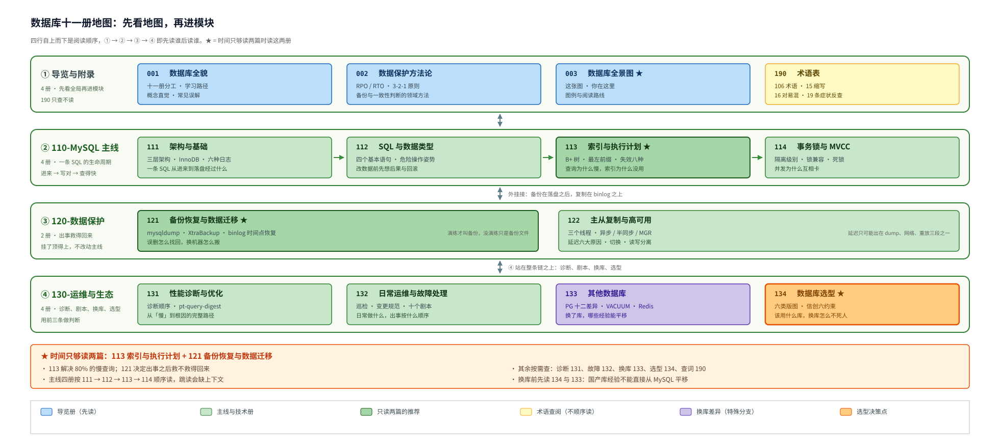

# 数据库全景图

> **这一册回答**：数据库板块十一册的分工关系，一张图看清。
> **怎么用**：看图定册，再回 [001-数据库全貌](001-数据库全貌.md) 按模块选册。

## 体系一张图

## 图例说明

| 模块 | 册 | 一句话 |
| --- | --- | --- |
| 110-MySQL主线 | 111 / 112 / 113 / 114 | 架构 → SQL → 索引 → 事务，管好一个 MySQL 的四块地基 |
| 120-数据保护 | 121 / 122 | 备份恢复与复制高可用——出事救得回来、挂了顶得上 |
| 130-运维与生态 | 131 / 132 / 133 / 134 | 性能诊断、日常剧本、换库平移、选型决策 |
| 附录 | 190 | 术语 · 缩写 · 易混对 · 症状反查 |

图中主线是**一条 SQL 的生命周期**：进来（111 架构）→ 写对（112 类型）→ 查得快（113 索引）→ 并发不卡（114 事务）；数据保护模块从生命周期外挂接（备份在落盘后、复制在 binlog 上）；运维与生态模块站在整条链之上做诊断与决策。

---

**上一篇**：[002-数据保护方法论](002-数据保护方法论.md)　**下一篇**：进模块 [110-MySQL主线/111-MySQL架构与基础](110-MySQL主线/111-MySQL架构与基础.md)
