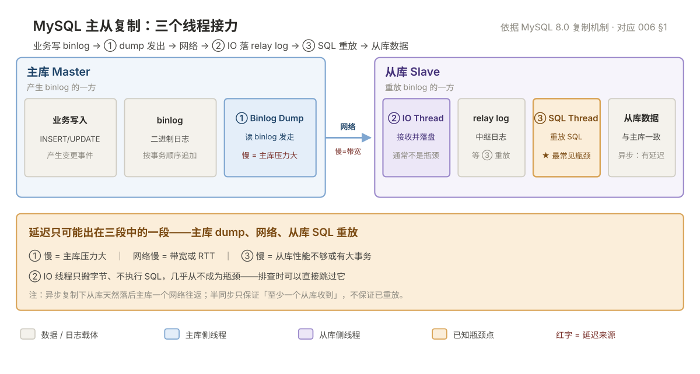

# 006 主从复制与高可用

> 主从解决"读扩展"和"数据冗余"，高可用解决"主库挂了怎么办"。这一篇讲清复制的机制、延迟的原因、切换的代价。

## 目录

| 章 | 内容 |
|---|---|
| 6.1 | 复制原理：三个线程 |
| 6.2 | 三种复制模式 |
| 6.3 | 搭建主从 |
| 6.4 | 监控：看哪些指标 |
| 6.5 | 延迟：六大原因与解法 |
| 6.6 | 数据不一致与校验 |
| 6.7 | 故障切换 |
| 6.8 | 读写分离的坑 |
| 6.9 | 高可用方案对比 |
| 6.10 | 九个坑 |
| 6.11 | 本章检查清单 |

---

## 6.1 复制原理：三个线程

MySQL 主从复制——三个线程接力完成一次数据同步：



```
主库                                          从库
┌──────────────┐                        ┌──────────────┐
│  业务写入     │                        │              │
│      ↓       │                        │              │
│  binlog      │                        │              │
│      ↓       │                        │              │
│ ① dump 线程  │ ──── binlog ────────→  │ ② IO 线程    │
│  (Binlog     │      网络传输           │  (IO Thread) │
│   Dump)      │                        │      ↓       │
└──────────────┘                        │  relay log   │
                                        │      ↓       │
                                        │ ③ SQL 线程   │
                                        │  (SQL Thread)│
                                        │      ↓       │
                                        │   重放到数据  │
                                        └──────────────┘
```

| 线程 | 在哪 | 作用 |
|---|---|---|
| **① Binlog Dump** | 主库 | 读取 binlog，发给从库 |
| **② IO Thread** | 从库 | 接收 binlog，写入 relay log |
| **③ SQL Thread** | 从库 | 读 relay log，重放 SQL |

**这个三段式结构决定了延迟的来源**：

- 主库 dump 慢 → 主库压力大
- 网络慢 → 带宽不足
- **SQL 线程重放慢 → 从库性能不够，或有大事务**（最常见）

## 6.2 三种复制模式

| 模式 | 机制 | 数据安全 | 性能 | 用在哪 |
|---|---|---|---|---|
| **异步复制**（默认） | 主库写完 binlog 就返回，不等从库 | **可能丢数据** | 最高 | 大部分场景 |
| **半同步复制** | 至少一个从库确认收到 binlog 才返回 | 较好 | 略低 | 对数据敏感 |
| **组复制（MGR）** | Paxos 多数派确认 | 高 | 较低 | 金融/核心业务 |

### 6.2.1 异步复制的风险

```
主库：写入 → 写 binlog → 返回成功给客户端
                            ↓
                        （此时从库还没收到）
                            ↓
主库宕机 → 这部分 binlog 没传到从库 → 数据丢失
```

**异步复制的 RPO > 0**，具体丢多少取决于主库崩溃时未传输的 binlog 量。

### 6.2.2 半同步复制

```sql
-- 主库安装插件
INSTALL PLUGIN rpl_semi_sync_master SONAME 'semisync_master.so';
SET GLOBAL rpl_semi_sync_master_enabled = 1;
SET GLOBAL rpl_semi_sync_master_timeout = 1000;    -- 1 秒超时

-- 从库
INSTALL PLUGIN rpl_semi_sync_slave SONAME 'semisync_slave.so';
SET GLOBAL rpl_semi_sync_slave_enabled = 1;
```

**关键参数 `rpl_semi_sync_master_timeout`**：等 1 秒还没从库确认，**自动降级为异步**。这是保护机制——从库全挂了不能把主库也拖死。

**代价**：每次提交多一个网络往返（约 0.1-1ms），TPS 会下降 10-30%。

### 6.2.3 组复制（MGR）

```sql
-- 8.0 内置，不需要额外插件
SET GLOBAL group_replication_bootstrap_group = ON;
START GROUP_REPLICATION;
SET GLOBAL group_replication_bootstrap_group = OFF;
```

| 特点 | 说明 |
|---|---|
| 多数派确认 | 3 节点容忍 1 个故障，5 节点容忍 2 个 |
| 自动选主 | 主库挂了自动选新主 |
| 冲突检测 | 并发写冲突会回滚 |
| **限制** | 只支持 InnoDB、必须主键、大事务会阻塞整个组 |

**MGR 的"大事务会阻塞整个组"是致命限制**：一个 100 万行的 `DELETE` 会让整个集群卡住。所以用 MGR 必须严格限制事务大小。

## 6.3 搭建主从

### 6.3.1 主库配置

```ini
[mysqld]
server_id = 1                    # 必须唯一，不能为 0
log_bin = /var/lib/mysql/binlog
binlog_format = ROW
gtid_mode = ON                   # 推荐开 GTID
enforce_gtid_consistency = ON
log_replica_updates = ON         # 双主/级联时必须开
```

```sql
-- 建复制账号
CREATE USER 'repl'@'%' IDENTIFIED BY 'xxx';
GRANT REPLICATION SLAVE ON *.* TO 'repl'@'%';
```

### 6.3.2 从库配置

```ini
[mysqld]
server_id = 2
log_bin = /var/lib/mysql/binlog     # 建议开，便于后续切换
gtid_mode = ON
enforce_gtid_consistency = ON
read_only = ON                       # 从库只读（对 super 用户无效）
super_read_only = ON                 # 对 super 也生效（8.0）
```

**`super_read_only=ON` 很重要**：`read_only` 对 `SUPER` 权限的用户无效，运维误操作照样能写从库，导致主从不一致。

### 6.3.3 建立复制（GTID 模式，最简单）

```bash
# 1. 主库做一次全量备份
mysqldump -uroot -p --single-transaction --set-gtid-purged=ON --all-databases > full.sql

# 2. 导入从库
mysql -uroot -p < full.sql

# 3. 从库指向主库
```

```sql
CHANGE REPLICATION SOURCE TO
  SOURCE_HOST = '10.0.0.5',
  SOURCE_PORT = 3306,
  SOURCE_USER = 'repl',
  SOURCE_PASSWORD = 'xxx',
  SOURCE_AUTO_POSITION = 1;      -- GTID 模式必须为 1

START REPLICA;
```

**8.0.23 之前**的语法是 `CHANGE MASTER TO ... MASTER_HOST=...`，8.0.23 起改名为 `REPLICA` / `SOURCE`。老语法仍兼容，但新版本建议用新语法。

### 6.3.4 验证

```sql
SHOW REPLICA STATUS\G
```

关键字段：

| 字段 | 期望值 |
|---|---|
| `Replica_IO_Running` | `Yes` |
| `Replica_SQL_Running` | `Yes` |
| `Seconds_Behind_Source` | `0` |
| `Last_IO_Error` | 空 |
| `Last_SQL_Error` | 空 |
| `Retrieved_Gtid_Set` | 和 `Executed_Gtid_Set` 逐步接近 |

**两个 `Running` 都是 `Yes` 才算正常。** 一好一坏是最常见的情况：

| IO | SQL | 含义 | 原因 |
|---|---|---|---|
| Yes | Yes | 正常 | — |
| **No** | Yes | 连不上主库 | 网络、账号、主库 dump 线程被占满 |
| Yes | **No** | 重放出错 | 主键冲突、行不存在、表不存在 |

## 6.4 监控：看哪些指标

### 6.4.1 核心四项

```sql
SHOW REPLICA STATUS\G
```

| 指标 | 阈值 | 说明 |
|---|---|---|
| `Replica_IO_Running` | 必须 Yes | 否 = 复制断了 |
| `Replica_SQL_Running` | 必须 Yes | 否 = 重放出错 |
| `Seconds_Behind_Source` | < 5 秒 | **不可全信**，见 6.4.3 |
| `Relay_Log_Space` | 稳定 | 持续涨 = SQL 线程跟不上 |

### 6.4.2 用 SQL 查（便于监控系统采集）

```sql
-- 8.0.22+
SELECT
  CHANNEL_NAME,
  SERVICE_STATE,
  LAST_ERROR_MESSAGE,
  REPLICATION_LAG_IN_MILLISECONDS   -- 8.0.33+ 有更精确的延迟
FROM performance_schema.replication_applier_status;
```

### 6.4.3 `Seconds_Behind_Source` 为什么不可靠

这个值算的是 **`SQL 线程当前时间 - relay log 里最后一个事件的原始时间戳`**。

三种失真的情况：

| 情况 | 现象 |
|---|---|
| **主库长时间没写入** | 值为 0，但实际从库可能落后好几个 binlog |
| **主库有大事务** | 主库执行了 10 分钟的大事务，从库开始重放时值为 0，重放过程中一直是 0，重放完才跳到 600 |
| **从库 IO 线程断了** | 值为 NULL 或 0，但根本没在同步 |

**更可靠的延迟测量**：用 `pt-heartbeat`，往主库定期写时间戳，从库读出来算差值。

```bash
pt-heartbeat --host=master --update --database=percona --interval=1 &
pt-heartbeat --host=slave --monitor --database=percona
```

### 6.4.4 完整监控项

| 项 | 采集方式 | 告警阈值 |
|---|---|---|
| 复制状态 | `SHOW REPLICA STATUS` | 任一 Running = No |
| 延迟 | `pt-heartbeat` | > 10 秒 |
| relay log 积压 | `Relay_Log_Space` | 持续增长 |
| 从库只读 | `SELECT @@read_only` | = 0 且不该可写 |
| GTID 差距 | `Retrieved_Gtid_Set` vs `Executed_Gtid_Set` | 持续拉大 |

## 6.5 延迟：六大原因与解法

### 6.5.1 原因一：从库硬件不如主库

**最容易被忽略。** 主库 32 核 128G，从库 8 核 16G，主库每秒 5000 TPS，从库根本追不上。

**解法**：从库配置不低于主库的 70%，尤其是 CPU 和 IO。

### 6.5.2 原因二：大事务

```sql
-- 一个 100 万行的 DELETE
-- 主库执行 30 秒，从库重放也要 30 秒（甚至更久，因为单线程）
DELETE FROM logs WHERE created_at < '2025-01-01';
```

**为什么从库更慢**：主库可以并行处理其他请求，从库的 SQL 线程只能串行重放这个大事务，期间所有后续变更都在等。

**解法**：**所有大批量操作必须分批**。

```sql
DELETE FROM logs WHERE created_at < '2025-01-01' LIMIT 1000;
-- 重复执行
```

### 6.5.3 原因三：从库的 SQL 线程单线程

MySQL 5.6 之前，SQL 线程完全单线程重放。5.7+ 有多线程复制（MTS）。

```sql
-- 8.0 默认开启，看配置
SHOW VARIABLES LIKE 'replica_parallel_workers';       -- 默认 4
SHOW VARIABLES LIKE 'replica_parallel_type';          -- LOGICAL_CLOCK

-- 调大（按 CPU 核数）
SET GLOBAL replica_parallel_workers = 8;
```

**MTS 的限制**：只能并行重放"不冲突"的事务。如果业务大量写同一张表，实际还是串行。

### 6.5.4 原因四：从库上有查询压力

从库不只做重放，还要承接读请求。读太多会拖慢重放。

**解法**：读请求分流到多个从库；从库上避免大查询（如无索引的统计查询）。

### 6.5.5 原因五：主库 binlog 写入太快

主库 binlog 生成速度超过网络或从库消费速度。

**解法**：

```sql
-- 主库 binlog 组提交优化（默认已开）
SHOW VARIABLES LIKE 'binlog_group_commit_sync_delay';
SHOW VARIABLES LIKE 'binlog_group_commit_sync_no_delay_count';
```

### 6.5.6 原因六：从库回放时的唯一键冲突

```sql
-- 从库报错
Last_SQL_Error: Duplicate entry '1001' for key 'PRIMARY'
```

**原因**：双主架构下两边都写入，或者从库被人为写过。

**解法**：先 `STOP REPLICA`，确认冲突数据，手工修数据，再 `START REPLICA`。

```sql
-- 临时跳过（危险，只用于明确的单条冲突）
SET GLOBAL sql_replica_skip_counter = 1;
START REPLICA;
```

**`sql_replica_skip_counter` 是应急手段，跳过的语句意味着主从不一致**，必须记录并在事后补数据。

### 6.5.7 延迟的应对策略

| 延迟程度 | 策略 |
|---|---|
| < 1 秒 | 正常，不用管 |
| 1–10 秒 | 监控，看趋势 |
| 10 秒–5 分钟 | 读请求避开从库（降级到主库） |
| > 5 分钟 | 告警，排查原因 |
| > 30 分钟 | 考虑重建从库 |

**业务侧的兜底**：

```go
// 读请求带延迟判断
if lag > threshold {
    return readFromMaster(ctx, key)   // 降级到主库
}
return readFromReplica(ctx, key)
```

## 6.6 数据不一致与校验

### 6.6.1 为什么会不一致

| 原因 | 说明 |
|---|---|
| 从库被人为写入 | `read_only` 对 super 用户无效 |
| `binlog_format=STATEMENT` | 非确定性函数导致重放结果不同 |
| 复制报错后跳过 | `sql_replica_skip_counter` 跳过的语句永久丢失 |
| 主库崩溃丢了未传输的 binlog | 异步复制的固有问题 |

### 6.6.2 校验工具

```bash
pt-table-checksum --host=master --databases=app_db \
  --replicate=percona.checksums --no-check-binlog-format
```

它会分块计算校验和，对比主从。

```bash
# 查出不一致的表
pt-table-sync --replicate=percona.checksums h=master h=slave --print
# --print 只打印修复 SQL，确认后去掉 --print 执行
```

**注意**：`pt-table-checksum` 会在主库执行 `CHECKSUM` 查询，对大表有压力，建议低峰执行并限速。

## 6.7 故障切换

### 6.7.1 手动切换（最可控）

```sql
-- 1. 确认从库已追上主库
SHOW REPLICA STATUS\G
-- Retrieved_Gtid_Set 和 Executed_Gtid_Set 相同，且 Seconds_Behind_Source = 0

-- 2. 停复制
STOP REPLICA;
RESET REPLICA ALL;

-- 3. 提升为可写
SET GLOBAL read_only = OFF;
SET GLOBAL super_read_only = OFF;

-- 4. 其他从库指向新主
CHANGE REPLICATION SOURCE TO SOURCE_HOST='新主IP', ...;
START REPLICA;

-- 5. 应用切换到新主（改 DNS 或 VIP 或连接串）
```

**手动切换的关键是第 1 步**：如果从库还没追上，切过去就会丢数据。

### 6.7.2 MHA：老牌方案

| 特点 | 说明 |
|---|---|
| 原理 | 管理节点检测主库故障 → 选最优从库 → 补完 relay log → 提升 → 其他从库改指向 |
| 优点 | 能最大程度减少数据丢失 |
| 缺点 | 已停止维护（最后一次更新 2018 年），配置复杂 |

**新项目不建议用 MHA。**

### 6.7.3 MGR：现代方案

| 特点 | 说明 |
|---|---|
| 自动选主 | 多数派存活就能选 |
| 数据安全 | 多数派确认，不丢数据 |
| 限制 | 只支持 InnoDB、必须主键、大事务阻塞 |

### 6.7.4 云上 RDS

| 能力 | 说明 |
|---|---|
| 自动主备切换 | 通常 30–60 秒 |
| 只读实例 | 加从库点点鼠标 |
| **你要关心的** | **切换期间连接会断**，应用必须有重连逻辑 |

**云 RDS 不代表高可用是云厂商的事**：切换后连接串要能自动指向新主（靠 DNS 或代理），应用要能重连，这些都是你的责任。

### 6.7.5 切换的三个代价

| 代价 | 说明 |
|---|---|
| **数据可能丢** | 异步复制下，未传输的 binlog 丢失 |
| **连接中断** | 应用要重连，期间请求失败 |
| **脑裂风险** | 旧主没完全停止，两边都在写 |

**脑裂的预防**：切换前必须确保旧主已停止写入（关掉或改成 `read_only`），否则两个"主库"会产生两份不同的数据，无法合并。

## 6.8 读写分离的坑

### 6.8.1 坑一：写完立刻读，读到旧数据

```go
// 事务提交后立刻查，可能还在主库 binlog 里，从库没有
db.Write("INSERT INTO orders ...")
order := db.SlaveQuery("SELECT * FROM orders WHERE id = ?")  // 查不到！
```

**三种解法**：

| 解法 | 说明 |
|---|---|
| **写后强制读主** | 写入后 N 秒内的读都走主库 |
| **按业务分流** | 支付、订单等强一致场景全走主 |
| **等待 GTID** | 记录写入的 GTID，读从库前等从库追上这个 GTID |

```sql
-- 等待从库追上指定 GTID（8.0）
SELECT WAIT_FOR_EXECUTED_GTID_SET('3E11FA47-71CA-11E1-9E33-C80AA9429562:1-5', 10);
-- 最多等 10 秒
```

### 6.8.2 坑二：从库上跑统计查询

运维在从库上跑一个没索引的 `GROUP BY` 大查询，把从库 CPU 打满，SQL 线程跟着变慢，延迟飙升。

**解法**：统计类查询走专门的报表库或 OLAP 系统，不要打业务从库。

### 6.8.3 坑三：事务里跨主从

```go
tx := db.Begin()          // 主库
tx.Exec("UPDATE ...")     // 主库
tx.Commit()
row := replica.Query(...) // 从库 —— 不在同一个事务里！
```

**读写分离和事务天然冲突**。事务内的所有操作必须走同一个实例。

## 6.9 高可用方案对比

| 方案 | 自动切换 | 数据安全 | 复杂度 | 适用 |
|---|---|---|---|---|
| **主从 + 手动切换** | 否 | 中 | 低 | 小规模、可接受停机 |
| **MHA** | 是 | 中高 | 高 | 老系统维护 |
| **MGR** | 是 | 高 | 中 | 新项目、核心业务 |
| **云 RDS 高可用版** | 是 | 高 | 低 | 大部分场景 |
| **ProxySQL / Orchestrator** | 是 | 中 | 中 | 需要精细控制流量 |

**给运维的建议**：如果没有强需求，**用云 RDS 高可用版**，把精力放在备份验证和应用侧的重连逻辑上，比自建 MHA 划算得多。

## 6.10 九个坑

| # | 坑 | 后果 | 正确做法 |
|---|---|---|---|
| 1 | `server_id` 重复 | 复制中断 | 每个实例唯一 |
| 2 | 从库只设 `read_only` | super 用户仍可写，主从不一致 | 加 `super_read_only` |
| 3 | 信 `Seconds_Behind_Source` | 大事务期间显示 0 但实际落后 | 用 `pt-heartbeat` |
| 4 | 大事务不分批 | 从库延迟几十分钟 | 分批 + sleep |
| 5 | 从库配置远低于主库 | 永远追不上 | 不低于主库 70% |
| 6 | 切换前不确认从库已追上 | 丢数据 | 对比 GTID |
| 7 | 切换后不处理旧主 | 脑裂，两份数据 | 旧主设 `read_only` 或关机 |
| 8 | 写后立刻从从库读 | 读不到刚写的数据 | 写后读主，或等 GTID |
| 9 | 从库上跑报表查询 | 延迟飙升 | 报表走独立实例 |

第 3 条和第 6 条是同源的：**延迟指标不可靠 + 切换不校验 = 静默丢数据**。这两个必须一起防。

## 6.11 本章检查清单

| # | 问题 |
|---|---|
| 1 | 复制有哪三个线程，分别在哪个实例上？ |
| 2 | 异步复制和半同步复制的 RPO 差别？ |
| 3 | `Replica_IO_Running=No` 和 `SQL_Running=No` 分别意味着什么？ |
| 4 | `Seconds_Behind_Source` 为什么会失真？ |
| 5 | 从库延迟突然涨到 30 分钟，按什么顺序排查？ |
| 6 | 切换主库前必须确认什么？ |
| 7 | 什么是脑裂，怎么防？ |
| 8 | 写完立刻读从库读不到，三种解法是什么？ |
| 9 | MGR 为什么怕大事务？ |

---

> 下一篇：《007 性能诊断与优化》——慢查询从发现到解决的完整路径。
