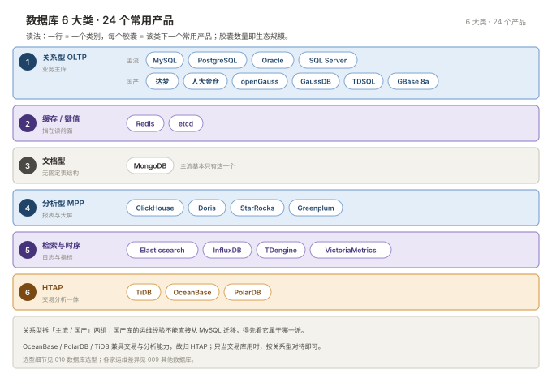

# 010 数据库选型

> **解决**：引入新系统该用什么库、公司要换库时怎么评估、换的过程中怎么不死人。  
> **范围**：六类版图与撞墙逻辑 · 关系型五大家族 · 缓存/文档/分析/检索时序 · 国产数据库与信创 · 迁移九个翻车点 · 横向对照 · 云数据库责任边界。  
> **口径**：运维视角的选型与守土——不替开发做架构设计，但评审会上要能提出对的问题。  
> **更新**：2026-11-06

## 目录

| 节 | 内容 |
|---|---|
| 1 | 选型总纲：撞墙逻辑与速查表 |
| 2 | 关系型 OLTP：五大家族 |
| 3 | 缓存、文档型 |
| 4 | 分析型与 HTAP |
| 5 | 检索与时序（含国产库版图导览） |
| 6 | 国产数据库版图与三个真相 |
| 7 | 信创选型的六个现实约束 |
| 8 | 迁移：换库时真正会死人的地方 |
| 9 | 运维视角的横向对照 |
| 10 | 云数据库：你还在管什么 |
| 11 | 选型的坑 |
| 12 | 检查清单 |

---

## 1. 选型总纲：撞墙逻辑与速查表

每一类数据库都是**上一类在某个维度撞墙后的产物**：

| 撞墙的维度 | 撞墙后的产物 | 举例 |
|---|---|---|
| 单机容量（数据装不下） | 分库分表 → 分布式数据库 | MySQL 分库分表 → TiDB |
| 单机写入（QPS 打不上去） | 内存存储 | Redis |
| 分析查询要扫全表 | 列式存储 + MPP | ClickHouse、Doris |
| 表结构频繁变 | 无模式（Schema-less） | MongoDB |
| 数据带强时间属性 | 时序专用压缩与分区 | TDengine、InfluxDB |
| 需要分词/模糊检索 | 倒排索引 | Elasticsearch |

有人提议"上 XX 数据库"时，先反问"现在撞的是哪面墙"。多数答案是"没撞墙，只是听说它快"——那这个选型大概率是负债。反面案例：日活几千的管理后台，20GB 数据，上了三节点分布式集群，运维复杂度翻五倍，跨节点事务偶发超时，单机 MySQL 完全够用。



按场景从上往下判断：

| 场景特征 | 首选 | 备注 |
|---|---|---|
| 有事务、有关系、数据量 < 2TB | MySQL 或 PostgreSQL（单机主从） | 覆盖 80% 的业务系统 |
| 数据量 > 5TB 或写入持续打满单机 | TiDB / OceanBase / PolarDB | 先确认真的打满了，别猜 |
| 需要同时 OLTP + 实时分析 | HTAP，或 OLTP + 独立 OLAP | 后者更常见、更稳 |
| 分析为主，扫大量行做聚合 | ClickHouse / Doris / StarRocks | 高频点更新是弱项 |
| 高并发计数、会话、锁、排行榜 | Redis | 明确能不能丢数据 |
| 表结构频繁变、嵌套结构 | MongoDB | 代价是没有 JOIN |
| 监控指标、传感器数据 | TDengine / InfluxDB / VictoriaMetrics | 必须配保留策略 |
| 全文检索、日志分析 | Elasticsearch | 不做主存储 |
| 强制信创要求 | 按信创目录 + 现有采购 + 原厂能力选 | 先看 §6 六个约束，再谈技术 |

**最后一条判断原则**：能用一个库解决的，不要用两个。每多一个组件，就多一套备份、监控、高可用、升级流程和故障域——**运维成本是选型里最常被低估的一项**。

## 2. 关系型 OLTP：五大家族

技术差异没那么多，**核心都是 B+ 树 + WAL + MVCC + 事务**，差异在实现细节和生态：

| 家族 | 代表 | 开源 | 运维上手难度 | 关键特征 |
|---|---|---|---|---|
| **MySQL 系** | MySQL、MariaDB、Percona | 是（GPL） | 低 | 生态最广、资料最多、云厂商支持最好 |
| **PostgreSQL 系** | PostgreSQL | 是（类 BSD） | 中 | 功能最强（JSONB、窗口函数、扩展体系） |
| **Oracle** | Oracle Database | 否 | 高 | 金融政企存量巨大，许可费贵 |
| **SQL Server** | Microsoft SQL Server | 否 | 中 | 微软技术栈标配 |
| **国产库** | 达梦、金仓、OceanBase 等 | 部分 | 视产品 | 见 §5，多数是上面几家的内核改造 |

**MySQL 的知识 60% 能迁移到 PostgreSQL，但命令和默认行为差异足以出事故**。三个照搬就出事的例子：`SHOW PROCESSLIST` 在 PG 里不存在（用 `pg_stat_activity`）；PG 更新写新版本行、旧行靠 VACUUM 回收（不 VACUUM 会表膨胀）；PG 未加引号的标识符统一转小写（`User` 与 `user` 同表——迁移期"表不存在"报错的头号来源）。

MySQL 一统互联网、Oracle 守着金融是历史路径：MySQL 赶上 Web 2.0 免费轻量、生态反哺；Oracle 在 90 年代解决了银行要的 RAC/Data Guard/审计，迁移成本极高——国产化替代主要替这一块。

## 3. 缓存、文档型

| 产品 | 定位 | 运维最需要知道的 |
|---|---|---|
| **Redis** | 内存 KV，兼作缓存/锁/队列/计数器 | **持久化不等于备份**；大 key 和热 key 是头号故障源。故障模式与关系型完全不同——问题是"瞬间全崩"不是"慢" |
| **etcd** | 分布式 KV，强一致（Raft） | K8s 元数据的家，**它的健康度=集群可用性**；默认 2GB 上限，超了报 `NOSPACE` |

大量系统把 Redis 当主存储（会话、排行榜、锁）——"缓存挂了业务降级"在你们系统里可能是假的。**运维工作量占比约 25%，深入运维见「Redis」板块。**

MongoDB 只在一种情况下该用：**表结构频繁变，或数据天然是嵌套 JSON**（代价：没有 JOIN）。生产必须副本集；WiredTiger 内存不够时性能断崖式下降；头号故障是磁盘写满导致副本集转只读；默认 `w:1` 写入"发出去就算成功"，要求不丢配 `writeConcern: majority`。

## 4. 分析型与 HTAP

| 产品 | 特点 | 不适合 |
|---|---|---|
| **ClickHouse** | 单表聚合极强，压缩比高 | 高频点更新、复杂 JOIN、事务 |
| **Apache Doris** | MySQL 协议兼容，易用性好 | 超大规模单表极致性能略逊 CH |
| **StarRocks** | Doris 分支，CBO 更强 | 生态相对新 |

共同点：这类库的"故障"往往不是宕机，而是**一个大查询吃光集群资源**——资源队列/资源组是必配项。

| 产品 | 架构 | 兼容 | 运维复杂度 |
|---|---|---|---|
| **TiDB** | 计算(TiDB)+存储(TiKV)+调度(PD)，存算分离 | MySQL 5.7 | 高，组件多 |
| **OceanBase** | 单机一体化 + Paxos 多副本 | Oracle/MySQL 双模式 | 高，一体化程度好 |
| **PolarDB** | 共享存储，一写多读 | MySQL/PG | 中（云上托管为主） |

**这类库的价值和代价是同一个东西**：把分库分表从应用层挪进数据库层——应用不用改，但故障域从一台机器变成一个分布式系统，网络抖动、时钟偏移、副本选举都会变成你的工单。**单机 MySQL 能扛住的业务不要上分布式**：合理索引下单机 5000~10000 QPS、2TB 以内数据量很常见；真正需要分布式的是"写入持续打满单机"。

## 5. 检索与时序

| 类别 | 代表 | 运维必须知道的一条 |
|---|---|---|
| **搜索** | Elasticsearch | **不是主数据库**。必须配分片数和 ILM，否则分片过多拖垮集群（日志场景深入见「日志」002~003） |
| **时序** | InfluxDB、TDengine、VictoriaMetrics | 数据量靠**降采样和保留策略**控制——不配 retention 的时序库半年必爆盘 |

VictoriaMetrics 单独提一句：Prometheus 远程存储的常见替代，兼容 PromQL，压缩比远高于本地存储（见「监控」008）。其余类型知道即可：图数据库（Neo4j，关系即数据）、宽列（Cassandra/HBase）、向量库（小数据量优先 pgvector）、湖仓表格式（Iceberg/Hudi，归数据团队）。

## 6. 国产数据库版图与三个真相

信创推进下，很多运维第一次接触国产库是**被动的**——项目要求换库，你手上突然多了一套不熟悉的系统。

### 先看派系，不要看名单

产品两百多个，**有独立内核研发能力的不到十家**，其余按技术来源归派：

```plain
              国产数据库
                  │
   ┌──────────┬───┴────────┬─────────────┐
 自研内核    PostgreSQL 派   MySQL 派      借商业内核
 达梦 DM     人大金仓 KES    TDSQL         GBase 8s
 OceanBase   openGauss      GoldenDB      (Informix)
 GBase 8a    GaussDB        PolarDB-MySQL
 (列存)      Vastbase/AntDB  TiDB(协议兼容)
```

派系直接决定上手速度：**MySQL 派最快**（命令/协议/备份工具基本通用）、**PG 派一两周**（`psql` 换 `ksql`/`gsql`，视图结构相同）、**自研派一两个月**（视图/参数/工具链全独立）、**Informix 派最慢**（国内几乎无存量经验）。

| 产品 | 厂商 | 技术来源 | 兼容 | 常见场景 |
|---|---|---|---|---|
| **达梦 DM8** | 武汉达梦 | 自研 | Oracle 兼容度高 | 政务、金融、军工 |
| **人大金仓 KES** | 人大金仓 | PostgreSQL | Oracle+PG 双模式 | 政务、能源、央企 |
| **openGauss / GaussDB** | 华为 | PG 起点深度改造 | PG / Oracle | 运营商、金融核心 |
| **OceanBase** | 蚂蚁 | 自研（LSM+Paxos） | Oracle/MySQL 双模式 | 金融核心 |
| **TiDB** | PingCAP | 自研（RocksDB+Raft） | MySQL 5.7 | 互联网 HTAP |
| **TDSQL** | 腾讯 | MySQL 内核+分布式路由 | MySQL | 金融、政务 |
| **PolarDB** | 阿里云 | MySQL/PG 内核+共享存储 | MySQL/PG | 阿里云业务 |
| **GBase 8a** | 南大通用 | 自研列存 MPP | — | 分析、数仓 |

### 三个真相

**真相一：兼容度宣传 ≠ 实际兼容度。**"Oracle 兼容 95%"指常用 SQL 语法；真正麻烦的 PL/SQL 包、系统视图、隐式转换差异仍大——**评估兼容度必须拿自己最复杂的十条 SQL 和三个存储过程实测**。

**真相二：性能对比测试水分很大。** 榜单是特定硬件特定负载下的成绩；真实差距在**复杂查询的优化器成熟度和执行计划稳定性**，不在简单读写吞吐。

**真相三：决定成败的是生态，不是内核。** 监控接不进现有体系、备份工具难用、出问题找不到人、招不到人、升级路径不明——**这五项任何一项不合格，都比"性能差 10%"严重得多**。

## 7. 信创选型的六个现实约束

运维不一定参与选型，但一定承担后果。评审会上要能提出对的问题：

| # | 约束 | 运维要问的问题 |
|---|---|---|
| 1 | 信创目录与测评 | 在不在目录里？过了等保、密评吗？ |
| 2 | **License 模式** | 按核数还是按节点？**到期会锁库吗**——商业库到期可能是"拒绝新连接"或"只读"，是生产停摆不是性能问题。接手任何商业库第一件事：把 license 到期时间写进监控和日历 |
| 3 | 硬件与操作系统适配 | 鲲鹏/飞腾（ARM）还是海光/兆芯（x86）？麒麟/统信上有认证版本吗？ |
| 4 | 生态工具链 | 监控/备份/迁移/审计能否对接现有运维平台？ |
| 5 | 人才可得性 | 团队有人会吗？市场上招得到吗？ |
| 6 | 原厂支持条款 | 7×24 吗？驻场吗？重大故障升级路径？ |

## 8. 迁移：换库时真正会死人的地方

换库的风险不在"数据搬过去"，在"搬过去之后行为不一样"。九个翻车点：

| # | 差异点 | 具体表现 | 后果 |
|---|---|---|---|
| 1 | 空串 vs NULL | Oracle `''` 就是 NULL；PG 系 `''` 是空字符串 | `WHERE col=''` 结果完全不同；NOT NULL 下插入报错 |
| 2 | 标识符大小写 | Oracle 存大写；PG 系存**小写** | `SELECT * FROM "User"` 报表不存在 |
| 3 | 分页语法 | ROWNUM / LIMIT / LIMIT OFFSET | 分页全要改写 |
| 4 | PL/SQL 存储过程 | 包、自治事务、游标 | **最难的一块**，自动工具只能转 70~80% |
| 5 | 序列与自增 | SEQUENCE / SERIAL / AUTO_INCREMENT | 主键生成逻辑要改，迁移后序列当前值要校 |
| 6 | 隐式类型转换 | Oracle `'123'=123` 成立；PG 报类型错误 | 错误运行时才暴露，历史 SQL 大量报错 |
| 7 | 日期函数 | SYSDATE/TO_DATE/NVL | 换 NOW()/COALESCE/+INTERVAL |
| 8 | 执行计划差异 | 同 SQL 同索引，优化器选择不同 | **最隐蔽**：测试环境小数据看不出来，上生产才炸 |
| 9 | 字符集与排序 | collation 影响 ORDER BY | 中文排序不一致，分页业务错乱 |

正确做法（运维视角）：**评估**（厂商工具扫描，要"带明细的不兼容清单"不是百分比）→ **改造**（全量 SQL 测试库跑通）→ **数据迁移**（行数/校验和/抽样逐表比对）→ **压测**（用生产量级数据，关键接口 P99 劣化不超 20%）→ **双跑**（读写比对）→ **切换**（低峰 + 演练过的回滚方案）。**压测与回滚是最容易跳过也最容易出事的两步**：小数据压测通过就切，几乎必然"上线后突然变慢"；换库回滚意味着增量数据反向同步——切换前必须能回答"30 分钟内发现问题，数据怎么回来"，没答案就不要切。

## 9. 运维视角的横向对照

换库时照着找对应项，不用从零摸索：

| 维度 | MySQL | PostgreSQL | Oracle | 达梦 DM | 人大金仓 | OceanBase |
|---|---|---|---|---|---|---|
| 默认端口 | 3306 | 5432 | 1521 | 5236 | 54321 | 2881（代理 2883） |
| 主配置文件 | my.cnf | postgresql.conf | spfile | dm.ini | kingbase.conf | OCP 管理 |
| 客户端 | mysql | psql | sqlplus | disql | ksql | obclient |
| 逻辑备份 | mysqldump | pg_dump | expdp | dexp | sys_dump | obdumper |
| 物理备份 | XtraBackup | pg_basebackup | RMAN | DMRMAN | sys_basebackup | OCP/OBD |
| 高可用 | MHA/MGR | Patroni | RAC+DG | DM 数据守护 | KES RAC | Paxos 多副本 |
| 看连接 | SHOW PROCESSLIST | pg_stat_activity | v$session | V$SESSIONS | sys_stat_activity | v$ob_processlist |
| 看锁 | performance_schema | pg_locks | v$lock | V$LOCK | pg_locks | v$ob_locks |
| 监控采集 | mysqld_exporter | postgres_exporter | oracledb_exporter | 厂商工具 | 厂商工具 | OCP+obagent |

达梦刻意把系统视图做成 `V$` 风格对齐 Oracle（降低迁移成本）；PG 派保留 `pg_`/`sys_` 风格——**看这一列就知道这个库想让谁好上手**。

## 10. 云数据库：你还在管什么

云数据库是交付形态的变化：RDS 是托管 MySQL/PG，PolarDB 是共享存储版。关键是**责任边界**——

| 事项 | 云厂商负责 | 你仍然负责 |
|---|---|---|
| 主机/系统/打补丁 | 是 | 否 |
| 备份执行 | 是 | **保留天数、恢复演练、跨区域备份** |
| 高可用切换 | 是 | **切换后应用重连、只读延迟容忍** |
| 参数配置 | 部分（很多锁定） | **能改的那部分怎么设** |
| 慢 SQL 与索引 | 否 | **全部是你的** |
| 容量规划 | 否（扩容你操作） | **全部是你的**，含磁盘水位告警 |
| 数据正确性 | 否 | **全部是你的**（误删、误更新） |

一句话：**云厂商把"机器"接管了，没接管"SQL"和"数据"**——线上 80% 的数据库问题责任完全在你。云上五坑：连接数上限与规格绑定（加连接池或升规格）、只读实例延迟（写后读走主库）、备份默认只留 7 天（延长+跨区域另存）、部分参数要提工单（提前确认）、磁盘自动扩容有上限（80% 就扩）。

## 11. 选型的坑

| # | 坑 | 后果 | 正确做法 |
|---|---|---|---|
| 1 | 没撞墙就引入新组件 | 组件每多一个，备份/监控/HA/升级全多一套 | 反问"撞的是哪面墙" |
| 2 | 商业库 license 到期没进监控 | 到期锁库，**生产直接停摆** | 到期时间进监控和日历 |
| 3 | 用测试数据量压测后直接切换 | 上线后执行计划突变，"突然变慢" | 生产量级压测，P99 劣化 ≤20% |
| 4 | 只看兼容度宣传与榜单 | 隐式转换、存储过程在运行时爆 | 自家最复杂 SQL 实测 |
| 5 | 切换前没演练回滚 | 出问题时增量数据回不去 | 回滚方案演练过才允许切换 |
| 6 | 把 Redis 默认当"可丢的缓存" | 会话/锁全丢，业务"全崩" | 接手系统先盘 Redis 里存什么 |

## 12. 检查清单

| # | 问题 |
|---|---|
| 1 | 新需求引入新库，撞的是哪面墙？运维成本算过吗？ |
| 2 | 商业库的 license 到期时间在监控里吗？ |
| 3 | 国产库归哪个派系？上手路径是几天还是一两个月？ |
| 4 | 信创评审的六个约束能各提一个问题吗？ |
| 5 | 迁移九个翻车点里，自家项目最容易踩哪三个？ |
| 6 | 云数据库的责任边界表里，"仍然是你负责"的五行背下来了吗？ |

---

**回到**：[数据库板块总览](README.md) —— 十一册完结，回到板块导航。
