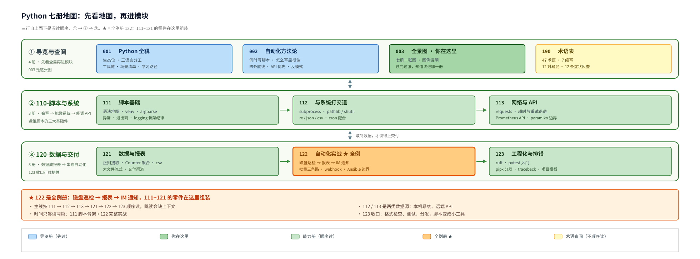

# Python 全景图

> **这一册回答**：Python 板块七册的能力递进关系，一张图看清。
> **怎么用**：看图定位自己缺哪块，再回 [001-Python运维实战全貌](001-Python运维实战全貌.md) 选册。

## 体系一张图

## 图例说明

| 模块 | 册 | 能力段 |
| --- | --- | --- |
| 110-脚本与系统 | 111 / 112 / 113 | 会写 → 能碰系统 → 能调 API，运维脚本的三大基础件 |
| 120-数据与交付 | 121 / 122 / 123 | 数据成报表 → 串成自动化 → 工程化收口 |
| 附录 | 190 | 术语 · 缩写 · 易混对 · 症状反查 |

图中自左向右是**能力递进**：111 的骨架纪律（异常/日志/退出码）贯穿全部后续册；112 与 113 是两类主要数据源（本机系统、远端 API）；121~123 把取到的数据变成可交付、可调度、可维护的资产。

---

**上一篇**：[002-自动化方法论](002-自动化方法论.md)　**下一篇**：进模块 [110-脚本与系统/111-脚本基础](110-脚本与系统/111-脚本基础.md)
