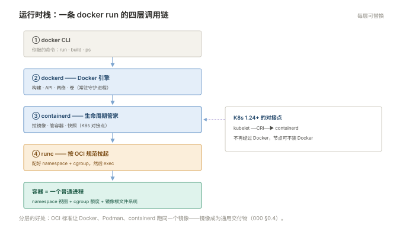

# 000 容器全貌

> **解决**：容器是什么、为什么行业都转向它、Docker / containerd / K8s 三者什么关系。  
> **范围**：容器 vs 虚机 · OCI 标准与运行时栈 · 生态地图 · 云上托管 · 本套学习路径。  
> **口径**：与 [README](README.md) 一致。  
> **更新**：2026-10-31

## 目录

| 节 | 内容 |
|---|---|
| 0.1 | 容器解决什么问题：环境不一致与部署密度 |
| 0.2 | 容器 vs 虚机：隔离的是进程，不是机器 |
| 0.3 | 运行时栈：Docker → containerd → runc，谁干什么 |
| 0.4 | OCI：镜像和运行时的两个标准 |
| 0.5 | Kubernetes 的位置：单机引擎与集群编排的分界 |
| 0.6 | 云上托管 vs 自建：你在管什么、省了什么 |
| 0.7 | 生态地图：仓库、网络插件、存储插件、监控对接 |
| 0.8 | 什么时候不该用容器 |
| 0.9 | 十个误解 |
| 0.10 | 本套学习路径与各册映射 |

---

## 0.1 容器解决什么问题

容器不是新技术炫技，它针对的是运维每天在打的两场仗。

**第一仗：环境不一致。** 「在我机器上是好的」翻译成运维语言是三件事漂移了——依赖版本漂移（开发机 Node 20，生产 Node 16）、配置漂移（手工改过的机器说不清改了什么）、系统库漂移（glibc 版本差一个符号链接就崩）。容器把「应用 + 依赖 + 系统库」整体打成一份不可变镜像，环境的定义从"这台机器的历史"变成"这份镜像的清单"。机器可以烂，镜像不烂。

**第二仗：部署密度与速度。** 传统部署一台机器跑一个应用，资源按峰值预留，平时大量闲置；虚机分配了 8G 内存就占着 8G。容器共享宿主内核，每个容器只是带资源限额的进程——同一台 64G 机器可以塞几十个限了额的容器，按实际用量共享。启动速度从分钟级（开机+装环境）降到秒级（拉进程）。

还有一个副产品经常被低估：**交付物的标准化**。有了镜像，「交付」这个词从"一份部署文档 + 一个 tar 包 + 口头注意事项"变成"一个镜像地址 + 一个配置清单"——CI/CD（「CICD」册）的全部地基就是它。

---

## 0.2 容器 vs 虚机：隔离的是进程，不是机器

| 维度 | 虚机 | 容器 |
|---|---|---|
| 虚拟化对象 | 整台机器（含内核） | 只隔离进程视图与资源 |
| 内核 | 每个 VM 一个独立内核 | **共享宿主一个内核** |
| 启动速度 | 分钟级 | 秒级 |
| 单机密度 | 几个到十几个 | 几十个到上百个 |
| 隔离强度 | 强（硬件级，内核漏洞互不影响） | 较弱（内核逃逸漏洞一次打穿全机） |
| 系统多样性 | Windows/Linux 随意 | 只能跑与宿主兼容的内核上的系统 |

表里最重要的一行是**内核**。容器的"操作系统"就是宿主的操作系统：Linux 容器跑不了 Windows 应用，CentOS 6 的老程序在 Ubuntu 宿主的容器里跑的是容器镜像自己带的用户态 + 宿主的内核——大多数场景没问题，但依赖特定内核行为/模块的应用要单独验证。也是同一行，决定了**内核漏洞是容器安全的头号威胁**：宿主打补丁的及时性，直接决定所有容器的安全水位。

隔离强度那行也别吓到自己：日常 Web 服务的隔离需求，namespace + cgroup 够用；多租户强隔离场景用虚机或带硬件隔离的沙箱（如 Kata），不属于本册范围。

---

## 0.3 运行时栈：Docker → containerd → runc，谁干什么

一条 `docker run` 背后的调用链是三层，理解分层才能理解「K8s 为什么不用 Docker 也能跑容器」：

```plain
docker CLI ──▶ dockerd（Docker 引擎：镜像构建/管理、API、网络）
                  │ gRPC
                  ▼
              containerd（容器生命周期管理：拉镜像、管容器、快照）
                  │
                  ▼
              runc（按 OCI 规范：配好 namespace/cgroup，exec 出容器进程）
```



| 组件 | 职责 | 类比 |
|---|---|---|
| Docker | 面向人的全家桶：build、run、网络、卷、Compose | 整套厨房 |
| containerd | 工业级容器管家：拉镜像、管生命周期、快照 | 后厨主管 |
| runc | 最后一步：真正把容器进程拉起来的小工具 | 开火的那个动作 |

K8s 1.24 起移除 dockershim，**kubelet 通过 CRI（容器运行时接口）直接对接 containerd**，不再经过 Docker。这意味着：K8s 节点上可以完全不装 Docker，`docker ps` 看不到 K8s 的容器（要看用 `crictl`）。日常开发机上的 Docker 与集群里的 containerd 用的镜像格式完全一致（都是 OCI 镜像），所以「本地 build → 推仓库 → 集群拉」这条路不受任何影响。

---

## 0.4 OCI：镜像和运行时的两个标准

OCI（Open Container Initiative）把容器行业从"Docker 一家独大"拉回到"谁符合标准谁就能互换"，它定了两个标准：

- **镜像规范（image spec）**：镜像长什么样——分层的 tar 包 + 一份 manifest（各层摘要、启动命令、环境变量）。任何符合规范的镜像，Docker、containerd、Podman 都能跑；
- **运行时规范（runtime spec）**：容器跑起来需要什么——namespace 配置、cgroup 限额、根文件系统。runc 是参考实现。

对运维的实际意义一句话：**镜像成了通用交付物**。CI 里构建一次，开发机、测试集群、生产集群、不同运行时全部通用——这是 000.1 说的"交付物标准化"的标准背书。

---

## 0.5 Kubernetes 的位置：单机引擎与集群编排的分界

Docker 解决的是「一台机器上的容器」，它的能力边界在三台机器开始的地方：

| 需求 | 单机 Docker | 需要 K8s 的原因 |
|---|---|---|
| 跑几个容器 | `docker run` / Compose | – |
| 跨多台机器调度 | 做不到 | scheduler 决定 Pod 落哪台 |
| 容器挂了自动拉起 | `--restart` 只管本机 | 控制平面盯着期望副本数，跨节点自愈 |
| 滚动更新/回滚 | 手工逐台 | Deployment 原生 |
| 服务发现与负载均衡 | 手工维护地址 | Service / DNS / kube-proxy 原生 |
| 扩缩容 | 手工 | HPA 按指标自动加副本 |

本套的分界线因此很清晰：**001–004 册是"一台机器"的世界，005–009 册是"一组机器"的世界**。两套概念有延续（镜像、日志、资源限制都在），但心智模型变了——从「我跑什么命令」变成「我声明什么状态」。

---

## 0.6 云上托管 vs 自建：你在管什么、省了什么

| | 自建（kubeadm） | 云上托管（ACK/EKS/TKE） |
|---|---|---|
| 控制平面（apiserver/etcd/scheduler） | 你装、你升级、你备份 | 云厂商管，**不可见也不可改** |
| 节点 | 你装 OS、kubelet、扩容 | 节点池托管，但仍要管节点水位 |
| 版本升级 | 一次一个 minor，自己排计划 | 控制面一键，节点池跟不跟自己定 |
| 故障责任边界 | 全归你 | 控制面归云，负载与配置归你 |
| 成本 | 机器钱 + 你的人力 | 溢价 + 同样的人力（省的部分被运维量吃回一半） |

托管省掉的是 009 册里最难的两件事（etcd 运维、控制平面升级），没省掉的是 Pod/Deployment/存储/网络配置的全部责任。**本套 005–009 的内容两种形态都需要**，差异只在 9.8/9.9 两节（etcd 备份与集群升级）——托管用户可以只读不练。

---

## 0.7 生态地图：仓库、网络插件、存储插件、监控对接

围绕 Docker/K8s 的四个高频生态位，本套怎么覆盖：

| 生态位 | 是什么 | 常见选择 | 本套在哪 |
|---|---|---|---|
| 镜像仓库 | 存镜像、扫漏洞 | Harbor、云厂商 ACR/ECR | 「CICD」006 |
| 网络插件（CNI） | 给 Pod 分配 IP、打通跨节点 | Calico（BGP）、Flannel（VXLAN）、Cilium | 006 册选型与验证；包怎么走见「网络」008 |
| 存储插件（CSI） | 给 Pod 动态供盘 | 云盘 CSI、NFS、Ceph | 007 册 |
| 监控对接 | 容器指标采集 | Prometheus + node-exporter + kube-state-metrics + cAdvisor | 「监控」册的口径可直接套 |

---

## 0.8 什么时候不该用容器

容器不是万能答案，四类场景三思：

1. **重度依赖内核特性/硬件的应用**：需要特定内核模块、GPU 直通以外的硬件、特定系统调用的老软件——先验证再迁；
2. **有状态且强绑定机器的服务**：数据库当然能容器化（K8s 上跑 MySQL 的方案很成熟），但"为了容器化而容器化"、又不想上 operator/StatefulSet 的团队，虚机上跑得更稳；
3. **桌面/GUI 程序**：能做但体验差，不属于运维主线；
4. **合规要求虚机边界的多租户**：见 0.2 的隔离强度行。

---

## 0.9 十个误解

| # | 误解 | 实际 |
|---|---|---|
| 1 | 容器是"轻量虚机" | 是被隔离的进程，共享宿主内核 |
| 2 | 容器里的数据天然安全 | 可写层随容器删，持久化靠卷 |
| 3 | 容器 = 更安全 | 隔离弱于虚机，安全靠镜像扫描 + 运行时约束 |
| 4 | 上了 K8s 就不用管 Linux | cgroup/OOM/网络/磁盘全是 Linux 问题换了件衣服 |
| 5 | 微服务必须上 K8s | 三个服务用 Compose 更省心，规模到了再上 |
| 6 | K8s 会自动优化资源 | requests/limits 不配，调度与驱逐全是盲的 |
| 7 | 镜像越新越好 | 新基础镜像要回归验证，CVE 修复与兼容性要权衡 |
| 8 | 容器日志会自动轮转 | json-file 默认不轮转，磁盘迟早写满 |
| 9 | Docker 和 K8s 是竞争关系 | 分层协作：K8s 底下就是 containerd/runc |
| 10 | 上了容器不用做备份 | 镜像不备份你的数据，卷和 etcd 才是要备份的 |

---

## 0.10 本套学习路径与各册映射

```plain
Docker 线（docker/）    001 镜像与容器 ──▶ 002 Dockerfile ──▶ 003 数据卷 ──▶ 004 Compose
                            ──▶ 005 网络与隔离底层 ──▶ 006 运行时进阶：containerd 与 ctr
K8s 线（k8s/）          005 架构与核心对象 ──▶ 006 网络 ──▶ 007 存储与配置
                            ──▶ 008 发布与资源管理 ──▶ 009 排障与生产实践
```

横向衔接：镜像构建对接「CICD」册的流水线；网络协议细节在「网络」008；cgroup/namespace 底子在「Linux」002；监控对接按「监控」册口径。

---

> 下一篇：《001 镜像与容器》——镜像怎么变成容器，容器为什么本质上是一个进程。
