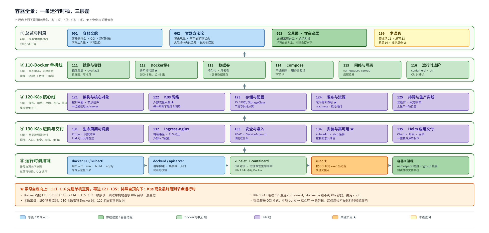

# 容器全景图

> **这一册回答**：容器板块 16 册的三层分工，一张图看清。
> **怎么用**：看图定层，再回 [001-容器全貌](001-容器全貌.md) 按线选册。

## 体系一张图

## 图例说明

| 层 | 册 | 一句话 |
| --- | --- | --- |
| 领域地基 | 001 / 002 / 003 | 全貌地图 · 方法论 · 本图 |
| Docker 单机线（110） | 111 ~ 116 | 镜像 → 构建 → 数据卷 → Compose → 网络底层 → 运行时 |
| K8s 核心线（120） | 121 ~ 125 | 架构 → 网络 → 存储 → 发布 → 排障 |
| K8s 进阶线（130） | 131 ~ 135 | 调度 → Ingress → 安全准入 → 安装 HA → Helm |
| 附录 | 190（板块）+ 110 / 120（工具） | 领域词 + 工具专有词双层分工 |

图中自下而上是**运行时栈**：内核隔离（cgroup/namespace）→ containerd/dockerd → Pod → 控制平面。学习自底向上建立直觉（Docker 线在前），排障自顶向下穿透（K8s 现象最终落到节点运行时现场）。

---

**上一篇**：[002-容器方法论](002-容器方法论.md)　**下一篇**：进模块 [110-Docker/111-镜像与容器](110-Docker/111-镜像与容器.md)
