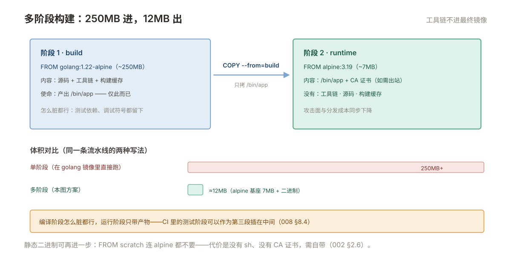

# 002 Dockerfile 与镜像构建

> **解决**：镜像怎么造出来、怎么瘦下去、怎么保证安全。  
> **范围**：指令语义 · 构建缓存 · 多阶段构建 · `.dockerignore` · 标签策略 · 镜像扫描。  
> **口径**：Docker CE 24+ 默认 BuildKit 构建器，语法行 `# syntax=docker/dockerfile:1`。  
> **更新**：2026-10-31

## 目录

| 节 | 内容 |
|---|---|
| 2.1 | 第一条 Dockerfile：一个 Go 服务的最小可运行镜像 |
| 2.2 | 指令逐个讲透：FROM / RUN / COPY / ENV / ARG / USER / WORKDIR / EXPOSE |
| 2.3 | CMD 与 ENTRYPOINT 在 Dockerfile 里的组合写法 |
| 2.4 | 分层与构建缓存：指令顺序为什么决定构建速度 |
| 2.5 | 多阶段构建：编译环境与运行环境分离 |
| 2.6 | 镜像瘦身清单：基础镜像选型、合并 RUN、清缓存 |
| 2.7 | .dockerignore：把 .git 和依赖目录挡在构建上下文外 |
| 2.8 | 标签策略：为什么生产禁用 latest，版本怎么命名 |
| 2.9 | 镜像扫描与信任：Trivy 扫 CVE、构建密钥的藏法 |
| 2.10 | 八个坑 |
| 2.11 | 本章检查清单 |

---

## 2.1 第一条 Dockerfile

001 册讲清了「镜像跑起来是容器」，这一册从无到有造一个镜像。目标：把一个静态编译的 Go Web 服务做成镜像。先看最朴素但已经合格的版本：

```dockerfile
# syntax=docker/dockerfile:1
FROM golang:1.22-alpine AS build
WORKDIR /src
COPY . .
RUN CGO_ENABLED=0 go build -o /bin/app ./main.go

FROM alpine:3.19
COPY --from=build /bin/app /bin/app
ENTRYPOINT ["/bin/app"]
```

```bash
docker build -t myapp:1.0.0 .
docker run -d --name myapp -p 8080:8080 myapp:1.0.0
docker logs myapp          # 应用日志打到 stdout，001 §1.8 的纪律
```

十行里有三处先标出来，后面各节展开：**两个 FROM 是两个阶段**（2.5）、**`COPY . .` 前面其实还欠一个 `.dockerignore`**（2.7）、**`ENTRYPOINT` 用的是 exec 形式**（001 §1.6 的信号问题）。

---

## 2.2 指令逐个讲透

每条指令记住「它给镜像加了什么、缓存怎么算」两件事就够：

| 指令 | 干什么 | 关键提醒 |
|---|---|---|
| `FROM` | 定基础镜像，也开新阶段 | 选型见 2.6；`AS` 给阶段命名供 `--from` 引用 |
| `RUN` | 构建时执行命令，**产生一层** | 多命令 `&&` 连写；产生的临时文件**必须在同一条里删** |
| `COPY` | 从构建上下文拷文件进镜像 | 源路径相对上下文，不是相对 Dockerfile 所在机器的任意路径 |
| `ADD` | COPY 的超集：额外解压 tar、支持 URL | **能用 COPY 就别用 ADD**——隐式行为多，review 费劲 |
| `ENV` | 环境变量，**留在镜像里运行时可用** | 默认配置放这；含密钥的东西永远不进 ENV |
| `ARG` | 构建参数，**只在构建期有效** | `--build-arg K=V` 传入；别当密钥的藏身处（2.9） |
| `USER` | 之后的 RUN/CMD 以谁的身份 | 生产镜像以非 root 跑是基线，`USER app` 收尾 |
| `WORKDIR` | 切工作目录，后续指令的相对路径基准 | 比 `RUN cd xxx && …` 好——WORKDIR 不产生层 |
| `EXPOSE` | 声明端口，**纯文档** | 不会发布端口；真正发布是 `run -p`（001 §1.5） |
| `HEALTHCHECK` | 声明健康检查 | K8s 用探针、Compose 用 healthcheck，单体 Docker 才靠它 |

其中 **RUN 是唯一"写坏就返工"的指令**，两条铁律：

**铁律一：临时文件在同一条 RUN 里删。** 每条 RUN 产一层，层一旦生成就永久存在——本条里删文件只影响"这一层的最终快照"，前一条 RUN 留下的东西是删不掉的：

```dockerfile
# ❌ 两层：curl 下载的 30MB 包永久留在第一层里，镜像平白胖 30MB
RUN curl -LJO https://example.com/pkg.tar.gz
RUN tar -xf pkg.tar.gz && rm pkg.tar.gz

# ✅ 一条里完成下载、解压、清理，层快照里只剩解压结果
RUN curl -LJO https://example.com/pkg.tar.gz \
 && tar -xf pkg.tar.gz && rm pkg.tar.gz
```

**铁律二：包管理器的缓存同理。** `apk add` / `apt-get install` 后接 `rm -rf /var/cache/apk/*` 或 `apt-get clean`，同样必须 `&&` 在同一条里。

### 进阶指令四讲：ONBUILD / USER 落地 / HEALTHCHECK 细节 / 多服务保活

**ONBUILD——延迟到子镜像构建时触发。** 带 ONBUILD 的镜像被用作 `FROM` 基础时，那些指令才在子镜像的构建期执行（本镜像自己构建时不执行）。适合"框架类基础镜像"：约定"用我的人记得把代码放进 /app"，子镜像构建时自动完成。排查用 `docker inspect --format '{{.Config.OnBuild}}' img`。副作用：继承链一深行为难追踪——**应用镜像里别用**。

**USER 的落地细节——一行 `USER app` 前面还有三件事。** 非 root 运行不是写一行就完：先在镜像里建用户（`RUN adduser -D app`），再把应用要写的目录**属主改给它**（`RUN chown -R app /run/nginx /var/lib/nginx /var/cache/nginx`），否则 USER 切过去后程序写日志/临时文件直接报权限错误——nginx 的 `mkdir /var/cache/nginx failed` 就是这么来的。建目录加属主有现成一条命令：`install -d -o app -g app /run/nginx`。坑：容器里 sshd 以普通用户起不来（要绑 22 特权端口、要主机密钥），别用 USER 硬跑 sshd。

**HEALTHCHECK 的四个参数。** `--interval` 检查间隔、`--timeout` 单次超时、`--retries` 连续失败几次才判不健康，最容易漏的是 **`--start-period`——启动宽限期**：期内的失败不计数，给慢启动应用（JVM 预热、大配置加载）留初始化时间。没有 start-period，慢启动应用会在启动期被误判 unhealthy 而被编排系统反复重启。

**多服务镜像的保活套路。** 一个容器要同时跑 sshd + nginx？写一个 `start.sh` 把两个都拉起，**末尾 `tail -f /dev/null` 阻塞保活**——PID 1 是 start.sh，它不退容器就不退。但要想清楚：这违反"一容器一进程"的粒度约定，存量老应用捆绑部署才值得用；新设计拆成两个容器交给 Compose 编排。

---

## 2.3 CMD 与 ENTRYPOINT 在 Dockerfile 里的组合写法

001 §1.6 讲了覆盖规则，这一节给生产上的标准组合——**ENTRYPOINT 写死程序本体，CMD 给可被覆盖的默认参数**：

```dockerfile
ENTRYPOINT ["/bin/app"]
CMD ["-addr", ":8080", "-log", "stdout"]
```

日常 `docker run myapp` 用默认参数跑；临时换个端口只需覆盖 CMD，不用动镜像：

```bash
docker run myapp -addr :9090
```

反模式是全塞进 ENTRYPOINT：想改个参数还得 `--entrypoint` 覆盖整个程序，别扭。镜像发布方遵守这个组合，使用方才有"默认能用、需要可改"的体验。

---

## 2.4 分层与构建缓存：指令顺序为什么决定构建速度

BuildKit 逐条执行指令，**每条指令的输入没变，直接复用缓存层**。输入是什么？对 COPY 是"上下文里这些文件的内容"，对 RUN 是"指令文本 + 上一层"。缓存一旦命中，后面所有没变的层全部免费。

于是有了 Dockerfile 的**黄金排序法：不常变的写前面，常变的写后面**。以 Go 项目为例：

```dockerfile
# ✅ 依赖描述先 COPY 并下载，源码最后 COPY
COPY go.mod go.sum ./
RUN go mod download
COPY . .
RUN go build -o /bin/app .
```

改一行业务代码重建：`COPY go.mod` 层没变 → `go mod download` 命中缓存（跳过几十秒的依赖下载）→ 只重跑最后两步。反过来若第一行就是 `COPY . .`，**任何文件的任何改动都会把依赖下载连坐重来**——这是"构建一次十几分钟"的头号原因。

BuildKit 还能把包管理器的缓存目录挂在层外，连"依赖文件变了"的场景都提速：

```dockerfile
RUN --mount=type=cache,target=/go/pkg/mod \
    CGO_ENABLED=0 go build -o /bin/app .
```

`type=cache` 挂载的目录不进镜像层，跨构建复用——依赖升级只增量下载。排查缓存问题时用 `docker builder prune` 清构建缓存，`--keep-storage` 可保留最近的部分。

---

## 2.5 多阶段构建：编译环境与运行环境分离

2.1 的例子已经用了两个 FROM。把它的账算清楚：

- **第一阶段（build）**：`golang:1.22-alpine` 约 250MB+，装着整套编译工具链。它的使命只有一条：产出 `/bin/app`；
- **第二阶段（runtime）**：从干净 `alpine:3.19`（约 7MB）开始，只 `COPY --from=build` 拷进来一个二进制。

最终镜像里**没有 Go 工具链、没有源码、没有构建缓存**——约 12MB。若不用多阶段、直接在 golang 镜像里跑应用，镜像 250MB 起步，攻击面与分发成本全跟着涨。这就是"多阶段构建"的全部价值：**编译阶段怎么脏都行，运行阶段只带产物**。



阶段数不限于二。一个典型三阶段：`build`（编译）→ `test`（跑测试，用编译产物）→ `runtime`（只从 build 拷产物）。CI 门禁要的测试放在镜像构建流程里做（CICD 册 008 串进来）。

---

## 2.6 镜像瘦身清单

多阶段之外，五条清单按收益排：

| # | 手段 | 典型收益 |
|---|---|---|
| 1 | 换小基础镜像 | 基础镜像差多少，成品差多少 |
| 2 | 合并 RUN（2.2 铁律） | 消除包缓存与中间文件 |
| 3 | 静态编译 + 精简运行镜像 | Go/静态语言可到 scratch，只剩应用本身 |
| 4 | `.dockerignore`（2.7） | 上下文变小，构建起步就快 |
| 5 | `du`-style 查证：`docker history myapp` 找大层 | 别猜，看哪层大再优化哪层 |

基础镜像怎么选，一张对照表：

| 镜像 | 大小 | 特点 | 适用 |
|---|---|---|---|
| `alpine` | ~7MB | musl libc，极小 | 追求体积；注意 musl 与 glibc 的兼容差异 |
| `*-slim`（debian slim） | ~30-80MB | glibc，兼容性好 | Python/Node 等动态语言的主流选择 |
| `distroless` | ~20MB | 无 shell、无包管理器，只有应用 | 安全基线最高的生产运行镜像（调试只能 exec 进不去，靠 sidecar） |

`scratch` 是空镜像——静态二进制直接放进去，极致瘦身，代价是没有 `sh`、没有 CA 证书（需要 HTTPS 出站时要自己拷 `ca-certificates`）。

`scratch` 还有进阶玩法：`FROM scratch` + `ADD rootfs.tar.xz /`，把手工准备的 rootfs（busybox 静态编译版只有 2~3MB）直接灌进空镜像——等于自制了一个 2MB 的"发行版"。配套的取证工具是 `docker history --no-trunc myapp`：逐层列出每条构建指令，**别人的镜像也能用它反推出 Dockerfile 长什么样**——查一个来路不明的镜像里有没有可疑命令，这是第一工具。

---

## 2.7 .dockerignore：把 .git 和依赖目录挡在构建上下文外

`docker build .` 的那个 `.` 是**构建上下文**——整个目录会先打包发给构建器。不排除的话，`.git`（可能几百 MB）、`node_modules`、本地日志全部进上下文，再被 `COPY . .` 一并扫进镜像。

项目根放一份 `.dockerignore`，语法同 `.gitignore`：

```plain
.git
.gitignore
node_modules/
*.log
.env
tests/
Dockerfile*
docker-compose*.yml
```

两个细节：**`.env` 和密钥文件必须列进去**（`COPY . .` 是随手一写，什么都能卷进来）；上下文瘦身不只是快——`COPY . .` 的镜像里不该有 `.git` 历史，那等于把代码仓库连提交记录发给所有拉镜像的人。

体感一下差距：在项目里 `dd if=/dev/zero of=bigfile bs=1M count=1000` 造一个 1GB 文件，`docker build` 的第一行会显示 `Sending build context 1.087GB`——上下文把大文件全打包传给了构建器；配上 .dockerignore 排除后，上下文缩到几 MB。构建"起步就慢"的排障，先看这一行。

---

## 2.8 标签策略：为什么生产禁用 latest，版本怎么命名

001 §1.5 留的问题在这里展开。`latest` 的本质：**一个普通 tag，每次有人 build 并推送，它就指向新镜像**——今天和明天的 `latest` 不是同一个镜像，出了问题 `docker history` 都对不上号。

生产 tag 命名的可追溯组合：

```plain
myapp:1.4.2              # 语义化版本：主.次.补丁
myapp:1.4.2-20261031     # 版本 + 日期，人工扫一眼就知道多老
myapp:1.4.2-b3f2a1c      # 版本 + git commit 短哈希，出事一查到底
```

配套纪律两条：

1. **tag 不可变**：同一个 tag 推两次 = 覆盖 = 可追溯性归零。重新构建同一版本，换 tag（CICD 册 006 展开）；
2. **版本只增不减**：回滚是"部署旧 tag"，不是"重打新 tag"。

---

## 2.9 镜像扫描与信任：Trivy 扫 CVE、构建密钥的藏法

镜像做完了，最后一道工序是安全。

**扫描 CVE**——Trivy 一条命令：

```bash
trivy image --severity HIGH,CRITICAL myapp:1.4.2
```

高危漏洞的处置顺序：升级基础镜像（多数 CVE 来自基础层）→ 升级依赖 → 接受并记录。Harbor 自带同款扫描器，推送即扫（CICD 册 006 对接）。

**构建密钥的正确藏法**——先看清错误藏法有多深：`RUN curl -H "Authorization: Bearer sk-xxx" ...` 下载私有依赖，即使下一层 `RUN rm` 删了痕迹，**密钥已经永久烧进前一层**，`docker history` 与层解包都能挖出来。ARG 同理，`--build-arg TOKEN=xxx` 也会进层与缓存记录。

BuildKit 给了专门的通道，密钥**只在构建期的内存里、不落层**：

```bash
docker build --secret id=npm,src=$HOME/.npmrc .
```

```dockerfile
RUN --mount=type=secret,id=npm,target=/root/.npmrc \
    npm ci
```

已泄漏的密钥没有"删层"这个选项，只有轮换。这条规则和 `.gitignore` 是同一句话的两端：**密钥只能走通道，不能走文件**。

---

## 2.10 八个坑

| # | 坑 | 后果 | 正确做法 |
|---|---|---|---|
| 1 | 临时文件不在同一条 RUN 里删 | 删了也白删，前一层永久携带 | 下载/解压/清理一条 `&&` 写完 |
| 2 | `COPY . .` 放在依赖安装之前 | 任何文件改动连坐依赖重装，构建十几分钟 | 依赖描述先 COPY，源码最后 |
| 3 | 密钥写进 RUN/ARG | 烧进镜像层，history 可挖 | `--mount=type=secret`，泄漏即轮换 |
| 4 | 生产 tag 用 latest | 版本漂移，回滚无从谈起 | 版本 + 日期/commit 组合 tag |
| 5 | 没写 .dockerignore | 上下文带 .git 与密钥文件，慢且泄漏 | 首次提交前配好 |
| 6 | 该用 COPY 的地方用了 ADD | 隐式解压/下载，行为难 review | 默认 COPY |
| 7 | 全程 root 运行 | 容器逃逸的放大器 | 末尾 `USER app`，文件属主配套 |
| 8 | 以为 EXPOSE 会发布端口 | 服务起不来，以为网络坏 | EXPOSE 只是声明，发布靠 `-p` |

第 3 条再展开一层：很多人以为"下一层删掉就干净了"。镜像层的结构是**每层独立存档、叠加成视图**——上一层的文件在下一层被标记删除，只是视图里看不见，物理内容仍在。`docker history myapp --no-trunc` 能看到每条 RUN 的完整命令文本；拿一个旧镜像的层 id，`docker save` 解包也能翻。所以镜像里的密钥只有"轮换"一个结局，发现越早损失越小。

---

## 2.11 本章检查清单

读完能回答这六个问题，这一章就过了：

| # | 问题 |
|---|---|
| 1 | 为什么依赖下载要写在源码 COPY 之前？构建缓存的判定依据是什么？ |
| 2 | 多阶段构建里，运行阶段为什么只 `COPY --from` 产物？ |
| 3 | `docker history` 看到某层特别大，怎么定位是哪条指令？ |
| 4 | alpine / slim / distroless 三种基础镜像各牺牲了什么？ |
| 5 | 密钥进过一次镜像层，为什么"删除文件"救不回来？正确通道是什么？ |
| 6 | 生产 tag 的命名组合是什么？latest 为什么不能上生产？ |

---

> 下一篇：《003 数据卷与持久化》——可写层靠不住，数据放哪才不会随容器消失。
