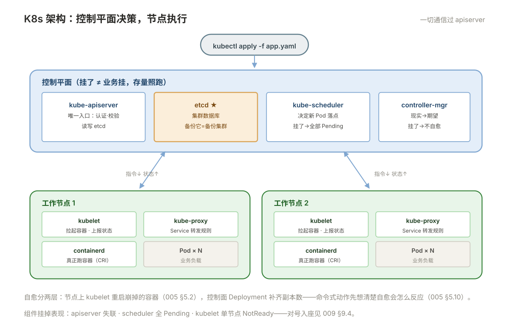

# 005 K8s 架构与核心对象

> **解决**：集群由什么组成，应用在 K8s 里怎么声明。  
> **范围**：控制平面组件 · etcd · Pod / ReplicaSet / Deployment · Label 与 Selector · Namespace · kubectl。  
> **口径**：Kubernetes 1.28+，kubeadm 集群。  
> **更新**：2026-10-31

## 目录

| 节 | 内容 |
|---|---|
| 5.1 | 集群架构：控制平面四个组件 + 节点上的 kubelet 与容器运行时 |
| 5.2 | 一次 `kubectl apply` 的旅程：谁处理、谁决策、谁执行 |
| 5.3 | etcd：集群唯一的事实来源，为什么它挂了全挂 |
| 5.4 | Pod：最小调度单位，容器怎么共享网络与存储 |
| 5.5 | 声明式与期望状态：YAML 里的每个字段在承诺什么 |
| 5.6 | Deployment / ReplicaSet / Pod 三层关系 |
| 5.7 | Label 与 Selector：一切关联关系的黏合剂 |
| 5.8 | Namespace：什么时候分、配额怎么设 |
| 5.9 | kubectl 日常：get / describe / apply / delete / explain |
| 5.10 | 八个坑 |
| 5.11 | 本章检查清单 |

---

## 5.1 集群架构

从 000 §0.5 的分界出发：K8s 接管的是"一组机器"。它的架构就是**分工**——做决定的组件集中在控制平面，干活的组件分散在每个节点：

```plain
┌─────────── 控制平面（任一节点或独立节点）───────────┐
│  kube-apiserver    唯一入口：认证/校验/读写 etcd      │
│  etcd              集群数据库：所有对象的真实状态      │
│  kube-scheduler    决策：新 Pod 落在哪个节点          │
│  controller-manager 各类控制器：把现实掰向期望状态      │
└──────────────────────────────────────────────────┘
        ▲ HTTPS（一切通信都过 apiserver）
┌───────── 工作节点 × N ─────────┐
│ kubelet         按指令拉起/重启本节点容器        │
│ kube-proxy      维护 Service 转发规则（006 册）  │
│ containerd      真正跑容器（000 §0.3）          │
│ Pod …                                            │
└─────────────────────────────────────────────────┘
```



每个组件挂掉的故障表现各不相同，排障时按表对号：

| 组件挂了 | 现象 |
|---|---|
| apiserver | `kubectl` 全部失联；**已运行的 Pod 不受影响**（kubelet 独立干活） |
| etcd | 同上（apiserver 没数据可读）；且**状态无法变更** |
| scheduler | 新建 Pod 全部 `Pending`；在跑的不动 |
| controller-manager | 故障不再自愈（副本少了不补、节点挂了不迁移） |
| 某节点 kubelet | 该节点 `NotReady`，其上 Pod 到期被驱逐重排 |

两个常被误解的点：**控制平面挂了不影响存量业务**（这是声明式系统的好品质）；**kubectl 从不直接连节点**，它只认识 apiserver。

---

## 5.2 一次 `kubectl apply` 的旅程

把架构图走成时间线，以 `kubectl apply -f app.yaml`（声明 `replicas: 3`）为例：

| 步 | 谁 | 干什么 |
|---|---|---|
| ① | kubectl | 读 YAML → 发 HTTPS 请求给 apiserver |
| ② | apiserver | 认证（你是谁）→ 鉴权（你能不能改）→ 准入校验（合不合规）→ **写入 etcd** |
| ③ | Deployment 控制器（controller-manager 内） | 看到期望"3 个副本"与现实的差距 → 创建 ReplicaSet |
| ④ | ReplicaSet 控制器 | 看到"3 个 Pod"的差距 → 创建 3 个 Pod 对象（此时还没地方跑） |
| ⑤ | scheduler | 给每个"没有节点"的 Pod 选节点（资源够不够、亲和性满不满足）→ 写回绑定结果 |
| ⑥ | 目标节点的 kubelet | 看到"本节点分到 Pod"→ 通过 CRI（containerd）拉镜像、起容器 |
| ⑦ | kubelet | 持续上报状态 → apiserver 写回 etcd |

注意两件事：**每一步之间只通过 apiserver/etcd 通信，组件之间互不直连**；第⑦步之后 kubelet 会持续盯着——容器崩了它自己重启，这就是"自愈"的实现位置（对比 Docker 的 `--restart`，K8s 把它下沉到了每个节点的常驻管家）。

---

## 5.3 etcd：集群唯一的事实来源，为什么它挂了全挂

etcd 是一个分布式键值数据库，**集群里所有对象——Pod、Deployment、Secret、配置——的真实内容都在里面**。apiserver 是唯一读写它的组件。

三条运维铁律：

1. **etcd 奇数节点部署**（3 或 5）：它的写入需要多数派确认，偶数节点白白浪费一台的容错额度；
2. **etcd 对磁盘延迟极敏感**：写入要落盘确认（WAL），慢盘会让整个集群的操作变卡——控制平面节点用 SSD 不是锦上添花；
3. **备份 etcd = 备份整个集群**：YAML 丢了可以重写，etcd 丢了集群就没了。`etcdctl snapshot save` 定期做并演练恢复——这是 009 册 9.8 的主题。

Secret 的存储注意：etcd 里 Secret 默认**明文**（base64 只在 API 层）。etcd 加密（encryption at rest）与 etcd 文件系统的访问控制是生产基线，属 009 册的范围，这里先建立"etcd 里有敏感数据"的意识。

---

## 5.4 Pod：最小调度单位

Pod 是 K8s 的最小调度单位——**一个或多个紧耦合容器组成的组**。同一 Pod 内的容器：

- **共享同一套网络**：同一个 IP、同一个端口空间，容器间用 `localhost` 互访（所以一个 Pod 里的两个容器不能同时听 8080）；
- **可共享存储卷**：把同一个 volume 分别挂给两个容器；
- **同生共死**：一起调度到同一节点，一起删除。

为什么要有 Pod 这一层而不是直接调度容器？经典例子是 sidecar 模式：主容器跑应用，sidecar 容器负责日志收集或代理——它们是"一个逻辑主机"的两个进程，天然该共享网络和生命周期。

两个新人必踩的规则在这里立好：

1. **不要部署裸 Pod**。Pod 死了没人重建。外面包一层 Deployment（5.6），才有副本与自愈；
2. **一个 Pod 里的容器必须"同生共死"**。需要独立扩缩的两部分（如应用和数据库）永远不进同一个 Pod。

### pause 容器：Pod 的骨架，四个职责一次说清

那个"隐形的基础设施容器"就是 **pause**，职责四个：**Pod 内第一个启动**；**创建并持住网络栈**（netns 由它建，业务容器加入共享）；**充当 PID 1 收养僵尸进程**；**它的生命周期就是 Pod 的生命周期**（业务容器死了 Pod 还在，pause 死了才算 Pod 死）——`crictl ps` 里第一个总是它。

不用 K8s 也能用 Docker 模拟出一个 Pod——三个共享一次给足：

```bash
docker run -d --name pause pause:3.8
docker run -d --name app --net=container:pause \
  --ipc=container:pause --pid=container:pause nginx
```

`curl 127.0.0.1:8080` 能通——nginx 和 pause 共享同一个网络栈，这就是"Pod 内容器 localhost 互通"的实体证明。

---

## 5.5 声明式与期望状态：YAML 里的每个字段在承诺什么

K8s 的灵魂是一句话：**你声明期望状态，系统持续把现实掰向期望**。以一个最小 Deployment 为例逐字段读：

```yaml
apiVersion: apps/v1
kind: Deployment
metadata:
  name: web
  labels:
    app: web
spec:
  replicas: 3                      # 期望：永远 3 个副本
  selector:
    matchLabels:
      app: web                     # 本 Deployment 管理哪些 Pod（按 label 匹配）
  template:                        # Pod 模板： ReplicaSet 按它造 Pod
    metadata:
      labels:
        app: web                   # 必须能被上面 selector 匹配，否则报错
    spec:
      containers:
        - name: web
          image: myapp:1.4.2
          ports:
            - containerPort: 8080
```

「持续」是关键词。`replicas: 3` 不是"启动时给我 3 个"，而是**永远**：某个 Pod 挂了，ReplicaSet 控制器发现现实是 2，立即补 1——这正是 5.2 第⑦步 kubelet 自愈之上的第二层自愈。你手工删一个 Pod，它反而会立刻重建（排障时想"停掉一个看看"要用 `scale` 而不是 `delete`）。

声明式的反面是命令式（`kubectl run`、`kubectl scale`）：快，但不留记录、不可 review。纪律：**日常变更一律走 YAML + apply，命令式只用于取证**（`exec`、`logs` 这类只读操作例外）。

### 资源清单五要素与三类资源层级

每个 YAML 的顶层结构固定五要素，写清单前先答"五格各填什么"：

| 要素 | 回答的问题 |
|---|---|
| `apiVersion` | 这个资源属于哪个组哪个版本（apps/v1、v1） |
| `kind` | 资源类型（Deployment / Service / Pod） |
| `metadata` | 名字、标签、命名空间——定位与归属 |
| `spec` | **你声明的期望状态**（唯一的"内容"区） |
| `status` | 系统回写的实际状态——只读，**永远别手写** |

资源按作用域分三类，决定它放在哪、用哪种 RBAC 管：

| 层级 | 例子 | 说明 |
|---|---|---|
| 名称空间级 | Pod / Deployment / Service / ConfigMap | 必须属于某个 ns，绝大多数日常资源 |
| 集群级 | Namespace / Node / ClusterRole / PV | 全集群共享，跨 ns 生效 |
| 元数据级 | HPA / LimitRange / PodTemplate | 作用于其他资源的"规则"对象 |

### apply、replace 与 diff：三个近亲命令的分界

- `kubectl apply -f x.yaml`：**部分更新**——把声明的字段合并进现对象，未声明的字段保留（其他控制器加的 annotation 不会被抹掉）；
- `kubectl replace -f x.yaml`：**全量替换**——以文件内容整体覆盖，未写的字段回到零值。适合"我就是想要文件里这份"的场景；
- `kubectl diff -f x.yaml`：先看 apply 会改什么再决定，配合 CI 做变更预览。

记法：**apply 是"合并声明"，replace 是"整份换血"**。拿不准就 apply + diff 预览。

---

## 5.6 Deployment / ReplicaSet / Pod 三层关系

三层各司其职，**直接操作的对象永远是 Deployment**：

```plain
Deployment  web            管"版本与发布"：改镜像 → 建新 ReplicaSet → 滚动替换
   └── ReplicaSet  web-7d9f8   管"副本数"：保持 3 个 Pod 活着（按模板哈希命名）
         ├── Pod  web-7d9f8-x1
         ├── Pod  web-7d9f8-x2
         └── Pod  web-7d9f8-x3
```

每改一次 Pod 模板（如换镜像 tag），Deployment 就创建一个**新的 ReplicaSet**（名字里是新的模板哈希），把旧 RS 缩到 0——旧 RS 保留下来，这就是 008 册 `rollout undo` 能一键回滚的原因（历史默认保留 10 份，`revisionHistoryLimit` 控制）。

自检方法：`kubectl get rs` 看到两个 RS 一新一旧（旧为 0 副本），说明刚经历过一次发布；`kubectl get deploy` 的 READY 只有 2/3，问题通常在 Pod 层——**逐层往下看**是 K8s 排障的基本姿势。

---

## 5.7 Label 与 Selector：一切关联关系的黏合剂

Label 是贴在对象上的任意键值对，本身没有语义——**语义全部来自"谁在按它查询"**：

| 谁在查 | 查什么 | 查不到会怎样 |
|---|---|---|
| Deployment 的 `selector` | 找到它管的 Pod | 新建 Pod 不受管 → 副本数永远补不齐 |
| Service 的 `selector`（006 册） | 找到转发目标 | Endpoints 为空 → 服务 100% 不通 |
| `kubectl get pods -l app=web` | 人工筛选 | – |

由此推出 K8s 排障的**第一条反射：任何"管不上/连不上"，先对比双方的 label 与 selector 是否一字不差**。`kubectl get pods --show-labels` 与 YAML 里的 `selector` 对一眼，超过一半的"玄学不通"当场破案。

Label 也是运维动作的抓手：按 `-l` 批量取数、按 `tier=frontend` 分组统计、按版本 label 观察灰度——「给对象打对标签」是进集群前的设计工作，不是事后补丁。

---

## 5.8 Namespace：什么时候分、配额怎么设

Namespace 是集群内的逻辑分区，两个用途：**隔离视图**（`kubectl get pods` 默认只看当前 ns）与**挂策略**（RBAC、配额、网络策略都以 ns 为边界）。

什么时候分：按**环境**（dev/staging/prod）或按**团队**分，两种都有人用；关键是选定一种并全集群一致。不要按"应用"分——几十个应用几十个 ns，跨 ns 的服务发现与策略管理会把人累死。

默认 namespace 没有资源限制，谁都能把集群吃满。基线两件套：

```yaml
apiVersion: v1
kind: ResourceQuota
metadata:
  name: quota
  namespace: dev
spec:
  hard:
    requests.cpu: "8"
    requests.memory: 16Gi
    pods: "50"
```

ResourceQuota 管"总量天花板"，LimitRange 管"单个 Pod 的默认值"（没写 requests/limits 的 Pod 自动补上默认值）——后者是 008 册 requests 纪律的兜底。

---

## 5.9 kubectl 日常：get / describe / apply / delete / explain

五个动词覆盖 90% 日常，先给速查：

```bash
kubectl get pods -o wide                    # 列表 + 节点 + IP
kubectl describe pod web-7d9f8-x1           # 全档案：状态、事件、容器详情
kubectl apply -f app.yaml                   # 声明式变更（日常变更的唯一姿势）
kubectl delete -f app.yaml                  # 按文件删（比按名字删精确）
kubectl explain deployment.spec.replicas    # 字段文档，离线的 API 手册
```

三个使用习惯值得养成：

1. **`describe` 看事件**：输出末尾的 `Events:` 是排障第一现场（009 册展开）——Pod 起不来、镜像拉不到、探针失败，全在这里留了时间线；
2. **`explain` 当字典**：忘了字段名/层级，`explain` 随时查，比搜网页准（它读的是你集群实际版本的定义）；
3. **`-o yaml` 对比差异**：`kubectl get deploy web -o yaml` 看"集群里实际存的定义"，和你的 YAML diff，是排查"apply 了没生效"的标准动作（配置被 admission/webhook 改过的痕迹也在这里）。

`kubectl` 连不上集群时的第一检查：`~/.kube/config` 或 `KUBECONFIG` 环境变量指的集群对不对——它是唯一给 apiserver 的凭证。

---

## 5.10 八个坑

| # | 坑 | 后果 | 正确做法 |
|---|---|---|---|
| 1 | 部署裸 Pod | 挂了没人重建 | 一律套 Deployment |
| 2 | Pod template 的 label 与 selector 不匹配 | apply 直接被拒绝 | label 抄 selector，一字不差 |
| 3 | 命令式变更成习惯 | 集群状态与 Git 脱节，谁也说不清线上是什么 | 变更走 YAML + apply |
| 4 | 一个 Pod 塞应用+数据库 | 无法独立扩缩/重启 | 按"同生共死"原则拆 Pod |
| 5 | 以为控制平面挂=业务挂 | 误判故障等级 | 存量 Pod 由 kubelet 独立维持（5.1） |
| 6 | Namespace 不设配额 | 一个团队的 Pod 吃满集群 | ResourceQuota + LimitRange 基线 |
| 7 | `kubectl delete pod` 当重启用 | 副本被自动补齐，"停服"失败 | 想停用 `scale --replicas=0` |
| 8 | etcd 明文存 Secret 没意识 | 敏感数据裸奔在控制平面磁盘上 | etcd 加密 / 磁盘访问控制（009） |

第 7 条展开：新人排查问题时常想"把出问题的容器停掉看看"，于是 `delete pod`——ReplicaSet 立刻补一个新 Pod（5.5 的自愈），现象消失，还误以为"重启治好了"。想真正停一个 Deployment：`kubectl scale deploy web --replicas=0`；想隔离一个节点：`cordon`（008 册）。**每一个"命令式动作"都要先过一遍自愈机制会怎么反应**。

---

## 5.11 本章检查清单

读完能回答这六个问题，这一章就过了：

| # | 问题 |
|---|---|
| 1 | 控制平面四个组件各管什么？各自挂掉的故障表现？ |
| 2 | `kubectl apply` 之后到容器跑起来，中间经过哪几步、谁负责每一步？ |
| 3 | 为什么说"备份 etcd 就是备份整个集群"？ |
| 4 | Deployment、ReplicaSet、Pod 三层各管什么？改镜像后 `get rs` 会看到什么？ |
| 5 | Service 连不上 Pod，第一反射查什么？ |
| 6 | 想真正停掉一个 Deployment，用什么命令？为什么 `delete pod` 停不掉？ |

---

> 下一篇：《006 K8s 网络》——Pod 之间怎么互通，外部流量怎么进来。
