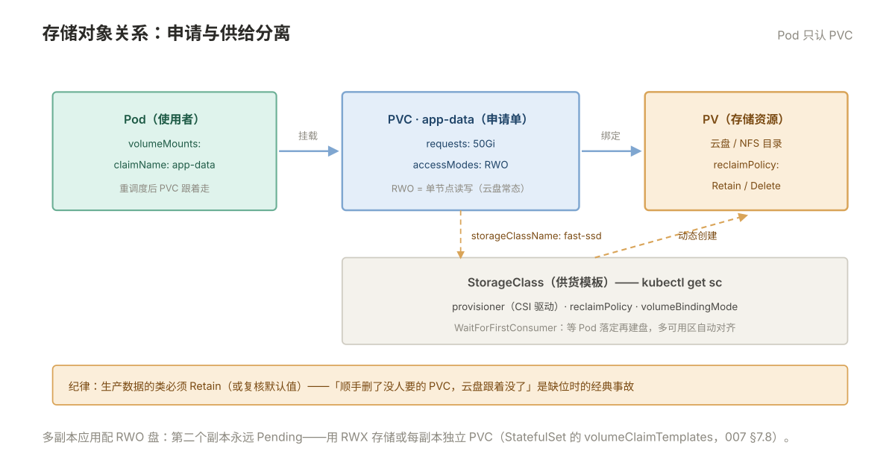

# 007 K8s 存储与配置

> **解决**：配置怎么注入容器，有状态数据怎么落地。  
> **范围**：ConfigMap / Secret · emptyDir / hostPath · PV / PVC / StorageClass。  
> **口径**：Kubernetes 1.28+。  
> **更新**：2026-10-31

## 目录

| 节 | 内容 |
|---|---|
| 7.1 | 配置注入的两种方式：环境变量与文件挂载 |
| 7.2 | ConfigMap：创建、引用、更新后怎么生效 |
| 7.3 | Secret：base64 不是加密、RBAC 管住可读性 |
| 7.4 | Pod 内临时存储三件套：emptyDir、hostPath、可写层 |
| 7.5 | PV 与 PVC：存储资源与使用申请的分离 |
| 7.6 | 访问模式与回收策略：RWO/ROX/RWX，Retain/Delete |
| 7.7 | StorageClass 与动态供给：PVC 一申请盘就到 |
| 7.8 | 数据库上 K8s 的存储：StatefulSet 注记 |
| 7.9 | 八个坑 |
| 7.10 | 本章检查清单 |

---

## 7.1 配置注入的两种方式

003 册在 Docker 层面用 `-e` 和 `-v` 注入配置，K8s 里对应两条同样的路，但载体变成了 ConfigMap/Secret：

| 方式 | YAML 写法 | 特点 |
|---|---|---|
| 环境变量 | `env: [{name: LOG_LEVEL, valueFrom: configMapKeyRef…}]` | 改配置**必须重启 Pod** 才生效（进程启动时读） |
| 文件挂载 | `volumes: [{configMap: {name: app-conf}}]` 挂到路径 | ConfigMap 更新后**文件自动同步**（有延迟），应用要支持热加载 |

选择标准与「接入层」之外所有配置管理一致：**值少且启动期确定 → 环境变量；配置文件、证书、需要不重启变更 → 文件挂载**。两种都建立在"配置与镜像分离"上（002 §2.9 的通道思想在 K8s 里的形态）。

---

## 7.2 ConfigMap：创建、引用、更新后怎么生效

ConfigMap 是一组键值：值可以是一行配置，也可以是整个文件。两种创建姿势：

```bash
# 命令式创建（快速实验用）
kubectl create configmap app-conf --from-file=app.properties --from-literal=LOG_LEVEL=info

# 声明式（日常姿势，进 Git）
kubectl apply -f app-config.yaml
```

```yaml
apiVersion: v1
kind: ConfigMap
metadata:
  name: app-conf
data:
  LOG_LEVEL: "info"
  app.properties: |
    timeout=30
    retries=3
```

文件挂载引用后，Pod 里会多出同名文件。**更新的生效行为必须分清**：

- **环境变量方式**：永远不更新。进程已把值读进内存，改 ConfigMap 与它无关——要生效就滚动重启（`kubectl rollout restart`，008 册）；
- **文件挂载方式**：kubelet 会把更新同步到容器内（默认有约一分钟的同步周期），**但用 `subPath` 挂载的单文件永远不会更新**——这是本册第一坑（7.9 展开）。

因此团队纪律通常二选一：要么接受"改配置 = 滚动重启"（简单、确定），要么应用实现配置热加载 + 全部用目录挂载（灵活）。最糟的是"以为热加载了其实没挂对"，徒留玄学。

想强制"改配置立刻滚动重启"，给 Pod 模板注入一个校验和 annotation——配置一变，模板变，触发滚动：

```bash
kubectl annotate deploy web kubectl.kubernetes.io/restartedAt="$(date +%s)" --overwrite
```

另一个常被忽略的开关是 **immutable: true**（创建后不可改，只能删了重建）。两大收益：**防误改**（配置变更必须走 Git 流程）与**降负载**（kubelet 不再持续 watch 这个 ConfigMap）——只读配置、证书类内容建议全开。

---

## 7.3 Secret：base64 不是加密、RBAC 管住可读性

Secret 的结构与 ConfigMap 一模一样，三个"不要误会"：

1. **base64 是编码不是加密**——`echo -n 值 | base64` 谁都能解。它的作用是让二进制/特殊字符安全传输，不是保密；
2. 真正的保密靠三道门：**RBAC**（谁能 get 这个 Secret）、**etcd 加密**（5.3 提过）、**不出现在日志里**（kubectl 输出 Secret 内容时默认打码是最后的防线，不是唯一防线）；
3. Secret 有 **1MB 的大小限制**（etcd 单记录限制），证书链级别的体积没问题，别拿它存数据。

还有一个安全细节值得知道：**Secret 的分发是收敛的**——只分发到"调度的节点上确实引用它的 Pod"，且 kubelet 把它挂在 **tmpfs（内存盘）**里不落盘；1.7 起 etcd 里的 Secret 还支持静态加密。三道门之外，这是第四道：最小化落盘面。

创建与引用（挂载成文件是最常用形态，数据库密码、TLS 证书都走这条路）：

```bash
kubectl create secret generic db-auth --from-literal=password='S3cr3t!'
```

```yaml
containers:
  - name: app
    volumeMounts:
      - name: auth
        mountPath: /run/secrets/db
        readOnly: true
volumes:
  - name: auth
    secret:
      secretName: db-auth
```

K8s 1.21+ 还有 `type: kubernetes.io/tls`（成对的 cert/key）、`docker-registry`（拉私库凭据——`ImagePullSecrets`，009 册 ImagePullBackOff 排障要用）等预制类型，语义更明确。

---

## 7.4 Pod 内临时存储三件套：emptyDir、hostPath、可写层

K8s 里不挂 PV 时，数据落在哪？三个去处，寿命各不相同：

| 载体 | 寿命 | 用途 | 红线 |
|---|---|---|---|
| 可写层（overlayfs） | 容器重启即清 | 极临时产物 | **有状态数据禁止**（003 §3.1 同源理由） |
| `emptyDir` | Pod 生命周期 | 同 Pod 容器间共享的草稿区：排序缓冲、checkpoint | Pod 重建（被驱逐/重调度）即清空 |
| `hostPath` | 节点上的真实目录 | 节点级日志、cgroup、Datadog 类 agent | **Pod 换节点数据就不在**；且有安全风险 |

`emptyDir` 有个变体 `medium: Memory`——挂在内存里（tmpfs），快但计入容器内存限额，超了就是 OOM，只给小体积高频读写用。

排障时想知道 emptyDir 实际占了多少盘，实体路径在节点上：`/var/lib/kubelet/pods/<pod-uid>/volumes/kubernetes.io~empty-dir/<卷名>/`——Pod 被驱逐后这个目录整个消失，这也是"Pod 重建后数据没了"的物理现场。

`hostPath` 要划重点：它是排障与节点级 agent（需要读宿主 `/var/log`、`/proc`）的正当工具，但**业务负载用 hostPath 存数据 = 伪装的持久化**——副本被调度到另一个节点，"持久化"的数据凭空消失，还把 Pod 和节点耦合死了。见到业务 YAML 里出现 hostPath，先问一句"为什么不用 PVC"。

---

## 7.5 PV 与 PVC：存储资源与使用申请的分离

K8s 把存储拆成两个对象，模仿的是"资源与申请"的思路（和 requests/limits 管算力一个思想）：

- **PV（PersistentVolume）**：一块真实的存储资源——一块云盘、一个 NFS 目录。集群里的"库存"；
- **PVC（PersistentVolumeClaim）**：使用者的申请单——"我要 50Gi、可读写"。

```yaml
apiVersion: v1
kind: PersistentVolumeClaim
metadata:
  name: app-data
spec:
  accessModes: ["ReadWriteOnce"]
  resources:
    requests:
      storage: 50Gi
  storageClassName: standard        # 用哪个"供货渠道"，见 7.7
```

Pod 里像挂普通卷一样引用 PVC，K8s 把申请单和库存绑定（bind），卷就挂进了容器：

```yaml
volumes:
  - name: data
    persistentVolumeClaim:
      claimName: app-data
```

这套分离的直接收益：**Pod 与存储解耦**——Pod 重调度到任何节点，PVC 跟着走（同一块盘重新挂上），这正是 7.4 里 hostPath 做不到的"真持久化"。



---

## 7.6 访问模式与回收策略：RWO/ROX/RWX，Retain/Delete

两个必须提前想清楚的策略字段：

**accessModes（访问模式）**——存储后端的物理能力，不是权限配置：

| 模式 | 全称 | 含义 |
|---|---|---|
| RWO | ReadWriteOnce | 单节点读写挂载（**云盘几乎都是这个**） |
| ROX | ReadOnlyMany | 多节点只读 |
| RWX | ReadWriteMany | 多节点读写（NFS/文件存储才有） |

RWO 的隐藏含义是"单节点"而非"单 Pod"：同一节点上的多个 Pod 可以共享一块 RWO 盘，跨节点不行。**部署多副本应用却给了 RWO 盘，第二个副本永远 Pending**——PVC 卡在别的节点上，这是本册最常见故障（7.9）。

**persistentVolumeReclaimPolicy（回收策略）**——PVC 被删后 PV 怎么办：

| 策略 | 行为 | 用途 |
|---|---|---|
| Retain | PV 进入 Released，数据保留，需人工处理 | **数据库、任何"删了就要命"的数据** |
| Delete | 联动删除底层存储 | 无状态重建可用的场景 |

默认策略由 StorageClass 定。纪律：**先看默认是什么再建 PVC**——"顺手删了个没人要的 PVC，云盘跟着没了"是 Retain 缺位时的经典事故。

---

## 7.7 StorageClass 与动态供给：PVC 一申请盘就到

没有动态供给的集群，运维要预先手工创建一堆 PV 等 PVC 来配对——配对条件（容量、模式、类）稍有出入就互相等死。**StorageClass 是"供货模板"**：PVC 声明用哪个类，控制器自动创建对应大小的 PV：

```yaml
apiVersion: storage.k8s.io/v1
kind: StorageClass
metadata:
  name: fast-ssd
provisioner: ebs.csi.aws.com        # 谁来真正创建盘（CSI 驱动）
parameters:
  type: gp3
reclaimPolicy: Delete               # 这个类的默认回收策略
volumeBindingMode: WaitForFirstConsumer   # 延迟到 Pod 调度时才建盘/绑盘
```

`WaitForFirstConsumer` 值得单独记：默认的 Immediate 会在 PVC 创建时立刻建盘，盘落在哪个可用区与后续 Pod 的调度无关——多可用区集群里"Pod 在区 A、盘在区 B"，Pod 永远 Pending。这个模式让建盘延迟到知道 Pod 落哪，可用区自动对齐。云上集群几乎都以此为默认。

运维视角 StorageClass 就是三件事：**看集群有哪些类**（`kubectl get sc`，标 `(default)` 的是不写 storageClassName 时的兜底）、**确认默认类的回收策略**、**生产数据的类必须是 Retain 或手工复核过**。

### 实操：自建 NFS 动态供给（没有云盘的环境）

自建集群最常见的诉求是"NFS 也想动态供给"，五步走通：

1. **NFS 服务器**起好并导出目录（`/data/nfs`，`rw,no_root_squash`）；
2. 部署 **nfs-subdir-external-provisioner**（一个 Deployment + **RBAC 四件套**：ServiceAccount、ClusterRole、ClusterRoleBinding、Role/RoleBinding——它要能 watch 与创建事件）；
3. 部署时声明 NFS 地址与导出路径（values 或 args：`-server=10.0.0.101 -path=/data/nfs`）；
4. 建 **StorageClass**：`provisioner: cluster.local/nfs-subdir-external-provisioner`，`parameters.archiveOnDelete: "true"`（删 PVC 时归档而非真删——NFS 版的 Retain 替代品）；
5. 建 PVC 测试：自动出现 `pvc-xxx` 命名的目录即通。

配合 StatefulSet 的 `volumeClaimTemplates`，每个副本自动在 NFS 下生成独立目录（`数据-mysql-0`、`-mysql-1`）——有序性与存储隔离同时拿到，这是"自建环境数据库上 K8s"的最小可行存储方案。

---

## 7.8 数据库上 K8s 的存储：StatefulSet 注记

数据库可以上 K8s，但它的载体是 **StatefulSet** 而不是 Deployment，差异有三点，都与存储直接相关：

1. **稳定的网络标识**：Pod 名固定（`mysql-0`、`mysql-1`），重建后 DNS 不变——主从复制的拓扑需要这个；
2. **每个副本独享一块 PVC**：StatefulSet 的 `volumeClaimTemplates` 给每个副本生成独立 PVC（`data-mysql-0`），扩副本自动建盘；
3. **有序部署与删除**：0 号起来健康了才起 1 号——主从建立顺序的保证。

提醒一条边界：本册只讲"存储怎么供给"，数据库在 K8s 上的运行与运维（高可用、备份、Operator）是另一个专题，口徑沿用「数据库」册的方法论，工具形态不同而已。**小团队的第一步往往是"数据库先留在虚机/云 RDS，应用容器化"**——这不是保守，是 000 §0.8 的场景判断。

---

## 7.9 八个坑

| # | 坑 | 后果 | 正确做法 |
|---|---|---|---|
| 1 | `subPath` 挂 ConfigMap 单文件 | 改配置永远不生效 | 目录挂载，或接受滚动重启 |
| 2 | 以为 Secret 的 base64 是加密 | 敏感数据裸奔 | RBAC + etcd 加密 + 不进日志 |
| 3 | 多副本应用配 RWO 盘 | 第二个副本永远 Pending | RWX 存储或每副本独立 PVC |
| 4 | 业务数据用 hostPath | 换节点数据消失 | PVC（7.4 红线） |
| 5 | 没确认回收策略就删 PVC | 云盘联动删除，数据没了 | Retain 优先，Delete 类要复核 |
| 6 | 多可用区 + Immediate 绑定 | 盘与 Pod 不同区，Pending | `WaitForFirstConsumer` |
| 7 | 环境变量方式注入配置后改 ConfigMap | 改了没生效，以为热更新 | env 只认启动值，滚动重启 |
| 8 | emptyDir 的 Memory 中档放大对象 | 内存限额被吃穿 OOM | Memory 卷只放小体积高频数据 |

第 1 条展开：`subPath` 的场景是"把 ConfigMap 里的某一个文件挂成容器里的一个文件"（比如只挂 `nginx.conf` 而不想挂整个目录）。代价是**这条路绕过了 ConfigMap 的同步机制**——kubelet 的更新只作用于按 ConfigMap 挂载的目录，subPath 是一次性的普通绑定。排查方法也很直接：`kubectl exec` 进容器看文件的修改时间，与 ConfigMap 的 `Age` 一对就露馅。解法两选一：改成目录挂载（应用容忍多出来的文件），或把"改配置"升级成"滚动重启"流程。

---

## 7.10 本章检查清单

读完能回答这六个问题，这一章就过了：

| # | 问题 |
|---|---|
| 1 | 环境变量与文件挂载两种注入，更新的生效行为差在哪？ |
| 2 | Secret 的 base64 为什么不是加密？真正的保密靠哪三道门？ |
| 3 | emptyDir、hostPath、PV 的寿命分别是什么？业务数据该用哪个？ |
| 4 | RWO 的"一次"指什么？多副本应用挂 RWO 会发生什么？ |
| 5 | Retain 和 Delete 的选择依据是什么？默认策略去哪确认？ |
| 6 | StatefulSet 相比 Deployment 多了哪三个保证？ |

---

> 下一篇：《008 K8s 发布与资源管理》——怎么更新不中断，资源怎么管得住。
