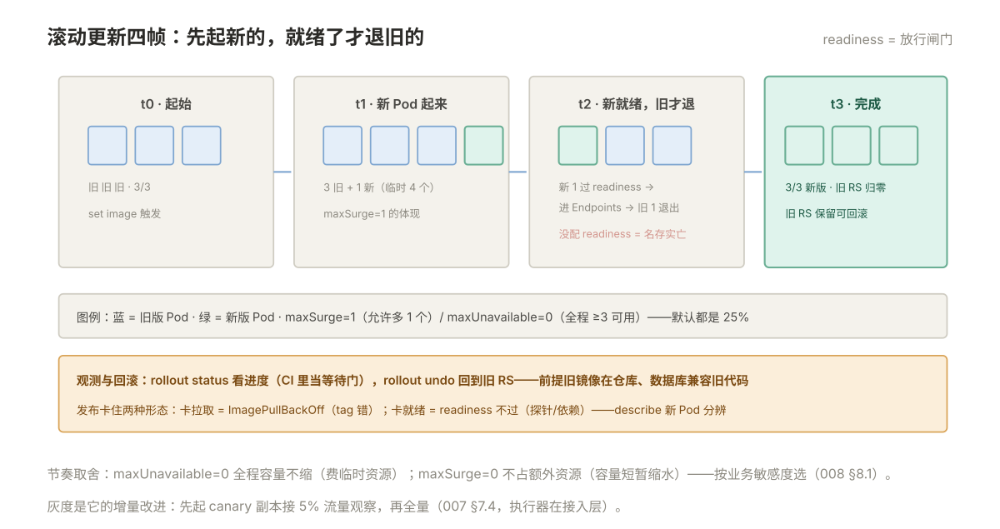

# 008 K8s 发布与资源管理

> **解决**：怎么更新不中断，资源怎么管得住。  
> **范围**：滚动更新与回滚 · 三种探针 · requests/limits 与 QoS · HPA · 驱逐。  
> **口径**：Kubernetes 1.28+，metrics-server 已安装（HPA 前提）。  
> **更新**：2026-10-31

## 目录

| 节 | 内容 |
|---|---|
| 8.1 | 滚动更新全过程：maxSurge / maxUnavailable 怎么控制节奏 |
| 8.2 | 发布状态观测：`rollout status` 与 `rollout history` |
| 8.3 | 回滚：`rollout undo` 的前提与局限 |
| 8.4 | 三种探针：liveness / readiness / startup 各管什么、配错的后果 |
| 8.5 | requests 与 limits：调度的依据与用量的上限 |
| 8.6 | QoS 三档：Guaranteed / Burstable / BestEffort 与驱逐顺序 |
| 8.7 | HPA：按什么扩、扩多快 |
| 8.8 | 节点维护：cordon、drain 与 PodDisruptionBudget |
| 8.9 | 八个坑 |
| 8.10 | 本章检查清单 |

---

## 8.1 滚动更新全过程

「CICD」007 册讲了发布策略的方法论，滚动更新在 K8s 里由 Deployment 原生实现。改镜像的瞬间发生了什么：

```bash
kubectl set image deploy/web web=myapp:1.4.3
```

Deployment 按两个参数控制节奏（默认都是 **25%**）：

| 参数 | 含义 | replicas=3 时的值 |
|---|---|---|
| `maxSurge` | 允许**多出**期望副本数几个新 Pod | 向上取整 = 1，最多同时 4 个 Pod |
| `maxUnavailable` | 允许**少**几个可用副本 | 向下取整 = 0，全程 ≥3 个可用 |

执行循环是：新 RS 起 1 个新 Pod → **readiness 通过后**（进 Endpoints 接流量）→ 旧 RS 减 1 个 → 再起新的……直到新 RS 3 个、旧 RS 归零。readiness 探针在这里扮演"放行闸门"——它没配或秒过，"不中断"就名存实亡（8.4）。



节奏调整的常识：`maxUnavailable: 0`（全程容量不缩水，代价是要临时资源）适合容量敏感业务；`maxSurge: 0`（不额外占资源，容量短暂缩水）适合资源紧张的集群。

**金丝雀发布的三板斧**（不引入额外工具，Deployment 原生能做）——把节奏参数当成"灰度比例"来用：

```bash
# ① 锁定节奏：只多起 1 个新 Pod，一个旧 Pod 都不少（灰度 1/3）
kubectl patch deploy/web -p '{"spec":{"strategy":{"rollingUpdate":{"maxSurge":1,"maxUnavailable":0}}}}'
# ② 推新镜像：只影响那 1 个新 Pod
kubectl set image deploy/web web=myapp:1.4.3
# ③ 暂停：新 Pod 就绪后停止继续替换——灰度状态固定住
kubectl rollout pause deploy/web
```

此时观察指标与用户反馈：没问题就 `rollout resume` 完成发布；有问题就 `rollout undo`（只回滚那 1 个灰度 Pod，损失极小）。**pause 是金丝雀的灵魂**——没有它，滚动更新会一口气跑完。

---

## 8.2 发布状态观测

三个命令覆盖观测需求：

```bash
kubectl rollout status deploy/web      # 当前发布进行到哪、是否完成/卡住
kubectl rollout history deploy/web     # 有哪些版本（revision）
kubectl get rs                         # 新旧 ReplicaSet 的交替实况
```

`rollout status` 是发布自动化里的"等待完成"标准用法——CI 流水线里推完新镜像后接一句它，发布失败（新 Pod 起不来）流水线立刻红，而不是等用户报障（「CICD」008 的 8.6 节把它串进流水线）。

发布"卡住"的两种形态要看清：**卡在镜像拉取**（`get pods` 看 ImagePullBackOff，tag 写错的居多）与**卡在就绪**（新 Pod Running 但 readiness 不过，探针或依赖问题）——`describe` 新 Pod 的 Events 一看便知。

---

## 8.3 回滚：`rollout undo` 的前提与局限

发布发现问题，一键回到上一版：

```bash
kubectl rollout undo deploy/web                    # 回到上一个 revision
kubectl rollout undo deploy/web --to-revision=2    # 回到指定版本
```

它快的本质在 5.6：旧 ReplicaSet 还留着，回滚 = 把旧 RS 扩起来、新 RS 缩下去，又是一次标准的滚动更新。

两个前提要自查：

1. **旧镜像还在仓库里**。undo 只改引用的 tag——如果仓库侧做了清理（「CICD」006 的保留策略误删），Pod 会拉不到镜像，回滚变成新一轮 ImagePullBackOff；
2. **数据库 schema 兼容旧镜像**。回滚镜像不回滚数据库——如果新版本带了不兼容的库变更，旧代码对着新表结构照样跑不通（「CICD」007 的 expand-contract 就是为此存在的）。

`undo` 不是备份策略，是发布流程的安全网。安全网的前提是：发布频率越低、单次跨度越大，undo 的"上一版"与"能用的版本"差距越大——小步快发让 undo 真正可靠。

---

## 8.4 三种探针：liveness / readiness / startup 各管什么、配错的后果

探针是 kubelet 对容器做的小检查（HTTP/TCP/命令），三种探针**语义完全不同**：

| 探针 | 失败的后果 | 回答的问题 |
|---|---|---|
| **liveness** | **重启容器** | 进程是不是死锁/僵死了？ |
| **readiness** | **从 Endpoints 摘除**（不重启） | 现在能不能接流量？（启动中、依赖断、过载） |
| **startup** | 在它成功前暂停另外两个探针 | 慢启动的应用给足宽限了吗？ |

配错的后果比不配更严重，三个经典事故：

1. **liveness 检查依赖外部服务**（如探数据库）：数据库抖一下 → 所有 Pod 被连环重启 → 全站重启风暴。liveness 只问进程自身死活，**永远不要把外部依赖放进 liveness**；
2. **readiness 没配**：应用启动要 30 秒，Pod 却在 Running 后立刻进 Endpoints 接流量——头几十秒的请求全部 502。这也是 8.1 滚动更新失真的原因；
3. **readiness 与 liveness 用同一个重检查**：依赖抖动时既重启又摘流，把一次抖动放大成两次事故。分工要清楚：liveness 轻（进程活），readiness 重（能服务）。

慢启动应用（JVM、大缓存预热）用 startup 探针兜底：它成功之前 liveness/readiness 都不生效，避免"启动慢被 liveness 误杀"。

---

## 8.5 requests 与 limits：调度的依据与用量的上限

每个容器可以声明两个水位，语义必须分清：

| 字段 | 含义 | 谁在用 |
|---|---|---|
| `requests` | **申请量**：调度器按它找节点，节点按它记账 | scheduler / `kubectl top` 对比 |
| `limits` | **上限**：运行时硬约束 | 内核 cgroup |

```yaml
resources:
  requests:
    cpu: 250m        # 250 毫核 = 0.25 核（m = milli）
    memory: 512Mi
  limits:
    cpu: "1"
    memory: 1Gi
```

**CPU 与内存超限的行为完全不同**（004 §4.6 的结论在 K8s 里原样成立）：CPU 超 limit 被 throttle（变慢不杀）；内存超 limit 被 OOMKill（137）。所以内存 limit 宁可稍宽，CPU limit 可按需收紧。

纪律两条：**requests 必填**——不填的 Pod 对调度器是隐形的（节点记账没有它），资源水位与驱逐判断全部失真；**requests 贴近真实用量**——虚高会造成"集群看着满了实际空转"，虚低会造成节点超卖后的性能互踩。`kubectl top` 与 requests 的比值是校准依据。

---

## 8.6 QoS 三档：Guaranteed / Burstable / BestEffort 与驱逐顺序

K8s 按 requests/limits 的填写情况自动给 Pod 分 QoS 等级——**它决定节点资源紧张时谁先被驱逐**：

| QoS | 判定条件 | 驱逐顺序 |
|---|---|---|
| Guaranteed | 所有容器 **requests == limits**（CPU 与内存都是） | 最后 |
| Burstable | 设置了 requests，但低于 limits | 中间 |
| BestEffort | **什么都没设** | **最先** |

默认什么都不填 = BestEffort = 节点一紧张第一批被赶走。生产负载至少做到 Burstable，核心服务做到 Guaranteed——这不是性能优化，是**资源紧张时的生存排序**。

驱逐（eviction）的触发者是 kubelet：节点内存/磁盘压力超过阈值时，它按 QoS 优先级 + 实际用量超 requests 的程度挑 Pod 清退，被清的 Pod 由其 Deployment 在其他节点重建。理解这个机制，"凌晨三点一批 Pod 集体重启"的日志才读得懂——先看是不是节点压力，再看谁没填 requests。

### LimitRange 五参数：给"没填 requests 的 Pod"自动兜底

ResourceQuota 管总量，**LimitRange 管单个**——命名空间里没写 requests/limits 的 Pod 由它自动补默认值。五个参数：

| 参数 | 管什么 |
|---|---|
| `max` | 单容器/单 Pod 的上限（超了拒绝创建） |
| `min` | 下限（低于拒绝——防止 requests 填得虚低） |
| `default` | **未写 limits 时自动补的默认 limit** |
| `defaultRequest` | **未写 requests 时自动补的默认 request** |
| `maxLimitRequestRatio` | limit/request 的最大倍数（防"request 极小 limit 巨大"的绕过） |

有了它，"requests 不填 → 调度盲"的坑在命名空间层面就有了兜底——这也是 5.8 基线两件套的另一半。

---

## 8.7 HPA：按什么扩、扩多快

HPA（Horizontal Pod Autoscaler）按指标自动调整 `replicas`，最常用 CPU 利用率：

```yaml
apiVersion: autoscaling/v2
kind: HorizontalPodAutoscaler
metadata:
  name: web
spec:
  scaleTargetRef:
    apiVersion: apps/v1
    kind: Deployment
    name: web
  minReplicas: 2
  maxReplicas: 10
  metrics:
    - type: Resource
      resource:
        name: cpu
        target:
          type: Utilization
          averageUtilization: 70     # 平均 CPU 达 requests 的 70% 就扩
```

三个前提与常识：

1. **requests 没配 HPA 就不工作**——CPU 利用率的分母就是 request，502 册的"隐形 Pod"在这里再次爆雷；
2. **metrics-server 必须已安装**（提供 Pod 的实时 CPU 数据），`kubectl top` 能出数就说明装了；
3. **HPA 调的是副本数不是规格**——它解决"流量波动"，不解决"单 Pod 内存泄漏"（那是 VPA/重启的事，别混）。

扩缩不是瞬时完成的：指标采集有周期、扩容后新 Pod 还要过 readiness——**HPA 是应对分钟级的缓变，应对秒级突刺靠的是冗余副本和入口缓冲**，这条预期要先立对。

---

## 8.8 节点维护：cordon、drain 与 PodDisruptionBudget

给节点打补丁、换机器时的标准三步：

```bash
kubectl cordon node-1                 # ① 标记不可调度：新 Pod 不再来
kubectl drain node-1 --ignore-daemonsets   # ② 清空：存量 Pod 优雅驱逐重排
# … 维护操作 …
kubectl uncordon node-1               # ③ 恢复调度
```

被 drain 驱逐的 Pod 由其 Deployment 在别的节点重建——**前提是有副本冗余**。单副本应用 drain 即中断，这正是 PDB（PodDisruptionBudget）存在的意义：

```yaml
apiVersion: policy/v1
kind: PodDisruptionBudget
metadata:
  name: web-pdb
spec:
  minAvailable: 2        # 或 maxUnavailable: 1
  selector:
    matchLabels:
      app: web
```

它约束**自愿中断**（drain 属于此类）：无论怎么驱逐，可用副本不得低于 2。节点维护流程因此闭环为：**冗余副本（≥2）→ PDB 兜底 → cordon → drain → 维护 → uncordon**。

---

## 8.9 八个坑

| # | 坑 | 后果 | 正确做法 |
|---|---|---|---|
| 1 | readiness 没配 | 启动期流量全 502，滚动更新失真 | 探针必配（8.4） |
| 2 | liveness 探了外部依赖 | 依赖抖动引发全站重启风暴 | liveness 只探进程自身 |
| 3 | requests 不填 | 调度盲、驱逐盲、HPA 失效 | requests 必填（LimitRange 兜底） |
| 4 | 内存 limit 给太紧 | 峰值 OOMKilled 137，反复重启 | 贴近峰值 × 安全系数 |
| 5 | 核心 Pod BestEffort | 节点紧张第一批被驱逐 | 至少 Burstable，核心 Guaranteed |
| 6 | 单副本 + drain | 维护节点 = 自我中断 | 副本 ≥2 + PDB |
| 7 | 回滚时不看数据库兼容 | 旧镜像对新 schema 跑不通 | expand-contract（「CICD」007） |
| 8 | 以为 HPA 能扛秒级突刺 | 扩容赶不上流量爬坡 | 冗余副本兜底，HPA 管缓变 |

第 1 条展开，因为它同时是 6.5 的故障源：readiness 探针 `/healthz` 返回 503 的 Pod，**容器是活的（liveness 通过）、日志正常（应用自认健康）、Service 却 100% 不通**——现象组合非常迷惑。反射是先 `describe` 看 `Readiness probe failed` 的事件，再确认探针路径/端口/依赖三件事。应用侧的对应义务：`/healthz` 只报进程活，`/readyz` 才报依赖与预热状态，两个端点分开。

---

## 8.10 本章检查清单

读完能回答这六个问题，这一章就过了：

| # | 问题 |
|---|---|
| 1 | maxSurge / maxUnavailable 各控制什么？readiness 在滚动更新里扮演什么角色？ |
| 2 | `rollout undo` 的两个前提是什么？ |
| 3 | 三种探针失败的后果分别是什么？liveness 的红线是什么？ |
| 4 | CPU 超 limit 和内存超 limit 的后果差在哪？ |
| 5 | QoS 三档怎么判定？驱逐顺序是什么？ |
| 6 | 节点维护的完整流程是什么？PDB 保护的是哪类中断？ |

---

> 下一篇：《009 K8s 排障与生产实践》——出了问题从哪查起，生产集群要注意什么。
