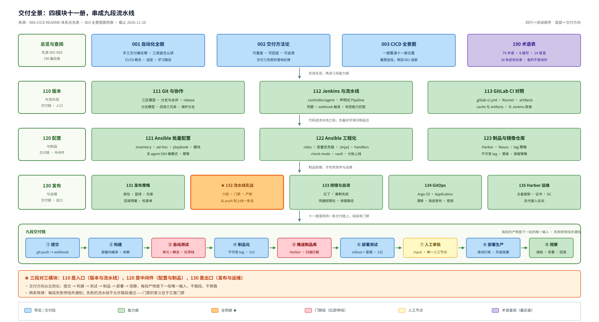

# CICD 全景图

> **这一册回答**：CICD 板块 11 册在交付链路上的位置，一张图看清。
> **怎么用**：看图定段，再回 [001-自动化全貌](001-自动化全貌.md) 选册。

## 体系一张图

## 图例说明

| 模块 | 册 | 交付链路段 |
| --- | --- | --- |
| 110-版本与流水线 | 111 / 112 / 113 | 提交 → 触发构建（版本控制 + CI 引擎） |
| 120-配置与制品 | 121 / 122 / 123 | 环境配置（Ansible）+ 制品晋级与仓库 |
| 130-发布与运维 | 131 ~ 135 | 发布策略 → 流水线串装 → 排错 → GitOps → Harbor 运维 |
| 附录 | 190 | 术语 · 缩写 · 易混对 · 症状反查 |

图中自左向右是**交付方向**：每段产出物是下一段的唯一输入（提交 → 构建 → 制品 → 部署 → 观察），不跳段、不旁路。三个模块对应交付链的三段：**入口**（版本与流水线）、**中间件**（配置与制品）、**出口**（发布与运维）。

---

**上一篇**：[002-交付方法论](002-交付方法论.md)　**下一篇**：进模块 [110-版本与流水线/111-Git与协作](110-版本与流水线/111-Git与协作.md)
