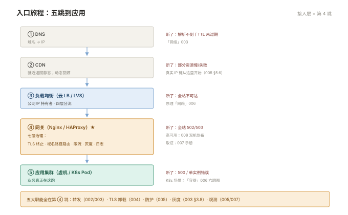

# 000 接入层全貌

> **解决**：流量从哪进来、这一层管什么、选哪个组件。  
> **范围**：入口全景（DNS→CDN→LB→网关）· 选型对照 · 学习路径。  
> **口径**：与 [README](README.md) 一致。  
> **更新**：2026-10-31

## 目录

| 节 | 内容 |
|---|---|
| 0.1 | 一条请求的入口旅程：DNS → CDN → LB → 网关 → 应用 |
| 0.2 | 接入层管什么：转发、卸载、防护、灰度、观测 |
| 0.3 | Nginx 的模型：事件驱动为什么能一机万连 |
| 0.4 | 选型对照：Nginx / HAProxy / 云 LB / API 网关 |
| 0.5 | 开源版 vs 商业版 vs 三方模块 |
| 0.6 | 与云原生接入（Ingress）的关系 |
| 0.7 | 十个误解 |
| 0.8 | 本套学习路径与各册映射 |

---

## 0.1 一条请求的入口旅程

「接入层」的定义要靠一条真实请求的旅程来讲。用户在浏览器敲 `https://app.example.com/api/list`，到应用收到请求，中间经过：

```plain
浏览器
  │ ① DNS 解析：app.example.com → CDN 边缘节点 IP（或直连 LB IP）
  ▼
CDN（如果接了）：就近返回静态资源；动态请求继续往源站转
  ▼
负载均衡（云 SLB / 自建 LVS+Keepalived）：公网 IP 的持有者，四层分流
  ▼
网关 / 反向代理（Nginx / HAProxy）：
     TLS 终止 · 按域名与路径路由 · 限流 · 压缩 · 缓存 · 灰度权重
  ▼
应用集群（虚机 / K8s Pod）：业务真正在这跑
```



每一跳都可能断，**每跳断了的现象不同**——这张图右侧的完整故障现象表在 007 册 §7.1（取证总纲）与「容器」006 §6.9（K8s 场景的对照图）。本套的目标是：九册读完，这张图上的每一跳你都能配置、能观测、能取证。

一个先立住的观念：**接入层是"用户体验的第一责任人"**——应用挂一台无所谓（有 LB），入口挂了是全站事故。这决定了 008 册（高可用）在本套里的分量。

---

## 0.2 接入层管什么：转发、卸载、防护、灰度、观测

接入层组件（Nginx 为代表）的五大职能，每一条对应本套的一册：

| 职能 | 是什么 | 本套在哪 |
|---|---|---|
| **转发**（反向代理/负载均衡） | 按域名/路径把流量分给后端，后端挂了自动摘除 | 002 / 003 |
| **TLS 卸载** | 在入口解密 HTTPS，后端走明文（内网）；证书统一管理 | 004 |
| **防护** | 限流、IP 黑白名单、认证、WAF 接入位 | 005 |
| **灰度** | 按权重把少量流量导给新版本——发布的执行器 | 003 §3.8（衔接「CICD」007） |
| **观测** | 访问日志、错误日志、耗时字段——排障与容量分析的数据源 | 005 / 007 |

反过来读这张表也很重要：**接入层不管什么**——它不处理业务逻辑（那是应用的事）、不做持久化、不理解数据库。见到"在 Nginx 配置里用 Lua 写业务规则"的需求先打个问号（OpenResty 是另一个专题，本套边界外）。

---

## 0.3 Nginx 的模型：事件驱动为什么能一机万连

Nginx 能用一台 4 核机器接住上万并发连接，靠的是与 Apache 传统模式（每连接一个进程/线程）完全不同的模型：

- **一个 master + N 个 worker**：master 读配置、绑端口、管理 worker（001 册 §1.8）；worker 是干活的进程，`worker_processes auto` 即核数；
- **每个 worker 单线程 + 事件循环（epoll）**：成千上万个连接注册在一个事件循环里，谁的数据到了处理谁——**慢的连接不会阻塞别的连接**（0.1 里"慢客户端拖垮后端"的问题，Nginx 用缓冲机制隔离，002 册 §2.6）；
- **容量公式**：并发连接数 ≈ worker 数 × `worker_connections`，而"代理一个请求"要占客户端与后端两条连接——公式的精确用法在 006 册 §6.1。

这套模型的运维含义：Nginx 的性能问题很少是"并发太大"，更多是**配置的某一项（缓冲、超时、gzip）与业务特征不匹配**——这也是为什么 007 册的故障手册按"现象→取证"组织而不是按"参数"组织。

---

## 0.4 选型对照：Nginx / HAProxy / 云 LB / API 网关

四个常被拿来比较的组件，真实差异在"定位"：

| | Nginx | HAProxy | 云 LB | API 网关 |
|---|---|---|---|---|
| 定位 | Web 服务器 + 反向代理 + LB 三合一 | 专业负载均衡器 | 托管的流量入口 | 面向 API 的管理层 |
| 健康检查 | 开源版被动（003 §3.7） | **主动检查** | 托管提供 | 依实现 |
| 动态配置 | reload（秒级，无感） | 运行时 API 可改 | 控制台/API | 热更新 |
| 静态文件 | **强项**（sendfile/缓存） | 无此能力 | 无 | 通常无 |
| 生态/扩展 | 模块/Lua（OpenResty） | 纯 LB 语义 | 云锁定 | 插件体系（鉴权/限流） |

务实的选择树：**对外统一入口且要管静态资源/复杂 rewrite → Nginx**；**纯流量分发、要主动健康检查 → HAProxy**；**云上想少运维一层 → 云 LB 打底 + Nginx 做七层**；**微服务 API 治理（鉴权/计量/文档）→ API 网关（通常部署在 Nginx 之后）**。三者叠用很常见：云 LB → Nginx/Ingress → 应用。本套主线是 Nginx（使用面最广），HAProxy 在 008 作为高可用搭档出场。

---

## 0.5 开源版 vs 商业版 vs 三方模块

本套的口径是**开源版 Nginx**，三个能力边界要提前知道（都用得上时再考虑升级/替代）：

| 能力 | 开源版 | Nginx Plus（商业） |
|---|---|---|
| 被动健康检查（失败摘除） | ✓（003 §3.3） | ✓ |
| **主动健康检查**（定期探测） | ✗ | ✓ |
| 会话保持 | 仅 ip_hash | ✓（cookie sticky） |
| 动态 upstream API | ✗ | ✓ |

开源版的三个常见补位方案：主动健康检查用 **HAProxy 顶在 Nginx 前**（008）、或三方模块（`nginx_upstream_check_module`——维护状态一般，引入需评估）、或外部分布式探测 + 动态改配置。**会话保持**用 ip_hash 或应用侧集中 session（Redis）。知道边界在哪，选型时才不会被"为什么 Nginx 没有这个功能"绊住。

---

## 0.6 与云原生接入（Ingress）的关系

K8s 的对外入口（Ingress Controller）多数就是 Nginx——`ingress-nginx` 是 Nginx + 一个自动生成配置的 K8s 控制器。本套的语法知识**直接迁移**：

- `proxy_pass`、超时、缓冲（002 册）→ Ingress 的 annotations（`nginx.ingress.kubernetes.io/proxy-read-timeout` 等）；
- 限流（005 册）→ `limit-rps` 注解；
- TLS 证书（004 册）→ `tls` 段 + Secret。

差异是**配置的组织方式**：本套是手写 server/location，K8s 是声明 Ingress 资源由控制器生成配置。学完本套再看 ingress-nginx 的注解表，会是一片熟悉的名字——这也是本套排序在「容器」006 之前不必、之后不迟的原因。

---

## 0.7 十个误解

| # | 误解 | 实际 |
|---|---|---|
| 1 | Nginx 配置改完就生效 | 要 `nginx -t` + reload；reload 失败旧配置继续服务 |
| 2 | `EXPOSE`/`listen` 之一就能对外 | `listen` 绑端口，防火墙/安全组还要放行 |
| 3 | 负载均衡就是平均分 | 按权重/连接数/会话分，均匀≠正确 |
| 4 | HTTPS 上了就安全 | 证书链、协议版本、套件、HSTS 都有坑 |
| 5 | 限流只防攻击 | 也防自己人（上游故障引发的雪崩重试） |
| 6 | Nginx 会自动探测后端好坏 | 开源版被动摘除，恢复感知慢（003） |
| 7 | 日志就是访问记录 | error log 才是排障第一现场 |
| 8 | 高可用=部署两台 | VIP 漂移、脑裂、回切都要设计（008） |
| 9 | CDN 前面就不用管真实 IP | 限流与风控的键全在"拿到真实 IP" |
| 10 | Nginx 性能调优就是改 worker 数 | 瓶颈多在缓冲/超时/gzip 与业务的错配 |

---

## 0.8 本套学习路径与各册映射

```plain
全景          000（本册）
Nginx 主线    001 配置体系 ──▶ 002 反向代理 ──▶ 003 负载均衡
                  │
专项          004 HTTPS 证书 ──▶ 005 日志与限流 ──▶ 006 性能调优
                  │
收口          007 故障排查手册 ──▶ 008 高可用接入 ──▶ 009 HAProxy 四层
```

横向衔接：TLS 语义在「网络」005、LVS/VRRP 原理在「网络」006、容器里的 Ingress 在「容器」006、灰度发布的上游是「CICD」007——本册 0.1 的旅程图把所有衔接点标了一遍。

---

> 下一篇：《001 Nginx 配置体系》——配置文件怎么组织，改了怎么验证、怎么生效。
