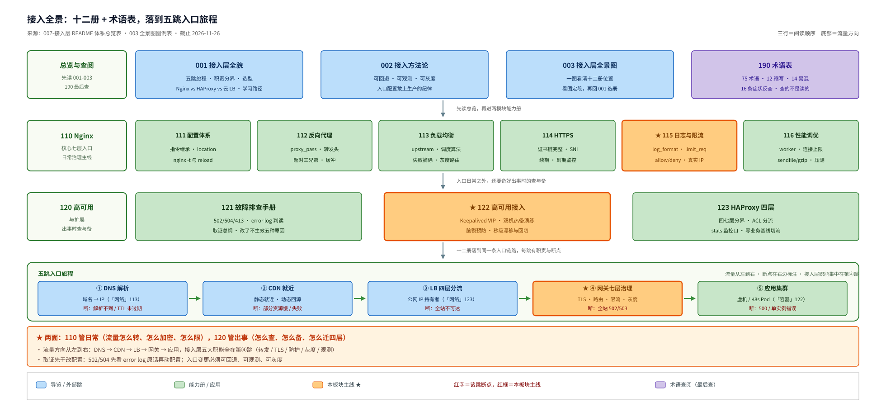

# 接入层全景图

> **这一册回答**：接入层板块 12 册在流量链路上的位置，一张图看清。
> **怎么用**：看图定段，再回 [001-接入层全貌](001-接入层全貌.md) 选册。

## 体系一张图

## 图例说明

| 模块 | 册 | 流量链路段 |
| --- | --- | --- |
| 110-Nginx核心 | 111 / 112 / 113 / 114 / 115 / 116 | 七层入口主线：配置 → 反代 → 负载均衡 → HTTPS → 日志限流 → 调优 |
| 120-高可用与扩展 | 121 / 122 / 123 | 入口自己出问题：排查取证 → 双机热备 → 四层转发 |
| 附录 | 190 | 术语 · 缩写 · 易混对 · 症状反查 |

图中自外向内是**流量方向**：DNS → CDN → LB → 网关 → 应用，每跳有职责与断点。两个模块对应入口的两面：**110 管日常**（流量怎么转、怎么加密、怎么限），**120 管出事**（怎么查、怎么备、怎么迁四层流量）。

---

**上一篇**：[002-接入方法论](002-接入方法论.md)　**下一篇**：进模块 [110-Nginx核心/111-Nginx配置体系](110-Nginx核心/111-Nginx配置体系.md)
