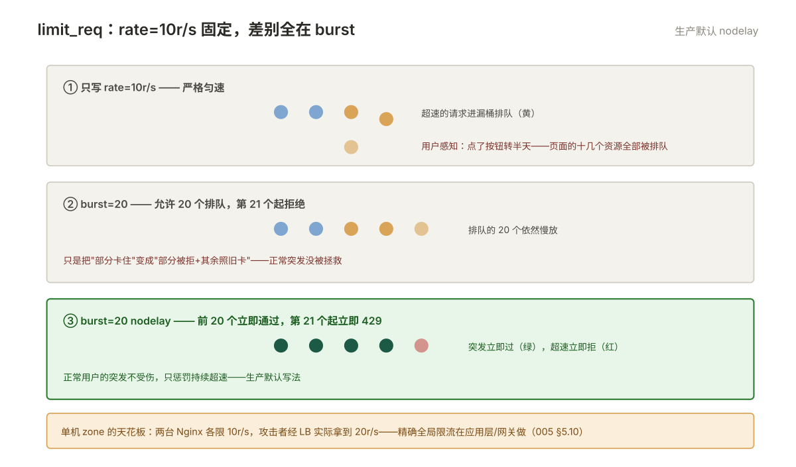

# 005 日志与访问控制

> **解决**：谁来了、被拦了，日志怎么管、流量怎么限。  
> **范围**：log_format · 日志切分 · limit_req/limit_conn · auth_basic · allow/deny。  
> **口径**：Nginx 1.24+ 开源版。  
> **更新**：2026-10-31

## 目录

| 节 | 内容 |
|---|---|
| 5.1 | log_format：默认格式少了什么，运维要加哪几个字段 |
| 5.2 | 把 upstream 耗时记进日志：取证价值 |
| 5.3 | 日志切分：logrotate 配置与 USR1 信号 |
| 5.4 | limit_req：速率与突发（rate / burst / nodelay） |
| 5.5 | limit_conn：并发连接限制 |
| 5.6 | 限流键的选择：CDN/代理之后的真实 IP 问题 |
| 5.7 | auth_basic：内部系统快速加门 |
| 5.8 | allow / deny：IP 白名单与封禁 |
| 5.9 | 日志分析入门：TOP IP、TOP URI、慢请求提取 |
| 5.10 | 十三个坑 |
| 5.11 | 本章检查清单 |

---

## 5.1 log_format：默认格式少了什么，运维要加哪几个字段

默认 combined 格式只有客户端视角的字段，**没有 upstream 的任何信息**——007 册的取证全靠补上的这几个字段。生产可直接用的格式：

```nginx
log_format main '$remote_addr - $remote_user [$time_local] "$request" '
                '$status $body_bytes_sent "$http_referer" '
                '"$http_user_agent" '
                'rt=$request_time urt=$upstream_response_time '
                'ua=$upstream_addr us=$upstream_status';

access_log /var/log/nginx/access.log main;
```

新增四字段的用途：

| 字段 | 含义 | 用来干什么 |
|---|---|---|
| `rt=$request_time` | Nginx 处理整条请求的耗时 | 分辨"Nginx 慢"还是"后端慢" |
| `urt=$upstream_response_time` | **后端响应耗时** | 慢请求定位主字段（007） |
| `ua=$upstream_addr` | 这条请求打到了哪个后端 | 负载分布/灰度观察（003 §3.2） |
| `us=$upstream_status` | 后端返回的状态码 | 502/504 判定（007 判定树） |

改 log_format 会作用到**整条 access log 的解析器**（采集、报表都按格式切字段）——变更要通知下游（ELK/采集器），这与 000 §0.2"观测"职能的一致性要求。

---

## 5.2 把 upstream 耗时记进日志：取证价值

单独一节讲两个字段的高级用法，它们是 007 取证树的语言。

**`urt` 的读法**：`urt=0.002`（2ms，后端很快）→ 慢在 Nginx 自身或网络；`urt=4.950` → 后端慢（去查应用/数据库）；**`urt=0.001, 4.900`（逗号分隔多个值）→ 请求在第一个后端失败重试了第二个**——重试行为本身暴露 upstream 摘除/超时配置的问题（003 §3.3）。

**`ua` 的读法**：`ua=10.0.1.11:8080`（单值）正常；`ua=:8080`（空地址）= 没走到 upstream（在 Nginx 层被拦/缓存命中）；多个逗号值与 urt 对应。两个字段联动，一条日志能回答"慢在哪、试了几次、打给谁"三件事——**这就是 5.1 说"必加"的原因**。

---

## 5.3 日志切分：logrotate 配置与 USR1 信号

access.log 不切分就是磁盘杀手（000.2 观测职能的反面）。logrotate 标准配置：

```plain
# /etc/logrotate.d/nginx
/var/log/nginx/*.log {
    daily                # 每天切
    rotate 14            # 保留 14 份
    compress             # 旧日志 gzip
    missingok
    notifempty
    dateext              # 文件名带日期：access.log-20261031
    sharedscripts
    postrotate
        [ -f /var/run/nginx.pid ] && kill -USR1 $(cat /var/run/nginx.pid)
    endscript
}
```

**USR1 信号的作用**：让 master 重新打开日志文件——切分后旧文件改名了，Nginx 还写着旧 inode，USR1 让它切到新文件。这就是 001 §1.8 进程模型知识的落地：master 管文件句柄。`copytruncate` 方案（先拷贝再清空原文件）可以免信号，但截断瞬间有丢日志的小窗口——**USR1 方案是首选**。验证：`logrotate -d /etc/logrotate.d/nginx`（dry-run 看它会做什么）。

切分之外还有两个静默坑：**轮转产物名若仍匹配原通配**（比如配置了 `extension .log` 产物仍以 `.log` 结尾），会被下一轮通配再次轮转——产物名带日期（dateext）或配 `olddir` 子目录隔离；`include /etc/logrotate.d` **不忽略** `.bak.20260918` 这类改名文件——废弃配置要 `mv` 出该目录（别留原地），改完 `logrotate -d` 干跑确认，否则同一天两套命名轮两次。

---

## 5.4 limit_req：速率与突发（rate / burst / nodelay）

limit_req 是**速率限制**（每秒几个请求），漏桶算法，三个参数的语义必须精确：

```nginx
# http 层：定义限流域（按 IP，binary 是省内存的二进制形式）
limit_req_zone $binary_remote_addr zone=perip:10m rate=10r/s;

server {
    location /api/ {
        limit_req zone=perip burst=20 nodelay;
        limit_req_status 429;        # 超限返回码（默认 503，429 更语义化）
    }
}
```

`burst` 与 `nodelay` 的组合语义（最易错处）：

| 写法 | 行为 |
|---|---|
| 只 `rate=10r/s` | 严格匀速：超出的请求**排队等**，用户感知为"卡了很久才响应" |
| `burst=20` | 允许 20 个排队，第 21 个起拒绝——但排队的那 20 个**还是慢** |
| `burst=20 nodelay` | 允许 20 个**立即通过**，第 21 个起立即 429——正常用户的突发不受伤 |

**生产默认写第三种**：`nodelay` 让正常突发（页面一次拉十几个资源）不受惩罚，只惩罚持续超速（脚本/攻击）。2M 的 zone 约 1.6 万个 IP 状态，容量按公网规模算。

---




## 5.5 limit_conn：并发连接限制

limit_conn 管"同时几个连接"，与 limit_req（每秒几个请求）互补：

```nginx
limit_conn_zone $binary_remote_addr zone=connperip:10m;

server {
    location /download/ {
        limit_conn connperip 5;      # 单 IP 同时最多 5 条连接
        limit_conn_status 429;
    }
}
```

它防的是**连接型滥用**：单 IP 开 500 个连接挂着（慢速下载占满连接池、慢速攻击）。注意连接≠请求：HTTP/2 复用下正常浏览器一条连接跑多请求，limit_conn 的额度要按协议形态调；下载类大文件场景它最有价值（006 的容量公式的守护者）。

---

## 5.6 限流键的选择：CDN/代理之后的真实 IP 问题

限流的键是 `$binary_remote_addr`——**直连 Nginx 的那个 IP**。一旦前面有 CDN/代理/另一层 LB，这个值就是 CDN 节点的 IP：**全站用户共享几十个键，限流会误伤全体**（CDN 一台节点的正常流量就超 10r/s）。

解法是先恢复真实 IP 再限流——realip 模块两行：

```nginx
# http 层
set_real_ip_from 10.0.0.0/8;          # 声明：这些网段来的 XFF 是可信的（CDN/内网 LB）
real_ip_header X-Forwarded-For;        # 从 XFF 里取真实客户端 IP
real_ip_recursive on;                  # 递归剔除可信代理段，取第一个不可信 IP

# 之后 $remote_addr / $binary_remote_addr 就是真实客户端 IP
limit_req_zone $binary_remote_addr zone=perip:10m rate=10r/s;
```

`recursive on` 的语义要理解：XFF 链 `伪造IP, CDN, 内网LB` 中，从右往左剔除可信段，取第一个不可信地址——**这同时防了"伪造第一条 XFF"的绕过**（002 §2.3 的安全注记）。可信段清单要与真实架构一致：CDN 的 IP 段（官方公布）+ 自己的 LB 段。

---

## 5.7 auth_basic：内部系统快速加门

内部系统（监控页、管理后台）最快的门是 HTTP Basic 认证：

```nginx
location /admin/ {
    auth_basic "Admin Area";
    auth_basic_user_file /etc/nginx/.htpasswd;
}
```

```bash
# 生成密码文件（apache2-utils 提供 htpasswd，或用 openssl）
htpasswd -bc /etc/nginx/.htpasswd ops 'S3cret!'
# openssl passwd -apr1 'S3cret!'  →  手动拼 "ops:$apr1$..."
```

三个边界要清楚：**Basic 认证的密码每次请求都传（Base64 编码非加密）**——必须在 HTTPS 下用（004 册是前提）；**它是"门"不是"权限体系"**——没有角色、没有审计，复杂需求上应用层或网关；**密码文件属主/权限 600**，htpasswd 的加密算法选 apr1（bcrypt 支持需编译）。

---

## 5.8 allow / deny：IP 白名单与封禁

`ngx_http_access_module` 提供 IP 级黑白名单，**按配置顺序逐条检查，命中即停**：

```nginx
location /admin/ {
    allow 10.0.0.0/8;         # 内网全放
    allow 203.0.113.5;        # 指定办公出口
    deny all;                 # 其余全拒
}
```

三个要点：**顺序即逻辑**（`deny all` 放前面等于全拒——与 add_header 的覆盖问题不同，这里是顺序语义）；**deny 返回 403**，要返回自定义页配 `error_page 403 /maintenance.html`；**真实 IP 依赖 5.6**——CDN 后面 deny 的"IP"是 CDN 节点，白名单形同虚设。它适合粗粒度门禁（办公网限定、封扫段），细粒度风控在应用层/WAF（000 §0.5 的边界）。

---

## 5.9 日志分析入门：TOP IP、TOP URI、慢请求提取

有了 5.1 的格式，三条 awk 命令覆盖日常分析（排除本机与健康检查的干扰项是通用前缀）：

```bash
# TOP 10 来源 IP
awk '{print $1}' access.log | sort | uniq -c | sort -rn | head

# TOP 10 URI（第 7 字段是 $request 里的路径，按格式微调）
awk '{print $7}' access.log | sort | uniq -c | sort -rn | head

# 慢请求：后端耗时 > 2s 的清单（urt= 字段，格式含在本册 log_format 里）
grep -oE 'urt=[0-9.]+' access.log | awk -F= '$2 > 2 {print $2}' | sort -rn | head

# 某个 IP 的行为轨迹
grep '^203.0.113.5 ' access.log | tail -50
```

这只是入门级——量级上来后进 ELK/Loki（「监控」生态的日志支柱），但**命令行分析的能力不能丢**：故障现场的日志在文件里，等不起采集管道。

---

## 5.10 十三个坑

| # | 坑 | 后果 | 正确做法 |
|---|---|---|---|
| 1 | 默认日志格式直接用 | 排障字段缺失 | 5.1 的 main 格式 |
| 2 | 日志不切分 | 磁盘写满 | logrotate + USR1（5.3） |
| 3 | `burst` 不加 `nodelay` | 正常用户被排队卡顿 | 生产默认 nodelay（5.4） |
| 4 | CDN 后用 $remote_addr 限流 | 全站被误伤 | realip 先行（5.6） |
| 5 | deny all 写在白名单前 | 全拒 | 顺序即逻辑（5.8） |
| 6 | Basic 认证跑在 HTTP | 密码裸奔 | 先上 HTTPS（004） |
| 7 | 限流只对单机生效 | 集群 N 台 = N 倍额度 | 分布式限流走应用层/网关 |
| 8 | 分析时不算健康检查 | TOP URI 全是 /healthz | grep -v 排除干扰项 |
| 9 | server 级写了 access_log | **覆盖而非叠加**：该站点不再进 http 级全局日志，全局统计悄悄少一块 | 分域日志的站点要全局留档时显式双写（5.1） |
| 10 | access_log 漏写格式名 | 静默回退内置 combined，**没有 urt/ua/us**，502/超时彻底失证 | 每个 access_log 显式带格式名（5.1） |
| 11 | access_log 路径带变量 | 文件由 **worker** 打开（固定路径是 master 打开），目录属主不对则每条请求 Permission denied、日志全丢 | 变量路径所在目录 chown 给 worker 用户（5.3 的进程模型） |
| 12 | 想给 error_log 上变量路径或 json | error_log **不支持变量路径，也不支持 json 格式** | 分域 error 只能逐 server 写固定路径；结构化字段只能 access 出 json（5.1） |
| 13 | logrotate 产物仍匹配原通配 / 目录里留 `.bak.日期` 旧配置 | 产物被下一轮再轮转；废弃配置照样被轮，同一天双份 | dateext 或 `olddir` 隔离；废弃配置 `mv` 出目录 + `logrotate -d` 干跑（5.3） |

第 7 条展开：limit_req 的状态（zone）在**单台 Nginx 的内存里**——两台 Nginx 各限 10r/s，经过 LB 的攻击者实际拿到 20r/s。这是单机限流的天花板：**入口层单机限流适合"挡明显的单点滥用"，精确的全局限流要应用层/分布式网关做**。接入层与应用的限流分工：接入层管粗（按 IP 的硬上限），应用层管细（按用户/账户的业务额度）——两层都要有，但别指望接入层做应用层的事。

---

## 5.11 本章检查清单

读完能回答这六个问题，这一章就过了：

| # | 问题 |
|---|---|
| 1 | log_format 必加的四个字段？`urt` 出现逗号说明什么？ |
| 2 | logrotate 里 USR1 信号的作用？为什么不用 copytruncate？ |
| 3 | burst / nodelay 三种组合的行为差异？生产默认哪种？ |
| 4 | CDN 后面限流，第一件事做什么？recursive on 防什么？ |
| 5 | allow/deny 的顺序语义？deny 的返回码？ |
| 6 | 单机限流的天花板是什么？与应用层限流怎么分工？ |

---

> 下一篇：《006 性能调优》——入口扛不住时调哪里，调完怎么证明有效。
