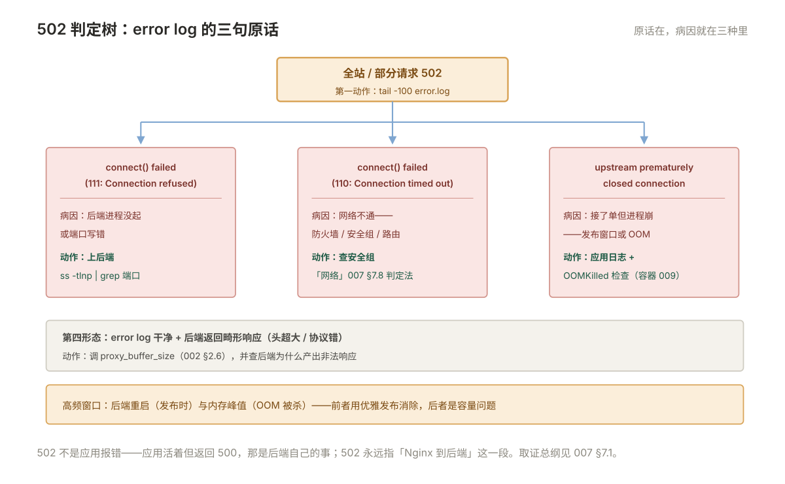

# 007 故障排查手册

> **解决**：502/504/413、改了不生效——从现象到根因的取证路线。  
> **范围**：按状态码取证 · error log 判读 · 上下游联合取证。  
> **口径**：Nginx 1.24+ 开源版；日志字段依赖 005 的 log_format。  
> **更新**：2026-10-31

## 目录

| 节 | 内容 |
|---|---|
| 7.1 | 取证总纲：四步路线图 |
| 7.2 | 502 判定树：三种 error log 原话 |
| 7.3 | 504 判定树：upstream timed out 的三种慢法 |
| 7.4 | 413 与上传问题：全链路的 body 限制 |
| 7.5 | 499：客户端等不及的间接证据 |
| 7.6 | 重定向循环：http/https 打架与代理头缺失 |
| 7.7 | 403/404：文件权限、index、location 错位 |
| 7.8 | 「改了不生效」的五种原因 |
| 7.9 | CPU / 内存高的取证 |
| 7.10 | 坑表：十个故障剧本 |
| 7.11 | 本章检查清单 |

---

## 7.1 取证总纲：四步路线图

全册的纲领先立：任何接入层故障，按固定顺序取证，**顺序本身就是方法**（与「网络」009、「容器」009 同源）：

```plain
① error log          系统告诉你的第一现场（connect 失败？超时？SSL 错？）
      tail -f /var/log/nginx/error.log
② access log         带上 005 的 urt/ua/us 字段：慢在哪、打给谁、后端回了什么码
      grep -E 'status' access.log | tail
③ 后端日志           ①② 定位到具体后端后，看应用日志（有没有收到、为什么慢）
④ 抓包               以上走完仍无头绪才动用（「网络」009 的 tcpdump）
```

两条纪律：**别跳读**（直接改配置是这一册的第一大忌）；**改配置前先在 staging 复现**（007 取证、005 §5.8 仪式——复现不了的问题改配置等于抽奖）。状态码是分类的起点：4xx 问"请求怎么了"，5xx 问"谁坏了"——下一节起按码展开。

---

## 7.2 502 判定树：三种 error log 原话

502 = **Nginx 到后端的链路出问题**（不是应用报错——应用报错是后端自己返回 500）。error log 里的三句原话对应三种病因：

| error log 原话 | 病因 | 动作 |
|---|---|---|
| `connect() failed (111: Connection refused)` | **后端进程没起/端口不对** | 上后端 `ss -tlnp | grep 8080`；查应用为什么没起 |
| `connect() failed (110: Connection timed out)` | 网络不通：防火墙/路由 | 后端防火墙、安全组（「网络」007 §7.8 的判定法） |
| `upstream prematurely closed connection` | **后端接了单但进程崩了** | 后端应用日志/核心转储；OOMKilled 检查（「容器」009） |



外加第四种形态：**error log 干净、后端返回了畸形响应**（头超大/协议错）——调 `proxy_buffer_size`（002 §2.6）并查后端为什么产出非法响应。

判定树的入口动作只有一个：**`tail -100 error.log | grep -v 'notice'`**——原话在，病因就在三种里。502 高频于后端重启的窗口（发布时）与 OOM 峰值（内存不够被杀）——前者用优雅发布消除（「CICD」007），后者是容量问题。

---

## 7.3 504 判定树：upstream timed out 的三种慢法

504 = **后端接了单但在 `proxy_read_timeout` 内没回完**（002 §2.5 的语义）。error log 原话 `upstream timed out (110: Connection timed out) while reading response header`。三种慢法按概率排：

| 慢法 | 验证 | 解法归属 |
|---|---|---|
| **慢查询**（SQL 慢） | access log 的 `urt` 大 → 后端慢日志 | 「数据库」007 |
| **慢外部调用**（第三方接口抖） | 应用日志的出站调用耗时 | 应用侧超时/熔断 |
| **后端过载**（CPU/线程池满） | 后端负载与线程池水位 | 容量问题（006） |

运维侧的正确姿势：**先看 005 §5.2 的 `urt` 字段把锅分清**，再决定修哪一层——Nginx 调大 read timeout 只对"确实需要长时间的合法请求"（报表导出类）使用，且单独 location（002 的例外登记法）。全站 504 的常见根因是后端集体过载或数据库锁死——那时 504 只是症状表，真正的战场在后端。

---

## 7.4 413 与上传问题：全链路的 body 限制

上传报 413（Request Entity Too Large）= **Nginx 的 `client_max_body_size` 拦的**，默认 1M——几乎必踩。配置与它的"全链路"属性：

```nginx
location /upload/ {
    client_max_body_size 100m;      # 按业务上限设，0 = 不限（慎用）
    proxy_request_buffering off;    # 可选：大文件边收边转后端，不先落 Nginx 缓冲
}
```

**"全链路"是关键**：Nginx 放行了，后端应用（PHP 的 upload_max_filesize、Java 的 multipart 限制、K8s Ingress 的注解）还有自己的限制——**413 在每一层都可能发生，取值必须逐层 ≥ 业务上限**。排查顺序：哪一层返回的 413（看响应头里的 Server 字段是 nginx 还是应用框架）→ 改那一层 → 重传验证。上传还要注意 `client_body_timeout`（客户端上传太慢被掐）与临时目录空间（body 先落 Nginx 磁盘）。

---

## 7.5 499：客户端等不及的间接证据

499 是 Nginx 的私有码：**客户端在响应返回前主动断开**。它不是错误——是**"慢 + 急"的联合证据**：

- 用户侧刷新页面/关页面（前端超时设置太短）；
- 上游调用方超时（网关 5s、应用等 8s——第 8 秒时 Nginx 记 499，**后端其实还在白干**）；
- 爬虫/健康检查主动放弃。

499 的运维价值：**大量 499 集中在某 URI = 该接口慢到用户放弃**——它是慢接口的探测器（比用户投诉早得多）。分析口径：`grep -c ' 499 '` 按 URI 分桶，TOP 的那个就是优化候选（转 7.3 的慢法排查）。另注意：499 发生后 Nginx 会中断对后端的请求吗——取决于 `proxy_ignore_client_abort`（默认 off，中断——后端看到 broken pipe）。

---

## 7.6 重定向循环：http/https 打架与代理头缺失

浏览器报"重定向次数过多"，curl 报 `Maximum redirects reached`。机制拆解：应用把用户 302 到 `https://`，Nginx 转发时**没告诉应用"原始请求是 https"**，应用以为自己是 http，又跳 https——死循环。两行配置的锅（002 §2.3/2.4）：

```nginx
proxy_set_header X-Forwarded-Proto $scheme;   # 告诉应用：用户用的是 https
proxy_set_header Host $host;                   # 让应用生成正确的绝对跳转地址
```

验证方法：`curl -sI http://app.example.com/ | grep -i location` 看每次跳转的目标——**循环路径一目了然**（http→https→http→…）。第二类成因是**双向强制跳转打架**：Nginx 层 http→https，应用层又 https→某个 http 路径——两条跳转规则 review 时对一遍即可。第三类：反向代理到后端的 301 带了内网地址（后端不知道真实域名）——Host 头修复。

---

## 7.7 403/404：文件权限、index、location 错位

静态站点的两大金刚，取证路线不同：

**403（禁止）**三种病因按概率：

| 病因 | 验证 |
|---|---|
| 文件/目录权限（worker 用户读不到） | `namei -l /data/web/app/index.html` 逐级看（「Linux」003 的工具） |
| **目录缺 index 且没开 autoindex** | 目录访问无默认文件 → Nginx 拒绝列目录 |
| SELinux（CentOS） | `audit.log` 有 AVC；bind mount 的 `:z`（「容器」003） |

**404（没有）**两种病因：路径真的不存在（`ls` 确认 root 拼接结果）；**location 匹配错了**——请求被别的 location 接走（`root` 不同）。验证工具是 001 §1.5 的匹配规则 + `error_log notice`（会打印匹配过程）。附加一招：`try_files $uri $uri/ /index.html;`——前端路由（SPA）的标准配置，没有它刷新子路径必 404。

---

## 7.8 「改了不生效」的五种原因

「配置改了服务没变」的完整清单，按出现频率排：

| # | 原因 | 验证 |
|---|---|---|
| 1 | 忘了 reload（或 reload 失败没注意） | `nginx -t` 的输出时间、`ps -ef` 的 master 启动时间 |
| 2 | 改错文件（include 链里有同名配置覆盖/未被 include） | `nginx -T` 输出**全部生效配置**，grep 自己的指令 |
| 3 | reload 时旧 worker 还在处理存量 | `ps -ef` 看新旧 worker 并存；等它退 |
| 4 | 另一个 Nginx 实例在跑（容器内/双进程） | `ss -tlnp | grep :80` 看真正监听的进程 |
| 5 | 客户端/中间层缓存 | curl 加随机参数绕缓存对比 |

`nginx -T`（大写）是本节的王牌：**输出主配置 + 所有 include 的合并结果**——"我的配置到底有没有被读到"的唯一权威答案。五种原因里 2 和 4 最阴险（配置明明在文件里、就是不生效），都靠 `nginx -T` 与 `ss -tlnp` 实锤。

---

## 7.9 CPU / 内存高的取证

入口机 CPU/内存报警的取证，先分锅再动手：

**CPU 高**：`top -H` 看 worker 线程 → 按 6.8 的证据链分三种——gzip 大响应（关掉对大文件压缩验证）、TLS 握手风暴（会话复用没生效/短连接客户端多）、流量真涨（扩容或限流）。access log 的 QPS 曲线与 CPU 曲线对齐看：**CPU 涨但 QPS 平 = 配置/攻击问题；同涨 = 容量问题**。

**内存高**：worker 内存 = 连接数 × 缓冲（6.1 的账），突刺常见于大响应缓冲堆积——`proxy_max_temp_file_size` 与并发一起看。另一种是**连接泄漏**（客户端长连接堆积、后端连接池满）——`ss -tn state established '( dport = :80 )' | wc -l` 对比 6.1 的账。worker 内存异常大且不回落：`gcore`/debug 前先试 `reload`（worker 平滑换血，无感修复——001 §1.7 的能力）。

---

## 7.10 坑表：十个故障剧本

值班视角，十个高频剧本的"现象 → 第一动作"： **本表即本册坑表**——「第一动作」是改法，「深入」列指向根因定位的节号。

| # | 现象 | 第一动作 | 深入 |
|---|---|---|---|
| 1 | 全站 502 | error log 三句原话对号（7.2） | 7.2 |
| 2 | 某接口 504 | urt 字段分锅 → 后端慢法（7.3） | 7.3 |
| 3 | 上传 413 | 哪层返回的 413 → 逐层放宽（7.4） | 7.4 |
| 4 | 用户报"打不开"，机器正常 | access log 有没有请求到达 | 7.8（可能是缓存/CDN） |
| 5 | 重定向循环 | curl -sI 看跳转链（7.6） | 7.6 |
| 6 | 改配置不生效 | `nginx -T` + `ss -tlnp`（7.8 的 2/4） | 7.8 |
| 7 | 静态文件 403 | namei -l 逐级权限（7.7） | 7.7 |
| 8 | CPU 打满 | QPS 与 CPU 曲线对齐（7.9） | 7.9 |
| 9 | 大量 499 | 按 URI 分桶找慢接口（7.5） | 7.5 |
| 10 | 某台后端响应特别慢 | ua 字段分布 + 后端单机取证（003 §3.2） | 003 |

---

## 7.11 本章检查清单

读完能回答这六个问题，这一章就过了：

| # | 问题 |
|---|---|
| 1 | 四步取证路线是什么？为什么改配置前先在 staging 复现？ |
| 2 | 502 的三种 error log 原话分别指向什么？ |
| 3 | 504 的三种慢法？Nginx 调大超时的正确用法？ |
| 4 | 413 为什么要"逐层"放宽？499 说明了什么？ |
| 5 | 重定向循环的两行修复？ |
| 6 | 「改了不生效」的五类原因里，哪两类最阴险？王牌命令是什么？ |

---

> 下一篇：《008 高可用接入》——入口自己挂了怎么办：HAProxy 与 Keepalived。
