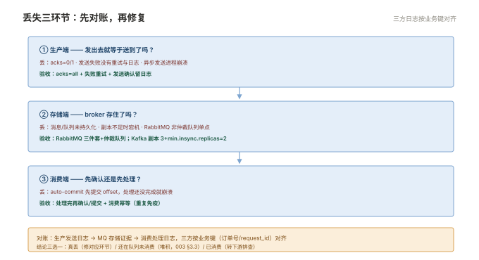
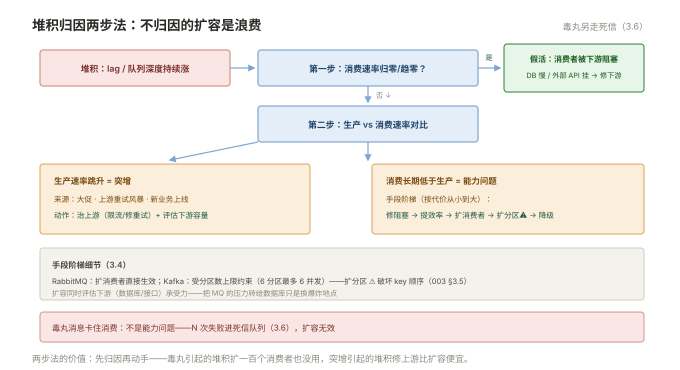

# 003 堆积与可靠性治理

> **解决**：堆积怎么归因与治理、消息丢失怎么对账、重复与顺序怎么兜底。  
> **范围**：丢失三环节 · 幂等消费 · 堆积成因与手段 · 顺序性 · 死信。  
> **口径**：两产品通用，差异处分别注记（RabbitMQ=队列视角，Kafka=lag 视角）。  
> **更新**：2026-11-01

## 目录

| 节 | 内容 |
|---|---|
| 3.1 | 消息丢失三环节对账 |
| 3.2 | 重复与幂等消费 |
| 3.3 | 堆积的成因分类 |
| 3.4 | 堆积治理的手段清单 |
| 3.5 | 顺序性保障 |
| 3.6 | 死信队列：毒丸的归宿 |
| 3.7 | 六个坑 |
| 3.8 | 本章检查清单 |
| 3.9 | 最小可复现实验：造一次堆积并三方对账 |

---

## 3.1 消息丢失三环节对账

"消息丢了"的申诉，先对账断在哪个环节：

| 环节 | 丢失机制 | 验收点（运维要查的配置） |
|---|---|---|
| ① 生产端 | 发出即忘（acks=0/1）、发送失败未重试 | acks=all · 失败回调有日志 · 本地可回放 |
| ② 存储端 | 未持久化/未复制就宕机 | RabbitMQ 三件套+仲裁队列；Kafka acks=all+min.insync.replicas=2 |
| ③ 消费端 | **先提交 offset/先 ack，处理还没做** | 处理完再确认；失败不确认（配合死信） |

三段各自的配置在 001/002 已讲，本册给的是**对账方法**：生产端有发送日志与确认记录 → MQ 端有存储证据（消息 id/offset）→ 消费端有处理日志。**三方日志按业务键（订单号/request_id）对齐**，缺口在哪个环节一目了然——这就是 000 §0.3 "分段归因"的实战形态。结论也分三档：真丢了（修对应环节）、还在队列里没消费（堆积）、消费了但业务说没有（下游问题转出去）。



---

## 3.2 重复与幂等消费

at-least-once（000 §0.4）意味着重复必然出现——**问题不在 MQ，在消费端有没有幂等**。幂等的四个常用实现，按业务选：

| 实现 | 做法 | 适用 |
|---|---|---|
| 唯一业务键 | 数据库唯一约束，重复插入报错忽略 | 入库类消费 |
| 去重表/已处理表 | 消息 ID 记账，处理前查 | 通用 |
| 状态机比对 | 只允许状态向前流转（旧→新） | 订单类状态消息 |
| 版本号/时间戳 | 旧版本消息直接丢弃 | 配置/状态同步 |

不推荐的"去重"：靠消费端内存去重（重启即失效）、靠 MQ 的"精确一次"跨系统承诺（不成立，000 §0.4）。**幂等写在消费逻辑里，是 at-least-once 世界的成人礼。**

---

## 3.3 堆积的成因分类

堆积（lag 持续增长）先归因，再动手。三大类成因：

| 成因 | 特征 | 验证 |
|---|---|---|
| **消费能力不足** | 生产平稳、消费速率长期低于生产速率 | 对比生产/消费速率曲线；单消费者处理耗时 |
| **生产突增** | 速率曲线同步跳升（大促/上游重试风暴/新业务上线） | 生产端曲线 + 上游变更记录 |
| **毒丸消息** | 堆积停在特定 offset 不动，消费者反复报错 | 消费日志反复对同一条消息报错 |

第四类隐性成因：**消费者"假活"**——进程在但下游阻塞（数据库慢/外部 API 超时），消费速率趋零。所以堆积排查永远两步：**先看消费速率是否归零（假活），再比较生产/消费速率差（真堆积）**。

---

## 3.4 堆积治理的手段清单

按见效速度与代价排序：

| 手段 | 见效 | 代价/前提 |
|---|---|---|
| ① 排查并修复消费阻塞 | 快 | 假活类立即恢复 |
| ② 提高单消费者效率 | 快 | 优化慢处理/批量拉取 |
| ③ 扩消费者实例 | 中 | **Kafka：受分区数上限约束**；RabbitMQ：直接加 |
| ④ 扩分区（Kafka） | 中 | ⚠️ 破坏 key→分区映射（002 §2.2），顺序业务慎用 |
| ⑤ 降级跳过 | 快 | 明确"这些消息可以不处理"——业务签字 |
| ⑥ 临时中转 | 快 | 转到缓冲队列慢慢消化（RabbitMQ 常用） |

纪律：**扩容前必须归因**——毒丸消息引起的堆积，扩一百个消费者也没用（每个都卡在同一条）；生产突增引起的堆积，扩消费要同时评估下游（数据库/接口）的承受力——**把 MQ 的压力转移到数据库，只是换了个爆炸地点**。



---

## 3.5 顺序性保障

需要顺序的场景（同账户的操作、同一订单的状态流转）的保障姿势：

- **Kafka**：生产者按业务 key（订单号）发消息进同分区——分区内有序天然成立；扩分区前评估（002 §2.7 第 4 条）；
- **RabbitMQ**：单队列单消费者天然有序；多消费者即无序——需要顺序的队列**不要设多个消费者**，用业务层并发键分流到多个队列（每队列仍有序）；
- **通用**：消息体里带**业务版本号/序号**，消费端比对——旧于当前状态的消息直接丢弃。**这是最可靠的顺序兜底**，因为即使 MQ 层顺序被意外破坏，业务状态也不会倒流。

---

## 3.6 死信队列：毒丸的归宿

毒丸消息（poison pill）= 让消费者每次处理都失败的消息（格式错/依赖的数据缺失）——不处理它会**卡死整条消费**（无限重试）。解法是死信机制：

- **RabbitMQ**：队列配置 DLX（死信交换器）——消息被 nack(reject 且不重回队列) 或超期/超长时，自动路由到死信交换器，进入死信队列等人处理；
- **Kafka**：无内建死信，**应用层约定**——处理失败 N 次后写入 `<topic>-DLT`（死信 topic），继续消费下一条。

死信队列的运维纪律：**死信也是资产**（业务对账可能要找回它），同样配保留与监控——死信队列自己又堆积起来，是"用死信掩盖问题"的信号，要告警。**处理死信要有工具**（重放脚本：人工修好数据后把消息重新投回原队列）。

---

## 3.7 六个坑

| # | 坑 | 后果 | 正确做法 |
|---|---|---|---|
| 1 | 消费端先提交后处理 | 崩溃即丢消息 | 处理完再确认（002 §2.4） |
| 2 | 无幂等裸奔 at-least-once | 重复消费造成业务错乱 | 四种幂等实现选一（3.2） |
| 3 | 堆积不归因直接扩容 | 毒丸/突增照旧 | 先归因（3.3）两步法 |
| 4 | Kafka 扩分区不管顺序 | 同 key 顺序失效 | 顺序业务扩分区前评估（3.5） |
| 5 | 毒丸无限重试卡死消费 | 整条队列停摆 | N 次失败进死信（3.6） |
| 6 | 死信无人处理无监控 | 问题被死信"藏"起来 | 死信堆积告警 + 重放工具 |

第 1 条展开：**消费端的"先提交后处理"是 MQ 丢消息的最大单一来源**，且它完全隐蔽——MQ 说"你确认过了"，业务说"我没收到"。两种正确姿势：手动提交（处理完成再 `commit`）；提交与处理之间崩溃造成的重复由幂等兜底。检查你负责的消费端配置：`enable.auto.commit` 是否开着、自动提交间隔多少——这个问题值得对每个消费组问一遍。

---

## 3.8 本章检查清单

读完能回答这六个问题，这一章就过了：

| # | 问题 |
|---|---|
| 1 | 丢失三环节各自机制与验收点？对账怎么做？ |
| 2 | 幂等的四种实现？为什么内存去重不行？ |
| 3 | 堆积三大成因？排查两步法的顺序？ |
| 4 | Kafka 扩分区破坏什么？RabbitMQ 扩消费者有没有这个问题？ |
| 5 | 顺序保障的三层姿势？最可靠的兜底是什么？ |
| 6 | 毒丸消息的归宿？死信队列自己的监控？ |

---

## 3.9 最小可复现实验：造一次堆积并三方对账

把 3.1 的三环节对账与 3.3 的两步归因，在**一次性测试 topic / queue** 上跑一遍。下面 `<...>` 全部换成实际值。

> ⚠️ **只在测试 topic / queue 上做**：暂停消费会制造真实堆积，绝不能对生产消费组执行第 ② 步。实验结束后删除测试 topic / queue，并确认消费者组已恢复。

**① 记录基线**

```bash
# Kafka：逐分区看 CURRENT-OFFSET / LOG-END-OFFSET / LAG
kafka-consumer-groups.sh --bootstrap-server <broker:9092> --describe --group <group>

# RabbitMQ 对照：ready 堆积量、未确认量、消费者数
rabbitmqctl list_queues name messages_ready messages_unacknowledged consumers
```

**② 停消费、持续生产，制造 lag**

```bash
# 先在测试环境暂停该消费组（停进程或缩副本到 0，按你的部署方式），再灌一批消息
# --throughput -1 表示不限速
kafka-producer-perf-test.sh --topic <topic> --num-records 10000 --record-size 200 --throughput -1 --producer-props bootstrap.servers=<broker:9092>
```

**③ 两次取数对比，按 3.3 两步法归因**

| 观察点 | 若看到 | 归因 |
| --- | --- | --- |
| LAG 增长、消费速率归零 | 消费者「假活」 | 3.3 第四类：查下游阻塞 |
| LAG 增长、消费速率稳定但小于生产 | 真能力不足或生产突增 | 3.3 前两类 |
| `messages_ready` 涨但 `consumers` 不为 0 | 消费端假活 | 同 3.3 第四类 |
| LAG 停在某个 offset 不动、消费日志反复报同一条 | 毒丸消息 | 3.6 死信；此时扩消费者无效 |

**④ 恢复消费并验收**：重启消费者，再执行一次 `--describe`，LAG 应持续回落；按业务键（订单号 / `request_id`）把生产端发送日志、MQ 的 offset 或消息 id、消费端处理日志三方对齐（3.1），确认没有「MQ 说确认过了、业务说没收到」。

**清理**：删除测试 topic / queue，确认 LAG 归零、无残留死信；实验产生的消息不进业务对账。

---

> 下一篇：《004 故障剧本》——MQ 自己坏了怎么办。
