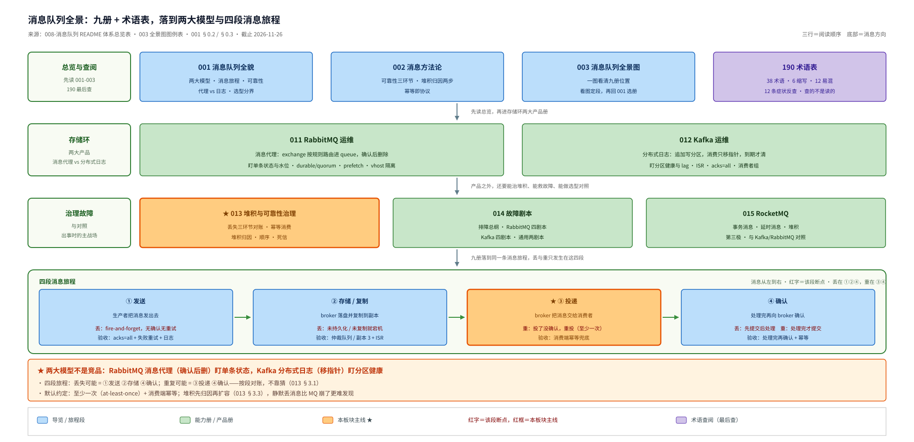

# 消息队列全景图

> **这一册回答**：消息队列板块 6 册在「一条消息的旅程」上的位置，一张图看清。
> **怎么用**：看图定段，再回 [001-消息队列全貌](001-消息队列全貌.md) 选册。

## 体系一张图

## 图例说明

| 册 | 消息旅程段 |
| --- | --- |
| 001 全貌 | 两大模型（代理 vs 日志）与选型分界 |
| 011 / 012 | 存储环：RabbitMQ 与 Kafka 各自怎么管 broker |
| 013 | 治理环：丢失三环节对账、堆积归因、幂等消费 |
| 014 | 故障环：broker 自己坏了的剧本 |
| 015 | 对照环：RocketMQ 的第三极与选型收束 |
| 190 术语表 | 术语 · 缩写 · 易混对 · 症状反查 |

图中自左向右是**消息方向**：生产 → 存储 → 消费，治理（013）与故障（014）是贯穿三段的横向能力。本板块免模块：6 册正文直接放板块根（011~015 顺延），规模到第 6 册时按规则拆模块。

---

**上一篇**：[002-消息方法论](002-消息方法论.md)　**下一篇**：[011-RabbitMQ运维](011-RabbitMQ运维.md)
