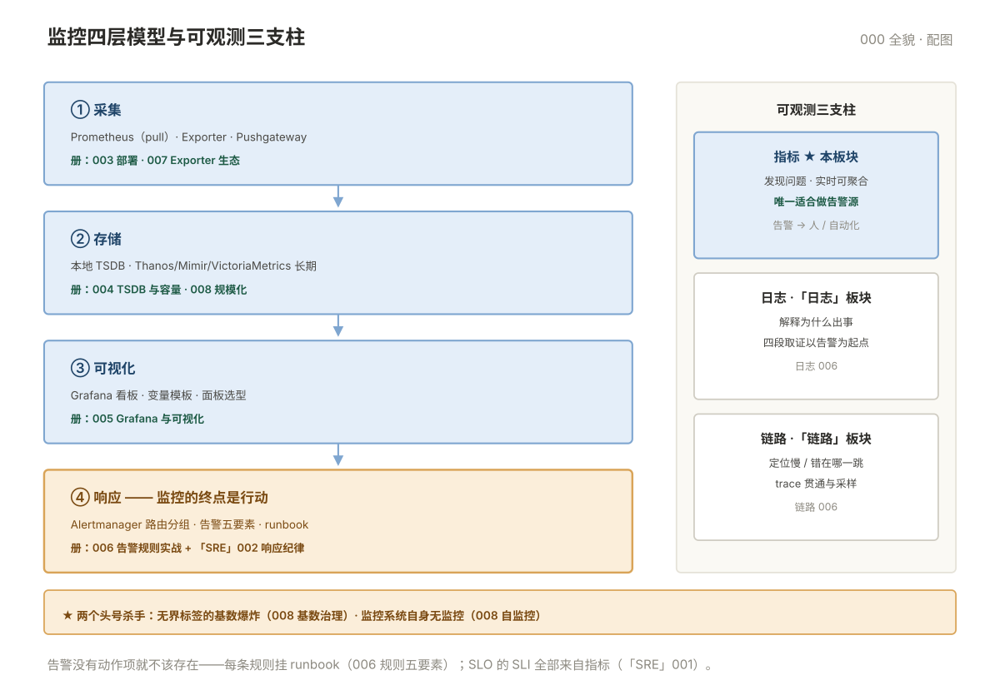

# 000 监控全貌

> **这一册回答**：监控板块管什么、四层模型怎么搭、Prometheus 八册怎么分工、什么问题不归监控管。10 分钟读完，把板块装进一张地图。  
> **给谁读**：要为自己的服务建立监控、响应告警的运维/SRE。本板块位于五阶段第四段（中间件与观测），是可观测性的**第一支柱**。

## 板块地图

板块分两层：**板块级文档（本册 + 术语表）管领域全景**，`prometheus/` 子目录管 Prometheus 工具深入。

| 册 | 一句话 | 回答的问题 |
|---|---|---|
| 本册 000 | 监控领域地图 | 四层模型、三支柱分工、从哪进、边界在哪 |
| [00 术语表](00-术语表.md) | 监控领域词汇与缩写 | 按主题分组 · 缩写速查 · 易混对 · 症状反查 |
| [prometheus/001 原理与架构](prometheus/001-原理与架构.md) | 它为什么长这样 | pull 模型、组件分工、一次抓取的六步 |
| [prometheus/002 数据与查询](prometheus/002-数据与查询.md) | 怎么取数、判断异常 | 四种指标类型、PromQL 全量、埋点规范 |
| [prometheus/003 配置与部署](prometheus/003-配置与部署.md) | 怎么把它配起来 | 最小配置、relabel、服务发现、告警演练 |
| [prometheus/004 存储-告警-排错](prometheus/004-存储-告警-排错.md) | 容量、告警链路、救火 | TSDB、告警链路、从 up=0 开始的排错路径 |
| [prometheus/005 Grafana 与可视化](prometheus/005-Grafana与可视化.md) | 数据怎么看得清 | 看板设计、变量模板、面板选型、权限 |
| [prometheus/006 告警规则实战](prometheus/006-告警规则实战.md) | 告警怎么不瞎响不漏报 | 规则五要素、SLO burn rate、告警疲劳治理 |
| [prometheus/007 Exporter 生态](prometheus/007-Exporter生态.md) | 该监控什么、数据从哪来 | node/blackbox/中间件 exporter、自定义、服务发现 |
| [prometheus/008 规模化与高可用](prometheus/008-规模化与高可用.md) | 规模上去了怎么扩 | HA 双实例、Thanos/Mimir/VM、基数治理 |

四层模型与三支柱的位置关系一张图看清：

## 核心概念速览

- **监控四层**：采集（exporter/pull）→ 存储（TSDB）→ 可视化（看板）→ 响应（告警到人、到行动）——每层有独立的问题与选型，故障时按层定位。
- **三支柱分工**：**指标发现问题**（实时、低成本、可聚合，唯一适合做告警源）；日志解释原因；链路定位哪一跳慢——监控是告警的起点，取证在另两个支柱。
- **Exporter = 数据源适配器**：它只负责把系统状态翻译成 `/metrics` 文本，挂了显示 target DOWN，不会自动换源。
- **指标设计先于工具**：USE（资源）、RED（服务）、四大黄金信号（延迟/流量/错误/饱和度）决定"该监控什么"——工具只是实现。
- **基数是头号杀手**：一个无界 label 能让监控内存爆掉，"监控挂了"多数不是流量大，是基数爆了（008）。

## 与相邻板块的分界

| 问题 | 去哪 |
|---|---|
| 告警响了，日志搜不到、查不出上下文 | 「日志」006 四段取证（以监控告警为起点） |
| 定位慢在哪一跳、跨服务调用还原 | 「链路」006 排障实战 |
| SLO 定义、错误预算、on-call 与复盘 | 「SRE」001（SLI 数据源来自指标）· 002（响应纪律）· 003（复盘） |
| 容器/K8s 指标从哪来（cAdvisor、kube-state-metrics） | 「容器」009 与本板块 007 §7 |
| 数据库自身的监控指标（mysqld_exporter 落点） | 「数据库」各册 + 本板块 007 |
| Windows 监控、云厂商监控 | 全库边界：不写（云监控随 015-云平台另立） |

## 学习路径

- **顺序读**：prometheus 001 → 002 → 003（跑通 003 的上手清单）→ 004 → 005 → 006 → 007 → 008。**建议读完 004 就先看 004 的排错路径**，再回头补 005~008。
- **按任务进**：要配一套新的 → 003；线上救火 → 004 排错路径；要画看板 → 005；要配告警 → 006；要接主机/中间件 → 007；规模问题 → 008。
- **按症状进**：告警没响、图是空的、内存暴涨、数据有洞——004 与 008 各有对应段落；板块级症状反查见 [00 术语表](00-术语表.md)。

## 误解澄清

| # | 误解 | 事实 |
|---|---|---|
| 1 | 装了 Prometheus 就算有监控 | 工具只是四层中的一层；指标设计、告警质量、响应机制才是监控 |
| 2 | 指标越多越全越好 | 无界 label 的指标是负债；基数治理（008）先于"多采集" |
| 3 | 告警越多越安全 | 告警疲劳会让真告警被淹没；规则五要素（006）先于加规则 |
| 4 | 图表做得漂亮 = 监控做得好 | 看板服务于排查路径（005），不是装饰 |
| 5 | 白盒黑盒二选一 | 黑盒探活（007）与白盒指标互补，缺一个就有盲区 |
| 6 | 监控系统自己不用被监控 | Prometheus 挂了全网全盲——自监控（meta-monitoring）是 008 的标配 |
| 7 | 采集频率越高越准 | 15s 是常见平衡点；频率翻倍 = 存储、基数、抓取压力全翻倍 |
| 8 | 数据有洞是采集抖动，正常 | remote_write 队列堆积、WAL 追不上都是真故障（008），要告警 |

---

**下一篇**：[prometheus/001 原理与架构](prometheus/001-原理与架构.md) —— 从一条样本讲到整个系统为什么这样设计。
