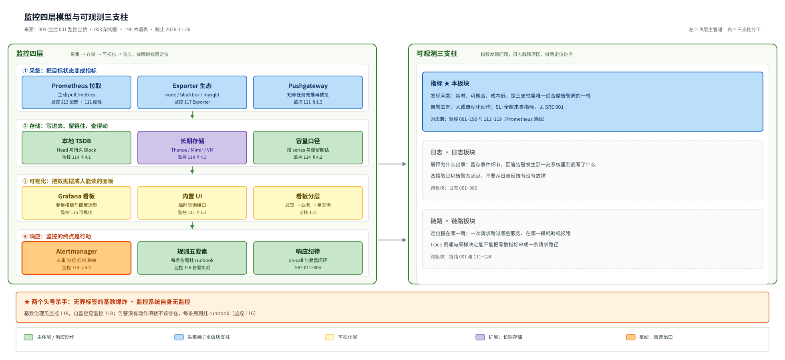

# 003 监控架构图

> **这一册回答**：监控体系的全景长什么样、四层与三支柱在图上怎么摆。
> 总览三件套的第三件：地图在 [001 监控全貌](001-监控全貌.md)，方法在 [002 监控方法论](002-监控方法论.md)。

## 四层模型与三支柱

## 图例说明

| 层 / 元素 | 说明 |
|---|---|
| 监控四层 | 采集（exporter/pull）→ 存储（TSDB）→ 可视化（看板）→ 响应（告警到人），故障时按层定位 |
| 三支柱 | 指标发现问题（唯一告警源），日志解释原因，链路定位跳点——见图右 |
| 工具路线 | Prometheus 与 Zabbix 两条并行路线的落位与取舍，详见 [120-Zabbix/121](120-Zabbix/121-两流派选型全貌.md) 选型对照 |

---

**下一篇**：[002 监控方法论](002-监控方法论.md) —— 该监控什么、怎么判异常。
