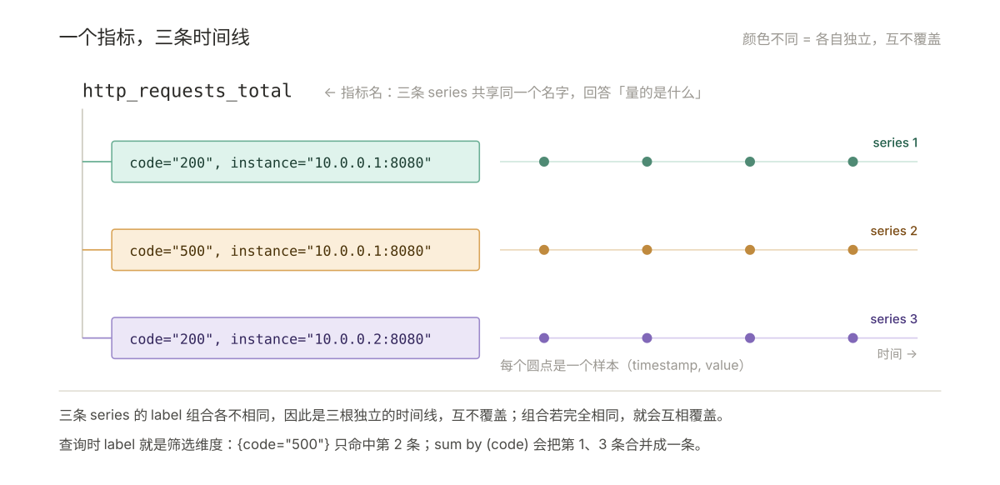
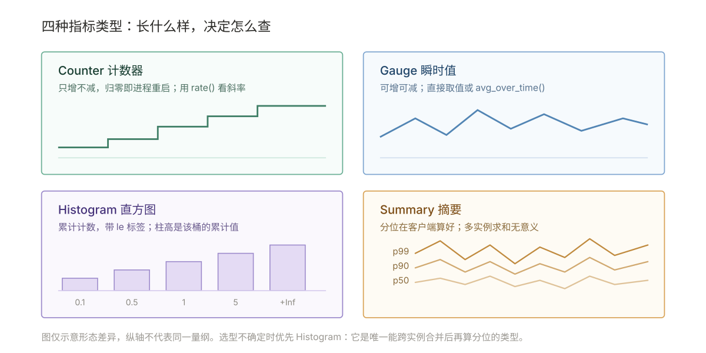

# 02 · 数据与查询

> **解决**：数据长什么样、怎么命名、`job` 与 `instance` 从哪来、PromQL 怎么写才不查错。  
> **范围**：一条样本，和它背后的时间线 · 四种指标类型 · 命名与 label 规范 · job 与 instance · PromQL 的求值模型  
> **口径**：以正文标注的配置、PromQL 与命令为准；不绑定单一 Prometheus 版本，差异在节内注记。  
> **更新**：2026-11-06  
> 前提是已读过 [001-原理与架构](001-原理与架构.md) 的抓取六步。

---

## 目录

| 节 | 内容 |
|---|---|
| 2.1 | 一条样本，和它背后的时间线 |
| 2.2 | 四种指标类型 |
| 2.3 | 命名与 label 规范 |
| 2.4 | job 与 instance：它们到底从哪来 |
| 2.5 | PromQL 的求值模型 |
| 2.6 | 选择器语法 |
| 2.7 | 常用函数速查 |
| 2.8 | `rate` 的三个坑 |
| 2.9 | `histogram_quantile` 的精度来自哪里 |
| 2.10 | 时间修饰符 |
| 2.11 | 子查询 |
| 2.12 | 十条必背查询 |
| 2.13 | Recording rules（预计算） |
| 2.14 | 埋点规范：让开发埋出能用的指标 |
| 2.15 | 3.x 迁移要点 |

| 2.16 | 检查清单 |
---

## 2.1 一条样本，和它背后的时间线

### 2.1.1 先看真实的 `/metrics` 长什么样

多数教程直接从"指标名 + label + 值"讲起，但没让人见过原始文本。实际打开 `http://host:9100/metrics` 看到的是这样：

```
# HELP node_cpu_seconds_total Seconds the CPUs spent in each mode.
# TYPE node_cpu_seconds_total counter
node_cpu_seconds_total{cpu="0",mode="idle"} 1.234567e+06
node_cpu_seconds_total{cpu="0",mode="system"} 8234.12
node_cpu_seconds_total{cpu="1",mode="idle"} 1.198765e+06

# HELP node_filesystem_avail_bytes Filesystem space available to non-root users in bytes.
# TYPE node_filesystem_avail_bytes gauge
node_filesystem_avail_bytes{device="/dev/sda1",fstype="ext4",mountpoint="/"} 4.2e+10
```

四个必须看懂的细节：

| 元素 | 含义 | 注意 |
| --- | --- | --- |
| `# HELP` | 给人看的说明文字 | **解析器会忽略**，但写文档、排查时全靠它判断这个指标到底量的是什么 |
| `# TYPE` | 指标类型（counter / gauge / histogram / summary） | Prometheus 会用它校验；类型标错的 exporter 会被拒绝入库 |
| `{cpu="0",mode="idle"}` | 这组 label 决定它属于哪条时间线 | label 通常按字母序输出，但顺序不影响身份 |
| `1.234567e+06` | 值，浮点数，支持科学计数法 | **单位在前面的 HELP 里说明**，Prometheus 不存单位 |

第一条 `node_cpu_seconds_total{cpu="0",mode="idle"} 1234567` 意味着：这台机器 0 号 CPU 累计有 1234567 秒处于 idle 状态。它是**累计值不是瞬时值**——所以不能直接画图看"当前 CPU 空闲率"，必须做差分，这就是 §2.7 里 `rate` 的作用。

### 2.1.2 样本与时间线的关系

数据模型——一个指标如何切出多条时间线：



```plain
http_requests_total{job="api", instance="10.0.0.1:8080", method="GET", code="200"} 1027
└──── 指标名 ────┘└──────────────── labels ────────────────────┘ └─ 值 ─┘
```

完整时间线 = **指标名 + 全部 label 的唯一组合**，再加一串 `(timestamp, value)`。

三者的关系，一句话说清：

- **指标名**回答"量的是什么"——`http_requests_total`。
- **label** 回答"哪一份"——哪台机器、哪个方法、哪个状态码。
- **series（时间线）** 是两者的唯一组合，是存储和查询的最小单位。

所以：`http_requests_total` 这一个指标，在有 10 台机器 × 5 个方法 × 6 个状态码的环境里，就是 **300 条时间线**。这就是"基数"的来源——**基数数的是 series，不是指标**。

> 同一个指标下的任意两条 series，它们的 label 组合必须**不完全相同**。如果 relabel 把两条不同来源的 series 改成了同样的 label 组合，它们会互相覆盖，表现为"数据莫名其妙少了一半"。

## 2.2 四种指标类型

四种指标类型的形态差异：



| 类型 | 语义 | 客户端方法 | 典型例子 | 常用查询 |
| --- | --- | --- | --- | --- |
| **Counter** | 单调递增，只增不减（进程重启会归零） | `inc()` / `add()` | `http_requests_total` | `rate()` / `increase()` |
| **Gauge** | 可增可减的瞬时值 | `set()` / `inc()` / `dec()` | `node_memory_MemAvailable_bytes` | 直接取值 / `avg_over_time()` |
| **Histogram** | 分桶计数，客户端算好 `_bucket` | `observe()` | `http_request_duration_seconds_bucket` | `histogram_quantile()` |
| **Summary** | 客户端算好的分位数 | `observe()` | `rpc_duration_seconds{quantile="0.99"}` | 直接读，**不可再聚合** |

两个必须记住的差别：

+ Histogram 的 `_bucket` 带 `le` 标签，**可以跨实例求和后再算分位**，这是它优于 Summary 的核心原因。
+ Summary 的分位数在客户端算好，多实例求和毫无意义（`0.99` 加 `0.99` 还是 `0.99`），且无法回溯任意分位。

Histogram 额外产出：`_bucket{le="..."}`（累计计数）、`_sum`（总和）、`_count`（总次数）。由 `_sum/_count` 可算平均值，但**平均值会掩盖长尾**，SLO 场景应看分位数。

> **怎么选**：不确定就选 Histogram。Summary 只在"单实例、只需要固定几个分位、且客户端 CPU 紧张"时才划算。
> **3.x**：native histogram 把分桶信息存成稀疏结构，不再产出 `_bucket` 系列，基数和精度都更好。用到时需要先确认客户端 SDK 与 Prometheus 版本都支持，且下游（Grafana/Thanos）也认识这种类型，否则会查不出数据。**开关在 3.x 换过三次**，从 `--enable-feature` 改成 `scrape_native_histograms: true`，见 §2.15.1。

## 2.3 命名与 label 规范

**必守四条**：

1. Counter 以 `_total` 结尾；单位作后缀（`_seconds`、`_bytes`、`_ratio`）。
2. label 只放**低基数、可枚举**的维度：`method`、`code`、`region`、`namespace`。
3. **禁止**把 `user_id`、`order_id`、`request_id`、`error_message`、`timestamp`、IP 全量路径塞进 label。
4. label 值保持稳定，不要用会漂移的值（如「带时间戳的版本号」）。

**基本单位表**（建议照抄，否则后面全是换算错误）：

| 类别 | 基本单位 | 备注 |
| --- | --- | --- |
| 时间 | `seconds` | 不要用毫秒 |
| 字节 | `bytes` | 即使是 bit 更常见的场景也用 bytes |
| 百分比 | `ratio` | 值为 0–1，命名用 `A_per_B` |
| 温度 | `celsius` | 特殊情况可用 kelvin |
| 长度 | `meters` | |
| 电压 / 电流 | `volts` / `amperes` | |
| 能量 / 功率 | `joules` / `watts` | 优先导出 joules 计数器，再用 `rate(joules[5m])` 得到瓦特 |
| 质量 | `grams` | 避免与 kilo 前缀冲突 |

**命名反例**（都是真实见过的高频错误）：

| ❌ 错误写法 | ✅ 正确写法 | 原因 |
| --- | --- | --- |
| `http_responses_500_total` | `http_requests_total{code="500"}` | 把 label 塞进指标名，结果 4xx/5xx 各要一个指标 |
| `node_memory_usage_mb` | `node_memory_usage_bytes` | 单位不统一，Grafana 里没法自动格式化 |
| `request_duration_ms` | `request_duration_seconds` | 同上 |
| `build_version="v1.2.3-8f3a2c1"` | `version="v1.2"` | 镜像 tag 哈希导致基数爆炸 |

**基数量级直觉**（内存与查询成本的核心）：

| 场景 | 活跃 series 约 | 说明 |
| --- | --- | --- |
| 10 台机器 + node_exporter | 8k–15k | 单机约 800–1500 条 |
| 500 pod + 标准埋点 | 20 万–50 万 | 每 pod 数百条 |
| 危险信号 | 单指标 label 组合 > 10 万 | 通常是把请求 ID 当 label |

经验换算：一个 label 值多出一千种组合，就等于多出一千条时间线。

## 2.4 job 与 instance：它们到底从哪来

这是新人最容易含糊的一节。`job` 和 `instance` **不是目标自己上报的**，是 Prometheus 在抓取时注入的。

### 2.4.1 注入规则

```yaml
scrape_configs:
  - job_name: node          # → 自动注入 label job="node"
    static_configs:
      - targets: ["10.0.0.1:9100", "10.0.0.2:9100"]   # → 注入 instance="10.0.0.1:9100"
```

+ `job`：抓取任务的逻辑分组名，来自 `job_name`，**在 relabel 之前就固定了**。
+ `instance`：默认取 `__address__`，可用 relabel 改成更可读的值（如主机名）。
+ 两者都可被 relabel 覆盖；覆盖后要保证全局唯一性，否则时间线冲突。

一个 job 下有多个实例时，同一指标会被复制成多份：

```plain
http_requests_total{job="api-server", instance="1.2.3.4:5670", method="POST"}
http_requests_total{job="api-server", instance="1.2.3.4:5671", method="POST"}
http_requests_total{job="api-server", instance="5.6.7.8:5670", method="POST"}
http_requests_total{job="api-server", instance="5.6.7.8:5671", method="POST"}
```

**目标暴露的指标内容完全一样**，区别只在 Prometheus 注入的 `instance`。所以"按实例拆分"不需要目标配合，`sum by (instance)` 就能拿到。

### 2.4.2 Prometheus 自己生成的自监控指标

每次抓取，无论目标有没有数据，都会产生下面这几个 series。**它们是排查抓取问题的第一手证据**：

| 时间序列 | 说明 | 特殊值 |
| --- | --- | --- |
| `up{job,instance}` | 实例健康状态 | `1` 成功 / `0` 失败 |
| `scrape_duration_seconds{job,instance}` | 本次抓取耗时 | — |
| `scrape_samples_scraped{job,instance}` | 目标暴露的样本数 | — |
| `scrape_samples_post_metric_relabeling{job,instance}` | metric relabel 之后剩下的样本数 | 与前一项的差额 = 被丢弃的量 |
| `scrape_series_added{job,instance}` | 本次新增的 series 近似数（v2.10+） | 持续上升 = 基数在涨 |
| `scrape_body_size_bytes{job,instance}` | 最近一次成功抓取的未压缩响应大小 | `-1` 超限 / `0` 失败 |
| `scrape_timeout_seconds{job,instance}` | 该目标配置的抓取超时 | — |
| `scrape_sample_limit{job,instance}` | 该目标配置的样本上限 | `0` = 无限制 |

其中 **`scrape_samples_scraped` 与 `scrape_samples_post_metric_relabeling` 的差额**最有用：它直接告诉你 `metric_relabel_configs` 丢了多少。如果差额突然变大，说明加了新的 drop 规则，或者有指标被误伤。

如果发现这几个指标查不到，检查是否启用了额外指标：

```bash
# 查看当前生效的功能开关
curl -s localhost:9090/api/v1/status/flags | grep -i feature
```

部分 2.x 版本需要 `--enable-feature=extra-scrape-metrics` 才会输出 `scrape_timeout_seconds`、`scrape_sample_limit`、`scrape_body_size_bytes` 等。

### 2.4.3 `up` 的四种用法

`up` 是最该先学会的指标，四条最常用：

```promql
up{job="api-server"}                      # 每个实例的当前状态，1 好 0 坏
sum(up{job="api-server"})                 # 在线实例数
up{job="api-server"} == 0                 # 只看挂掉的
avg_over_time(up{job="api-server"}[24h])  # 24 小时可用率，如 0.9998
```

第 4 条要注意：**它统计的是"抓取成功率"，不是"服务可用率"**。Prometheus 自身抖动、网络闪断都会算进去。真要做 SLA 报表，得配合业务侧的探针。

### 2.4.4 job 划分的四条实践

1. **相同功能的实例归为一个 job**。不要一个实例一个 job——那样 `sum by (job)` 就没意义了。
2. **不同环境用不同 job 名**（`api-prod` / `api-dev`），或用 `env` label 区分。两者选一，别混着来。
3. **善用自动标签做告警**。告警表达式里 `{{ $labels.instance }}` 直接可用，不用额外传参。
4. **实例超过 20 个就别用 static_configs**。改用 file_sd 或服务发现，否则每次扩缩容都要改配置、重载。

## 2.5 PromQL 的求值模型

这一节是原文缺的，但它决定你能否理解"为什么图看起来不对"。

### 2.5.1 四种查询结果类型

| 类型 | 形态 | 典型用途 |
| --- | --- | --- |
| **Instant vector** | 每个 series 一个当前值 | 表格、告警表达式 |
| **Range vector** | 每个 series 一段时间内的多个值 | 只能喂给函数（`rate` 等），不能直接画图 |
| **Scalar** | 单个浮点数 | 常量运算、阈值比较 |
| **String** | 字符串 | 极少用 |

关键约束：`rate(x[5m])` 合法；`x[5m]` 单独出现只能用于图表的 range 查询，不能做算术——**因为 range vector 没有单一数值可供运算**。

### 2.5.2 一个瞬时查询取的是哪个点

假设你在 `t` 时刻查 `node_memory_MemAvailable_bytes`：

1. Prometheus 对每条 series，**向前回看最多 5 分钟**（`--query.lookback-delta`，默认 `5m`）找一个样本。
2. 找到则返回该值；找不到则这条 series 不出现在结果里。

这解释了三个常见困惑：

| 现象 | 原因 |
| --- | --- |
| 目标刚重启，查询还能看到旧值 | 5 分钟内的最后样本仍被采用 |
| 指标刚上线，立刻查却查不到 | 还没有落到抓取周期里，等一个 `scrape_interval` |
| 目标进程挂了，图既不归零也不立刻断 | 抓取失败只改 `up`，指标本身仍取 5 分钟内最后样本，表现为"挂住" |

注意最后一行与"目标被移除"是两件不同的事：**进程死、target 还在** → 挂 5 分钟；**target 从服务发现里消失** → 立即写 stale marker、当轮就不再返回，见下节。把这两者混为一谈，排查时会找错方向。

### 2.5.3 staleness：为什么图会断，而不是归零

目标从服务发现中消失（被删掉、被缩容、job 配置移除）时，Prometheus 会为它写入一个 **stale marker（陈旧标记）**。查询遇到 marker 后，这条 series **立即不再返回**，不会再"挂"5 分钟。

这带来两个直接结论：

- **服务真的挂了**（进程死但目标还在）→ `up` 变 `0`，图是**下降**的，能看到断崖。
- **目标被移除了**（不再被抓）→ series 直接消失，图是**断开**的，看不到 0。

所以「图断了」和「图掉到 0」是两件不同的事，对应完全不同的处置。这是 004 §4.6 排查路径的第一分叉点。

### 2.5.4 range query 的 step

图表上的一条线由很多个点组成。Prometheus 把时间轴按 `step`（通常是 `scrape_interval` 或用户指定）切分，**在每个 step 上独立做一次瞬时查询**。

由此推出一个必须知道的结论：**`rate(x[5m])` 在每个 step 上用的是"该 step 往前 5 分钟"的数据**，相邻 step 的窗口是重叠的。所以：

- `[5m]` 的区间是**滑动窗口**，不是分桶。
- 图上的尖刺可能被 `[5m]` 平滑掉；把区间缩到 `[1m]` 才能看到。
- 大范围 + 小 step 的查询代价极高（每个 step 都要扫一遍窗口），这也是子查询慢的原因。

## 2.6 选择器语法

```plain
http_requests_total                          # 仅按指标名
http_requests_total{job="api"}               # 等值匹配
http_requests_total{code=~"5.."}             # 正则匹配（全匹配，非包含）
http_requests_total{code!="200", env!~"dev"} # 否定
{__name__=~"node_cpu.*"}                     # 按指标名正则
```

+ 正则自动锚定首尾，`code=~"5"` 等价 `^5$`；要模糊匹配需写 `.*5.*`。
+ 空值匹配：`label=""` 会匹配**不含该 label** 的 series，这是清空 label 后过滤的常用技巧。

## 2.7 常用函数速查

**Counter 专用（最常用，也最容易用错）**

| 函数 | 含义 |
| --- | --- |
| `rate(v[5m])` | 区间内**每秒平均**增长率，自动处理计数器归零 |
| `irate(v[5m])` | 用区间内**最后两个点**算瞬时速率，抖动大，适合看尖刺 |
| `increase(v[5m])` | 区间内**总增量**，≈ `rate * 区间秒数`，可能出小数 |

**Gauge 专用**

| 函数 | 含义 |
| --- | --- |
| `delta(v[5m])` / `idelta(v[5m])` | 区间首尾差值 / 最后两点差值 |
| `avg_over_time` / `max_over_time` / `min_over_time` | 区间聚合 |
| `predict_linear(v[1h], 3600)` | 线性外推，经典用法是预测磁盘多久写满 |
| `changes(v[1h])` / `resets(v[1h])` | 变化次数 / 计数器重置次数 |

**聚合**

| 语法 | 含义 |
| --- | --- |
| `sum by (job) (rate(x[5m]))` | 按 job 分组求和 |
| `sum without (instance) (x)` | 去掉 instance 后求和（保留其余全部标签） |
| `topk(5, x)` / `quantile(0.9, x)` | 前 5 名 / 分位数 |
| `count_values("ver", x)` | 按值分组计数 |
| `absent(x)` / `absent_over_time(x[1h])` | series 消失时返回 1，用于「抓不到也要告警」 |

**标签改写**（不属于聚合，但常一起用）

| 函数 | 含义 |
| --- | --- |
| `label_replace(v, "dst", "$1", "src", "(.*)")` | 从 src 正则提取后写入 dst |
| `label_join(v, "dst", "-", "a", "b")` | 把多个 label 拼成一个 |

**二元运算的向量匹配**

```plain
# 一对一：两侧标签完全一致才配对
rate(errors_total[5m]) / rate(requests_total[5m])

# 多对一：左侧多条对齐到右侧一条（如按实例补齐总请求数）
rate(err_total[5m]) / on (instance) group_left rate(req_total[5m])

# 忽略某些标签后再配
rate(a[5m]) / ignoring (code) rate(b[5m])
```

向量匹配是新手第一个坎，记一句就够：**默认要求两侧标签完全对应，对不上就没有结果（不是 0）**。`on`/`ignoring` 用来放宽这个要求，`group_left`/`group_right` 用于一对多时指明保留哪侧标签。查出来是空，先怀疑标签对不上，别怀疑数据没采到。

## 2.8 `rate` 的三个坑

1. **区间至少要有 2 个样本**，推荐 `rate 区间 ≥ 4 × scrape_interval`。15s 抓取用 `[1m]` 起步，用 `[5m]` 更平滑。
2. `rate` **有外推（extrapolation）**，区间边界不足一个步长时按比例外推，所以 `increase` 常出现 `9.9998` 这种小数——正常，不要 `floor`。
3. **进程重启导致计数器归零**：`rate` 会自动当作重置处理，不会出现负值；但跨重启的 `increase` 会**少算**归零前那段。要精确统计请用远端聚合或 `_total` 差分自算。

## 2.9 `histogram_quantile` 的精度来自哪里

原文只说了"必须保留 `le`"，但没说为什么结果会偏。这里补上。

`histogram_quantile` 的计算方式是**在桶内做线性插值**：

1. 用 `rate` 拿到每个桶的每秒增量，按 `le` 累加得到累计分布。
2. 找到分位数落在哪个桶。
3. 在该桶的上下界之间按比例插值，得出估算值。

三个由此推出来的结论：

| 情况 | 结果 |
| --- | --- |
| 分位数落在**最低桶** | 假设下界为 0 做插值；若最低桶上界已 ≤ 0，直接返回该上界 |
| 分位数落在**最高桶（+Inf）** | 返回**倒数第二桶的上界**——所以 p99 显示成 5s，很可能真实值是 12s，只是桶不够 |
| 桶边界过粗 | 插值出来的"精度"是假的。请求都在 0.1s 内、桶却从 0.5s 起，分位数会失真 |

所以「分位数明显偏低」有两个根因，不是只有一个：

- 忘了 `sum by (le)`（原文第 9 章第 5 条已提）；
- **桶边界设计不合理**（原文未提，但更常见）。

判断方法：查一下最高桶是否为空。

```promql
# 如果这个值持续为 0，说明没有请求超过最高桶上界，分位数可信
sum by (le) (rate(http_request_duration_seconds_bucket[5m]))
```

如果 `le` 最大的那个桶计数不为 0，说明有请求落在 `+Inf`，此时任何分位数都是**下界**，不是真实值。解决方法是改客户端的分桶配置——**这必须在埋点侧改，查询侧救不回来**。

## 2.10 时间修饰符

```plain
rate(x[5m] offset 1d)     # 取「昨天同一时刻」的 5 分钟速率，用于同比
x offset 30m              # 瞬时值回看 30 分钟
rate(x[5m] @ 1730000000)  # 固定在某个 Unix 时间点求值
x @ start() / x @ end()   # 固定在图表的起止时刻（配合 range query）
```

`offset` 与 `@` 是排查「昨天此时是否也这样」的核心工具，比手算时间戳可靠。

## 2.11 子查询

```plain
max_over_time( rate(http_requests_total[5m])[1h:1m] )
#                └─ 内层区间 ─┘ └范围:步长┘
```

用途：对「已经算出来的速率」再做一次区间聚合，例如求「过去 1 小时内的最大 QPS」。子查询代价高，避免大范围 + 小步长组合——按 §2.5.4 的解释，每个 step 都要扫一遍内层窗口。

## 2.12 十条必背查询

| 目的 | PromQL |
| --- | --- |
| 目标存活 | `up == 0` |
| 抓取耗时 | `scrape_duration_seconds > 5` |
| CPU 使用率 | `100 - avg by(instance)(rate(node_cpu_seconds_total{mode="idle"}[5m]))*100` |
| 内存使用率 | `(1 - node_memory_MemAvailable_bytes/node_memory_MemTotal_bytes)*100` |
| 磁盘使用率 | `(1 - node_filesystem_avail_bytes{fstype!~"tmpfs\|overlay"}/node_filesystem_size_bytes)*100` |
| 磁盘 4 小时写满预测 | `predict_linear(node_filesystem_avail_bytes[6h], 4*3600) < 0` |
| HTTP QPS | `sum by(path)(rate(http_requests_total[5m]))` |
| P99 延迟 | `histogram_quantile(0.99, sum by(le)(rate(http_request_duration_seconds_bucket[5m])))` |
| 5xx 占比 | `sum(rate(http_requests_total{code=~"5.."}[5m])) / sum(rate(http_requests_total[5m]))` |
| 指标消失 | `absent(up{job="api"})` |

> 最后一行的写法有讲究：`absent(up{job="api"} == 1)` 也能用，但它只在**整个 job 全部实例都挂**时返回 1，且输出**不带 `job` 标签**（复杂表达式无法推导标签），告警里就拿不到维度。如果意图是"某个实例彻底消失"，用 `absent(up{job="api"} == 1)` 并接受无标签；如果意图是"这个 job 不存在了"，用 `absent(up{job="api"})`。

### 2.12.1 在终端里跑这些查询

Graph 页适合探索，但写巡检脚本、做 CI 校验、或把结果贴进工单时，直接走 HTTP API 更省事。

```bash
# 瞬时查询：取当前值
curl -s http://localhost:9090/api/v1/query --data-urlencode 'query=up{job="node"}'

# 区间查询：start / end / step 三个参数缺一不可
curl -s http://localhost:9090/api/v1/query_range \
  --data-urlencode 'query=rate(node_cpu_seconds_total{mode="idle"}[5m])' \
  --data-urlencode "start=$(date -d '-15 min' +%s)" \
  --data-urlencode "end=$(date +%s)" \
  --data-urlencode 'step=30s'
```

后面加 `| python3 -m json.tool` 便于阅读。两种接口的返回形态不同：

| 接口 | `resultType` | `result` 形态 |
| --- | --- | --- |
| `/api/v1/query` | `vector` | 每条 series 一个 `[时间戳, "值"]` |
| `/api/v1/query_range` | `matrix` | 每条 series 一个 `values: [[时间戳, "值"], …]` |

```json
{
  "status": "success",
  "data": {
    "resultType": "vector",
    "result": [
      {
        "metric": { "__name__": "up", "job": "node", "instance": "10.0.0.1:9100" },
        "value": [1730185815.123, "1"]
      }
    ]
  }
}
```

两个容易误判的地方：

+ **`"result": []` 是正常响应**，表示语法没问题但没匹配到 series，不是接口报错。先按 §2.6 把 label 条件放宽，确认指标名拼对了。
+ 值一律是**字符串**（`"1"` 而非 `1`），解析时要做类型转换；`NaN`、`+Inf` 也以字符串形式出现。

时间戳只接受 Unix 秒；`date -d` 是 GNU 写法，macOS 换成 `date -v-15M +%s`。接口同时支持 GET 与 POST，上面用 `--data-urlencode` 会走 POST，两种都可。

## 2.13 Recording rules（预计算）

查询越复杂、面板越多，越需要预计算。命名规范 `level:metric:operations`：

```yaml
groups:
  - name: node.aggregation
    interval: 30s
    rules:
      - record: instance:node_cpu_util:rate5m
        expr: 100 - (avg by (instance) (rate(node_cpu_seconds_total{mode="idle"}[5m])) * 100)

      - record: job:http_requests:rate5m
        expr: sum by (job) (rate(http_requests_total[5m]))
```

原则：**跨实例聚合、跨指标比值、超长表达式**才做记录规则；单条 `rate` 不值得。规则结果同样占 series，注意基数。

## 2.14 埋点规范：让开发埋出能用的指标

运维经常要回答"这个服务该暴露哪些指标"。这节是给开发看的，也是评审埋点时的检查表。

### 2.14.1 三类服务，三套指标

| 服务类型 | 特征 | 关键指标 |
| --- | --- | --- |
| **在线服务**（HTTP / RPC / DB 查询） | 有人或系统在等响应 | 请求总数、错误数、延迟（Histogram）、**进行中的请求数** |
| **离线处理**（消费者、ETL） | 没人等，但队列会积压 | 每阶段传入数、**进行中数**、最后处理时间、发出数 |
| **批处理作业**（cron、一次性任务） | 不连续运行，抓不到 | 最后成功时间、各阶段耗时、总运行时间、处理记录总数 |

第三条最关键：**批处理作业是 Gauge，应该推送到 Pushgateway**，因为它活得比抓取间隔短。推送姿势见 001 §1.6。

在线服务的四个指标里，最容易被漏的是**进行中的请求数**（`http_requests_in_flight`）。它和延迟配合才能区分"慢"和"堵"：

```promql
# 延迟涨、in_flight 平 → 下游慢
# 延迟涨、in_flight 涨 → 自己被堵住了（线程池/连接池耗尽）
```

### 2.14.2 子系统怎么埋

| 对象 | 埋什么 | 为什么 |
| --- | --- | --- |
| **外部资源访问**（网络、磁盘、DB、IPC） | 总查询数、错误数、延迟；按资源区分（如连接池按库名） | 才能定位"是哪个下游拖慢了我" |
| **日志** | 每类日志行一个计数器，导出 info/warn/error 的总行数 | 日志量突增往往早于错误率上升 |
| **失败** | 每次失败 `inc()` 一个计数器，**同时**有总尝试次数 | 只有分子没有分母，算不出失败率 |
| **线程池 / 协程池** | 排队请求数、活跃线程数、拒绝数 | 拒绝数不为 0 就是容量问题，不是性能问题 |

「失败 + 总尝试次数」这一条最常被违反。只暴露 `errors_total` 的话，你永远不知道错误率是 1% 还是 50%——因为不知道分母。

### 2.14.3 埋点四条底线

1. **监控一切**：每个库、每个子系统至少要有一两个指标。
2. **埋点是代码的一部分**：和使用指标的代码放在同一个文件里，不要抽到遥远的公共模块，否则改逻辑时一定忘。
3. **用 label 表达维度，不要复制指标名**：`api_requests_total{op="create"}` 而不是 `api_create_requests_total`。
4. **区分请求阶段**：`duration_seconds{stage="extract|transform|load"}`，否则只知道总耗时，不知道慢在哪段。

## 2.15 3.x 迁移要点

前面各节按 2.53 的语义写。切到 3.x 后有五处行为变化，其中两处会让**原本能查的查询变成空**，且现象很像"数据没采到"。

### 2.15.1 native histogram 的开关换过三次

| 版本 | 启用方式 |
| --- | --- |
| 2.40–3.7 | `--enable-feature=native-histograms` |
| 3.8 | 新增 `scrape_native_histograms: true`（global 或 job 级）；此时 feature flag 的唯一作用是把该配置默认设为 `true` |
| 3.9 起 | feature flag 完全失效，**必须显式写 `scrape_native_histograms`** |
| v4（计划） | `scrape_native_histograms` 与 `send_native_histograms` 默认 `true` |

三条配套，漏一条就"本机能查、下游没有"：

+ 远端写要在 `remote_write` 里加 `send_native_histograms: true`。
+ 需要同时保留经典直方图，用 `always_scrape_classic_histograms: true`（3.0 起由 `scrape_classic_histograms` 改名而来，旧名不再生效）。
+ 不配 `scrape_native_histograms` 时，目标即使暴露原生直方图，Prometheus 也按经典格式解析。

```yaml
global:
  scrape_native_histograms: true     # 3.9 起必须显式开启

scrape_configs:
  - job_name: api
    always_scrape_classic_histograms: true   # 同时保留 _bucket

remote_write:
  - url: http://<thanos-receive-host>:19291/api/v1/receive
    send_native_histograms: true
```

### 2.15.2 range selector 改为左开右闭

2.x 的 `[5m]` 是左闭右闭，查询时刻正好对齐抓取时会多取一个点；3.x 统一成左开右闭，恒定取 5 个点。

影响几乎都落在子查询上：

```promql
foo[1m:1m]     # 2.x 返回 2 个点，rate 有值；3.x 只返回 1 个点，rate 直接无数据
```

处置：内层区间比步长大一档，用 `foo[2m:1m]`；或干脆把 `rate` 区间放大到 **≥ 4×step**。§2.8 里这条是"推荐"，在 3.x 的子查询场景下变成"必须"。

### 2.15.3 正则里的 `.` 现在匹配换行

`.*` 可以跨行了，**PromQL matcher 与 relabel 的 regex 同时生效**。靠 `^...$` 锚定、且默认"不会跨行"的旧写法要复查一遍；要恢复旧行为，把 `.` 换成 `[^\n]`。

### 2.15.4 目标端口不再自动补

`https://example.com/metrics` 在 2.x 会把 `instance` 补成 `:443`，3.x 原样保留。依赖 `instance` 拼接或 join 的看板、告警表达式，升级后会出现对不上的空结果。

### 2.15.5 被移除的 feature flag

| 旧写法 | 3.x 写法 |
| --- | --- |
| `--enable-feature=agent` | `--agent`（Agent 模式已稳定） |
| `--enable-feature=remote-write-receiver` | `--web.enable-remote-write-receiver` |
| `--enable-feature=promql-at-modifier`、`promql-negative-offset` | 默认启用，删掉即可 |
| `--enable-feature=new-service-discovery-manager`、`expand-external-labels` | 默认启用，删掉即可 |
| `--enable-feature=no-default-scrape-port` | 默认启用（即 §2.15.4 的行为） |

顺带一个新增能力：`external_labels` 的取值开始支持 `$VAR` / `${VAR}` 环境变量，未定义时替换为空串，`$$` 作转义——多环境共用一份配置时有用。

### 2.15.6 迁移检查清单

| # | 检查 | 通过标准 |
| --- | --- | --- |
| 1 | `promtool check config` | `SUCCESS`，无 "unknown field" 警告 |
| 2 | 有原生直方图需求 | 确认 `scrape_native_histograms: true` 已写 |
| 3 | 有子查询 | 抽一条 `rate(...[Xm:Ym])` 执行，**不是** No Data |
| 4 | 依赖 `instance` 端口的看板 | 对比升级前后的 label，端口存在差异就对不齐 |
| 5 | 有 `remote_write` | `prometheus_remote_storage_samples_dropped_total` 无增长 |


## 2.16 检查清单

| # | 问题 | 判据 |
|---|---|---|
| 1 | `rate` 区间至少要有几个样本？ | 至少 2 个，推荐区间 ≥ 4 × scrape_interval；15s 抓取用 `[1m]` 起步（§2.8） |
| 2 | `increase` 算出 9.9998 正常吗？ | 正常，`rate` 有外推；不要 `floor`（§2.8） |
| 3 | 进程重启后 `increase` 会怎样？ | `rate` 自动把归零当重置处理；但跨重启的 `increase` 会少算归零前那段（§2.8） |
| 4 | `job` 与 `instance` 从哪来？ | `job` 来自 `job_name`，`instance` 默认取 `__address__`；都能被 relabel 覆盖（§2.4） |
| 5 | 埋点最易犯的两条底线？ | 用 label 表达维度而非复制指标名；label 值保持稳定，不用会漂移的值（§2.3 / §2.14） |
| 6 | 3.x 迁移时哪些 feature flag 可直接删？ | 已默认启用的那些（`promql-at-modifier` 等）；用 `promtool check config` 验（§2.15.5 / §2.15.6） |

---

**上一篇**：[001-原理与架构](001-原理与架构.md)　**下一篇**：[003-配置与部署](003-配置与部署.md)