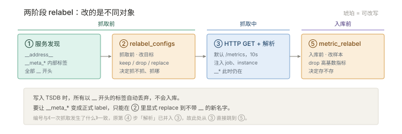
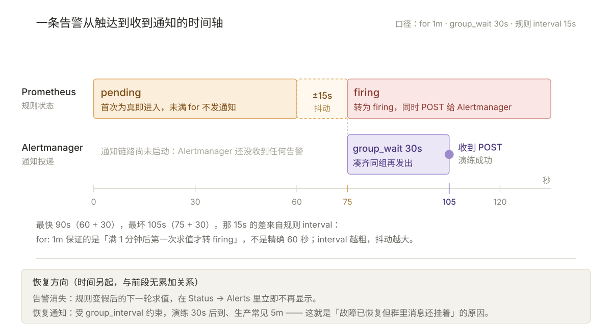

# 03 · 配置与部署

> 本篇回答：怎么把它从零跑起来，配置怎么写，改完怎么确认生效。
> 这一篇里的每条命令都给出了**预期输出**——敲完对不上，就说明中间某步没成。

---

## 3.1 安装

### 3.1.1 二进制（生产推荐）

```bash
# 1. 下载并解压（版本号按需替换）
wget https://github.com/prometheus/prometheus/releases/download/v2.53.0/prometheus-2.53.0.linux-amd64.tar.gz
tar xzvf prometheus-*.tar.gz
cd prometheus-*/

# 2. 确认版本（后面所有口径以此为准）
./prometheus --version
./promtool --version

# 3. 直接前台启动，先确认能跑
./prometheus --config.file=prometheus.yml
```

预期输出（`--version`）：

```plain
prometheus, version 2.53.0 (branch: HEAD, revision: ...)
  build user:       root@...
  build date:       ...
  go version:       go1.22.x
  platform:         linux/amd64
```

启动成功的标志是日志最后出现这几行：

```plain
level=info msg="Server is ready to receive web requests." component=web
level=info msg="Loading configuration file" filename=prometheus.yml
```

如果只看到 `Starting Prometheus` 但没有 `Server is ready`，说明配置加载失败，往上翻日志找 `level=error`。

### 3.1.2 Docker（本机试手推荐）

```bash
# 数据持久化：先建 volume，否则容器删了数据就没了
docker volume create prometheus-data

docker run -d --name prom \
  -p 9090:9090 \
  -v "$(pwd)/prometheus.yml:/etc/prometheus/prometheus.yml:ro" \
  -v prometheus-data:/prometheus \
  prom/prometheus
```

两个坑：

- **挂载的 `prometheus.yml` 必须事先存在**。文件不存在时 Docker 会把它**建成一个目录**，然后 Prometheus 报 `is a directory`。先 `ls prometheus.yml` 确认。
- 镜像内默认数据目录是 `/prometheus`，不是 `/var/lib/prometheus`。挂错位置重启就丢数据。

## 3.2 最小可跑配置

先跑通，再加东西。**这 6 行是能真正跑起来的最小配置**：

```yaml
global:
  scrape_interval: 15s
  evaluation_interval: 15s

scrape_configs:
  - job_name: prometheus
    static_configs:
      - targets: ["localhost:9090"]
```

它让 Prometheus 抓自己。启动后访问 `http://localhost:9090/targets`，应该看到一个 `prometheus` job，状态 `UP`。

> 关于 `scrape_interval` 的默认值：**程序内置默认是 `1m`**，但官方发布的示例配置文件里写的是 `15s`。两者都对，差别在"没写时"和"示例里"——正文按代码行为写 `1m`，你照抄示例就是 `15s`。

## 3.3 综合示例（需按环境替换）

下面这份是"什么都有"的样本，覆盖静态、文件 SD、Consul SD、K8s SD、remote_write 五种写法。**它不是拿来直接跑的**，是拿来对照删改的。带 `<…>` 的地方必须替换。

```yaml
# /etc/prometheus/prometheus.yml
global:
  scrape_interval: 15s
  scrape_timeout: 10s            # 单次抓取超时，必须 ≤ scrape_interval
  evaluation_interval: 15s       # 规则计算间隔
  external_labels:               # 只加在 remote_write / 告警 / 联邦结果上，不入本地库
    cluster: <集群名>

rule_files:
  - /etc/prometheus/rules/*.yml  # 目录不存在或为空会告警，先建目录

alerting:
  alertmanagers:
    - static_configs:
        - targets: ["<alertmanager-host>:9093"]

scrape_configs:
  # ① 静态目标：自监控（必须有）
  - job_name: prometheus
    static_configs:
      - targets: ["localhost:9090"]

  # ② 文件服务发现：大批主机最常用的折衷
  - job_name: node
    file_sd_configs:
      - files: ["/etc/prometheus/targets/node/*.json"]   # 目录与文件都要先建好
        refresh_interval: 30s
    relabel_configs:
      - source_labels: [__address__]
        regex: ([^:]+)(?::\d+)?
        replacement: $1:9100
        target_label: __address__

  # ③ Consul 服务发现（没有 Consul 就整段删掉）
  - job_name: consul-services
    consul_sd_configs:
      - server: "<consul-host>:8500"
        token_file: /etc/prometheus/consul.token     # 文件必须存在且可读
    relabel_configs:
      - source_labels: [__meta_consul_service]
        target_label: job
      - source_labels: [__meta_consul_service_address, __meta_consul_service_port]
        separator: ":"
        target_label: instance
      - regex: __meta_consul_service_metadata_(.+)
        action: labelmap

  # ④ Kubernetes 服务发现（抓 pod 注解声明的端口，非 K8s 环境整段删掉）
  - job_name: kubernetes-pods
    kubernetes_sd_configs:
      - role: pod
    relabel_configs:
      - source_labels: [__meta_kubernetes_pod_annotation_prometheus_io_scrape]
        action: keep
        regex: "true"
      - source_labels: [__meta_kubernetes_pod_annotation_prometheus_io_path]
        action: replace
        target_label: __metrics_path__
        regex: (.+)
      - source_labels: [__address__, __meta_kubernetes_pod_annotation_prometheus_io_port]
        action: replace
        regex: ([^:]+)(?::\d+)?;(\d+)
        replacement: $1:$2
        target_label: __address__
      - source_labels: [__meta_kubernetes_namespace]
        target_label: namespace
      - source_labels: [__meta_kubernetes_pod_name]
        target_label: pod
    sample_limit: 5000           # 防雪崩：单次抓取样本上限

# ⑤ remote_write：外挂长期存储（没有远端就整段删掉）
# 注意：它和 scrape_configs 平级，不是第 5 个 job
remote_write:
  - url: http://<thanos-receive-host>:19291/api/v1/receive
    queue_config:
      max_samples_per_send: 5000
      capacity: 10000
```

配套的 file_sd 文件（`/etc/prometheus/targets/node/prod.json`）：

```json
[
  {
    "targets": ["10.0.0.1:9100", "10.0.0.2:9100"],
    "labels": { "env": "prod", "idc": "sh" }
  }
]
```

> 原文把 `remote_write` 的注释写在了 `scrape_configs` 的缩进里，容易让人以为它是第 5 个 job。这里已修正为平级。

## 3.4 `global` 段字段

| 字段 | 默认 | 说明 |
| --- | --- | --- |
| `scrape_interval` | `1m` | 全局抓取间隔，可被 job 级覆盖 |
| `scrape_timeout` | `10s` | 单次抓取超时，**必须 ≤ `scrape_interval`**（相等合法） |
| `evaluation_interval` | `1m` | 规则计算频率 |
| `external_labels` | 空 | 只加在 remote_write / 告警 / 联邦结果上，不入本地库 |

## 3.5 `scrape_configs` 常用字段

| 字段 | 作用 | 备注 |
| --- | --- | --- |
| `job_name` | 任务名，**必填且唯一** | 直接成为 `job` label |
| `scrape_interval` / `scrape_timeout` | 覆盖全局 | 高频业务可设 10s |
| `metrics_path` | 指标路径 | 默认 `/metrics` |
| `scheme` | `http` / `https` | |
| `params` | URL 查询参数，如 `module=icmp` | blackbox 必用 |
| `basic_auth` / `authorization` / `oauth2` | 认证 | 生产务必加 |
| `tls_config` | CA、证书、`insecure_skip_verify` | 自签证书场景 |
| `static_configs` | 静态目标 + 附加 labels | 最直观，实例多了就别用 |
| `file_sd_configs` | 从 JSON/YAML 文件读目标 | **运维最推荐的折衷** |
| `consul_sd_configs` | 从 Consul 服务目录发现 | 配合 `__meta_consul_*` |
| `kubernetes_sd_configs` | K8s 原生发现，`role` 取 `node/pod/service/endpoints/endpointslice/ingress` | |
| `dns_sd_configs` | 靠 DNS SRV/A 记录发现 | 无依赖，适合云上 |
| `relabel_configs` | **抓取前**改标签 / 决定抓不抓 | 见 §3.6，高频考点 |
| `metric_relabel_configs` | **抓取后入库前**删改指标 | 降基数的最后一道闸 |
| `honor_labels` | 是否保留目标自带的 `job`/`instance` | 默认 `false`（冲突时加 `exported_` 前缀） |
| `sample_limit` / `label_limit` | 硬限流，超出则该次抓取失败 | 防雪崩，建议设值 |

## 3.6 relabel：配置里最需要吃透的一节

relabel 两条执行链与隐藏标签的消失点：



### 3.6.1 两个阶段的差别（必记）

|  | `relabel_configs` | `metric_relabel_configs` |
| --- | --- | --- |
| 执行时机 | 抓取**之前** | 抓取**之后**、入库之前 |
| 作用对象 | 目标标签（含 `__meta_*`、`__address__`） | 样本标签 |
| 能做的事 | 决定目标抓不抓、抓到哪、改哪个 label | 决定指标存不存、删哪个 label |
| 典型用途 | 白名单过滤、端口改写、元数据转正式标签 | 丢弃高基数指标、丢弃无用指标 |

**执行顺序**：按数组顺序逐条执行，**前一条的输出是后一条的输入**。所以顺序会改变结果——先 `keep` 再 `replace` 和反过来，命中的目标集不一样。

### 3.6.2 action 全表

| action | 语义 |
| --- | --- |
| `replace`（默认） | 用 `replacement`（默认 `$1`）写 `target_label` |
| `keep` | 正则匹配 `source_labels` 的值**保留**，否则丢目标/样本 |
| `drop` | 匹配则**丢弃** |
| `labelmap` | 把匹配 `regex` 的**标签名**映射为新标签名（K8s/Consul 元数据批量转正） |
| `labeldrop` / `labelkeep` | 按标签名删 / 留 |
| `hashmod` | 取模分片，配合 `keep` 实现分片抓取 |
| `lowercase` / `uppercase` | 大小写转换 |
| `keepequal` / `dropequal` | 值相等则保留 / 丢弃 |

### 3.6.3 四个高频示例

```yaml
# 只抓 prod 命名空间
- source_labels: [__meta_kubernetes_namespace]
  action: keep
  regex: prod

# 把 __address__ 的端口换成 9100
- source_labels: [__address__]
  regex: ([^:]+)(?::\d+)?
  replacement: $1:9100
  target_label: __address__

# 丢弃进程级高基数指标（累计 2000 条 series）
- source_labels: [__name__]
  regex: go_(gc_.*|memstats_.*)
  action: drop

# 统一清洗版本 label，避免镜像 tag 哈希导致基数爆炸
- source_labels: [version]
  regex: (v\d+\.\d+).*
  target_label: version
  replacement: $1
```

### 3.6.4 一个必须知道的默认行为

目标上以 `__` 开头的标签（`__meta_*`、`__address__`、`__scheme__`、`__metrics_path__`、`__param_*`）**抓取后自动丢弃**，不会入库；想让它们变成正式 label，必须在 `relabel_configs` 里显式 `replace` 到新名字。

## 3.7 常用启动参数

| 参数 | 默认 | 说明 |
| --- | --- | --- |
| `--config.file` | `prometheus.yml` | 主配置 |
| `--storage.tsdb.path` | `data/` | TSDB 目录，需大磁盘 |
| `--storage.tsdb.retention.time` | `15d` | 保留期 |
| `--storage.tsdb.retention.size` | `0`（不限） | 按容量兜底，**生产建议设** |
| `--storage.tsdb.wal-compression` | 启用 | WAL 压缩，不建议关 |
| `--web.enable-lifecycle` | `false` | 打开后可用 `POST /-/reload` 热加载 |
| `--web.enable-admin-api` | `false` | 放开删除 series 等管理接口，慎用 |
| `--query.lookback-delta` | `5m` | 瞬时查询向前回看的窗口（决定「多久算过期」） |
| `--query.max-samples` | `50000000` | 单查询样本上限，防 OOM |
| `--log.level` | `info` | `debug` 排查抓取问题时用 |

## 3.8 校验与加载：改完必须验证的三步

这是原文缺失的闭环。**改配置不验证，等于在线上赌博。**

### 第一步：语法校验

```bash
promtool check config /etc/prometheus/prometheus.yml
```

预期输出（通过时只有一行）：

```plain
SUCCESS: /etc/prometheus/prometheus.yml is valid prometheus config file syntax
```

失败时长这样，会指出行号与原因：

```plain
FAILED: parsing YAML file /etc/prometheus/prometheus.yml: yaml: line 27: did not find expected key
```

规则文件单独校验：

```bash
promtool check rules /etc/prometheus/rules/*.yml
```

预期输出：

```plain
SUCCESS: 12 rules found
```

### 第二步：热加载

```bash
# 前提：启动时带了 --web.enable-lifecycle
curl -X POST http://localhost:9090/-/reload
```

预期：**HTTP 200，无返回体**。检查返回码：

```bash
curl -s -o /dev/null -w "%{http_code}\n" -X POST http://localhost:9090/-/reload
# 期望输出：200
```

常见失败：

| 返回码 / 信息 | 原因 |
| --- | --- |
| `403 Lifecycle API is not enabled.` | 启动时没加 `--web.enable-lifecycle`，只能重启 |
| `400` + 具体报错 | 新配置有语法错误，旧配置仍在生效（**不会中断服务**） |

或者不重启、也不开 lifecycle，直接发信号：

```bash
kill -s SIGHUP $(pidof prometheus)
```

### 第三步：确认 relabel 结果对不对

**这一步最容易被跳过，但它能解决 80% 的抓取问题。**

```bash
curl -s localhost:9090/api/v1/targets | python3 -m json.tool | head -40
```

预期看到的结构（关键字段已标注）：

```json
{
  "status": "success",
  "data": {
    "activeTargets": [
      {
        "discoveredLabels": {
          "__address__": "10.0.0.1:9100",
          "__metrics_path__": "/metrics",
          "__scheme__": "http",
          "job": "node"
        },
        "labels": { "instance": "10.0.0.1:9100", "job": "node", "env": "prod" },
        "scrapeUrl": "http://10.0.0.1:9100/metrics",
        "health": "up",
        "lastError": ""
      }
    ]
  }
}
```

两个字段的分工，就是 relabel 前后的对照：

- **`discoveredLabels`** = relabel **之前**的原始标签（含全部 `__meta_*`）。
- **`labels`** = relabel **之后**实际注入的标签，也就是入库的样子。

所以配置里写的 relabel 规则到底生效没有，**直接比这两个字段**即可，不用猜。如果目标根本不在 `activeTargets` 里，说明被 `keep`/`drop` 过滤掉了——去 `GET /api/v1/targets?state=dropped` 看被丢弃的目标及原因。

## 3.9 优雅关闭

```bash
kill -s SIGTERM <PID>    # 或在控制终端按 ^C
```

Prometheus 收到 SIGTERM 后会：停止抓取 → 把内存中的 Head block 刷盘 → 退出。**给足 30 秒**，别用 `kill -9`——强杀会丢掉 WAL 里还没刷的部分，重启后虽然能重放，但如果 WAL 也损坏就只能接受数据缺口。

## 3.10 上手清单（15 分钟）

按顺序做，每步都有验收标准。

```bash
# ① 准备配置：先写最小可跑的那 6 行（见 §3.2）
cat > prometheus.yml <<'EOF'
global:
  scrape_interval: 15s
  evaluation_interval: 15s
scrape_configs:
  - job_name: prometheus
    static_configs:
      - targets: ["localhost:9090"]
EOF

# ② 校验，必须看到 SUCCESS
promtool check config prometheus.yml

# ③ 启动
docker run -d --name prom -p 9090:9090 \
  -v "$(pwd)/prometheus.yml:/etc/prometheus/prometheus.yml:ro" \
  -v prometheus-data:/prometheus \
  prom/prometheus

# ④ 起一个被监控目标
docker run -d --name nodeexp -p 9100:9100 prom/node-exporter

# ⑤ 确认目标自己先活着（这一步失败，后面全白搭）
curl -s localhost:9100/metrics | head -5
```

第 ⑤ 步的预期输出：

```plain
# HELP go_gc_duration_seconds A summary of the pause duration of garbage collection cycles.
# TYPE go_gc_duration_seconds summary
go_gc_duration_seconds{quantile="0"} 1.234e-05
...
```

看到一个以 `# HELP` 开头的文本流，说明 exporter 正常。然后在 `prometheus.yml` 里加第二个 job 并热加载：

```yaml
  - job_name: node
    static_configs:
      - targets: ["host.docker.internal:9100"]   # Linux 用宿主机 IP 或 docker0 地址
```

验收四步，全过才算跑通：

| # | 检查 | 在哪看 | 通过标准 |
| --- | --- | --- | --- |
| 1 | 配置合法 | `promtool check config` | `SUCCESS: ...is valid` |
| 2 | 目标在线 | `Status → Targets` | `prometheus` 与 `node` 两个 job 均为 `UP` |
| 3 | 能出图 | `Graph` 页查 `node_memory_MemAvailable_bytes` | 有线，不是 `Empty query result` |
| 4 | 规则生效 | 加一条记录规则后看 `Status → Rules` | `last evaluation` 有值，不是 `never` |

四步全绿，Prometheus 就是真的跑起来了。之后再做一遍告警演练（§3.11），把"告警真的会响"这件事也验证掉，长期存储的选型见 004 §4.3。

## 3.11 把一条告警真正发出去

前面 §3.10 验证的是"能采集"，这一节验证"能通知"。**告警是整套系统里唯一必须端到端跑通的模块**——规则写得对、配置也合法，但接收端配错时，界面上一切正常，只有故障当天才发现没人收到消息。

演练用一个**必然触发**的假告警，不用等真实故障。全程约 4 分钟，只需 docker 与本机一个 HTTP 端口，不依赖邮件或短信凭据。

### 3.11.1 起接收端（webhook）

Alertmanager 发出的是 HTTP POST，所以先用一段十行的 Python 起个"垃圾桶"，把收到的 JSON 原样打印出来：

```bash
python3 - <<'PY'
from http.server import BaseHTTPRequestHandler, HTTPServer
class H(BaseHTTPRequestHandler):
    def do_POST(self):
        n = int(self.headers.get('Content-Length', 0))
        print(self.rfile.read(n).decode(), flush=True)   # 原样打印收到的告警
        self.send_response(200); self.end_headers()
    def log_message(self, *a): pass                      # 关掉访问日志，输出更干净
HTTPServer(('0.0.0.0', 8080), H).serve_forever()
PY
```

这个终端要一直开着。看到 `POST /alert` 与一段 JSON 出现，就说明告警真的走通了。

> 也可以用 `nc -l 8080`，但各版本 `nc` 的参数不一致（有的要 `-p`），Python 这段更稳。

### 3.11.2 Alertmanager 最小配置

```yaml
# alertmanager.yml
global:
  resolve_timeout: 5m

route:
  receiver: webhook
  group_by: ["alertname"]
  group_wait: 30s          # 首条通知前等 30s 凑齐同组
  group_interval: 30s      # 演练时调小，便于观察恢复通知；生产一般 5m
  repeat_interval: 4h

receivers:
  - name: webhook
    webhook_configs:
      - url: http://host.docker.internal:8080/alert   # Linux 换成宿主机 IP
        send_resolved: true
```

启动并校验：

```bash
docker run -d --name am -p 9093:9093 \
  -v "$(pwd)/alertmanager.yml:/etc/alertmanager/alertmanager.yml:ro" \
  prom/alertmanager --config.file=/etc/alertmanager/alertmanager.yml

# amtool 在镜像里自带，不用另装
docker exec am amtool check-config /etc/alertmanager/alertmanager.yml
```

预期输出：

```plain
Checking '/etc/alertmanager/alertmanager.yml'  SUCCESS
Found:
 - global config
 - route
 - 0 inhibit rules
 - 1 receivers
 - 0 templates
```

`receivers` 必须为 1 而不是 0——这是最常见的失败：只写了 `route` 没定义 `receivers`，检查直接报 `undefined receiver "webhook" used in route`。

### 3.11.3 一条必响的规则

```yaml
# /etc/prometheus/rules/demo.rules.yml
groups:
  - name: demo.alerts
    interval: 15s
    rules:
      - alert: AlwaysFiring
        expr: vector(1) > 0        # 恒为真，保证一定触发
        for: 1m                    # 持续 1 分钟才 firing
        labels:
          severity: warning
        annotations:
          summary: "这是一条演练告警，可忽略"
          description: "当前值 {{ $value }}"
```

```bash
promtool check rules /etc/prometheus/rules/demo.rules.yml
# SUCCESS: 1 rule found
```

`prometheus.yml` 里要有两处指向它：

```yaml
rule_files:
  - /etc/prometheus/rules/*.yml

alerting:
  alertmanagers:
    - static_configs:
        - targets: ["host.docker.internal:9093"]   # Linux 换宿主机 IP
```

改完按 §3.8 的三步走：`promtool check config` → `POST /-/reload`（需启动时带 `--web.enable-lifecycle`）→ 看 `Status → Rules` 里这条规则 `last evaluation` 不再是 `never`。

### 3.11.4 观察四个阶段

| 阶段 | 在哪看 | 现象 |
| --- | --- | --- |
| **inactive** | `Status → Alerts` | 规则已加载，但还没到第一次为真 |
| **pending** | 同上 | 出现 `AlwaysFiring`，`Active Since` 开始走，此时**不发通知** |
| **firing** | 同上 | 约 60–75 秒后转 `firing`，同时 POST 给 Alertmanager |
| **收到通知** | 接收端终端 | 再过 `group_wait`（30s），出现 `POST /alert` 与 JSON |

**从触达到收到通知约 1 分 30 秒，最坏 1 分 45 秒**——即 `for` 与 `group_wait` 串联的实际手感（60s + 30s，浮动的那 15s 来自规则 `interval` 的判定粒度，详见 004 §4.4.1）。抱怨"告警太慢"时，先看这两个数，而不是去调 `scrape_interval`。两个阶段的刻度见下图。



收到的 JSON 关键字段（节选）：

```json
{
  "version": "4",
  "status": "firing",
  "groupLabels": { "alertname": "AlwaysFiring" },
  "alerts": [
    {
      "status": "firing",
      "labels": { "alertname": "AlwaysFiring", "severity": "warning" },
      "annotations": { "summary": "这是一条演练告警，可忽略" },
      "startsAt": "2026-10-29T03:20:15Z",
      "endsAt": "0001-01-01T00:00:00Z"
    }
  ]
}
```

`endsAt` 为 `0001-01-01` 表示"尚未恢复"，这是 Prometheus 与 Alertmanager 之间约定的写法。恢复后 `status` 变 `resolved`，`endsAt` 变成真实时间。

### 3.11.5 验证恢复通知

把规则表达式改成恒假的 `vector(1) > 2`，reload，然后看：

1. `Status → Alerts` 里该告警消失（或转 `inactive`）；
2. 接收端在 `group_interval`（这里设的 30s）之后收到 `status: "resolved"` 的 JSON。

**恢复通知不等于立刻到**——它受 `group_interval` 约束。这也是"故障恢复了但群里的消息还挂着"的常见原因。

### 3.11.6 演练常见失败

| 现象 | 原因 |
| --- | --- |
| `Status → Rules` 里没有这条规则 | `rule_files` 路径没匹配上（通配符、容器内路径），或没 reload |
| 一直 `pending` 不转 `firing` | `for` 未到；或表达式间歇为假（`vector(1) > 0` 恒真，不会出现这种情况） |
| 已 `firing`，接收端没动静 | `route.receiver` 名字与 `receivers[].name` 不一致；或容器内 `localhost` 指容器自己，没连到宿主机 |
| `amtool check-config` 报 `undefined receiver` | 只写了 `route`，漏了 `receivers` |
| 恢复通知迟迟不来 | 等 `group_interval`，不是立刻发 |

演练通过后，把 `receivers` 换成真实接收端即可，规则与 `route` 不用动。

### 3.11.7 换成企业微信 / 钉钉机器人时要注意

这两者虽然也是 webhook，但**不能直接填进 `webhook_configs`**：它们要求请求体是 `{"msgtype":"text","text":{"content":"..."}}` 这类固定结构，而 Alertmanager 发的是上面那个通用 JSON，直接发会被接口拒绝（返回 400 或 `invalid message type`）。

正确做法是中间加一层转换，两种都常见：

1. 用现成适配器（如 `prometheus-webhook-dingtalk`），Alertmanager 指它，它再转成机器人要的格式；
2. 自己写一个几十行的转发服务，收到 Alertmanager 的 JSON 后拼成 `msgtype` 格式再发。

邮件（`email_configs`）则不需要转换，但需要可用的 SMTP 凭据，不适合做首次演练。

---

**上一篇**：[002-数据与查询](002-数据与查询.md)　**下一篇**：[004-存储-告警-排错](004-存储-告警-排错.md)
