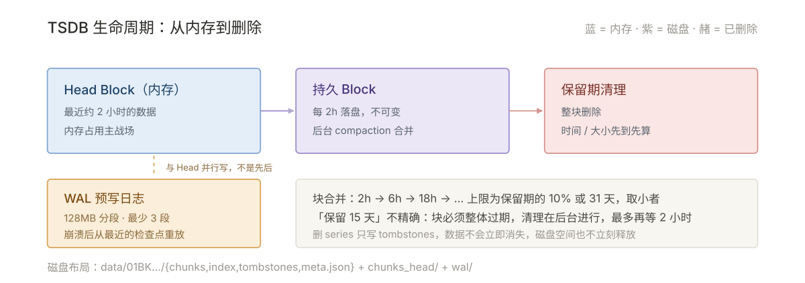
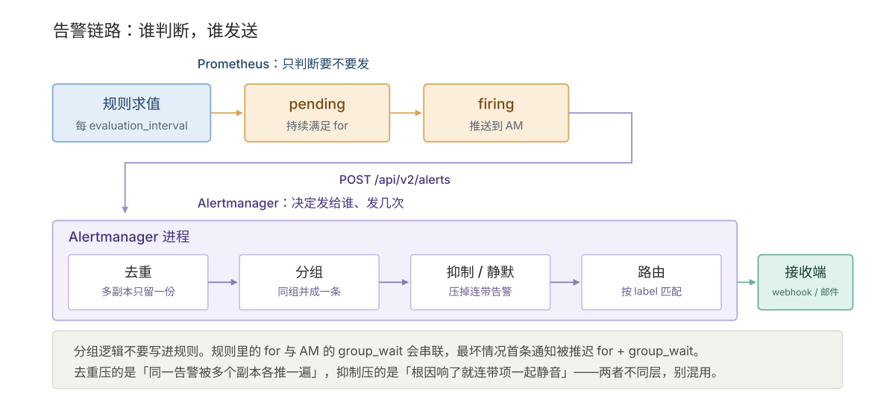
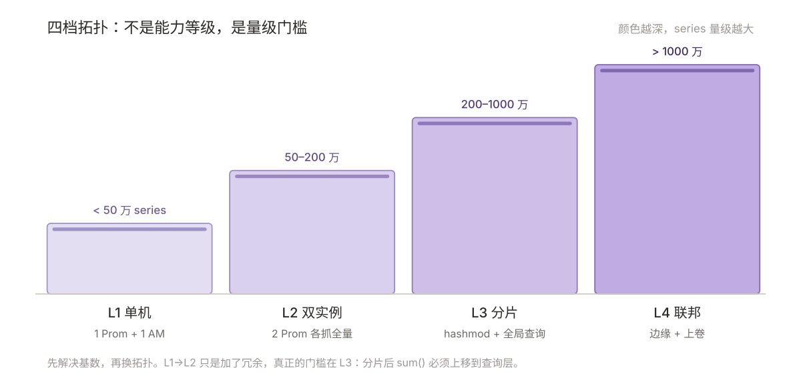

# 04 · 存储、告警、排错

> **解决**：数据存在哪、能存多久、要多少磁盘；告警怎么从规则走到人手里；出问题从哪一步开始查。  
> **范围**：TSDB 怎么工作 · 容量估算 · 长期存储 · 告警 · 部署拓扑与规模演进  
> **口径**：以正文标注的配置、PromQL 与命令为准；不绑定单一 Prometheus 版本，差异在节内注记。  
> **更新**：2026-11-06  
> 这是四篇里最"运维"的一篇，前三篇建立认知，这一篇用于日常决策和救火。

---

## 目录

| 节 | 内容 |
|---|---|
| 4.1 | TSDB 怎么工作 |
| 4.2 | 容量估算 |
| 4.3 | 长期存储 |
| 4.4 | 告警：从规则到通知 |
| 4.5 | 部署拓扑与规模演进 |
| 4.6 | 排错路径 |
| 4.7 | 速查附录 |

| 4.8 | 坑表 |
| 4.9 | 检查清单（自测题含答案） |
---

## 4.1 TSDB 怎么工作

TSDB 生命周期——WAL 到 Head 到 Block 到清理：



### 4.1.1 写入路径

上游那张图画的就是这一节，对着看：样本同时写 WAL 与 Head，Head 落盘成 Block，Block 再合并、再过期。

+ **WAL**：先写日志再返回成功，崩溃后重放恢复。**最少保留 3 个段**，高流量实例会自动留更多，以保证至少覆盖 2 小时原始数据。
+ **Head Block**：最近约 2 小时数据在内存 + mmap，**内存主要消耗在这里**。
+ **Block**：每 2 小时落盘为不可变块，后台 compaction 合并成更大块。**上限是保留期的 10% 或 31 天**，取小者——所以配 90 天保留，最终也就是 31 天一个块，不会无限合并。
+ **删除**：超出保留期的**整块**删除，所以「保留 15 天」实际会多留一些，不是精确到秒。

### 4.1.2 磁盘上长什么样

```text
./data
├── 01BKGV7JBM69T2G1BGBGM6KB12/   # 一个 2 小时块
│   ├── chunks/                   # 样本数据
│   │   └── 000001
│   ├── index                     # 索引文件
│   ├── tombstones                # 删除记录
│   └── meta.json                 # 元数据
├── chunks_head/                  # 当前块（内存映射）
│   └── 000001
└── wal/                          # 预写日志
    ├── 000000002
    └── checkpoint.00000001/
        └── 00000000
```

这块知识只在两种场景有用，但都挺要命：

- **磁盘满了要腾空间**：能删的是整个块目录（改保留期后自动删），**不能手工删 `chunks/000001`**，那会让索引和块对不上，启动时直接报 `corruption`。
- **想删个别 series**：通过 `POST /api/v1/admin/tsdb/delete_series` 删除时，删除记录写进 **`tombstones`** 文件，**数据本身不会立即从 chunk 里消失**，磁盘空间也不立刻释放。要真正回收得等块过期。

`--storage.tsdb.wal-compression` **默认启用**，压缩比通常 2–3 倍。除非排查 WAL 损坏，不要关。

### 4.1.3 体检：一条命令看清基数分布

§4.6.2 第 1 条说"内存涨就查高基数 label"，具体查法就是这个：

```bash
promtool tsdb analyze /var/lib/prometheus/data
```

只读操作，可对运行中的实例执行，低峰跑更稳。输出分四段，前两段是块信息，真正要看的是后两段排行：

```plain
Block ID: 01HK...
Duration: 2h0m0s
Series: <活跃 series 数>
Label names: <标签名个数>
Postings: <postings 段数>

Highest cardinality labels:
   <条数>  <label 名>
   ...

Highest cardinality metric names:
   <条数>  <指标名>
   ...
```

- **标签排行**告诉你哪个 label 在制造 series。榜首是 `pod`、`instance`、`container` 属正常；出现 `user_id`、`path`、`url`、`request_id` 就是 §2.3 点名的反模式，处置见 003 §3.6.3 的 `metric_relabel_configs`。
- **指标名排行**告诉你哪个指标最重。`node_cpu_seconds_total`、`container_*` 排前面是常态，不必紧张。

只看单个块会快很多：`promtool tsdb list <data>` 列出块 ID，再 `promtool tsdb analyze <data> <block-id>`。

## 4.2 容量估算

### 4.2.1 两套公式，结果一致

**按 series 推**（直观，适合已知指标规模时）：

```text
每日样本数 = 活跃 series 数 × 86400 / scrape_interval
磁盘占用   ≈ 每日样本数 × 1.5 B      （v2 压缩后经验值 1–2 B/sample）
内存占用   ≈ 活跃 series 数 × 1.5–3 KB（Head block + 索引，经验值）
```

**按摄入速率推**（适合已知 QPS 时，也便于和远端存储的报价对齐）：

```text
所需磁盘 = 保留时间(秒) × 每秒摄入样本数 × 每样本字节数
每秒摄入样本数 = 活跃 series 数 / scrape_interval
```

两套算出来应该差不多，可以用来自查。**差一个数量级，说明某个假设错了**（最常见是把 series 数当成了指标数）。

### 4.2.2 算例

10 万活跃 series，15s 抓取，保留 30 天：

| 项 | 计算 | 结果 |
| --- | --- | --- |
| 每秒摄入样本 | 100000 / 15 | ≈ 6667 |
| 每日样本 | 6667 × 86400 | 5.76 亿 |
| 每日磁盘 | 5.76e8 × 1.5B | ≈ 0.86 GB |
| 30 天磁盘 | 0.86 × 30 | ≈ 26 GB |
| 内存 | 100000 × 2KB | ≈ 200 MB（实际含查询峰值更高） |

用另一套公式验算：`2592000s × 6667 × 1.5B = 25.9 GB`，与 26 GB 一致。

### 4.2.3 三条实践结论

1. **磁盘不是瓶颈，series 基数和查询内存才是**。26 GB 对任何一台服务器都不算什么，但 10 万 series 的查询峰值内存可能到 1–2 GB。
2. **`--storage.tsdb.retention.size` 建议设为磁盘可用空间的 80–85%**，留出 compaction 的临时空间和系统余量。
3. **时间与大小同时配时，先到先算**。设 `retention.time=15d` + `retention.size=50GB`，实际保留是"15 天"和"50GB"谁先触发。这个组合是对的：时间是预期，大小是兜底。

> 规划时按「日增 × 保留天数 × 1.5」留余量。乘 1.5 是因为 compaction 期间新旧块会共存一段时间，峰值比稳态高。

## 4.3 长期存储

| 方案 | 形态 | 优点 | 代价 |
| --- | --- | --- | --- |
| 本地 TSDB | 单机 | 零依赖、延迟低 | 保留期短、无 HA |
| 双实例 + 同配置 | 主备冗余 | 简单、可查两个源 | 存储翻倍、无全局视图 |
| **Thanos** | Sidecar + 对象存储 | 长期存储、全局查询、降采样 | 组件多，运维复杂 |
| **Grafana Mimir** | 多租户水平扩展 | 大规模、原生多租户 | 资源要求高 |
| **VictoriaMetrics** | 单二进制替代 | 兼容 remote_write、压缩比高 | 非 CNCF 官方栈 |

选型建议：

- **中小规模（< 200 万 series）** 优先「本地 TSDB + 双实例」。这套的运维成本接近于零，而 Thanos 需要 sidecar、store、query、compactor 四五个组件，出问题的面大得多。
- **跨集群 / 超 30 天** 再上远端方案。**不要一开始就上 Thanos**——大多数团队的真实需求是"看三个月前的图"，而不是"存五年原始数据"，前者用降采样就够了。

**双实例的一个必踩坑**：两个 Prometheus 各抓全量，Grafana 配两个数据源时正常；但如果接 Thanos 或统一查询层，同一份数据会出现两份，必须去重：

```bash
--query.replica-label=replica     # 配合 external_labels: replica: prom-a / prom-b
```

不去重的表现是"所有计数翻倍"，且很难第一时间想到是这个原因。

**接了远端之后，看这三个数。** `remote_write` 是"至少一次"语义——可能重复投递、队列满会丢，所以"配置合法、日志没报错"不等于数据完整：

```promql
rate(prometheus_remote_storage_samples_dropped_total[5m])                 # 应恒为 0，非 0 就是真丢
prometheus_remote_storage_samples_pending                                 # 持续 > 0 说明发不出去
time() - prometheus_remote_storage_queue_highest_sent_timestamp_seconds   # 落后多少秒，正常在秒级
```

第一项非 0 的三个常见原因：`queue_config.capacity` 太小、对端写入慢、网络带宽不够。第二项长期高位而第一项为 0，说明还在追赶、暂时没丢，不用立刻动。

还有一条容易被忽略：**远端写不保证精确一次**。重试与队列重启都可能让同一批样本被发两遍，所以远端必须能按 `(series, timestamp)` 去重（Thanos / Mimir 默认如此）。去重做不了的存储，接了之后计数类指标会系统性偏高——这也是 001 §1.7 把"账单级计量"列为不适用场景的另一个原因。

## 4.4 告警：从规则到通知

告警链路——规则求值到通知投递的职责分界：



### 4.4.1 职责边界

上游那张图的上下两半，就是这条边界的两侧：上半是 Prometheus 的三态，下半是 Alertmanager 这个进程内部的四步。**去重、分组、抑制、路由全都发生在 Alertmanager 里，不在 Prometheus 里**，所以在 `prometheus.yml` 里找不到对应的配置项。

**Prometheus 只负责「判断是否触发」，Alertmanager 负责「发不发、发给谁、发几次」**。不要把分组逻辑写进规则。

这条边界带来的实际影响：规则里的 `for: 10m` 是"等 10 分钟确认"，`group_wait: 30s` 是"等 30 秒凑齐同组"。**两者串联，最坏情况第一条通知会被推迟 10 分 30 秒**。抱怨"告警来得太慢"时，先算这两个数。

### 4.4.2 告警规则写法

```yaml
groups:
  - name: node.alerts
    interval: 30s
    rules:
      - alert: NodeHighCPU
        expr: instance:node_cpu_util:rate5m > 85
        for: 10m                    # 持续 10 分钟才 firing，压抖动
        labels:
          severity: warning         # 分组与路由的依据
        annotations:
          summary: "实例 {{ $labels.instance }} CPU 偏高"
          description: "当前 {{ $value | printf \"%.1f\" }}%，已持续 10 分钟"
          runbook: "https://wiki/runbook/node-cpu"
```

可用模板变量：`$labels.<name>`、`$value`、`$externalLabels`；常用函数 `humanize`、`printf`、`toUpper`。

`runbook` 不是内置字段，但强烈建议加——它是"告警可行动"的唯一保障。

### 4.4.3 Alertmanager 四个核心机制

| 机制 | 作用 | 关键配置 |
| --- | --- | --- |
| **分组 grouping** | 同类告警合并成一条通知 | `group_by`、`group_wait`、`group_interval` |
| **抑制 inhibition** | 高优先级告警压下低优先级 | `inhibit_rules`（source/target + equal） |
| **静默 silence** | 人工临时屏蔽，带过期时间 | UI / `amtool silence add` |
| **路由 route** | 按 label 树形分发到不同接收端 | 嵌套 `routes` + `match`/`matchers` |

```yaml
route:
  receiver: default
  group_by: ["alertname", "cluster", "namespace"]
  group_wait: 30s
  group_interval: 5m
  repeat_interval: 4h
  routes:
    - matchers: ['severity="critical"']
      receiver: pagerduty
      repeat_interval: 1h
    - matchers: ['team="db"']
      receiver: db-oncall

inhibit_rules:
  - source_matchers: ['severity="critical"']
    target_matchers: ['severity="warning"']
    equal: ["alertname", "instance"]     # 同实例同告警，critical 压 warning
```

四个机制的生效顺序是 **去重 → 分组 → 抑制/静默 → 路由**，顺序不能反：被静默的告警不会再进路由，所以"设了静默但还是收到通知"通常是 `repeat_interval` 到期前的旧通知，等一轮就没了。

### 4.4.4 时间参数默认值（最容易记错）

| 参数 | 默认 | 含义 |
| --- | --- | --- |
| `for` | `0` | 规则侧，持续多久才 firing |
| `group_wait` | `30s` | 首条通知前的等待，用于凑齐同组 |
| `group_interval` | `5m` | 同组新增告警的最小通知间隔 |
| `repeat_interval` | `4h` | 无变化时的重复提醒间隔 |
| 告警保留 | `120h` | Alertmanager 内存/`--data.retention` |

第 5 行是很多人不知道的：**Alertmanager 只保留 5 天的告警历史**，超过就查不到了。要长期留档，得在接收端落地。

### 4.4.5 告警设计原则

1. **每条告警必须可行动**：看到后知道做什么，附 `runbook` 链接。
2. **用 `for` 过滤瞬时抖动**，但不要滥用（`for: 1h` 会让真故障延迟一小时）。
3. **告警分级不超过三级**：`critical`（叫醒人）/ `warning`（工作时间内处理）/ `info`（仅记录）。
4. **警惕「告警疲劳」**：一周内没被处理过的告警，应当删除或降级。
5. **不要对「必然发生」的现象告警**（如批量重启期间的 `up=0`），改用抑制规则。
6. **恢复通知要想清楚**：`send_resolved` 默认开启，大量抖动型告警会产生成倍的恢复消息。要么压住 `for`，要么在某些接收端关掉恢复通知。

> 以上都是判断，判断要靠一次实跑校准。可复现的 4 分钟演练见 [003 §3.11](003-配置与部署.md)：用一条恒真的假告警，把 `for` + `group_wait` 的延迟亲手量一遍，并看到 `resolved` 通知。

## 4.5 部署拓扑与规模演进

规模演进的四档拓扑与量级门槛：



| 阶段 | series 量级 | 拓扑 | 说明 |
| --- | --- | --- | --- |
| **L1 单机** | < 50 万 | 1 个 Prometheus + 1 个 Alertmanager | 最省事，接受单点 |
| **L2 双实例** | 50 万–200 万 | 2 个同配置 Prometheus（各抓全量）+ 2 个 AM 集群 | 无一致性协议，靠同配置冗余；统一查询需 `--query.replica-label` 去重 |
| **L3 分片** | 200 万–1000 万 | 按 `hashmod` 分片抓取 + Thanos/Mimir 全局查询 | 需处理「分片后聚合」 |
| **L4 联邦/多集群** | > 1000 万 | 边缘 Prometheus + `federation` 上卷关键指标 | 只上卷预聚合结果，不搬原始数据 |

**分片的关键点**：`hashmod` 只改「谁抓」，不改「抓到的是什么」。分片后 `sum()` 必须落在查询层（Thanos/Mimir），不能靠单个 Prometheus——因为每个实例只看到自己那一片。

判断该升到哪一档，看两个数字就够了：

- `prometheus_tsdb_head_series` 持续超过当前档上限；
- 单次查询的 `--query.max-samples` 经常触顶（日志里出现 `query processing would load too many samples into memory`）。

第二个信号比第一个更早出现，也更该重视——它说明查询已经在 OOM 边缘。

## 4.6 排错路径

这是原文"十个坑"的升级版：先给路径，再给症状表。

### 4.6.1 从「看不到数据」出发的四层分叉

```text
Q1: 目标在 Targets 列表里吗？
├─ 不在  → 是「抓取前」的问题（第 ①② 步）
│   ├─ 用 ?state=dropped 查被丢弃的目标 → 被 keep/drop 过滤了
│   ├─ 看 discoveredLabels 里的 __address__ 对不对 → 服务发现或 relabel 写错
│   └─ 目标数为 0 → 服务发现配置错，或 SD 后端不可达
│
└─ 在 → Q2: health 是 UP 还是 DOWN？
    ├─ DOWN → 看 lastError（最常见，直接给出原因）
    │   ├─ connection refused        → 目标没起，或端口写错
    │   ├─ context deadline exceeded → 超时：网络不通，或 /metrics 生成太慢
    │   ├─ 401 / 403                 → 认证没配（basic_auth / TLS）
    │   └─ 404                       → metrics_path 不对
    │
    └─ UP → Q3: 裸 curl 目标能看到这个指标吗？
        ├─ 看不到 → exporter 侧问题，与 Prometheus 无关
        └─ 看得到 → Q4: 被 metric_relabel 丢了？
            ├─ 比 scrape_samples_scraped 与 _post_metric_relabeling 的差
            ├─ 差很大 → 有 drop 规则命中，去 003 §3.6 复查
            └─ 差为 0 → 被 sample_limit 截断，看日志的 sample limit exceeded
```

这张图的价值在于**每一步都有可执行的检查动作**，而不是"凭经验猜"。Q1 和 Q2 在 `Status → Targets` 页面上 10 秒能看完。

### 4.6.2 症状速查表

| # | 现象 | 根因 | 处置 |
| --- | --- | --- | --- |
| 1 | 内存持续上涨直至 OOM | series 基数爆炸（高基数 label） | 查 `/api/v1/status/tsdb` 的 top series，加 `metric_relabel_configs` |
| 2 | 目标 `up=0` 但能手动 curl 通 | 网络域 / DNS / `__address__` 端口错 | 看 `Targets` 页 `Error` 字段，逐条核对 relabel 结果 |
| 3 | 图表出现断点 | 抓取超时，或目标被移出 SD（staleness） | 提高 `scrape_timeout`、查 `scrape_duration_seconds`；区分"断"与"降到 0" |
| 4 | `rate` 结果全是 0 | 区间内不足 2 个样本 | 区间放大到 ≥ 4× 抓取间隔 |
| 5 | 分位数明显偏低 | ①没保留 `le`；②桶边界过粗 | `sum by (le)`；检查最高桶是否非空（002 §2.9） |
| 6 | 告警风暴 | 没有 `group_by` 与抑制规则 | 收敛维度 + `inhibit_rules` |
| 7 | 告警不恢复 | 表达式用了 `for` 但指标直接消失（无 0 值） | 用 `absent()` 配套规则或 `or vector(0)` |
| 8 | 规则算出来的指标查不到 | 记录规则结果过期（同 `lookback`）或规则未加载 | `promtool check` + 看 `Rules` 页 `last evaluation` |
| 9 | Pushgateway 数据永久残留 | 推完没 `DELETE` | 任务结束清理 + 设置 `push_time_seconds` 监控 |
| 10 | 时间不同步导致数据错乱 | 目标机时钟漂移 | 全线 NTP；必要时 `honor_timestamps: false` 用抓取时间 |
| 11 | 接 Thanos 后所有计数翻倍 | 双实例未去重 | `--query.replica-label`（见 §4.3） |
| 12 | 删了 series 但磁盘没降 | 只写了 tombstone，块未过期 | 等块过期，或调小 retention 后重建 |
| 13 | 升到 3.x 后子查询 `rate` 变 No Data | range selector 改成左开右闭，内层窗口只覆盖 1 个点 | 内层区间放大一档（`[1m:1m]`→`[2m:1m]`），见 002 §2.15.2 |

第 11–13 条是原文没有的，都是在"能跑起来之后"才会遇到、且第一反应想不到原因的那类问题。

## 4.7 速查附录

### 4.7.1 端口表

| 服务 | 默认端口 |
| --- | --- |
| Prometheus | 9090 |
| Alertmanager | 9093 |
| Pushgateway | 9091 |
| node_exporter | 9100 |
| blackbox_exporter | 9115 |
| kube-state-metrics | 8080 |
| Grafana | 3000 |
| cAdvisor | 8080 |
| mysqld_exporter | 9104 |
| redis_exporter | 9121 |

> `kube-state-metrics` 与 `cAdvisor` 都是 8080，同机部署时其中一个要改端口。

### 4.7.2 目录结构约定

```text
/etc/prometheus/
├── prometheus.yml            # 主配置
├── rules/                    # 记录与告警规则
│   ├── node.rules.yml
│   └── app.rules.yml
└── targets/                  # file_sd 目标文件
    └── node/prod.json

/var/lib/prometheus/          # TSDB 数据目录（独立大磁盘）
├── wal/
└── 01ABCD.../                # block
```

### 4.7.3 自监控必看的五个指标

| 指标 | 看什么 |
| --- | --- |
| `up` | 抓取是否成功 |
| `scrape_duration_seconds` | 抓取耗时趋势 |
| `scrape_samples_scraped` | 单目标样本数，暴涨=有新指标或基数问题 |
| `prometheus_tsdb_head_series` | 活跃 series 总量，**容量第一指标** |
| `prometheus_rule_evaluation_duration_seconds` | 规则计算耗时，接近 interval 就该优化 |

再补一个：`prometheus_tsdb_compactions_failed_total`。它不为 0 说明 compaction 在失败，通常意味着磁盘满了或 IO 跟不上——此时数据会继续在 Head 里堆积，内存随之上涨，是 OOM 的前兆。

---

## 4.8 坑表

本册高频误用，现象与处置均出自正文各节；机制细节见对应节号。

| # | 现象 | 根因 | 改法 |
|---|---|---|---|
| 1 | 标签排行出现 `user_id` / `path` / `request_id` | 高基数 label 在制造 series，是 §2.3 点名的反模式 | 用 `metric_relabel_configs` 删掉（003 §3.6.3） |
| 2 | 一开始就上 Thanos | 真实需求多是「看三个月前的图」，不是存五年原始数据 | 先用降采样；跨集群 / 超 30 天再上远端方案（§4.3） |
| 3 | 双实例接统一查询层后同一数据出现两份 | 两个 Prometheus 各抓全量，查询层未去重 | 配置去重（外部标签 / 查询层去重） |
| 4 | 把分组、抑制逻辑写进告警规则 | 职责错位：Prometheus 只判断触发，Alertmanager 决定发不发、发给谁、发几次 | 分组 / 抑制 / 静默都放 Alertmanager（§4.4.1） |
| 5 | 用 `for: 1h` 压抖动 | 真故障会被延迟一小时 | 用短 `for` 过滤瞬时抖动，别滥用（§4.4.5） |
| 6 | 关掉 WAL 压缩想省 CPU | `--storage.tsdb.wal-compression` 默认启用、压缩比 2–3 倍 | 除非排查 WAL 损坏，不要关（§4.1） |

---

## 4.9 检查清单（自测题含答案）

答案放在题后，先自己答，再对。

| # | 问题 | 答案要点 |
| --- | --- | --- |
| 1 | pull 模型相比 push，最大的运维优势是什么？ | 监控端自己知道"该抓但没抓到"，`up=0` 是自生成的；push 无法区分"没数据"和"目标静默" |
| 2 | `job` 和 `instance` 从哪来？能不能被 relabel 改？ | `job` 来自 `job_name`，`instance` 默认取 `__address__`；**都能**被 relabel 覆盖，但覆盖后要保证唯一 |
| 3 | 为什么 `rate` 不能作用于 Gauge？ | `rate` 假设单调递增并会处理"归零=重启"；Gauge 本来就会降，会被误判成重置，算出无意义的值。Gauge 用 `delta` |
| 4 | `rate` 与 `irate` 的区别，什么场景必须用 `irate`？ | `rate` 用区间首尾做外推平均，`irate` 只用最后两个点。看瞬时尖刺（如毛刺排查）必须用 `irate`，但要接受抖动 |
| 5 | 为什么 `histogram_quantile` 前必须保留 `le`？Summary 为什么不能跨实例聚合？ | 分位数计算依赖按 `le` 的累计分布，丢了 `le` 就无法定位分位落在哪个桶。Summary 的分位是客户端算好的单值，相加没有统计意义 |
| 6 | 两阶段 relabel 的时机差别，各举一个只属于它的用途？ | `relabel_configs` 在抓取前，能做"决定抓不抓"（`keep`/`drop` 目标）和改 `__address__`；`metric_relabel_configs` 在入库前，能删高基数指标——反过来做不到 |
| 7 | 以 `__` 开头的标签去哪了？怎么保留？ | 抓取后自动丢弃，不入库。要保留必须在 `relabel_configs` 里显式 `replace` 到不带 `__` 的新名字 |
| 8 | WAL、Head、Block 各解决什么问题？为什么"保留 15 天"不是精确 15 天？ | WAL 保崩溃恢复；Head 保最近 2h 可写；Block 保长期只读。删除按块进行，块必须整体过期，且清理是后台的，最多延迟 2h |
| 9 | 20 万 series、30s 抓取、保留 15 天，估算磁盘 | 每秒 200000/30≈6667 样本；15 天=1296000s；6667×1296000×1.5B≈**12.9 GB**（按 series 法：200000×2880×1.5B×15 同样≈12.96 GB） |
| 10 | Prometheus 与 Alertmanager 的职责边界？分组、抑制、静默各解决什么？ | Prometheus 判断"是否触发"，AM 决定"发给谁、发几次"。分组=把同类合并减少噪声；抑制=用高优先级压掉衍生告警；静默=人工临时屏蔽 |
| 11 | 什么是告警疲劳？用哪三个手段避免？ | 告警太多导致被忽略。手段：①每条告警可行动+runbook ②限定分级≤3 且用 `for` 压抖动 ③定期清理一周内无人处理的告警 |
| 12 | 单机到瓶颈时有哪三档演进？分片后 `sum()` 为什么必须在查询层做？ | L2 双实例 → L3 hashmod 分片 → L4 联邦。分片后每个 Prometheus 只有自己那一片数据，单机 `sum` 只能算出局部和 |

第 9 题是唯一需要动笔的，两个公式算出来应该对得上——对不上说明 series 数与摄入速率这两个前提有一个写错了。

---

**上一篇**：[003-配置与部署](003-配置与部署.md)　**下一篇**：[005-Grafana与可视化](005-Grafana与可视化.md)