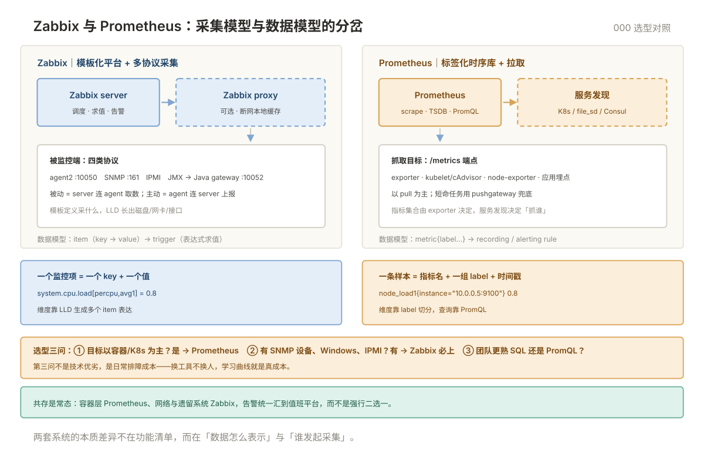

# 000 两流派选型全貌

> **这一册回答**：Zabbix 与 Prometheus 各自解决什么问题、什么环境该选谁、两者能不能共存。10 分钟读完，把「传统 IT 监控」装进一张地图。  
> **给谁读**：要接管一批物理机、虚拟机、交换机的运维；或已有 Prometheus、被要求「把网络设备也纳进来」的团队。本板块位于五阶段第四段（中间件与观测），与 `prometheus/` 共同构成指标监控的两条路线。

## 板块地图

Zabbix 目录六册，围绕「一个服务端 + 多协议采集 + 模板复用」展开：

| 册 | 一句话 | 回答的问题 |
|---|---|---|
| [00 术语表](00-术语表.md) | Zabbix 专有词与缩写 | 按册分组 · 缩写速查 · 12 对易混 · 12 条症状反查 |
| [001 架构与部署](001-架构与部署.md) | 装起来、跑通第一台主机 | 组件与端口 · 数据库初始化 · 前端时区 · agent2 主被动 |
| [002 模板与 LLD](002-模板与LLD.md) | 几十台机器怎么不重复配 | 模板继承 · 宏 · 发现规则 · 监控项原型 · SNMP 接入 |
| [003 触发器与告警动作](003-触发器与告警动作.md) | 什么该报、报给谁、怎么不刷屏 | 表达式 · 恢复条件 · 依赖 · 动作升级 · 维护窗口 |
| [004 分布式 Proxy](004-分布式Proxy.md) | 跨网段、大规模怎么采 | 主被动 · 本地缓存 · 代理组 · 队列排错 |
| [005 API 自动化](005-API自动化.md) | 批量纳管、对接 CMDB | JSON-RPC · 认证 · 常用方法 · Python 封装 |

两条路线的根本差异，一张图看清：

一句话记法：**Prometheus 是「标签化的时序库 + 拉取」，Zabbix 是「模板化的监控平台 + 多协议采集」。**

六册的依赖是线性的：001 装不通，后面全部无从谈起；002 与 003 是日常做的两件事——采什么、什么情况报；004 与 005 是规模与效率，可以最后补。只想先跑起来，读到 003 就够用。

## 核心概念速览

- **拉与推**：Prometheus 由服务端定时拉 `/metrics`；Zabbix 两种都支持——被动检查是 server 连 agent 的 10050，主动检查是 agent 连 server 的 10051。跨网段优先主动。
- **数据模型**：Prometheus 一条样本 = 指标名 + 一组 label + 时间戳，靠 label 切维度；Zabbix 一个监控项（item）= 一个 key + 一个值，维度靠 LLD 生成多个 item 表达。
- **模板与 LLD**：Zabbix 用模板定义「一类主机该采什么」，用低级发现自动长出磁盘、网卡、交换机接口这些动态实体；Prometheus 靠服务发现找到目标，指标集合由 exporter 固定。
- **Proxy**：Zabbix 独有的一层区域代理，断网可本地缓存续传，适合多分支、弱网、跨安全域；Prometheus 对应位置是 federation 或 remote write，语义不同。
- **SNMP**：网络设备不装 agent，靠 OID 取数。v2c 用明文 community，v3 有认证与加密；`snmpwalk` 是验证设备可读性的第一步（002 §3 展开）。

## 与相邻板块的分界

| 问题 | 去哪 |
|---|---|
| Prometheus 怎么部署、PromQL 怎么写、告警规则怎么做 | 本板块 [prometheus/](../prometheus/README.md) 001~008 |
| K8s 里的指标、Operator、ServiceMonitor | [prometheus/009 K8s 监控](../prometheus/009-K8s监控.md) |
| 该监控什么、USE/RED/黄金信号 | 本板块 [001 监控方法论](../001-监控方法论.md) |
| 告警响了之后怎么响应、SLO 怎么定 | 「SRE」001（SLO）· 002（响应）· 003（复盘） |
| 网络设备本身的连通性、VLAN、路由 | 「网络」001~009（本目录只讲怎么采，不讲网络原理） |
| 日志与链路 | 「日志」「链路」板块 |
| Windows 服务器监控 | 本目录 001~002（agent2 支持 Windows） |
| 告警发到谁、值班怎么轮、升级找谁 | 「SRE」002 响应流程（本目录 003 只管「该不该报」） |
| 监控数据长期归档、容量报表 | 本目录 [004](004-分布式Proxy.md) 保留期与 housekeeper；报表归「数据库」与「SRE」 |
| 主机与数据库自身的性能调优 | 「Linux」·「数据库」板块（监控负责发现，不负责修） |

## 学习路径

- **顺序读**：000 → 001（装通）→ 002（模板与 LLD）→ 003（告警）→ 004（规模）→ 005（自动化）。
- **按任务进**：刚接手 Zabbix → 001；主机太多配不过来 → 002；告警太吵 → 003；跨网段采不到 → 004；要对接 CMDB/批量导入 → 005。
- **按角色进**：网络工程师从 002 §3（SNMP）与 001 §3 入手；值班同学只读 003；平台与自动化角色先看 005；跨地域项目先看 004。
- **选型判断**（先回答三个问题）：
  1. 目标以容器/K8s 为主吗？是 → Prometheus；否 → 继续。
  2. 有 SNMP 网络设备、Windows、IPMI 带外吗？有 → Zabbix 必上。
  3. 团队更熟 SQL 还是 PromQL？这决定日常排障成本，不是技术优劣。

## 选型对照

| 维度 | Zabbix 6.0 LTS | Prometheus |
|---|---|---|
| 采集模型 | 拉 + 推 + trap，多协议 | 以拉为主，短命任务靠 pushgateway |
| 数据模型 | item + trigger，结构化 | metric + label，多维 |
| 存储 | MySQL/PostgreSQL（可选 TimescaleDB） | 自带 TSDB，长期存储需远端 |
| 动态实体 | LLD 自动生成 item | 服务发现 + exporter 固定指标 |
| 查询 | 前端筛选 + API | PromQL |
| 告警 | 内置动作、升级、媒体类型 | 规则 + Alertmanager 路由 |
| 网络设备 | SNMP v1/v2c/v3 原生 | 需 snmp_exporter + 映射文件 |
| 容器/K8s | 支持但非强项 | 原生强项 |
| 高基数 | 不擅长（item 数爆炸） | label 设计得当可承载，需治理 |
| 上手成本 | 前端操作多，概念多 | 配置文件 + 查询语言 |
| 权限模型 | 用户组 + 主机组 + 6.0 角色 | 无内置多租户，靠反代或 Thanos 补 |
| 审计 | 内置 audit log | 无 |
| 升级 | server / 前端 / DB 脚本需同步升 | 换二进制即可 |
| 典型场景 | 传统 IDC、政企、网络运维 | 云原生、微服务、SRE |

> **共存是常态**：容器层用 Prometheus，网络与遗留系统用 Zabbix；告警统一汇到值班平台（两边都能发 Webhook），而不是强行二选一。Zabbix 可用 HTTP agent 监控项抓取 Prometheus 的 `/api/v1/query` 结果，Prometheus 也有 zabbix_exporter，但都属桥接而非替代。

> **版本口径**：本目录以 Zabbix 6.0 LTS 为基线；7.0 已发布，对运维影响最大的变化是 API 认证从 `auth` 字段改为 Bearer token（005 已标注），其余概念与流程不变。

## 误解澄清

| # | 误解 | 事实 |
|---|---|---|
| 1 | Zabbix 过时了，云原生时代只该用 Prometheus | 网络设备、Windows、带外管理仍是 Zabbix 的主场，二者互补 |
| 2 | Zabbix 只能拉，不能推 | 主动检查、trapper、SNMP trap 都是推模型 |
| 3 | 装了 Zabbix 就自动有监控 | 模板与触发器要按业务配，默认模板只覆盖基础资源 |
| 4 | LLD 发现越多越好 | 无过滤的发现会生成大量无用 item，先写过滤器再启用 |
| 5 | 告警级别越高越安全 | 全是灾难级等于没有级别，分级要能驱动不同响应 |
| 6 | Proxy 只是转发，随便放 | Proxy 决定数据完整性与故障域，跨网段位置要规划 |
| 7 | Zabbix 用关系库所以不能存长期数据 | 历史/趋势保留期与 housekeeper 可配，TimescaleDB 可扩展 |
| 8 | SNMP v2c 够用，不必上 v3 | community 是明文口令，等保与安全审计场景必须 v3 |
| 9 | 两套监控可以各看各的 | 告警入口不统一，故障时没人对得上两份时间线 |
| 10 | 只装 server 和 agent 就够了 | 前端、数据库、Java gateway（SNMP trap 用）各对应一类数据进不来 |

---

**下一篇**：[001 架构与部署](001-架构与部署.md) —— 从组件、端口与数据库初始化开始，把第一台主机跑通。
