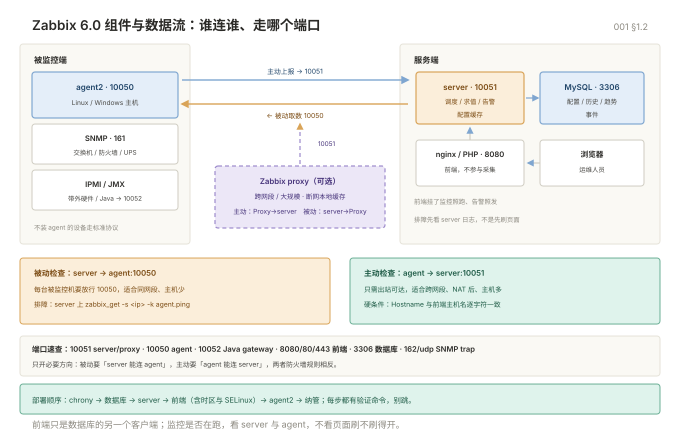

# 001 架构与部署

> **解决**：把 Zabbix 6.0 LTS 从零装起来、跑通第一台被监控主机，并搞清每个组件与端口的职责。  
> **范围**：组件与数据流 · 端口清单 · 服务端安装与数据库初始化 · 前端与 SELinux · agent2 主被动 · 首次纳管。  
> **口径**：Zabbix 6.0 LTS + MySQL 8.0，RHEL 8 / Rocky 8 系为主线；Debian/Ubuntu 的包名与路径差异在节内注记。  
> **更新**：2026-11-06

## 目录

| 节 | 内容 |
|---|---|
| 1 | 组件、端口与一次取数 |
| 2 | 服务端安装（数据库、server、前端） |
| 3 | agent2 部署与主被动模式 |
| 4 | 首次纳管一台主机 |
| 5 | 坑表 |
| 6 | 检查清单 |

---

## 1. 组件、端口与一次取数

上一册讲了选型；本节把 Zabbix 拆成六个进程，先知道谁连谁，再动手装。

### 1.1 六个组件

| 组件 | 职责 | 装在哪 |
|---|---|---|
| Zabbix server | 采集调度、触发器求值、告警分发、配置缓存 | 监控服务器 |
| Zabbix agent2 | 在被监控机上执行 item key，返回数值或文本 | 每台被监控机 |
| Zabbix proxy | 区域代理，替 server 采集并缓存，断网可续传 | 分支/网段侧 |
| Frontend | PHP Web 界面，读写同一套数据库 | 监控服务器 |
| Java gateway | 接收 JMX 数据，供 server 取 | 需要监控 Java 应用时 |
| 数据库 | 存配置、历史、趋势、事件 | 监控服务器或独立库 |

**关键认知**：前端不参与采集，它只是数据库的另一个客户端。前端挂了监控照跑、告警照发——这也是排障时先看 server 日志而不是先刷页面的原因。

### 1.2 端口清单

| 端口 | 协议 | 谁监听 | 用途 |
|---|---|---|---|
| 10051 | TCP | server / proxy | 主动检查上报、proxy 与 server 通信 |
| 10050 | TCP | agent2 | 被动检查，server 连过来取数 |
| 10052 | TCP | Java gateway | JMX 数据 |
| 8080 / 80 / 443 | TCP | nginx | 前端页面 |
| 3306 | TCP | MySQL | server 与前端连库 |
| 162 | UDP | snmptrapd | SNMP trap 接收（配 trap 时） |

### 1.3 一次被动取数的完整路径

```plain
server 的 poller 进程
  → 读配置缓存，拿到「主机 H 的 item I，类型 Zabbix agent，key system.cpu.load」
  → 连 H:10050，发 key
  → agent2 执行 key，返回值
  → server 写入 history 表（经 history syncer / writer）
  → 触发器按新值求值，状态变化时生成 event
  → 动作匹配 event，按媒体类型投递
```

这条链路里任何一环断，表现都是「没有数据」或「数据延迟」，但病根完全不同。第 5 节坑表按环节归类。

六个组件谁连谁、各自走哪个端口，一张图看清：



---

## 2. 服务端安装

上一节知道了组件；本节按「仓库 → 数据库 → server → 前端」顺序装，每步都带验证命令。

### 2.1 前置与仓库

```bash
# 时间同步是监控的底线，时间错了图全错
dnf install -y chrony && systemctl enable --now chronyd

# Zabbix 6.0 官方仓库（release 包版本以官网为准）
rpm -Uvh https://repo.zabbix.com/zabbix/6.0/rhel/8/x86_64/zabbix-release-6.0-4.el8.noarch.rpm
dnf clean all
dnf install -y zabbix-server-mysql zabbix-web-mysql zabbix-nginx-conf \
  zabbix-sql-scripts zabbix-selinux-policy zabbix-agent2 zabbix-get
```

Debian/Ubuntu 用 `wget https://repo.zabbix.com/zabbix/6.0/debian/pool/main/z/zabbix-release/zabbix-release_6.0-4+debian12_all.deb && dpkg -i ...`，包名为 `zabbix-server-mysql zabbix-frontend-php zabbix-apache-conf zabbix-sql-scripts zabbix-agent2`。

### 2.2 数据库初始化

```sql
CREATE DATABASE zabbix CHARACTER SET utf8mb4 COLLATE utf8mb4_bin;
CREATE USER 'zabbix'@'localhost' IDENTIFIED BY '换成强口令';
GRANT ALL PRIVILEGES ON zabbix.* TO 'zabbix'@'localhost';
-- MySQL 8 导入存储过程需要，导完记得关
SET GLOBAL log_bin_trust_function_creators = 1;
```

```bash
zcat /usr/share/doc/zabbix-sql-scripts/mysql/server.sql.gz | mysql -uzabbix -p zabbix
mysql -uroot -p -e "SET GLOBAL log_bin_trust_function_creators = 0;"
```

验证：`mysql -uzabbix -p zabbix -e "SHOW TABLES LIKE 'hosts';"` 有输出即导入成功（6.0 的表数在一百多张，导入通常 1~3 分钟）。

### 2.3 server 配置

编辑 `/etc/zabbix/zabbix_server.conf`，最小集：

```ini
DBHost=localhost
DBName=zabbix
DBUser=zabbix
DBPassword=换成强口令
ListenPort=10051
```

容量相关的几个参数（默认值偏保守，主机多时要调）：

| 参数 | 作用 | 调整信号 |
|---|---|---|
| `StartPollers` | 被动检查并发 | 队列里「等待」多、poller 忙 |
| `StartTrappers` | 主动上报并发 | agent 上报延迟 |
| `CacheSize` | 配置缓存 | 日志报 cache 不足 |
| `HistoryCacheSize` | 历史写缓存 | history syncer 积压 |
| `ValueCacheSize` | 触发器求值缓存 | value cache 命中率低 |
| `Timeout` | 单次检查超时 | 外网设备慢，默认 3 秒常不够 |

### 2.4 前端、时区与 SELinux

```bash
# nginx 站点：默认监听 8080，按需改
vi /etc/nginx/conf.d/zabbix.conf
#   listen 8080;
#   server_name _;

# PHP 时区：不改会出现「数据晚 8 小时」
vi /etc/php-fpm.d/zabbix.conf
#   php_value[date.timezone] = Asia/Shanghai

# SELinux：不开这两个布尔值，前端连不上 server 和数据库
setsebool -P httpd_can_connect_zabbix on
setsebool -P httpd_can_network_connect_db on

# 防火墙
firewall-cmd --add-service=http --permanent
firewall-cmd --add-port=10051/tcp --permanent
firewall-cmd --reload
```

### 2.5 启动与三层验证

```bash
systemctl restart zabbix-server zabbix-agent2 php-fpm nginx
systemctl enable zabbix-server zabbix-agent2 php-fpm nginx
```

| 层 | 命令 | 期望 |
|---|---|---|
| 端口 | `ss -lntp \| grep -E '10051\|10050\|8080'` | 三个都在听 |
| server 日志 | `grep -i 'error\|cannot' /var/log/zabbix/zabbix_server.log \| tail` | 无数据库连接错误 |
| 取数 | `zabbix_get -s 127.0.0.1 -k agent.ping` | 返回 `1` |
| 前端 | 浏览器访问 `http://<ip>:8080` | 出现安装向导 |

安装向导走完后会生成 `/etc/zabbix/web/zabbix.conf.php`。默认账号 `Admin` / `zabbix`，**登录后第一件事是改密码**。

---

## 3. agent2 部署与主被动模式

服务端跑通只完成一半；本节把采集端装到被监控机，并决定用主动还是被动。

### 3.1 安装与最小配置

```bash
dnf install -y zabbix-agent2
vi /etc/zabbix/zabbix_agent2.conf
```

```ini
Server=10.0.0.10            # 允许哪些 server 来被动取数
ServerActive=10.0.0.10      # 主动上报给谁
Hostname=web-01             # 必须与前端主机名完全一致
```

```bash
systemctl enable --now zabbix-agent2
firewall-cmd --add-port=10050/tcp --permanent && firewall-cmd --reload
```

Windows 版 agent2 是 MSI 安装包，安装时填 Server / ServerActive / Hostname，其余同上。

### 3.2 主动与被动的选择

| | 被动检查 | 主动检查 |
|---|---|---|
| 谁发起连接 | server → agent:10050 | agent → server:10051 |
| 防火墙要求 | 每台被监控机开放 10050 给 server | 被监控机可出站到 10051 |
| 适合场景 | 同网段、主机少、要求实时 | 跨网段、NAT 后、主机多 |
| 前端配置 | 主机接口填 IP | 主机名必须匹配，接口可留空 |
| 排障入口 | server 上 `zabbix_get` | agent 日志 + 前端「最新数据」 |

**经验值**：超过几十台或跨安全域，一律主动；否则每次加机器都要改防火墙，迟早漏一台。

### 3.3 主动模式的两个硬条件

1. `Hostname` 与前端 `Host name` **逐字符一致**（大小写、短横线都算），不一致时 agent 日志会反复出现 `no active checks on server`。
2. 前端主机必须至少有一个接口（哪怕主动模式不填 IP），否则配置不会下发。

验证主动链路：

```bash
# agent 侧看是否拿到配置
tail -f /var/log/zabbix/zabbix_agent2.log
# 正常会周期性出现 "active check configuration update from [10.0.0.10:10051] started to work"
```

---

## 4. 首次纳管一台主机

前面装好了两端；本节在 Web 上把主机建出来，并用「最新数据」确认闭环。

1. **Data collection → Hosts → Create host**。
2. `Host name` 填 `web-01`（与 agent 的 Hostname 一致）；`Host groups` 选 `Linux servers`。
3. `Templates` 链接 `Template OS Linux by Zabbix agent`（6.0 的模板名；Windows 用 `Template OS Windows by Zabbix agent`）。
4. `Interfaces` 加 Agent 接口，IP 填被监控机地址；主动模式可只填 DNS 或留空。
5. `Macros` 里可覆盖模板默认值，例如 `{$CPU.UTIL.CRIT}`。
6. 保存后等 1~2 个采集周期，回到 **Monitoring → Latest data** 过滤该主机。

可用性图标（ZBX）三种状态：绿 = 正常，红 = 连不上，灰 = 未知/未启用。灰色最常见的原因是主动模式主机名不匹配，或模板未链接。

---

## 5. 坑表

| # | 现象 | 原因 | 解法 |
|---|---|---|---|
| 1 | 前端 502 / 空白页 | php-fpm 未起、nginx 未 include 站点、SELinux 拦截 | `systemctl status php-fpm`；查 `nginx -T \| grep zabbix`；看 `/var/log/nginx/error.log` |
| 2 | 图表时间整体偏 8 小时 | PHP 时区未设 | `/etc/php-fpm.d/zabbix.conf` 设 `Asia/Shanghai` 后重启 php-fpm |
| 3 | 导入 `server.sql.gz` 报错 | MySQL 8 未开 `log_bin_trust_function_creators` | 导入前 `SET GLOBAL ... = 1`，导入后关掉 |
| 4 | 中文乱码或导入中断 | 库字符集不是 `utf8mb4` / `utf8mb4_bin` | 重建库，字符集与排序规则都要对 |
| 5 | 前端提示连不上数据库 | SELinux 布尔值未开 | `setsebool -P httpd_can_network_connect_db on` |
| 6 | agent 装了但 ZBX 灰 | Hostname 不一致 / 10051 未放行 / 接口未配 | 对齐主机名；`firewall-cmd --list-ports`；补接口 |
| 7 | `zabbix_get` 超时 | 10050 未开放、agent 未起、`Server=` 未含源 IP | 逐项排查，`Server=` 支持多 IP 逗号分隔 |
| 8 | 数据有但时间乱序 | 被监控机与 server 时间不同步 | 两端都上 chrony，偏差控制在秒级 |
| 9 | server 日志报 cache 不足 | 主机/监控项超出默认缓存 | 调 `CacheSize`、`ValueCacheSize`，重启生效 |
| 10 | 默认 Admin 密码未改 | 安装后未做安全加固 | 立即改密码，禁用默认账号或加 IP 白名单 |

## 6. 检查清单

| # | 问题 | 判据 |
|---|---|---|
| 1 | 六个端口该开的都开了吗？ | `ss -lntp` 与防火墙规则逐条对上 |
| 2 | 时间同步做了吗？ | 两端 `chronyc tracking` 偏差在秒级内 |
| 3 | 数据库字符集与导入都验证过吗？ | `SHOW TABLES LIKE 'hosts'` 有结果，中文不乱码 |
| 4 | 前端时区是对的吗？ | 图表时间与服务器 `date` 一致 |
| 5 | 主动模式主机名逐字符对上了吗？ | agent 日志出现 `started to work` |
| 6 | 第一台主机 Latest data 有值吗？ | 至少 `agent.ping`、CPU、内存三项有数 |

---

**下一篇**：[002 模板与 LLD](002-模板与LLD.md) —— 从「一台台配」升级到「模板 + 自动发现」。
