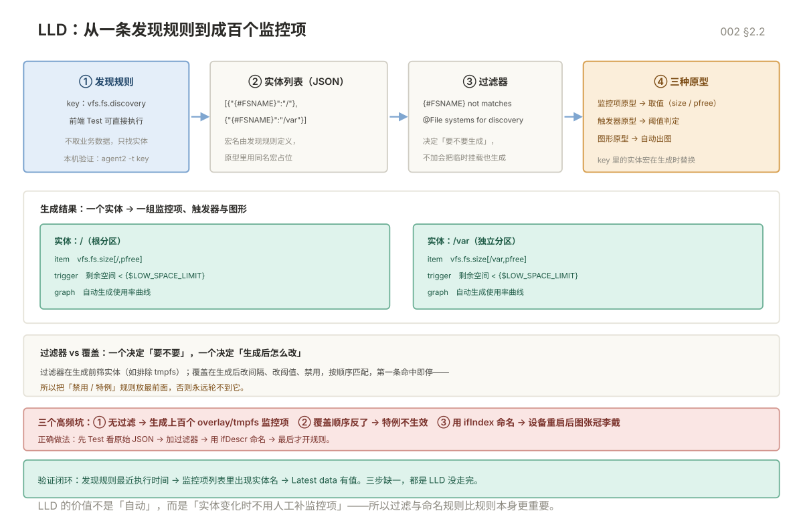

# 002 模板与 LLD

> **解决**：几十上百台主机与交换机，怎么用模板与低级发现做到「配一次、自动长」，而不是逐台点鼠标。  
> **范围**：模板继承与宏 · 发现规则 · 监控项/触发器/图形原型 · 过滤器与覆盖 · SNMP 网络设备接入 · trap。  
> **口径**：Zabbix 6.0 LTS；SNMP v2c 为主、v3 安全场景；交换机以 Cisco IOS 与通用 IF-MIB 为例。  
> **更新**：2026-11-06

## 目录

| 节 | 内容 |
|---|---|
| 1 | 模板体系与宏 |
| 2 | 低级发现（LLD） |
| 3 | SNMP 网络设备监控 |
| 4 | 坑表 |
| 5 | 检查清单 |

---

## 1. 模板体系与宏

上一册把单台主机跑通了；本节解决「第二台到第一百台」的复制问题。

### 1.1 三层结构：模板、主机、继承

Zabbix 的复用单位是**模板**：监控项、触发器、图形、发现规则都定义在模板里，主机链接模板后继承全部内容。6.0 的 OS 模板做了模块化拆分——`Template OS Linux by Zabbix agent` 本身是聚合模板，链接了 CPU、Memory、Network interfaces、Filesystems 等 `Template Module ...` 子模板。

| 层级 | 放什么 | 例子 |
|---|---|---|
| 模块模板 | 单一资源类 | `Template Module Linux CPU by Zabbix agent` |
| 聚合模板 | 一类系统的模块组合 | `Template OS Linux by Zabbix agent` |
| 主机 | 实际被监控对象 + 覆盖宏 | `web-01` |

**纪律**：不要直接改官方模板。要么复制一份改名（如 `Corp Linux Base`），要么在主机层用宏覆盖。直接改会在下次导入官方模板时被覆盖。

### 1.2 宏的优先级

| 类型 | 写法 | 作用域 |
|---|---|---|
| 全局宏 | `{$TIMEOUT}` | 全库 |
| 模板宏 | `{$CPU.UTIL.CRIT}` | 链接该模板的主机 |
| 主机宏 | `{$CPU.UTIL.CRIT}` | 仅该主机，优先级最高 |
| 上下文宏 | `{$LOW_SPACE_LIMIT:"/var"}` | 按参数区分，如不同分区不同阈值 |
| LLD 宏 | `{#FSNAME}` | 发现结果自动填，只读 |

排障时宏不生效，先确认**主机层是否覆盖**，再看模板链接顺序（多个模板定义同名宏时，后链接的生效，容易踩）。

### 1.3 模板维护的三条规矩

1. **一层继承**：`Corp Linux Base` 只链接官方模块模板，业务模板再链接 `Corp Linux Base`，不要横向互相链接。
2. **命名带归属**：`Corp` / `Biz` 前缀，避免与官方模板混淆。
3. **变更走导出**：改模板前 `Data collection → Templates → Export` 存一份 YAML，出问题可导回。

---

## 2. 低级发现（LLD）

上一节的模板是静态的；磁盘、网卡、交换机接口数量因机而异，靠 LLD 自动长出监控项。

### 2.1 发现规则：返回实体列表

发现规则的本质是执行一个 key，拿到 JSON 数组，每个元素是一组宏：

```json
[{"{#FSNAME}":"/","{#FSTYPE}":"xfs"},
 {"{#FSNAME}":"/var","{#FSTYPE}":"xfs"}]
```

常用内置发现 key：

| key | 发现什么 | 典型宏 |
|---|---|---|
| `vfs.fs.discovery` | 挂载点 | `{#FSNAME}` `{#FSTYPE}` |
| `net.if.discovery` | 网卡 | `{#IFNAME}` |
| `system.cpu.discovery` | CPU 核 | `{#CPU.NUMBER}` |
| `snmp.discovery[...]` | SNMP 表的一列 | `{#SNMPINDEX}` `{#SNMPVALUE}` |

本机验证发现结果，不用等前端：

```bash
zabbix_agent2 -t vfs.fs.discovery
```

### 2.2 从发现到监控项：原型

发现规则本身不取业务数据，它只负责「找到实体」。真正的采集由**监控项原型**完成：

```plain
发现规则 vfs.fs.discovery
  → 发现 / 与 /var 两个实体
  → 监控项原型 vfs.fs.size[{#FSNAME},pfree] 生成两个监控项
  → 触发器原型「{#FSNAME} 剩余空间低于 {$LOW_SPACE_LIMIT}」生成两个触发器
  → 图形原型自动出图
```

原型里的 key 用 LLD 宏占位，实体生成时替换。删除实体后，对应的监控项会被标记为「lost」并按规则清理。



### 2.3 过滤器与覆盖

无过滤的发现是灾难：容器宿主机能发现几十个 `overlay` 挂载点、交换机有几十个 down 的接口。

| 手段 | 作用 | 例子 |
|---|---|---|
| 过滤器 | 决定「生成不生成」 | `{#FSNAME} not matches @File systems for discovery` |
| 覆盖 | 生成后「怎么改」 | `{#IFNAME} matches ^eth` → 采集间隔 30s，其余 5m |
| 覆盖禁用 | 不生成该实体 | `{#FSNAME} matches ^/run` → 禁用 |

优先级：覆盖按顺序匹配，**第一条命中即停**，所以把「禁用」规则放最前面。

### 2.4 LLD 排错的三个入口

1. **前端 Test**：发现规则页的 `Test` 按钮直接执行 key，看返回 JSON。
2. **最新数据**：实体没生成时，先确认发现规则最近一次执行时间。
3. **日志**：`/var/log/zabbix/zabbix_server.log` 搜 `cannot process discovery rule`，常见是 JSON 格式或宏缺失。

---

## 3. SNMP 网络设备监控

上一节讲的是 agent 侧发现；交换机、防火墙不装 agent，本节用 SNMP 把接口、流量、状态接进来。

### 3.1 三个版本怎么选

| 版本 | 认证 | 安全 | 建议 |
|---|---|---|---|
| v1 | community | 明文 | 只在老设备兼容时用 |
| v2c | community | 明文 | 内网过渡可用，community 当密码管理 |
| v3 | 用户 + 认证/加密 | 可加密 | 等保、跨域、生产主线 |

v3 的三个安全级别：`noAuthNoPriv`、`authNoPriv`（认证不加密）、`authPriv`（认证 + 加密，推荐 SHA + AES）。

### 3.2 先用 snmpwalk 证明设备可读

配置 Zabbix 之前，必须在**监控服务器上**用命令行验证通，否则前端配错参数时你分不清是网络、ACL 还是 Zabbix。

```bash
# 系统信息：能返回 sysDescr 就说明通路与 community 都对
snmpwalk -v2c -c 'YourCommunity' 192.168.1.1 1.3.6.1.2.1.1

# 单个 OID：设备运行时长（单位 1/100 秒）
snmpget -v2c -c 'YourCommunity' 192.168.1.1 1.3.6.1.2.1.1.3.0

# v3 认证不加密
snmpwalk -v3 -l authNoPriv -u monitor -a SHA -A 'AuthPass' 192.168.1.1 1.3.6.1.2.1.1

# 把 MIB 名字翻译成数字 OID
snmptranslate -On IF-MIB::ifOperStatus
```

网络设备常用 OID：

| 名称 | OID | 说明 |
|---|---|---|
| sysDescr | `.1.3.6.1.2.1.1.1.0` | 设备型号与系统版本 |
| sysUpTime | `.1.3.6.1.2.1.1.3.0` | 运行时长，重启会归零 |
| ifDescr | `.1.3.6.1.2.1.2.2.1.2` | 接口名，如 GigabitEthernet0/1 |
| ifOperStatus | `.1.3.6.1.2.1.2.2.1.8` | 1=up，2=down |
| ifInOctets | `.1.3.6.1.2.1.2.2.1.10` | 入字节，32 位，会回绕 |
| ifOutOctets | `.1.3.6.1.2.1.2.2.1.16` | 出字节，32 位 |
| ifHCInOctets | `.1.3.6.1.2.1.31.1.1.1.6` | 入字节，64 位，千兆以上必用 |
| ifHighSpeed | `.1.3.6.1.2.1.31.1.1.1.15` | 接口速率（Mbps） |

### 3.3 Zabbix 侧配置

1. **Data collection → Hosts → Create host**，主机名用设备管理名（如 `sw-core-01`）。
2. **Interfaces** 加 **SNMP** 接口：IP、端口 `161`、版本 `SNMPv2`、`{$SNMP_COMMUNITY}`（或 v3 的用户名与安全级别）。
3. **Macros** 定义 `{$SNMP_COMMUNITY}` = 实际 community。
4. **Templates** 链接 `Template Net Cisco IOS SNMP`（Cisco）或 `Template Module Generic SNMP`（其他品牌基础项）。
5. 保存后等一个周期，看 `Latest data` 是否出现 `sysUpTime`。

**注意**：SNMP 接口和 Agent 接口是两套，同一台设备可以同时有（Linux 服务器既跑 agent 又开 SNMP 的场景也存在）。

### 3.4 接口发现与流量

交换机接口数量不固定，用 LLD 发现 `ifDescr`，再为每个接口生成状态与流量监控项：

| 原型 | key | 用途 |
|---|---|---|
| 接口状态 | `ifOperStatus.{#SNMPINDEX}` | up/down 告警 |
| 入流量 | `ifHCInOctets.{#SNMPINDEX}` | 配「每秒变化」预处理转 bps |
| 出流量 | `ifHCOutOctets.{#SNMPINDEX}` | 同上 |
| 接口速率 | `ifHighSpeed.{#SNMPINDEX}` | 算利用率的分母 |

**命名用 `ifDescr` 而不是 `ifIndex`**：设备重启或换板卡后 ifIndex 可能重排，按序号命名的图会张冠李戴。LLD 宏里 `{#SNMPINDEX}` 用于取 OID 实例，`{#SNMPVALUE}` 用于命名，两者别混。

流量监控项要加预处理 **Change per second**，否则拿到的是累计字节数，图上永远单调上升。

### 3.5 SNMP trap：设备主动推的告警

轮询能发现「状态变了」，但设备重启、端口 flap、电源故障这类事件，trap 更及时。

```bash
# server 端 /etc/zabbix/zabbix_server.conf
StartSNMPTrapper=1
SNMPTrapperFile=/var/log/snmptrap/snmptrap.log

# snmptrapd 把 trap 写进同一文件
# /etc/snmp/snmptrapd.conf
traphandle default /usr/sbin/snmptthandler
```

```bash
systemctl enable --now snmptrapd
firewall-cmd --add-port=162/udp --permanent && firewall-cmd --reload
```

设备侧配置 `snmp-server host <zabbix_ip> version 2c <community>`。Zabbix 侧链接 `Template Module Generic SNMP trap`，trap 会以事件形式进入前端。

---

## 4. 坑表

| # | 现象 | 原因 | 解法 |
|---|---|---|---|
| 1 | 主机改了宏但没生效 | 主机层宏覆盖了模板宏 | 查 Host → Macros，优先级最高 |
| 2 | 多层模板同名宏取值怪 | 后链接的模板覆盖前面的 | 收敛为一层继承，或统一在主机层定义 |
| 3 | LLD 生成上百个无用监控项 | 未配过滤器 | 先加 `not matches` 过滤，再启用规则 |
| 4 | 过滤器写正则后一个实体都不生成 | 正则语法或大小写不匹配 | 用 Test 看原始 JSON，再逐条试匹配 |
| 5 | 覆盖规则不生效 | 前面的规则已命中（首条命中即停） | 把禁用/特例规则放最前 |
| 6 | snmpwalk 通但 Zabbix 取不到 | ACL 只放行了跳板机 / community 填错 / 用了 v3 参数在 v2 设备 | 在 server 本机复测 snmpwalk，逐项对齐 |
| 7 | 交换机端口图张冠李戴 | 用 ifIndex 命名，重启后序号变了 | 改用 ifDescr 命名，`{#SNMPINDEX}` 只用于取数 |
| 8 | 千兆口流量图周期性归零 | 用了 32 位 ifInOctets，计数器回绕 | 改用 ifHCInOctets / ifHCOutOctets |
| 9 | trap 收不到 | 162/udp 未开、snmptrapd 未起、traphandle 未配 | 三处逐一确认，`tcpdump -i any udp port 162` 抓包 |
| 10 | 官方模板更新后自定义改动丢了 | 直接改了官方模板 | 复制为 `Corp ...` 模板再改，官方模板只读 |

## 5. 检查清单

| # | 问题 | 判据 |
|---|---|---|
| 1 | 模板是复制改的还是直接改官方？ | 官方模板保持只读，自定义有 `Corp` 前缀 |
| 2 | 每类动态实体都有过滤器吗？ | 磁盘、网卡、接口三类都有排除规则 |
| 3 | 发现规则的 Test 返回符合预期吗？ | 实体数量与人工 `lsblk` / 设备端口数对得上 |
| 4 | SNMP 在 server 本机 snmpwalk 通吗？ | `sysDescr` 能返回，v3 参数一致 |
| 5 | 流量监控项加了 Change per second 吗？ | 图形是 bps 曲线，不是单调上升 |
| 6 | 接口命名用 ifDescr 吗？ | 图上接口名与设备 `show interface` 一致 |

---

**下一篇**：[003 触发器与告警动作](003-触发器与告警动作.md) —— 数据采上来之后，什么情况该吵醒人。
