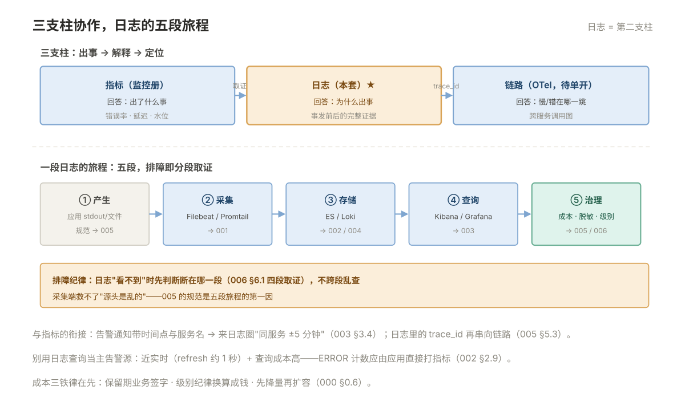

# 000 日志全貌

> **解决**：日志在三支柱里管什么、集中日志解决什么问题、两条路线怎么选。  
> **范围**：可观测性三支柱 · 集中日志的价值 · 日志的旅程 · 选型对照 · 成本意识。  
> **口径**：与 [README](README.md) 一致。  
> **更新**：2026-11-01

## 目录

| 节 | 内容 |
|---|---|
| 0.1 | 日志管什么：三支柱里的第二支柱 |
| 0.2 | 集中日志解决什么问题：从 SSH tail 到一站式 |
| 0.3 | 两条路线：EFK 重量级 vs Loki 轻量级 |
| 0.4 | 日志的旅程：产生 → 采集 → 存储 → 查询 → 治理 |
| 0.5 | 与其它支柱的衔接：告警响了来日志取证 |
| 0.6 | 成本意识：日志是吃存储的大户 |
| 0.7 | 十个误解 |
| 0.8 | 本套学习路径与各册映射 |

---

## 0.1 日志管什么：三支柱里的第二支柱

可观测性（observability）指"从系统外部输出判断内部状态"的能力，行业把它拆成三根支柱，各有分工：

| 支柱 | 形态 | 回答的问题 | 本库在哪 |
|---|---|---|---|
| **指标（metrics）** | 数字时间序列 | **出了什么事**——错误率、延迟、水位 | 「监控」册 |
| **日志（logs）** | 离散事件文本/JSON | **为什么出事**——事发前后的完整证据 | 本套 |
| **链路（traces）** | 跨服务调用图 | **慢/错在哪一跳**——分布式系统的路径还原 | 000 只立概念，深入单独成文 |

三者的协作关系是单向流水线：**指标告警发现异常 → 到日志里看事发前后的上下文 → 需要跨服务定位时用 trace_id 串起链路**。日志是证据链的中间环节——没有集中日志的告警，值班等于"知道着火了但没有消防通道"。

三支柱的采集标准正在收敛到 **OpenTelemetry（OTel）**——指标/日志/链路一套 SDK 与协议。本册的 Filebeat/Promtail 是日志支柱的现行主流，OTel 接入是演进方向，概念在此立住即可。

---

## 0.2 集中日志解决什么问题：从 SSH tail 到一站式

没有集中日志的日常：出事 → SSH 登上某台机器 → `grep` 翻文件 → 发现要看另一台 → 再 SSH……三个结构性问题：

1. **机器多了找不到**：几十台机器 + 容器随时重建，日志的"位置"本身就不存在了；
2. **时间对不齐**：每台机器各看各的，多服务串行请求要人工拼时间线；
3. **权限与审计失控**：谁都能登机器看日志（含敏感数据），或反过来谁都看不了。

集中日志一次性解决三件事：**一个入口搜全部**（Kibana/Grafana）、**时间线天然对齐**（统一时间字段）、**权限收敛到查询层**（不用登机器）。附带收益：日志可留存可回溯，合规审计有据。

前提条件写在前面：**应用日志必须先可采集**——打 stdout（容器，「容器」004 的纪律）或写规范路径的文件（传统服务），格式尽量结构化。采集端救不了"日志本身是乱的"——这就是 005 册存在的理由。

---

## 0.3 两条路线：EFK 重量级 vs Loki 轻量级

集中日志两大主流路线，设计哲学相反：

| | EFK（Elasticsearch 系） | Loki（Grafana 系） |
|---|---|---|
| 索引方式 | **全文倒排索引**：每个词都可搜 | **只索引标签**：正文压缩存储，查询先圈标签再顺序扫 |
| 查询体验 | 关键词随便搜，全文检索强 | 必须先用标签缩小范围，正文用文本匹配 |
| 资源开销 | 内存与磁盘大户（索引比正文还大） | 便宜一个数量级（对象存储友好） |
| 运维复杂度 | 高：JVM、分片、水位、ILM | 低：单二进制起步，组件可拆 |
| 适合 | 日志量大、要全文检索与复杂分析 | 已用 Grafana、日志结构规范、成本敏感 |

选型经验值（详细对照在 004 §4.6）：**日志是"结构化 JSON + 按标签查"的团队，Loki 路线性价比极高**；**需要全文关键词检索、安全审计、复杂聚合分析的场景，EFK 仍是硬通货**。两条路线的采集端（Filebeat/Promtail）思路相通——001 册的模型两边通用。

---

## 0.4 日志的旅程：产生 → 采集 → 存储 → 查询 → 治理

一段日志从应用到眼睛，五段旅程，每段有自己的组件与坑：

```plain
应用（stdout/文件）
   │ ① 产生：格式、级别、字段——治理的源头（005）
   ▼
采集（Filebeat / Promtail / Alloy）
   │ ② 搬运：读取、多行合并、附加元数据、断点续传（001）
   ▼
存储（Elasticsearch / Loki）
   │ ③ 落地：索引、分片、保留策略、水位（002 / 004）
   ▼
查询（Kibana / Grafana）
   │ ④ 检索：语法、过滤、聚合、仪表盘（003）
   ▼
治理（贯穿全程）
   ⑤ 成本 · 脱敏 · 级别纪律 · 排障（005 / 006）
```



排障时这张图就是**分段取证的地图**：日志"看不到"的问题，先判断断在哪一段（006 §6.1 的四段取证法），不跨段乱查。

---

## 0.5 与其它支柱的衔接：告警响了来日志取证

集中日志不是孤岛，两条标准衔接线：

1. **指标 → 日志**：告警通知里带上时间点与服务名（「监控」004 的告警链路），值班到 Kibana 圈"同服务 ±5 分钟"的 ERROR——这是 003 §3.4 聚合的典型用法；
2. **日志 → 链路**：日志里输出 `trace_id`（005 §5.3），要跨服务定位时拿 ID 去链路系统还原调用图——三支柱由此串成闭环。

反向也成立：日志本身可以出指标（如"每分钟 ERROR 数"），接进「监控」册的告警链路——但**别用日志查询当主告警源**（查询成本高、实时性差），ERROR 计数应由应用直接打指标。

---

## 0.6 成本意识：日志是吃存储的大户

日志是所有可观测性数据里**体积最大、增长最失控**的一类——一个中型集群一天产生几百 GB 很正常。三条成本铁律，从设计第一天就要立：

1. **保留期是业务决定不是技术默认**：7 天、30 天、90 天，价差一个数量级。业务方签字确认，写进 002 的 ILM；
2. **级别纪律直接换算成钱**：DEBUG 上生产 = 存储翻几倍（005 §5.5）；
3. **先降量再扩容**：日志量异常增长几乎总是某个服务的 bug 或配置（006 §6.5），扩容是最后手段。

---

## 0.7 十个误解

| # | 误解 | 实际 |
|---|---|---|
| 1 | 上了 EFK 就不用管日志规范 | 垃圾进垃圾出，005 的规范是前提 |
| 2 | ES 是实时数据库 | 近实时（约 1 秒 refresh），别当实时告警源 |
| 3 | 副本可有可无 | 关副本=节点坏一块数据就缺，green 变 yellow 起步 |
| 4 | Loki 和 ES 功能等价 | Loki 不做全文索引，查正文关键词是弱项 |
| 5 | 采集器不会丢日志 | registry 之外（如 stdout 丢失）仍可能丢，下游要可幂等 |
| 6 | 日志越多越好排障 | 噪音淹没信号，级别纪律才可排障 |
| 7 | Kibana 能查就能查到一切 | mapping 配错/text-keyword 用反，字段就是搜不到 |
| 8 | 磁盘满了删日志文件就行 | ES 的数据在索引里，删文件无效还可能致 red |
| 9 | trace_id 和 request_id 是一回事 | 可合一但概念不同：追踪 ID 归链路系统（005 §5.3） |
| 10 | 集中日志可以当长期归档 | 归档要走对象存储/WORM，ES 集群不是备份介质 |

---

## 0.8 本套学习路径与各册映射

```plain
全景          000（本册）
主线 EFK      001 采集 Filebeat ──▶ 002 Elasticsearch ──▶ 003 Kibana
对照路线      004 Loki 轻量路线（学完主线再读，模型互通）
治理收口      005 日志规范与治理 ──▶ 006 排障与治理
平台对照      007 Graylog（开箱的日志管理平台，学完主线再读）
```

横向衔接：stdout 纪律在「容器」004，本机日志在「Linux」006，告警联动在「监控」004，接入层 access log 字段在「接入层」005——本册是它们共同的下游。

---

> 下一篇：《001 采集 Filebeat》——散落在各机器的日志怎么收上来。
