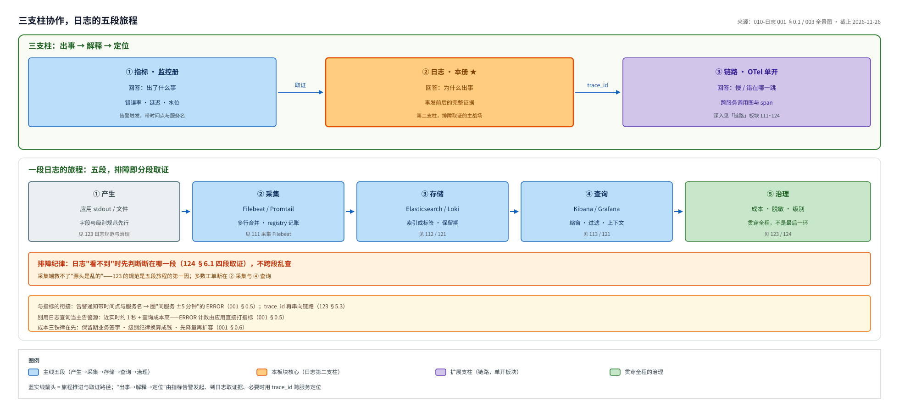

# 日志全景图

> **这一册回答**：日志板块 9 册在「一条日志的旅程」上的位置，一张图看清。
> **怎么用**：看图定段，再回 [001-日志全貌](001-日志全貌.md) 选册。

## 体系一张图

## 图例说明

| 模块 | 册 | 日志旅程段 |
| --- | --- | --- |
| 110-EFK主线 | 111 / 112 / 113 | 采集 → 存储 → 查询（主线三段） |
| 120-多路线与治理 | 121 / 122 / 123 / 124 | 轻量与平台两条对照路线 + 规范治理 + 排障取证 |
| 附录 | 190 | 术语 · 缩写 · 易混对 · 症状反查 |

图中自左向右是**日志方向**：应用与组件产生 → 采集（111）→ 存储（112）→ 查询（113）。120 模块装的是「另一条路」（121 Loki、122 Graylog）与「横向能力」（123 规范、124 排障）——路线可以换，规范与取证不变。

---

**上一篇**：[002-日志方法论](002-日志方法论.md)　**下一篇**：进模块 [110-EFK主线/111-采集Filebeat](110-EFK主线/111-采集Filebeat.md)
