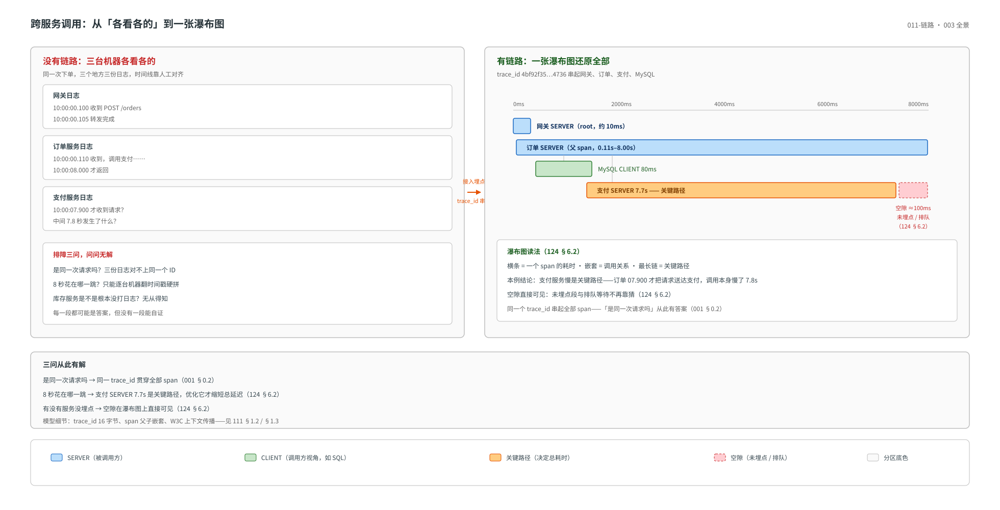

# 链路全景图

> **这一册回答**：链路板块 7 册在「一条 trace 的旅程」上的位置，一张图看清。
> **怎么用**：看图定段，再回 [001-链路全貌](001-链路全貌.md) 选册。

## 体系一张图

## 图例说明

| 模块 | 册 | trace 旅程段 |
| --- | --- | --- |
| 110-体系与采集 | 111 / 112 | 数据模型与语义约定 → 采集管线（OTel 两级 Collector） |
| 120-后端与实战 | 121 / 122 / 123 / 124 | 后端存储 → 贯通实战 → 采样成本 → 排障定位 |
| 附录 | 190 | 术语 · 缩写 · 易混对 · 症状反查 |

图中自上而下是**数据方向**：应用埋点 → Collector 管线 → 后端存储 → 查询定位。110 模块管「数据怎么来」，120 模块管「数据怎么用」——模型先行（111），贯通落地（122），成本收口（123），证据落袋（124）。

---

**上一篇**：[002-链路方法论](002-链路方法论.md)　**下一篇**：进模块 [110-体系与采集/111-OTel数据模型](110-体系与采集/111-OTel数据模型.md)
