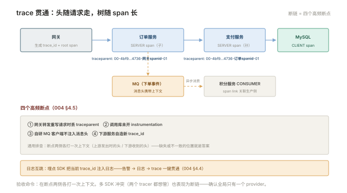

# 004 trace 贯通实战

> **解决**：一次下单请求如何穿过网关、订单、支付、MQ 全链路贯通——以及哪里最容易断。  
> **范围**：入口生成 · W3C 头透传 · DB span · MQ 异步关联 · 日志关联 · 断链排查。  
> **口径**：埋点以 Python 自动埋点打底（001 §1.5），手工埋点补业务段。  
> **更新**：2026-11-01

## 目录

| 节 | 内容 |
|---|---|
| 4.1 | 目标场景：一次下单穿过四层 |
| 4.2 | 入口与传播：网关生成，W3C 头透传 |
| 4.3 | 数据库与 MQ 的 span：客户端埋点与异步关联 |
| 4.4 | 日志关联：日志里的 trace_id |
| 4.5 | 断链排查：哪里断了、为什么 |
| 4.6 | 六个坑 |
| 4.7 | 本章检查清单 |
| 4.8 | 最小可复现实验：按 trace_id 串起请求、日志与瀑布图 |

---

## 4.1 目标场景：一次下单穿过四层

```plain
用户 ──▶ 网关 ──▶ 订单服务 ──▶ 支付服务 ──▶ 银行（外部）
                    │
                    ├──▶ MySQL（下单写库）
                    └──▶ MQ ──▶ 积分服务（异步加积分）
```

贯通后的验收形态（后端瀑布图应能还原）：**网关 SERVER span → 订单 SERVER span（内含 CLIENT span：MySQL、MQ）→ 支付 SERVER span → 积分 CONSUMER span**——一棵树、一个 trace_id、每段耗时一目了然。中间任何一段缺失就是"断链"，4.5 给排查法。

---

## 4.2 入口与传播：网关生成，W3C 头透传

**入口规则**：第一个收到外部请求的组件（网关或入口服务）负责**生成 trace_id 并开始第一个 SERVER span**——上游用户没有上下文可继承。

**传播规则**：向下游发起调用前，SDK 自动把当前上下文写成 W3C 头（001 §1.3）：

```plain
traceparent: 00-<trace_id>-<当前span_id>-01
```

**验收点（运维与开发共同检查）**：每一跳的下游是否真的收到了这个头。取证方法：在下游服务打印收到的请求头（或抓包），确认 `traceparent` 存在且 trace_id 与上游一致——**三处高频断点**：网关重写请求时丢头、内部 HTTP 客户库未开启 instrumentation、跨语言团队用了私有头格式而不带 W3C 标准。



MQ 场景的传播同理：生产者把上下文注入**消息头**（AMQP headers / Kafka headers），消费者从消息头提取——SDK 的 MQ instrumentation 自动完成，自研客户端要手动注入/提取。

---

## 4.3 数据库与 MQ 的 span：客户端埋点与异步关联

**数据库 span**：自动埋点会为每次 SQL 创建 CLIENT span（`db.system=mysql`、`db.statement=…`）——瀑布图里"订单服务内嵌一条 MySQL 慢查询"直接可见，与「数据库」007 的慢查询取证互相印证。注意 `db.statement` 可能含敏感数据——脱敏策略（「日志」005 §5.4 同源）。

**MQ 的异步关联**：MQ 是"发出去先不等人"——生产侧 PRODUCER span 与消费侧 CONSUMER span **在时间上不嵌套**，可能跨秒甚至跨分钟。OTel 的处理：消费侧新建 trace/自成一段，并用 **span link** 指回生产侧的 span——瀑布图上能看到"来自订单服务 P0 的消息"的关联标识。**运维验收点**：MQ instrumentation 是否启用、消息头是否携带上下文（自研客户端是高频漏点）。

---

## 4.4 日志关联：日志里的 trace_id

「日志」005 §5.3 立过 request_id/trace_id 的规矩，这里兑现：**埋点 SDK 会把当前 span 上下文注入日志记录**——

```python
import logging
from opentelemetry.trace import get_current_span

trace_id = get_current_span().get_span_context().trace_id
log.info("下单成功", extra={"trace_id": f"{trace_id:032x}"})
```

排障闭环由此成立：**告警（指标）→ 打开日志搜 ERROR → 复制日志里的 trace_id → 链路后端还原瀑布**。三个系统的 ID 必须一致——这就是"日志/链路共用 trace_id"的全部理由。反向也通：瀑布图里看到慢 span → 复制 trace_id → 日志系统过滤同 ID 的全部日志。

---

## 4.5 断链排查：哪里断了、为什么

瀑布图不完整时的排查顺序：

| 现象 | 断点 | 修法 |
|---|---|---|
| 某服务完全没有 span | 未埋点 / SDK 未启用 / service.name 缺失 | 001 §1.6 |
| trace 在某服务后断开（无下游 span） | 调用传播头丢失：手工转发未透传 / 客户端未 instrument | 4.2 验收点 |
| 下游是新 trace（不同 trace_id） | 下游服务自造 trace_id / 用了非 W3C 头 | 统一 W3C（001 §1.3） |
| MQ 消费侧与生产侧无关联 | 消息头未携带 / 无 span link | 4.3 |
| span 有了但属于另一条 trace | 中间件/框架自建 tracer | 检查多 SDK 冲突 |

通用排查动作：**在断点两侧各打印一次上下文**（上游发出时的 traceparent、下游收到时的请求头）——缺失/不一致的位置就是答案。

---

## 4.6 六个坑

| # | 坑 | 后果 | 正确做法 |
|---|---|---|---|
| 1 | 网关转发丢 traceparent | 下游另起 trace | 转发配置显式透传 W3C 头 |
| 2 | 异步线程池丢上下文 | 子任务没有父子关系 | 用 SDK 的 context 传播工具 |
| 3 | MQ 自研客户端不注入 | 异步链断 | 注入消息头或换 instrumented 客户端 |
| 4 | 日志与链路 ID 不一致 | 三系统无法互跳 | 统一 trace_id（4.4） |
| 5 | span 名含变量（URL/订单号） | 后端聚合爆炸 | span 名用路由模板（001 §1.2） |
| 6 | 只埋了 HTTP 没埋 DB/MQ | 瀑布图"空隙"无法归因 | instrumentation 全家桶补齐 |

第 2 条展开：Python 的 `threading`/`asyncio` 场景里，上下文**不会自动跟随新线程/协程**——创建任务时要用 SDK 提供的 context 传播（如 `trace.use_span` 或 contextvars 机制）。症状特征鲜明：主请求的 trace 完整，但"后台任务/异步回调"的段全部缺失或各自成树——**异步边界就是传播边界**，每一类异步原语都要确认一次。

---

## 4.7 本章检查清单

读完能回答这六个问题，这一章就过了：

| # | 问题 |
|---|---|
| 1 | 贯通的验收形态？四层各自什么 span？ |
| 2 | trace_id 在哪里生成？W3C 头长什么样？ |
| 3 | MQ 异步的上下游怎么关联？ |
| 4 | 日志与链路互跳的机制？ |
| 5 | 断链的四种现象与修法？ |
| 6 | 异步线程池为什么会丢上下文？ |

---

## 4.8 最小可复现实验：按 trace_id 串起请求、日志与瀑布图

4.4 的排障闭环是「日志 ERROR → 复制 trace_id → 后端还原瀑布」。这一节用一条手工注入的 W3C `traceparent`（格式见 4.2）从头跑一遍；`<...>` 换成实际地址。

**① 触发一次带上下文的请求**：

```bash
curl -sS -o /dev/null -w '%{http_code}\n' -H 'traceparent: 00-4bf92f3577b34da6a3ce929d0e0e4736-00f067aa0ba902b7-01' http://<入口地址>/api/order
```

**② 日志侧按同一 ID 检索**（字段公约见「日志」005 §5.3；Loki 用 `logcli`，ES / Kibana 用 KQL，按实际栈选一）：

```bash
logcli query '{app="api"} | json | trace_id="4bf92f3577b34da6a3ce929d0e0e4736"'
```

**③ 链路侧还原瀑布图**：

```bash
curl -s "http://<Jaeger-Query地址>/api/traces/4bf92f3577b34da6a3ce929d0e0e4736" | jq '.data[0].spans | length'
```

**④ 判定**

| 结果 | 说明 |
| --- | --- |
| ② 命中日志，③ 返回 span 数 > 0 且父子连贯 | 贯通成立，4.1 的验收形态达成 |
| ② 有日志，③ 查不到 | 埋点 / 导出 / 采样问题，按 4.5 断链排查 |
| ③ 有 span，② 查不到 | 日志注入 trace_id 未生效，回 4.4 与「日志」005 §5.3 |
| 两侧 ID 不一致 | 头在某一跳被重写，按 4.2 的三处高频断点逐跳取证 |

**边界**：本实验只做一次 HTTP 请求与只读查询，不改采样率、不改线上配置；示例 trace_id 是 W3C 规范中的固定示例值，不对应任何真实用户请求。反向验证（造一条合规日志并按 ID 检索）见「日志」005 §5.9。

---

> 下一篇：《005 采样与成本》——全量不可行时留哪些、留多少。
