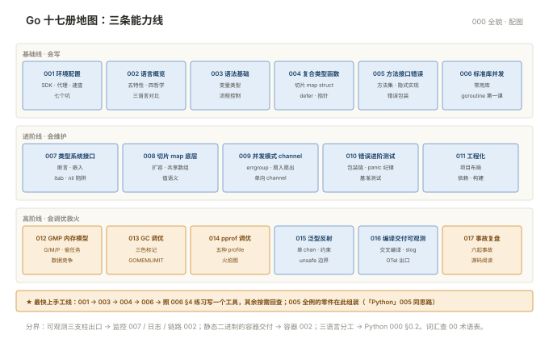

# 000 Go 全貌

> **这一册回答**：Go 板块管什么、十七册怎么分工、从哪进。10 分钟读完装进一张地图。  
> **给谁读**：会 Shell 与 Python（「Linux」008、「Python」001 水平）、要学 Go 写运维工具的运维。位于五阶段第五段（方法与语言）。

## 板块地图

十七册三条线：**基础线会写 → 进阶线会维护 → 高阶线会调优救火**。

| 册 | 一句话 | 回答的问题 |
|---|---|---|
| [001 环境配置与工具链](001-环境配置与工具链.md) | 15 分钟从零跑通第一个测试 | SDK · 代理 · 编辑器 · 命令速查 · 七个坑 |
| [002 语言概览与设计哲学](002-语言概览与设计哲学.md) | 它是什么、好在哪、运维为什么学 | 五特性 · 四哲学 · 三语言对比 · 生态版图 |
| [003 语法基础](003-语法基础.md) | 会写基本语句 | 变量类型 · 流程控制 · 零值 |
| [004 复合类型与函数](004-复合类型与函数.md) | 数据怎么组织、怎么传 | 切片/map/struct · defer · 指针 |
| [005 方法、接口与错误处理](005-方法接口与错误处理.md) | 行为怎么组织、错误怎么处理 | 方法 · 接口 · 错误包装 · 包 |
| [006 标准库与并发第一课](006-标准库与并发第一课.md) | 标准库速览，goroutine 初体验 | 常用库 · goroutine/channel/select |
| [007 类型系统与接口进阶](007-类型系统与接口进阶.md) | 类型和接口的运行时行为 | 断言 · 嵌入 · 方法集 · itab |
| [008 切片 map 底层与值语义](008-切片map底层与值语义.md) | 三个经典陷阱的根源 | 扩容 · 共享底层数组 · 值语义 |
| [009 并发模式与 channel 进阶](009-并发模式与channel进阶.md) | 并发编组的常用模式 | errgroup · 扇入扇出 · 单向 channel |
| [010 错误处理进阶与测试基准](010-错误处理进阶与测试基准.md) | 错误与测试的进阶用法 | 包装链 · panic 纪律 · 基准测试 |
| [011 工程化与代码组织](011-工程化与代码组织.md) | 从能跑到能维护 | 项目布局 · 依赖 · 构建 |
| [012 GMP 调度与内存模型](012-GMP调度与内存模型.md) | 运行时怎么跑你的代码 | G/M/P · work stealing · 数据竞争 |
| [013 GC：内存管理与调优](013-GC内存管理与调优.md) | 垃圾回收从入门到调优 | 三色标记 · GOGC · GOMEMLIMIT |
| [014 pprof 与性能调优](014-pprof与性能调优.md) | 用 profile 定位真热点 | 五种 profile · 火焰图 · 高性能写法 |
| [015 并发高级、泛型与反射](015-并发高级泛型与反射.md) | 高级形态与边界 | 单 chan · 泛型约束 · 反射 |
| [016 编译、交付与可观测](016-编译交付与可观测.md) | 静态二进制交付与三支柱出口 | 交叉编译 · slog · client_golang · OTel |
| [017 事故复盘与源码阅读](017-事故复盘与源码阅读.md) | 六起生产事故复盘 | 复盘方法 · 源码阅读路线 |
| [00 术语表](00-术语表.md) | 词汇 · 缩写 · 易混对 · 症状反查 | 按册分组 |

十七册的位置关系：

## 核心概念速览

- **静态单二进制**：编译产物不依赖运行时——容器镜像可以只有一个可执行文件（016）。
- **CSP 并发**：goroutine + channel "以通信共享内存"，语言内置（006/009）。
- **错误是值**：`if err != nil` 是显式处理，不是异常（005/010）。
- **GMP 调度**：几万个 goroutine 跑在少量线程上，work stealing 自动均衡（012）。
- **GC 停顿微秒级**：三色标记 + 混合写屏障，容器里管好 GOMEMLIMIT（013）。

## 与相邻板块的分界

| 问题 | 去哪 |
|---|---|
| Go 服务打点给谁采（client_golang 落点） | 「监控」007 · 本板块 016 §3 |
| slog 日志进什么体系 | 「日志」板块 · 016 §3 |
| trace 埋点（OTel SDK） | 「链路」002 · 016 §3 |
| 多阶段构建出静态二进制的 Dockerfile | 「容器」002 |
| 什么时候用 Python/Shell 而不是 Go | 「Python」000 §0.2 三语言分工 |

## 学习路径

- **顺序读**：001 → 002 → 003~006（基础线）→ 007~011（进阶线）→ 012~017（高阶线）。
- **最快上手工线**：001 → 003 → 004 → 006 → 照 006 §4 练习写一个工具，其余按需回查。
- **复习**：术语表症状反查 + 各册检查清单。

## 误解澄清

| # | 误解 | 事实 |
|---|---|---|
| 1 | Go 难，运维学不动 | 语法关键字不到 25 个，难的部分本板块已按册拆好 |
| 2 | goroutine 很轻，随便开 | 泄漏与阻塞是真坑（009 §3） |
| 3 | 有 GC 就不用管内存 | 容器里 GOMEMLIMIT 不设照样 OOM（013） |
| 4 | 接口一定要显式实现 | Go 是隐式实现，方法集对上就行（007） |
| 5 | 性能问题靠猜 | pprof 用数据说话（014） |
| 6 | 反射很高级要多用 | 反射慢且难读，非必要不用（015） |

---

**下一篇**：[001 环境配置与工具链](001-环境配置与工具链.md) —— 15 分钟从零跑通第一个测试。
