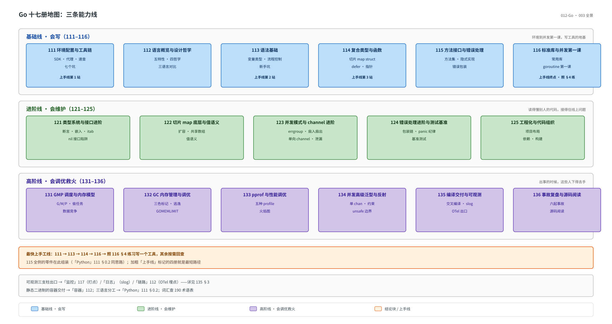

# Go 全景图

> **这一册回答**：Go 板块 17 册正文在三条能力线上的位置，一张图看清。
> **怎么用**：看图定线，再回 [001-Go全貌](001-Go全貌.md) 选册。

## 体系一张图

## 图例说明

| 模块 | 册 | 能力线 |
| --- | --- | --- |
| 110-基础线 | 111 ~ 116 | 会写：环境 → 语法 → 复合类型 → 方法接口错误 → 标准库并发 |
| 120-进阶线 | 121 ~ 125 | 会维护：接口底层 → 切片陷阱 → 并发模式 → 测试 → 工程化 |
| 130-高阶线 | 131 ~ 136 | 会调优救火：GMP → GC → pprof → 泛型反射 → 交付可观测 → 事故复盘 |
| 附录 | 190 | 术语 · 缩写 · 易混对 · 症状反查 |

图中自上而下是**能力递进**：先能写出来（110），再能读懂改动别人的（120），最后能在生产上定位它的毛病（130）。三线是递进不是并列——只读到 120 就上生产，等于会开车没学修车。

---

**上一篇**：[002-Go方法论](002-Go方法论.md)　**下一篇**：进模块 [110-基础线/111-环境配置与工具链](110-基础线/111-环境配置与工具链.md)
