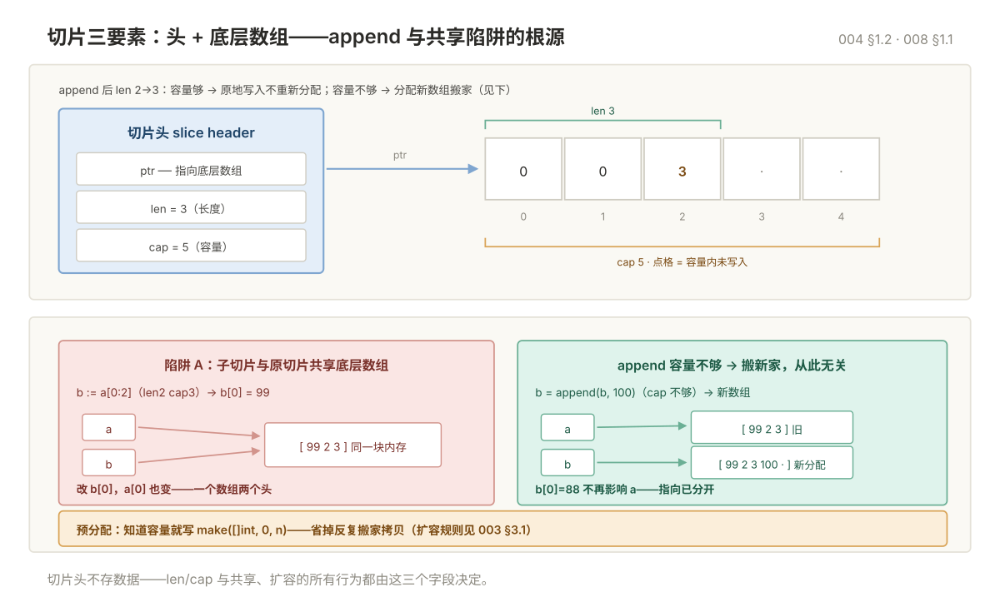

# 004 复合类型与函数

> **解决**：用好切片、map、结构体三件套与函数、defer、指针——数据怎么组织、怎么传。  
> **范围**：复合类型 · 函数与 defer · 指针 · 新手坑（切片与 defer）。  
> **口径**：Go 1.22+；示例均可 `go run`。  
> **更新**：2026-11-06

## 目录

| 节 | 内容 |
|---|---|
| 1 | 复合类型：切片、map、struct |
| 2 | 函数与 defer |
| 3 | 指针 |
| 4 | 新手坑：切片与 defer |

---
## 1. 复合类型：切片、map、struct

### 1.1 数组 vs 切片

| | 数组 `[3]int` | 切片 `[]int` |
|---|---|---|
| 长度 | 类型的一部分，固定 | 动态 |
| 传参 | **整个复制** | 传的是描述符（指向同一底层数组） |
| 用得多吗 | 很少 | **几乎只用切片** |

```go
arr := [3]int{1, 2, 3}        // 数组
sli := []int{1, 2, 3}         // 切片（中括号里没数字）
```

### 1.2 切片的三个要素

切片本身不存数据，它只是三个字段：**指针（指向底层数组）+ 长度 len + 容量 cap**。

```go
s := make([]int, 2, 5)   // len=2, cap=5，已初始化两个 0
fmt.Println(len(s), cap(s))   // 2 5

s = append(s, 3)
fmt.Println(len(s), cap(s))   // 3 5，容量够，不重新分配
```

`append` 时如果容量不够，会分配一块更大的新数组（通常是 2 倍或 1.25 倍），把数据拷过去。**这意味着原切片的修改不会反映到新切片上**：

```go
a := []int{1, 2, 3}
b := a[0:2]        // b 和 a 共享底层数组
b[0] = 99
fmt.Println(a)     // [99 2 3]  ← a 被改了

b = append(b, 100) // 容量不够，b 指向新数组
b[0] = 88
fmt.Println(a)     // [99 2 3]  ← 这次 a 不受影响
```

**预分配能省大量内存拷贝**，知道要装多少就写 `make([]int, 0, n)`。



### 1.3 map

```go
m := map[string]int{
	"a": 1,
	"b": 2,
}

m["c"] = 3          // 写
v := m["a"]         // 读，不存在返回零值
delete(m, "b")      // 删

// 判断 key 是否存在（重要）
if v, ok := m["x"]; ok {
	fmt.Println("存在:", v)
} else {
	fmt.Println("不存在")
}
```

三个必须记住的点：

1. **遍历顺序随机**，不要依赖顺序，需要有序就另外存 key 再排序。
2. **不是并发安全的**，多协程同时写会直接 `fatal error`（不是普通 panic，`recover` 抓不到）。并发场景用 `sync.RWMutex` 或 `sync.Map`。
3. `nil` map 能读不能写，务必用 `make` 或字面量初始化。

### 1.4 struct

```go
type Server struct {
	Name    string
	Port    int
	Tags    []string
	Created time.Time
}

// 键值写法（推荐，字段增减不会错位）
s := Server{
	Name: "web-01",
	Port: 8080,
}

// 位置写法（字段一改就编译报错，不推荐跨包用）
s2 := Server{"web-02", 8080, nil, time.Now()}

fmt.Println(s.Name)   // 访问字段
```

**结构体是值类型**，赋值、传参都是整个复制。字段多了或要修改时用指针：

```go
func (s *Server) Addr() string {
	s.Port++                       // 指针接收者，能改
	return fmt.Sprintf("%s:%d", s.Name, s.Port)
}
```

结构体标签用于序列化：

```go
type User struct {
	ID       int    `json:"id"`
	Name     string `json:"name"`
	Password string `json:"-"`         // - 表示不输出
	Email    string `json:"email,omitempty"`  // 空值则省略
}
```

### 1.5 字符串与字符

字符串是**不可变的字节序列**，UTF-8 编码。中文一个字占 3 字节：

```go
s := "你好"
fmt.Println(len(s))                  // 6，字节数
fmt.Println(len([]rune(s)))          // 2，字符数

for i, r := range s {                // range 按 rune 遍历，正确
	fmt.Println(i, string(r))        // i 是字节偏移
}
```

```go
// 常用操作
strings.Contains(s, "你")
strings.HasPrefix(s, "http")
strings.Split("a,b,c", ",")
strings.Join([]string{"a", "b"}, "-")
strings.TrimSpace(s)
strings.ToUpper(s)
strings.ReplaceAll(s, "a", "b")

// 拼接：少量用 +，循环里必须用 Builder
var b strings.Builder
for i := 0; i < 1000; i++ {
	b.WriteString("x")
}
result := b.String()
```

循环里用 `+` 拼字符串是 O(n²)，一万次拼接能差出几百倍。

---

## 2. 函数与 defer

### 2.1 多返回值

Go 最常见的错误处理形态：

```go
func divide(a, b int) (int, error) {
	if b == 0 {
		return 0, errors.New("除数不能为 0")
	}
	return a / b, nil
}

// 调用
result, err := divide(10, 2)
if err != nil {
	return err
}
```

### 2.2 命名返回值

```go
func parse(s string) (n int, err error) {
	n, err = strconv.Atoi(s)
	return          // 裸返回，返回已命名的变量
}
```

只在函数很短时用。长了会让人找不到到底返回了什么。

### 2.3 可变参数

```go
func sum(nums ...int) int {
	total := 0
	for _, n := range nums {
		total += n
	}
	return total
}

sum(1, 2, 3)
sum([]int{1, 2, 3}...)   // 传切片要加 ...
```

### 2.4 闭包

函数可以捕获外部变量：

```go
func counter() func() int {
	n := 0
	return func() int {
		n++
		return n
	}
}

c := counter()
fmt.Println(c())   // 1
fmt.Println(c())   // 2
```

### 2.5 defer：函数返回前执行

```go
func readFile(path string) error {
	f, err := os.Open(path)
	if err != nil {
		return err
	}
	defer f.Close()      // 函数结束时一定执行，不管有没有 return/panic

	data, err := io.ReadAll(f)
	// ...
	return err
}
```

三个要点：

```go
// 1. 多个 defer 是后进先出（栈）
defer fmt.Println("1")
defer fmt.Println("2")
defer fmt.Println("3")
// 输出：3 2 1

// 2. 参数在 defer 那一刻就求值了
n := 1
defer fmt.Println(n)   // 打印 1，不是后面的 100
n = 100

// 3. 别在循环里 defer
for _, p := range paths {
	defer os.Remove(p)   // 一万个文件 → 一万个待执行，内存涨，最后才删
}
```

---

## 3. 指针

Go 有指针，但没有指针运算，比 C 安全得多。

```go
n := 10
p := &n           // 取地址
fmt.Println(*p)   // 解引用，输出 10
*p = 20           // 通过指针改
fmt.Println(n)    // 20
```

**什么时候用指针：**

| 场景 | 用不用 |
|---|---|
| 要在函数里修改原值 | 用 `*T` |
| 结构体很大（几个字段以上），避免复制 | 用 `*T` |
| 需要表达"没有这个值" | 用 `*T`（nil 表示不存在） |
| 小结构体、基本类型只读 | 不用，直接传值 |

`new` 很少用，因为 `&T{}` 更常见：

```go
p := new(int)        // 指向零值 int 的指针
p2 := &Server{}      // 更常用
```

**空指针解引用是 panic**，所以指针字段用完前先判空：

```go
if s == nil {
	return errors.New("nil server")
}
```

---


---

## 4. 新手坑：切片与 defer

| # | 坑 | 现象 | 正确做法 |
|---|---|---|---|
| 1 | 循环里 `defer` | 资源迟迟不释放，内存涨 | 抽成函数，defer 在函数内 |
| 2 | nil map 写入 | panic | `make` 初始化 |
| 3 | 切片 append 后原切片被改 | 数据"莫名"变化 | 用 `make` + `copy` 隔离 |

---

**下一篇**：[005 方法、接口与错误处理](005-方法接口与错误处理.md) —— 方法和接口是 Go 的骨架。
