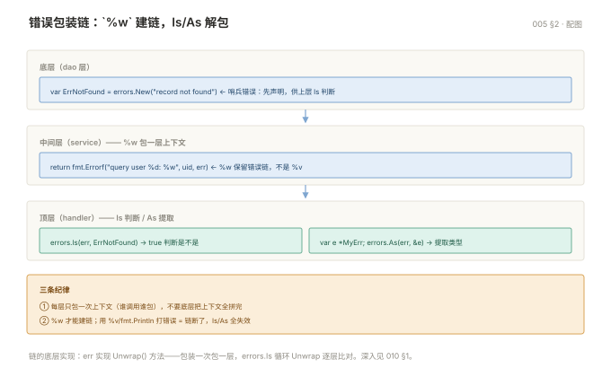

# 005 方法、接口与错误处理

> **解决**：用方法与接口组织行为，按 Go 的方式处理错误。  
> **范围**：方法与接口 · 错误处理 · 包与模块 · 新手坑（nil error）。  
> **口径**：Go 1.22+；示例均可 `go run`。  
> **更新**：2026-11-06

## 目录

| 节 | 内容 |
|---|---|
| 1 | 方法与接口 |
| 2 | 错误处理 |
| 3 | 包与模块 |
| 4 | 新手坑：nil error |
| 5 | 检查清单 |

---
## 1. 方法与接口

### 1.1 方法

方法是带接收者的函数：

```go
type Rect struct {
	W, H float64
}

// 值接收者：不修改原值
func (r Rect) Area() float64 {
	return r.W * r.H
}

// 指针接收者：可修改
func (r *Rect) Scale(k float64) {
	r.W *= k
	r.H *= k
}
```

**规则：同一个类型的方法集，要么全用指针接收者，要么全用值接收者。** 混用会导致接口实现变得难以预料。经验上：结构体有可变状态就用指针，否则用值。

### 1.2 接口：隐式实现

Go 的接口是**鸭子类型**——只要方法签名对得上，就自动实现了，不需要写 `implements`：

```go
type Writer interface {
	Write(p []byte) (int, error)
}

type FileLogger struct{ path string }

// 没有声明它实现 Writer，但方法签名一致，就是实现了
func (l *FileLogger) Write(p []byte) (int, error) {
	return os.WriteFile(l.path, p, 0644)
}

func logAll(w Writer, msgs []string) {
	for _, m := range msgs {
		w.Write([]byte(m))
	}
}

logAll(&FileLogger{path: "app.log"}, []string{"a", "b"})
```

这个设计的好处：**接口在使用方定义，不在实现方定义**。你用标准库的 `io.Writer`，自己的类型不用引任何包就实现了它，依赖是单向的。

### 1.3 空接口与类型断言

`any`（`interface{}` 的别名）可以装任意值，取出来要断言：

```go
var v any = 42

// 带 ok 的断言，安全
if n, ok := v.(int); ok {
	fmt.Println("是 int:", n)
}

// 不带 ok，类型不对直接 panic
n := v.(int)
```

多类型判断用 `type switch`：

```go
switch x := v.(type) {
case int:
	fmt.Println("int", x)
case string:
	fmt.Println("string", x)
case error:
	fmt.Println("error", x.Error())
default:
	fmt.Printf("未知类型 %T\n", x)
}
```

**接口是 nil 不等于里面的值是 nil**，这是新手最常踩的坑：

```go
func doWork() error {
	var e *MyError = nil
	return e            // 返回的 err != nil！因为类型信息还在
}

if err := doWork(); err != nil {
	// 这里会进来，即使 e 是 nil
}
```

判据：**接口 == nil 要求类型和值都为 nil**。所以函数不要返回 `*T` 类型的 nil 当作"无错误"，要返回字面量 `nil`。

---

## 2. 错误处理

Go 不用异常，错误是普通返回值。

```go
f, err := os.Open("a.txt")
if err != nil {
	return fmt.Errorf("打开配置文件失败: %w", err)   // %w 包装，保留原始错误
}
defer f.Close()
```

**包装链的意义**：调用方既能加上下文，又能在上层用 `errors.Is` 精确判断：

```go
// 底层
var ErrNotFound = errors.New("not found")

func find(id int) error {
	return fmt.Errorf("查询用户 %d: %w", id, ErrNotFound)
}

// 上层
if errors.Is(err, ErrNotFound) {     // 能穿透包装匹配到 ErrNotFound
	fmt.Println("用户不存在")
}
```

取自定义错误类型用 `errors.As`：

```go
type ConfigError struct {
	Field string
	Err   error
}

func (e *ConfigError) Error() string { return e.Field + ": " + e.Err.Error() }

var ce *ConfigError
if errors.As(err, &ce) {
	fmt.Println("出错的字段:", ce.Field)
}
```

### panic 与 recover

**panic 只用于程序无法继续的状态**：数组越界、空指针、初始化缺配置。业务错误一律用 `error`。

```go
func safeRun(fn func()) {
	defer func() {
		if r := recover(); r != nil {
			log.Printf("捕获 panic: %v", r)
		}
	}()
	fn()
}
```

三条边界：

- `recover` 只在 `defer` 里直接调用才有效，套一层函数就失效。
- 只在**服务的最外层**（HTTP handler、goroutine 起点）兜底，不要到处写。
- `recover` 抓不到 `fatal error`（如并发写 map、栈溢出），这类只能靠代码正确性避免。

---

错误包装链一图看清——`%w` 建链、Is/As 解包：



## 3. 包与模块

### 3.1 概念区分

| 概念 | 是什么 |
|---|---|
| **模块 module** | 一个 `go.mod` 文件管理的一组包，是版本管理单位 |
| **包 package** | 同一目录下的 `.go` 文件，是编译单位 |

```bash
go mod init github.com/you/project    # 初始化模块
go get github.com/gin-gonic/gin       # 加依赖，自动写入 go.mod
go mod tidy                           # 清理没用到的，补齐缺的
```

### 3.2 导出的规则：首字母大写

```go
package mypkg

var Exported = 1      // 大写：其他包能访问
var internal = 2      // 小写：仅包内可见

func Do() {}          // 导出
func helper() {}      // 不导出
```

没有 `public/private` 关键字，就靠首字母。**这是 Go 唯一、也是必须遵守的可见性规则。**

### 3.3 标准项目结构

```
project/
├── go.mod
├── go.sum
├── main.go                 # 程序入口
├── internal/               # 私有代码，外部模块无法导入
│   ├── config/
│   ├── handler/
│   └── service/
├── pkg/                    # 可被外部引用的公共包（可选）
└── Makefile
```

`internal/` 是编译器强制的边界，不是约定——外部模块 `import` 会直接编译报错。

### 3.4 包的导入习惯

```go
import (
	"context"
	"fmt"
	"os"

	"github.com/gin-gonic/gin"          // 第三方，空一行

	"myproject/internal/config"         // 本项目，再空一行
)
```

分组只是 gofmt 的美化结果，不影响编译，但团队评审会看。

---

## 4. 新手坑：nil error

| # | 坑 | 现象 | 正确做法 |
|---|---|---|---|
| 1 | 返回 `*T` 的 nil 当 error | `err != nil` 成立但内容是 nil | 直接 `return nil` |

---

## 5. 检查清单

| # | 问题 | 判据 |
|---|---|---|
| 1 | 值接收者与指针接收者的方法集差在哪？ | `*T` 的方法集含两者，`T` 只含值方法；接口断言失败常因这个 |
| 2 | `errors.New` 与 `fmt.Errorf("%w")` 的区别？ | 后者可包装并保留原错误，`errors.Is/As` 才能穿透 |
| 3 | 包名与目录名必须一致吗？ | 不强制，但惯例一致；`internal/` 下的包只能被父目录树内导入 |
| 4 | 返回 `*MyError` 的 nil 指针为什么 `err != nil`？ | 接口值 = (类型, 值)，类型非空即不等于 nil；直接 `return nil` |
| 5 | 判断错误类型用 `==` 还是 `errors.As`？ | 包装后用 `As`；`==` 只能匹配未包装的同一个值 |
| 6 | `go mod tidy` 与 `go mod vendor` 各做什么？ | tidy 增删依赖并同步 go.sum；vendor 把依赖拷进 `vendor/` 供离线构建 |

---

**下一篇**：[006 标准库与并发第一课](006-标准库与并发第一课.md) —— 标准库速览与 goroutine 初体验。
