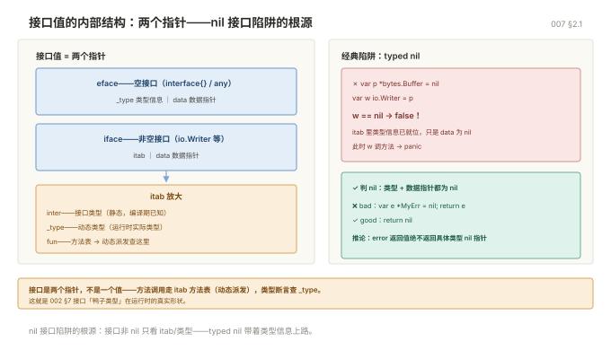

# 007 类型系统与接口进阶

> **解决**：吃透类型系统与接口的运行时行为——断言、嵌入、方法集、itab。
> **范围**：类型系统 · 接口进阶 · 新手坑（接口与接收者）。
> **口径**：Go 1.22+；示例均可 `go run`。
> **更新**：2026-11-06

## 目录

| 节 | 内容 |
|---|---|
| 1 | 类型系统 |
| 2 | 接口进阶 |
| 3 | 新手坑：接口与接收者 |
| 4 | 检查清单 |

---
## 1. 类型系统

### 1.1 类型定义 vs 类型别名

```go
type MyInt int          // 定义：全新类型，和 int 不能混用
type Alias = int        // 别名：完全是同一个类型，只是换个名字
```

```go
var a MyInt = 1
var b int = 2
// a + b               // 编译错误：类型不匹配
a2 := int(a) + b       // 必须显式转换

var c Alias = 3
var d int = 4
_ = c + d              // 可以，Alias 就是 int
```

**关键差别：定义新类型不会继承原类型的方法**，别名会。

```go
type MyInt int
func (m MyInt) Double() int { return int(m) * 2 }

// 如果写 type MyInt = int，上面这行会报错：不能在非本地类型上定义方法
```

这也是为什么 `type any = interface{}` 是别名——它是为了给你一个短名字，不是为了造新类型。

### 1.2 底层类型

每个类型都有一个底层类型，转换和比较都看它：

```go
type Celsius float64
type Fahrenheit float64

var c Celsius = 100
// f := Fahrenheit(c)      // 可以转换，底层都是 float64
```

但**同名方法不共享**，两个类型的值不能直接比较。

### 1.3 类型断言与类型切换

接到 `any` 后必须还原类型：

```go
func describe(v any) string {
	switch x := v.(type) {
	case nil:
		return "nil"
	case int, int64:
		return fmt.Sprintf("整数 %v", x)
	case string:
		return "字符串 " + x
	case fmt.Stringer:              // 走接口：任何实现了 String() 的类型
		return x.String()
	case error:
		return "错误: " + x.Error()
	default:
		return fmt.Sprintf("未知 %T", x)
	}
}
```

**case 顺序有意义**：`case nil` 放最前，具体类型放前，接口放后。`fmt.Stringer` 写在 `string` 之前会拦住 string 吗？不会——具体类型优先匹配，但写在前面读起来更清楚。

### 1.4 嵌入：Go 的"继承"

Go 没有继承，用组合加嵌入：

```go
type Logger struct{ prefix string }

func (l Logger) Log(msg string) {
	fmt.Println(l.prefix, msg)
}

type Service struct {
	Logger              // 嵌入（不带字段名），方法被提升
	Name   string
}

s := Service{Logger: Logger{prefix: "[svc]"}, Name: "api"}
s.Log("启动")           // 直接调用，等价于 s.Logger.Log(...)
```

嵌入的坑：**同名方法/字段会被外层覆盖**，且不会报错。

```go
type A struct{ Name string }
type B struct{ Name string }
type C struct {
	A
	B
}
// c.Name 会编译报错：有歧义
// 必须写 c.A.Name
```

### 1.5 什么时候该定义新类型

| 场景 | 例子 |
|---|---|
| 需要附加方法 | `type UserID int64` + `func (u UserID) Valid() bool` |
| 需要类型安全隔离 | `type Celsius float64` 防止和 `Fahrenheit` 混 |
| 需要实现接口 | `type HandlerFunc func(...)` 让它有 `ServeHTTP` |
| 只是缩短名字 | 用别名 `type Alias = X` |

---

## 2. 接口进阶

### 2.1 内部结构

接口值在内存里是**两个指针**：类型信息 + 数据指针。

```go
var w io.Writer = os.Stdout
// w 内部 = { *itab（类型+方法表）, 指向 os.Stdout 的指针 }
```

这解释了那个经典陷阱：

```go
var p *bytes.Buffer = nil
var w io.Writer = p            // w 不是 nil！
fmt.Println(w == nil)          // false
```

因为类型信息 `*bytes.Buffer` 已经有了，只有数据指针是 nil。所以：

```go
// 判断接口是否为 nil，必须类型和值都为 nil
if w != nil {
	w.Write([]byte("x"))       // 这里会 panic：nil 指针调方法
}
```

**推论：函数返回 error 时，绝对不要返回具体类型的 nil 指针。**

```go
func bad() error {
	var e *MyErr = nil
	return e                    // ❌
}

func good() error {
	return nil                  // ✅
}
```



### 2.2 方法集与接收者

这是 Go 最反直觉的规则之一：

| 类型 | 值方法 | 指针方法 |
|---|---|---|
| `T` | 有 | **无** |
| `*T` | 有（自动解引用） | 有 |

```go
type S struct{}
func (s S) ValMethod()  {}
func (s *S) PtrMethod() {}

var s S
var ps *S = &s

// 接口要求 ValMethod
var i1 interface{ ValMethod() } = s     // OK
var i2 interface{ ValMethod() } = ps    // OK（自动解引用）

// 接口要求 PtrMethod
var i3 interface{ PtrMethod() } = ps    // OK
// var i4 interface{ PtrMethod() } = s  // ❌ 编译错误：S 没有 PtrMethod
```

**结论：如果一个类型的指针接收者方法要实现接口，就只能传指针。** 这也解释了为什么 `json.Unmarshal` 必须传 `&v`。

### 2.3 接口设计原则

**接口应该由使用方定义，而不是实现方。**

```go
// ❌ 实现方定义一个大接口
package storage
type Storage interface {
	Get(key string) ([]byte, error)
	Put(key string, val []byte) error
	Delete(key string) error
	List(prefix string) ([]string, error)
	Close() error
}

// ✅ 使用方按需定义小接口
package service
type Reader interface {
	Get(key string) ([]byte, error)
}

func LoadConfig(r Reader) error { ... }   // 只依赖它真正用到的方法
```

好处：`LoadConfig` 不引 storage 包，测试时给个 3 行的假实现就行。

**接口越少越好，1-2 个方法最佳。** 标准库的 `io.Reader`、`io.Writer`、`error`、`fmt.Stringer` 都是单方法接口，这是 Go 生态可组合性的根源。

### 2.4 常用标准库接口

| 接口 | 方法 | 你在什么时候实现它 |
|---|---|---|
| `io.Reader` | `Read(p []byte) (int, error)` | 自定义数据源 |
| `io.Writer` | `Write(p []byte) (int, error)` | 自定义输出目标 |
| `io.Closer` | `Close() error` | 需要释放资源 |
| `fmt.Stringer` | `String() string` | 想让 `%v` 打印好看 |
| `error` | `Error() string` | 自定义错误 |
| `sort.Interface` | `Len/Less/Swap` | 自定义排序（现在更推荐 `slices.SortFunc`） |
| `http.Handler` | `ServeHTTP(w, r)` | 自定义 HTTP 处理器 |
| `encoding.TextMarshaler` | `MarshalText() ([]byte, error)` | 让类型能作为 map key 序列化 |

### 2.5 接口零值

`nil` 接口调用任何方法都 panic：

```go
var h http.Handler
h.ServeHTTP(w, r)     // panic: nil pointer dereference
```

所以结构体里存接口字段，用之前必须判空，或者给个默认实现（null object 模式）。

---

## 3. 新手坑：接口与接收者

| # | 坑 | 后果 | 正确做法 |
|---|---|---|---|
| 1 | 接口值里塞 nil 指针 | `err != nil` 但值是 nil | 直接 `return nil` |
| 2 | 值接收者复制了 Mutex | 锁失效，数据竞争 | 用指针接收者；`go vet` 会报 |

---

## 4. 检查清单

| # | 问题 | 判据 |
|---|---|---|
| 1 | `type A B` 与 `type A = B` 的区别？ | 前者是新类型（不继承方法、需转换），后者是别名（完全等价） |
| 2 | 接口值的底层结构是什么？ | (itab/type, data) 两个字；类型字段非空即接口不等于 nil |
| 3 | 值接收者方法复制了 `sync.Mutex` 会怎样？ | 锁作用在不同的副本上，互斥失效、`go vet` 报 copylocks |
| 4 | 类型断言两种写法差别？ | `v := i.(T)` 失败 panic；`v, ok := i.(T)` 失败 ok=false 不 panic |
| 5 | 什么时候用泛型、什么时候用接口？ | 行为抽象用接口；容器/算法需要保留具体类型、避免装箱用泛型 |
| 6 | 接口组合怎么写、有什么好处？ | 嵌入多个小接口拼成大接口；调用方只依赖需要的最小集合 |

---

**下一篇**：[008 切片 map 底层与值语义](008-切片map底层与值语义.md) —— 切片陷阱与值语义判定。
