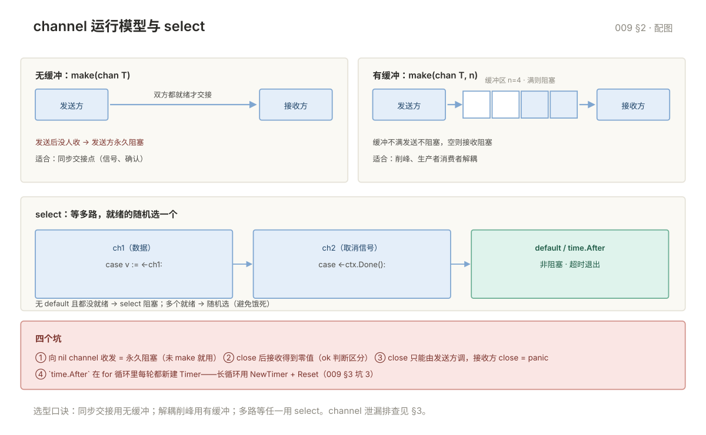

# 009 并发模式与 channel 进阶

> **解决**：并发编组的常用模式与 channel 的进阶细节——errgroup、扇入扇出、单向 channel。泄漏与阻塞的坑全在这。
> **范围**：并发模式 · channel 进阶 · 新手坑（泄漏与阻塞）。
> **口径**：Go 1.22+；示例均可 `go run`。
> **更新**：2026-11-06

## 目录

| 节 | 内容 |
|---|---|
| 1 | 并发模式 |
| 2 | channel 进阶 |
| 3 | 新手坑：泄漏与阻塞 |

---
## 1. 并发模式

### 1.1 WaitGroup

```go
var wg sync.WaitGroup
for _, id := range ids {
	wg.Add(1)
	go func(id int) {
		defer wg.Done()
		process(id)
	}(id)
}
wg.Wait()
```

`Add` 必须在 `go` 之前调用。放在 goroutine 里可能 `Wait` 已经返回了才 Add，导致漏等。

### 1.2 context：取消与超时

`context` 是**跨调用链传递取消信号和超时**的标准机制，函数第一个参数通常就是它。

```go
ctx, cancel := context.WithTimeout(context.Background(), 5*time.Second)
defer cancel()                       // 必须调用，否则泄漏

req, _ := http.NewRequestWithContext(ctx, "GET", url, nil)
resp, err := client.Do(req)
```

四个派生函数：

| 函数 | 用途 |
|---|---|
| `context.WithCancel` | 手动取消 |
| `context.WithTimeout` | 超时自动取消 |
| `context.WithDeadline` | 指定时间点 |
| `context.WithValue` | 传请求级数据（**只放元数据，不放业务参数**） |

在 goroutine 里响应取消：

```go
func worker(ctx context.Context) error {
	for {
		select {
		case <-ctx.Done():
			return ctx.Err()               // context.Canceled 或 DeadlineExceeded
		case job := <-jobs:
			handle(job)
		}
	}
}
```

**三条纪律：**

1. `cancel` 一定要 `defer cancel()`，即使提前返回。
2. 不要在结构体里存 context，要显式传参。
3. `WithValue` 的 key 用自定义类型，避免撞车：

```go
type ctxKey struct{}
ctx = context.WithValue(ctx, ctxKey{}, "req-123")
```

### 1.3 errgroup：并发 + 错误

`golang.org/x/sync/errgroup` 比裸 WaitGroup 好用得多：

```go
g, ctx := errgroup.WithContext(context.Background())

for _, url := range urls {
	url := url
	g.Go(func() error {
		return fetch(ctx, url)     // 任一失败，ctx 被取消，其他任务收到信号
	})
}

if err := g.Wait(); err != nil {
	return err                          // 返回第一个错误
}
```

带并发上限：

```go
g.SetLimit(10)      // 最多 10 个并发
```

### 1.4 worker pool

固定 N 个消费者处理队列，是最常用的限流手段：

```go
func workerPool(jobs <-chan Job, results chan<- Result, workers int) {
	var wg sync.WaitGroup
	for i := 0; i < workers; i++ {
		wg.Add(1)
		go func() {
			defer wg.Done()
			for j := range jobs {
				results <- process(j)
			}
		}()
	}
	wg.Wait()
	close(results)
}
```

调用方负责 `close(jobs)`，否则 worker 永远阻塞在 `range`。

### 1.5 pipeline

多阶段流水线，用 channel 串起来：

```go
func gen(nums ...int) <-chan int {
	out := make(chan int)
	go func() {
		defer close(out)
		for _, n := range nums {
			out <- n
		}
	}()
	return out
}

func square(in <-chan int) <-chan int {
	out := make(chan int)
	go func() {
		defer close(out)
		for n := range in {
			out <- n * n
		}
	}()
	return out
}

for v := range square(gen(1, 2, 3)) {
	fmt.Println(v)     // 1 4 9
}
```

**每个阶段的函数都返回只读 channel 并由自己负责关闭**，这是 pipeline 的约定。

### 1.6 限流

```go
// 简单令牌桶
limiter := rate.NewLimiter(100, 10)   // 每秒 100 个，桶容量 10

if err := limiter.Wait(ctx); err != nil {
	return err
}
doRequest()
```

`golang.org/x/time/rate` 是标准方案。自己用 channel + ticker 实现容易在突发流量下不准。

### 1.7 singleflight：合并重复请求

缓存击穿场景，同一 key 的并发请求只放一个到后端：

```go
var g singleflight.Group

func Get(key string) (string, error) {
	v, err, _ := g.Do(key, func() (any, error) {
		return loadFromDB(key)          // 同一 key 只执行一次
	})
	return v.(string), err
}
```

### 1.8 并发总结

| 需求 | 用什么 |
|---|---|
| 等一批任务完成 | `WaitGroup` |
| 等一批任务完成 + 错误传播 | `errgroup` |
| 超时/取消 | `context` |
| 限并发数 | `errgroup.SetLimit` 或 worker pool |
| 限速率 | `rate.Limiter` |
| 合并重复请求 | `singleflight` |
| 后台定时任务 | `time.Ticker` + `select ctx.Done()` |

---

## 2. channel 进阶

### 2.1 三种状态的语义

| channel 状态 | 发送 | 接收 | close |
|---|---|---|---|
| `nil` | 永久阻塞 | 永久阻塞 | panic |
| 打开 | 阻塞或成功 | 阻塞或成功 | 成功 |
| 已关闭 | **panic** | 立即返回零值 | **panic** |

**nil channel 的妙用**：在 select 里可以让某个分支永久禁用。

```go
// 优雅关闭：先把 ch 置 nil，从 select 里摘掉
var ch chan int = make(chan int)
for {
	select {
	case v, ok := <-ch:
		if !ok {
			ch = nil          // 这个 case 以后再也不会被选中
		}
	}
}
```

### 2.2 缓冲的选择

| 缓冲 | 行为 | 适用 |
|---|---|---|
| 0（无缓冲） | 发送和接收必须同时就绪，强同步 | 需要确认对方收到 |
| N | 满 N 个才阻塞 | 生产者/消费者解耦，削峰 |
| 无限 | Go 不支持，别自己实现 | — |

**默认用无缓冲**，除非你有明确理由。缓冲过大会掩盖背压问题，让上游以为发成功了，实际下游已经堵死。

### 2.3 单向 channel

函数签名里限制方向，防止误用：

```go
func produce(out chan<- int)   // 只能发
func consume(in <-chan int)    // 只能收
```

调用方传双向的即可，Go 会自动转换。写库的时候这么定义，接口更清晰。

### 2.4 select 的几个细节

```go
// 1. 多个 case 同时就绪时，随机选一个（不是按顺序）
select {
case <-ch1:
case <-ch2:
}

// 2. 有 default 就不阻塞
select {
case v := <-ch:
	fmt.Println(v)
default:
	// 没数据，立刻走这里
}

// 3. 用 for + select 循环取
for {
	select {
	case <-done:
		return
	case v := <-ch:
		handle(v)
	}
}
```

**不要用 `len(ch)` 判断有没有数据**，它只是一个瞬间快照，多协程场景下毫无意义。

### 2.5 超时的正确写法

```go
// ❌ 高频循环里：每次都新建 Timer，不 GC
for {
	select {
	case <-ch:
	case <-time.After(time.Second):   // 每次都创建
	}
}

// ✅ 复用 Timer
t := time.NewTimer(time.Second)
defer t.Stop()
for {
	t.Reset(time.Second)
	select {
	case <-ch:
	case <-t.C:
	}
}
```

---


---

channel 的运行模型与 select 一图看清：



## 3. 新手坑：泄漏与阻塞

| # | 坑 | 后果 | 正确做法 |
|---|---|---|---|
| 1 | goroutine 泄漏 | 内存持续涨，goroutine 数只增不减 | 每个 goroutine 都要有退出路径（ctx 或 close） |
| 2 | 无缓冲 channel 没人收 | 发送方永久阻塞，泄漏 | 确认接收方存在，或加缓冲 + default |
| 3 | `time.After` 在循环里 | Timer 堆积 | `NewTimer` + `Reset` |
| 4 | map 并发写 | `fatal error`，recover 抓不到 | 加锁或 sync.Map |
| 5 | `context.WithValue` 传业务参数 | 类型断言满屏，编译期无保障 | 只放请求 ID、trace 等元数据 |
| 6 | 忘记 `defer cancel()` | context 泄漏，计时器不释放 | 每个 With* 都配 defer cancel |

坑 1 的检查方法：

```go
import "runtime"

n := runtime.NumGoroutine()      // 定期打点，只增不减就是泄漏
```

有 pprof 时直接看 `go tool pprof http://localhost:6060/debug/pprof/goroutine`。

---

**下一篇**：[010 错误处理进阶与测试基准](010-错误处理进阶与测试基准.md) —— 错误包装、panic 纪律与测试。
