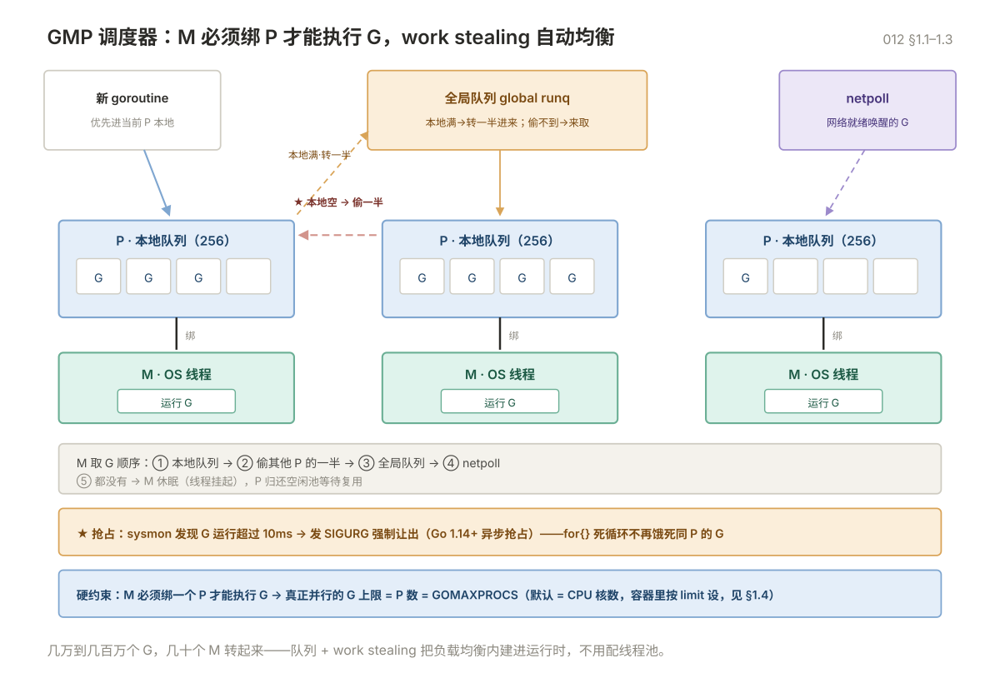

# 012 GMP 调度与内存模型

> **解决**：运行时怎么调度成千上万的 goroutine，以及并发正确性的内存模型底线。
> **范围**：运行时与调度器 GMP · 内存模型与数据竞争。
> **口径**：Go 1.22+（1.14+ 异步抢占）。
> **更新**：2026-11-06

## 目录

| 节 | 内容 |
|---|---|
| 1 | 运行时与调度器 GMP |
| 2 | 内存模型与数据竞争 |

---
## 1. 运行时与调度器 GMP

### 1.1 三个字母

| 符号 | 是什么 | 数量 |
|---|---|---|
| **G** | goroutine，协程 | 几万到几百万 |
| **M** | machine，操作系统线程 | 默认上限 10000（`debug.SetMaxThreads`） |
| **P** | processor，逻辑处理器，持有运行队列 | 启动时固定 = `GOMAXPROCS`，默认等于 CPU 核数 |

关键约束：**M 必须绑定一个 P 才能执行 G**。所以真正并行的 goroutine 数量上限就是 P 的数量。

```go
runtime.NumCPU()        // 物理核数
runtime.GOMAXPROCS(0)   // 当前 P 的数量（读，不改）
runtime.NumGoroutine()  // 当前 goroutine 数
```

### 1.2 调度流程

```
新 goroutine → 优先放入当前 P 的本地队列（容量 256）
                  ↓ 满了
              转移一半到全局队列
                  ↓
空闲 M ← 绑定 P ← 从本地队列取 G 执行
                  ↓ 本地为空
              先偷其他 P 的一半（work stealing），再取全局队列
                  ↓ 全局也为空
              从 netpoll 取（网络事件唤醒的 G）
                  ↓ 都没有
              M 休眠，P 放回空闲池
```

**work stealing 是 Go 调度的核心**：它让负载自动均衡，不需要用户配置线程池。

### 1.3 抢占：为什么死循环不会饿死别人

Go 1.14 之前是协作式抢占（只在函数调用点检查），所以 `for {}` 这种无函数调用的循环会导致整个 P 被独占，其他 goroutine 饿死。

Go 1.14 起是**基于信号的异步抢占**：`sysmon` 检测到某个 G 运行超过 10ms，发 `SIGURG` 强制它让出。



```go
func main() {
	go func() {
		for {          // 现在不会饿死主 goroutine 了
		}
	}()
	time.Sleep(time.Second)
	fmt.Println("能打印出来")
}
```

`sysmon` 是一个不绑定 P 的特殊线程，还负责：触发 GC、回收长时间阻塞的 P、netpoll。

### 1.4 GOMAXPROCS 怎么设

| 场景 | 建议 |
|---|---|
| 纯 CPU 计算 | 等于核数（默认就是） |
| 大量 IO 等待（HTTP 服务） | 可以略小于核数，减少线程切换，但收益有限 |
| **容器里** | **必须显式设置**，见下 |

**容器里的坑**：Go 1.24 之前，`NumCPU` 读的是**宿主机核数**，不是 cgroup 限制。一个 4 核 limit 的容器跑在 64 核机器上，会创建 64 个 P，导致严重的线程切换和内存开销。

```go
// Go 1.25 起默认尊重 cgroup 限制。旧版本用 automaxprocs：
import _ "go.uber.org/automaxprocs"
```

或者启动时显式设：

```bash
GOMAXPROCS=4 ./app
```

### 1.5 goroutine 的开销

| 项 | 数值 |
|---|---|
| 初始栈 | 2KB |
| 栈增长 | 按需翻倍，最大默认 1GB |
| 创建耗时 | 约 200ns（线程是 10μs 级） |
| 切换耗时 | 约 100ns（线程是 1μs 级） |

所以"起 10 万个 goroutine"完全正常，但"每个 goroutine 都阻塞在一个没人写的 channel 上"就是泄漏。

---

## 2. 内存模型与数据竞争

### 2.1 什么是数据竞争

两个 goroutine 同时访问同一变量，至少一个是写，且没有同步 → **数据竞争（data race）**，行为未定义。

```go
var counter int

for i := 0; i < 1000; i++ {
	go func() { counter++ }()      // 竞争！counter++ 是读-改-写三步
}
```

`counter++` 不是原子操作，两个 goroutine 可能都读到 5，都写 6，最终少加一次。

### 2.2 竞态检测器

```bash
go test -race ./...
go run -race main.go
go build -race -o app-race .
```

`-race` 会让程序慢 5-10 倍、内存涨 5-10 倍，**只能在测试和预发用，不能上生产**。

输出会精确指出两处访问的代码行：

```
WARNING: DATA RACE
Write at 0x00c00001a0a8 by goroutine 7:
  main.main.func1()
      /app/main.go:8 +0x44
Previous write at 0x00c00001a0a8 by goroutine 8:
  main.main.func2()
      /app/main.go:8 +0x44
```

**CI 里必须跑 `-race`**，这是 Go 项目最容易漏掉的一环。

### 2.3 happens-before

Go 内存模型保证的同步关系（Go 1.19 起有正式文档）：

| 操作 A | 操作 B | 保证 |
|---|---|---|
| channel 发送 | 对应的接收完成 | A happens-before B |
| channel 关闭 | 接收到零值 | 关闭前的写对接收方可见 |
| `sync.Mutex.Unlock` | 后续的 `Lock` | 临界区内的写对下一个持锁者可见 |
| `sync.Once.Do` 返回 | 所有 `Do` 返回 | 初始化内容对所有调用方可见 |
| `atomic` 操作 | 后续的 atomic 操作 | 顺序一致（Go 1.19 的 atomic 类型） |
| `wg.Done` | `wg.Wait` 返回 | goroutine 内的写对 Wait 之后可见 |

不在这张表里的"看起来像同步"的写法都不保证：

```go
// ❌ 靠 sleep 保证顺序，不可靠
go func() { data = 1 }()
time.Sleep(time.Millisecond)
fmt.Println(data)          // 可能还是 0

// ✅ 用 channel 建立 happens-before
done := make(chan struct{})
go func() {
	data = 1
	close(done)
}()
<-done
fmt.Println(data)          // 一定是 1
```

### 2.4 三种正确姿势

```go
// 1. 消息传递（首选）
ch <- v

// 2. 互斥锁
mu.Lock()
v++
mu.Unlock()

// 3. 原子操作（只适合简单计数、标志位）
atomic.AddInt64(&counter, 1)
```

---


---

**下一篇**：[013 GC：内存管理与调优](013-GC内存管理与调优.md) —— 垃圾回收从入门到调优。
