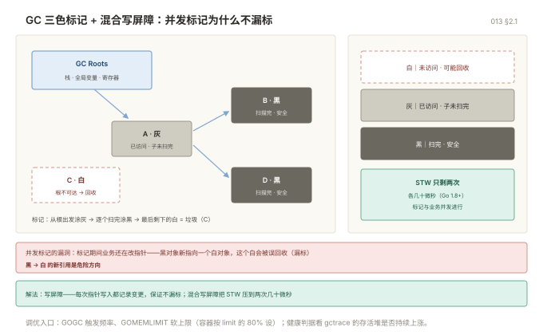

# 013 GC：内存管理与调优

> **解决**：GC 怎么工作、怎么看有没有问题、怎么调——从栈堆基础到三色标记与 GOMEMLIMIT。
> **范围**：栈和堆 · GC 工作方式 · 三色标记与混合写屏障 · 调优参数与 gctrace。
> **口径**：Go 1.22+；GOGC/GOMEMLIMIT 为官方参数。
> **更新**：2026-11-06

## 目录

| 节 | 内容 |
|---|---|
| 1 | 内存管理与 GC 入门 |
| 2 | GC 深入与调优 |

---
## 1. 内存管理与 GC

### 1.1 栈和堆

- **栈**：函数调用时分配，函数返回自动回收，极快。每个 goroutine 初始 2KB，按需增长。
- **堆**：逃逸出函数的变量，由 GC 管理。

**逃逸分析**决定变量去哪：

```bash
go build -gcflags='-m' ./...      # 看逃逸分析结果
go build -gcflags='-m -m' ./...   # 更详细的原因
```

输出示例：

```
./main.go:10:2: moved to heap: x
./main.go:15:9: s does not escape
```

常见逃逸原因：

| 原因 | 例子 |
|---|---|
| 返回局部变量指针 | `return &T{}` |
| 存进 interface | `fmt.Println(x)` 里 x 装箱 |
| 闭包捕获 | 引用了外部变量 |
| 切片/map 元素是指针 | 底层数组在堆上 |
| 变量太大 | 超过栈帧限制 |
| 发送到 channel | 跨协程必须共享 |

**优化方向不是"消灭所有逃逸"**，而是"减少高频路径上的分配"。用 `go build -gcflags='-m'` 找到热点的逃逸，再针对性改。

### 1.2 GC 工作方式

Go 的 GC 是**并发三色标记 + 写屏障**，目标是 STW 控制在亚毫秒级。

| 阶段 | 做什么 | 是否 STW |
|---|---|---|
| Mark Setup | 开启写屏障 | 极短 STW |
| Concurrent Mark | 并发标记可达对象 | 否（和业务并行） |
| Mark Termination | 收尾 | 极短 STW |
| Concurrent Sweep | 并发清扫 | 否 |

关键参数：

```bash
GOGC=100          # 默认。堆增长 100% 触发一次 GC。调大=GC 更少但内存更高
GOGC=off          # 关闭 GC（只适合批处理短程序）
GOMEMLIMIT=4GiB   # Go 1.19+，软内存上限，防止 OOM
GODEBUG=gctrace=1 # 打印每次 GC 的详细数据
```

`GOGC` 和 `GOMEMLIMIT` 应该配合用：`GOMEMLIMIT` 是硬约束，`GOGC` 是调节频率。

```bash
# 看 GC 开销是否过高：gc CPU 占比 > 20% 就该优化了
GODEBUG=gctrace=1 ./app 2>&1 | head
```

### 1.3 减少 GC 压力的手段

```go
// 1. 复用对象
var bufPool = sync.Pool{
	New: func() any { return make([]byte, 0, 4096) },
}

func handle() {
	b := bufPool.Get().([]byte)
	defer bufPool.Put(b[:0])           // 注意重置长度
	// 用 b
}

// 2. 预分配容器
m := make(map[string]int, 1000)

// 3. 避免不必要的指针（结构体存值比存指针 GC 扫描量小）

// 4. 大对象用指针，小对象用值（避免复制开销大于 GC 收益）
```

---

## 2. GC 深入与调优

### 3.1 三色标记 + 混合写屏障

| 颜色 | 含义 |
|---|---|
| 白 | 未访问，可能被回收 |
| 灰 | 已访问但子对象未扫描完 |
| 黑 | 已访问且子对象扫描完，安全 |

标记过程：从根（栈、全局变量、寄存器）出发，把可达对象涂灰，逐个扫描涂黑，最后剩下的白对象就是垃圾。

**并发标记的问题**：标记进行时，业务代码还在改指针，可能把黑对象指向白对象，导致白对象被误回收。

解法是**写屏障**：每次写指针时记录变更，保证不漏标。Go 1.8 起用**混合写屏障**，把 STW 压到两次几十微秒的短停顿。



### 3.2 两个调优参数

```bash
GOGC=100            # 默认。上次 GC 后堆大小翻倍就触发下一次
GOGC=200            # GC 频率减半，内存翻倍
GOGC=off            # 只在极短命的批处理里用
GOMEMLIMIT=2GiB     # 软上限。接近时提前触发 GC，防 OOM
```

**正确组合方式**：`GOMEMLIMIT` 设成容器 limit 的 80% 左右，`GOGC` 保持默认或略调大。

```bash
# 容器 limit 4GiB 的服务
GOMEMLIMIT=3200MiB GOGC=100 ./app
```

`GOMEMLIMIT` 是**软限制**，它不会阻止内存超过上限，只是提前更卖力地回收。如果存活对象真的超过上限，还是会 OOM。

### 3.3 怎么看 GC 是否有问题

```bash
GODEBUG=gctrace=1 ./app 2>&1 | head -5
```

```
gc 1 @0.012s 0%: 0.008+0.12+0.003 ms clock, 0.064+0.10/0.05/0.002+0.024 ms cpu, 4->4->2 MB, 5 MB goal, 8 P
```

| 字段 | 含义 | 关注点 |
|---|---|---|
| `@0.012s` | 程序启动后时间 | GC 是否越来越频繁 |
| `0%` | GC 占用 CPU 比例 | **> 20% 就该优化** |
| `0.008+0.12+0.003` | STW + 并发标记 + STW | 总 STW 是否超毫秒 |
| `4->4->2 MB` | GC前堆 → GC后堆 → 存活堆 | 存活堆持续涨 = 内存泄漏 |
| `5 MB goal` | 下次触发的目标 | — |

**判据**：如果 `存活堆` 在长时间运行后稳定不涨，那就没泄漏；如果一路向上，就是泄漏，去 pprof 看 heap。

### 3.4 降低 GC 压力的四个手段

```go
// 1. sync.Pool（高频短命对象）
var bufPool = sync.Pool{New: func() any { return new(bytes.Buffer) }}

func handle() {
	b := bufPool.Get().(*bytes.Buffer)
	b.Reset()                    // 必须重置！
	defer bufPool.Put(b)
	// ...
}

// 2. 预分配（能算出大小的都预分配）
result := make([]Item, 0, len(input))
m := make(map[string]*User, 1000)

// 3. 减少指针（GC 只扫描指针，结构体存值比存指针扫描量小）
type Point struct{ X, Y int }
// []Point 比 []*Point 对 GC 友好得多

// 4. 批处理（减少分配次数）
// 一次分配 1000 个，比循环里分配 1000 次省 999 次 GC 记账
```

`sync.Pool` 有两个特性必须知道：**内容可能在任何一次 GC 后被清空**（不能当缓存用），且**取出的对象必须重置状态**（否则带上一次的数据，是经典 bug）。

---


---

**下一篇**：[014 pprof 与性能调优](014-pprof与性能调优.md) —— 用 profile 定位真热点。
