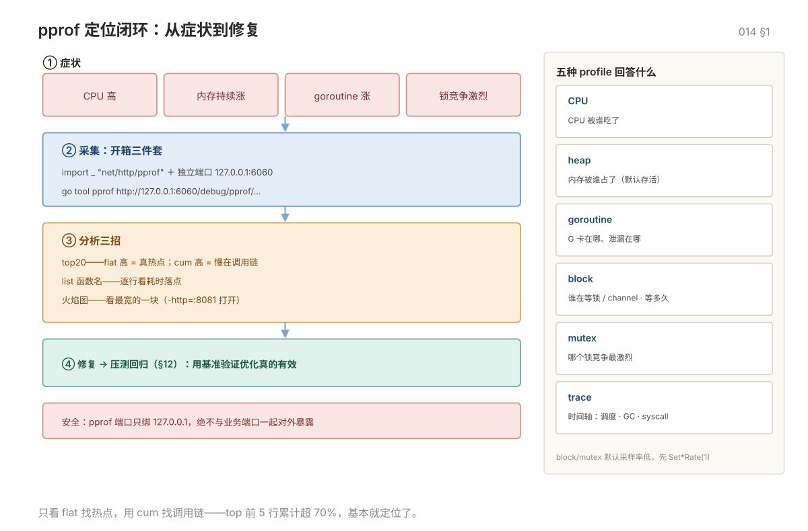

# 014 pprof 与性能调优

> **解决**：CPU/内存/goroutine 的问题用 profile 定位到行，并用高性能写法修掉。
> **范围**：pprof 全家桶 · 高性能写法 · 性能回归与压测。
> **口径**：Go 1.22+；pprof 端口只绑 127.0.0.1。
> **更新**：2026-11-06

## 目录

| 节 | 内容 |
|---|---|
| 1 | pprof 全家桶 |
| 2 | 高性能写法 |
| 3 | 性能回归与压测 |
| 4 | 常见坑：采集与结论 |
| 5 | 检查清单 |

---
## 1. pprof 全家桶

### 1.1 开箱即用

```go
import _ "net/http/pprof"          // 匿名导入即注册路由

func main() {
	go func() {
		// 用独立端口，别和业务端口混在一起对外暴露
		log.Println(http.ListenAndServe("127.0.0.1:6060", nil))
	}()
	// 业务代码
}
```

命令行程序也可以直接写 profile 文件：

```go
f, _ := os.Create("cpu.prof")
pprof.StartCPUProfile(f)
defer pprof.StopCPUProfile()
```

### 1.2 五种 profile

| 类型 | 路径 | 回答什么问题 |
|---|---|---|
| **CPU** | `/debug/pprof/profile?seconds=30` | CPU 被谁吃了 |
| **heap** | `/debug/pprof/heap` | 内存被谁占了（默认是存活对象） |
| **goroutine** | `/debug/pprof/goroutine?debug=2` | 这么多 goroutine 卡在哪 |
| **block** | `/debug/pprof/block` | 谁在等锁/channel，等了多久 |
| **mutex** | `/debug/pprof/mutex` | 哪个锁竞争最激烈 |
| **trace** | `/debug/pprof/trace?seconds=5` | 时间轴：调度、GC、syscall 全景 |

`block` 和 `mutex` 默认采样率很低，要先开：

```go
runtime.SetBlockProfileRate(1)        // 1 = 每次阻塞都记录（开销大，只用于排查）
runtime.SetMutexProfileFraction(1)
```

### 1.3 分析命令

```bash
# CPU：采 30 秒
go tool pprof http://127.0.0.1:6060/debug/pprof/profile?seconds=30
# 进入交互后
(pprof) top20                 # 前 20 个热点函数
(pprof) list myFunc           # 逐行看某函数的耗时
(pprof) web                   # 生成调用图（需要 graphviz）

# 堆：看谁占内存
go tool pprof http://127.0.0.1:6060/debug/pprof/heap
(pprof) top20 -cum            # 按累计内存排序
(pprof) list myFunc

# goroutine 泄漏：直接看文本
curl -s 'http://127.0.0.1:6060/debug/pprof/goroutine?debug=2' | head -50
```

**读 `top` 输出的关键**：

```
flat  flat%   sum%        cum   cum%
 1.2s  30.0%  30.0%      2.4s  60.0%  runtime.mallocgc
 0.8s  20.0%  50.0%      0.8s  20.0%  encoding/json.Marshal
```

| 列 | 含义 | 怎么看 |
|---|---|---|
| `flat` | 函数自身耗时（不含调用子函数） | 高 = 这里真的在算 |
| `cum` | 函数累计耗时（含子函数） | 高但 flat 低 = 只是调用了别人的慢函数 |
| `sum%` | 累计占比 | 前 5 行超过 70% 就基本定位了 |

**只看 flat 找热点，用 cum 找调用链。**

### 1.4 火焰图

```bash
go tool pprof -http=:8081 http://127.0.0.1:6060/debug/pprof/profile?seconds=30
```

浏览器自动打开，选 Flame Graph。**看最宽的那块，横向是占比，纵向是调用栈（上宽下窄）。**



### 1.5 trace：看时间轴

CPU profile 是统计采样，trace 是逐事件记录，用来看**调度延迟和 GC 停顿**：

```bash
go tool trace http://127.0.0.1:6060/debug/pprof/trace?seconds=5
```

能回答的问题：为什么 P 有空闲但请求延迟高（可能是 sysmon 抢占不及时）、GC 停顿的具体时刻和多长、某个 goroutine 从创建到执行的等待时间。

### 1.6 生产环境的安全

**pprof 端点绝对不要暴露在公网**，里面有内存内容、函数名、调用栈，属于信息泄露。

| 做法 | 说明 |
|---|---|
| 只监听 127.0.0.1 | 通过 SSH 隧道访问 |
| 独立端口 + 防火墙白名单 | 和业务端口隔离 |
| 独立管理端口，只在内网 | K8s 里用单独的 named port |
| 带认证的 mux | 自己注册而不是匿名导入 |

```bash
# SSH 隧道访问生产 pprof
ssh -L 6060:127.0.0.1:6060 user@prod-host
# 然后本地 go tool pprof http://127.0.0.1:6060/debug/pprof/heap
```

---

## 2. 高性能写法

### 2.1 减少分配

最有效的优化几乎都是"少分配"，因为分配要触发 GC，GC 要占 CPU。

```go
// ❌ 每次循环都分配
for _, s := range items {
	fmt.Println("item: " + s)          // 一次字符串拼接 = 一次分配
}

// ✅ 复用 buffer
var b strings.Builder
for _, s := range items {
	b.Reset()
	b.WriteString("item: ")
	b.WriteString(s)
	_, _ = os.Stdout.WriteString(b.String())
}
```

### 2.2 常见分配来源

| 来源 | 消除方法 |
|---|---|
| `fmt.Sprintf` | 用 `strconv` + `strings.Builder` 替代 |
| 字符串与 `[]byte` 互转 | 尽量在一侧处理完，不来回转 |
| 接口装箱（`any` 参数） | 热路径用泛型或具体类型 |
| 闭包捕获 | 抽成普通函数或传参 |
| 返回指针 | 小结构体返回值 |
| 切片未预分配 | `make([]T, 0, n)` |
| map 未预分配 | `make(map[K]V, n)` |

### 2.3 字符串与数字转换

```go
// 慢：fmt.Sprintf 要解析格式串
s := fmt.Sprintf("%d", n)

// 快：strconv 专用函数
s := strconv.Itoa(n)
```

在每秒几十万次调用的路径上，这个差别是数量级的。

### 2.4 避免不必要的接口

```go
// 慢：每次调用都要装箱 + 动态派发
func Sum(vs []any) int { ... }

// 快：泛型，编译期单态化
func Sum[T ~int | ~int64](vs []T) T { ... }
```

泛型在 Go 里不是零成本（有字典传递开销），但比接口装箱便宜得多。

### 2.5 批量而非逐条

```go
// ❌ 一次一条 SQL，1 万条 = 1 万次往返
for _, u := range users {
	db.Exec("INSERT INTO t VALUES (?)", u.Name)
}

// ✅ 批量提交，几百倍差距
db.Exec("INSERT INTO t (name) VALUES " + placeholders, args...)
```

同理适用于：HTTP 请求、Redis 命令（pipeline）、日志写入（批量 flush）。

### 2.6 CPU 密集用池，IO 密集用并发

| 场景 | 策略 |
|---|---|
| CPU 密集（编解码、压缩、加密） | 并发数 = 核数，超过只会增加切换 |
| IO 密集（HTTP、DB、文件） | 并发数可以远大于核数（几十到几百） |
| 混合 | 分开两个池，别让 IO 阻塞占满 CPU 池 |

### 2.7 优化顺序（重要）

```
1. 先测量：pprof 定位真正的热点
2. 再优化：只改占比 > 5% 的地方
3. 再测量：benchstat 确认有提升
4. 不满意就重复
```

**没测量过的优化一律不做。** 凭直觉优化的结果经常是：代码难读了，性能没变，甚至更慢（因为破坏了缓存局部性）。

---

## 3. 性能回归与压测

### 3.1 基准对比流程

```bash
# 1. 改动前，跑 10 轮降低噪声
git stash
go test -bench=BenchmarkHandle -count=10 -benchmem > old.txt
git stash pop

# 2. 改动后
go test -bench=BenchmarkHandle -count=10 -benchmem > new.txt

# 3. 对比
benchstat old.txt new.txt
```

```
                │   old.txt    │          new.txt           │
                │    sec/op    │   sec/op     vs base       │
HandleRequest-8   1.245µ ± 2%   0.872µ ± 1%  -29.96% (p=0.000)
                │    B/op      │    B/op      vs base       │
HandleRequest-8    512.0 ± 0%    128.0 ± 0%  -75.00% (p=0.000)
```

`p=0.000` 表示差异显著，`± 2%` 是波动范围。**波动超过 10% 说明测试环境不稳定，结果不可信**（可能是 CPU 降频、其他进程干扰）。

### 3.2 压测工具

| 工具 | 特点 |
|---|---|
| `hey` | 简单，`hey -n 10000 -c 100 URL` |
| `wrk` | 高性能，支持 Lua 脚本 |
| `vegeta` | 恒定速率压测，结果可导出图表 |
| `k6` | 脚本化场景，适合复杂业务流程 |

**压测必须看 p99 而不是平均值。** 平均值 50ms 但 p99 是 2s，说明有 1% 的用户在挨打。

### 3.3 常见性能问题定位顺序

```
1. 先看是不是 GC：GODEBUG=gctrace=1，看 gc CPU%
2. 再看 CPU 热点：pprof profile，top20 flat
3. 再看内存：pprof heap，看存活对象和分配点
4. 再看阻塞：pprof block / mutex，看锁竞争
5. 再看调度：trace，看 P 是否空闲、goroutine 等待时间
6. 最后看外部：DB 慢查询、下游超时、网络 RTT
```

**顺序不能反**。直接从第 6 步猜"是不是数据库慢"，会浪费大量时间。

---

## 4. 常见坑：采集与结论

| # | 坑 | 现象 | 正确做法 |
|---|---|---|---|
| 1 | 匿名导入 pprof 且监听 `0.0.0.0` | 端点暴露公网，内存内容与调用栈可被读取 | 只绑 `127.0.0.1`，用 SSH 隧道；或独立端口加白名单 |
| 2 | 直接看 `block` / `mutex` 拿不到数据 | 端点有响应但没有样本 | 先 `SetBlockProfileRate(1)` / `SetMutexProfileFraction(1)`，排查完关掉 |
| 3 | 采样率设置留在生产 | 每次阻塞都记录，CPU 明显变高 | 只在实际排查期间开，或通过开关动态控制 |
| 4 | 只盯 `flat` 或只盯 `cum` | 优化了不占时间的地方，或误判调用者 | `flat` 找自己算得多的，`cum` 找调用链上游 |
| 5 | 凭直觉做优化不测量 | 代码变难读，性能没变甚至更差 | 先 pprof 定位，只改占比 > 5% 的点，改完 benchstat 验证 |
| 6 | 压测只看平均延迟 | 平均 50ms 看着正常，p99 已到 2s | 看 p99 / p999，平均值会掩盖长尾 |
| 7 | benchstat 波动超过 10% 还下结论 | 结论不可复现，被"优化"骗了 | 波动超 10% 说明环境不稳，重跑或固定 CPU 频率 |

---

## 5. 检查清单

| # | 问题 | 判据 |
|---|---|---|
| 1 | pprof 端点在哪监听？谁能访问？ | 只绑 `127.0.0.1` 或内网管理端口，公网不可达 |
| 2 | 五种 profile 各回答什么问题？ | CPU/堆/goroutine/block/mutex，另加 trace 看时间轴 |
| 3 | `flat` 与 `cum` 怎么配合看？ | `flat` 高是真热点；`cum` 高 `flat` 低说明只是调用者 |
| 4 | 优化前有基线吗？ | 改动前 `-count=10 -benchmem` 存 baseline，改后 benchstat 对比 |
| 5 | 压测看的是哪个分位数？ | p99 起，不看平均值 |
| 6 | 排查顺序是什么？ | GC → CPU 热点 → 内存 → 阻塞 → 调度 → 外部依赖，不跳步 |

---

**下一篇**：[015 并发高级、泛型与反射](015-并发高级泛型与反射.md) —— 单 chan、泛型与反射的边界。
