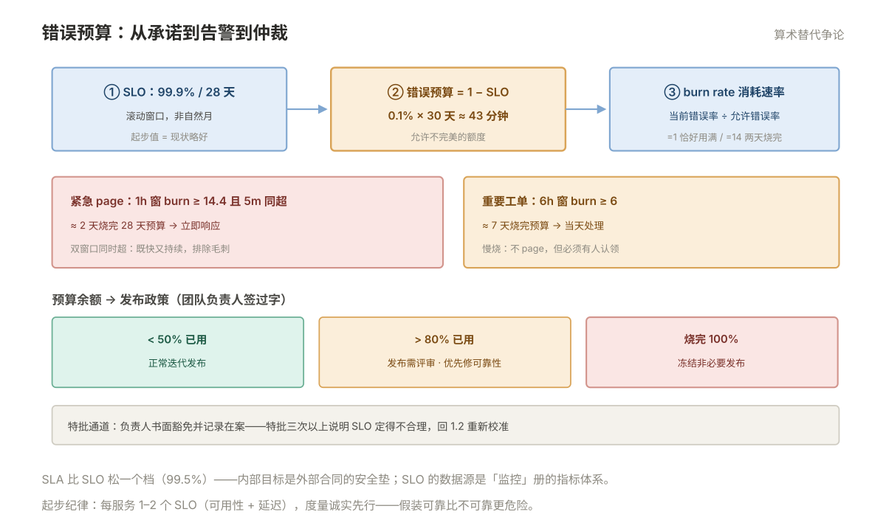

# 001 SLO 与错误预算

> **解决**：可靠性怎么从"感觉"变成"可度量的承诺"，发布与稳定的争论怎么被数据仲裁。  
> **范围**：SLI · SLO · 错误预算 · burn rate 告警 · SLO 文档化。  
> **口径**：数据源来自「监控」册的指标体系；窗口以 28 天滚动为准。  
> **更新**：2026-11-01

## 目录

| 节 | 内容 |
|---|---|
| 1.1 | SLI：用户视角的度量信号 |
| 1.2 | SLO：目标值为什么不是 100% |
| 1.3 | 错误预算：允许不完美的额度 |
| 1.4 | 基于 burn rate 的告警 |
| 1.5 | SLO 文档化与评审 |
| 1.6 | 六个坑 |
| 1.7 | 本章检查清单 |
| 1.8 | 最小可复现实验：把 burn rate 双窗口落成一条告警规则 |

---

## 1.1 SLI：用户视角的度量信号

SLI 是"用户怎么看这个服务"的度量，四类经典信号：

| SLI | 度量 | 数据源（本库） |
|---|---|---|
| 可用性 | 成功请求数 ÷ 总请求数 | 接入层 access log / 应用指标（「接入层」005 的日志聚合可作补充） |
| 延迟 | P99 响应时间 | 「监控」册指标（histogram） |
| 正确性 | 返回正确结果的占比 | 业务指标 |
| 新鲜度 | 数据更新延迟 | 批处理/同步类系统 |

三条选择纪律：**SLI 必须从用户视角定义**（"CPU 使用率 < 80%" 不是 SLI——CPU 空转时用户照样苦）；**一上来只选 1–2 个**（可用性 + 延迟覆盖大多数服务）；**度量要有原始数据**——「监控」册没采的指标先补采集再谈 SLO。

---

## 1.2 SLO：目标值为什么不是 100%

SLO 是对 SLI 的内部承诺：**"过去 28 天滚动窗口内，可用性 ≥ 99.9%"**。

为什么目标不是 100%？——三个理由层层递进：**100% 不可度量验证**（任何一次重启都违规）；**100% 成本无穷大**（冗余、冻结发布、拒绝一切变更）；**100% 与迭代对立**（没有预算就没有创新空间）。合理的 SLO 起步值：**比现状略好**——度量到当前是 99.7%，就定 99.8%，跳一跳够得着，别定 99.99% 的空中楼阁。

SLO 的两个技术细节：**窗口用 28 天滚动**而非自然月（月初"清零"会掩盖月末的灾难）；**SLO 是内部目标**，对外合同 SLA 必须比 SLO 更松（SLO 99.9% → SLA 99.5%——内部目标是外部承诺的安全垫）。

---

## 1.3 错误预算：允许不完美的额度

错误预算 = 1 − SLO，换算成时间是这套机制最有体感的地方：

```plain
SLO 99.9%（28 天窗口）→ 错误预算 = 0.1% × 30 天 ≈ 43 分钟
含义：28 天内累计"不达标时间/等效损失"允许 43 分钟
```

预算的四种花法与仲裁机制：

| 预算状态 | 政策 |
|---|---|
| 余额充足（<50% 已用） | 正常迭代发布 |
| 快烧完（>80% 已用） | 发布需评审、优先修可靠性 |
| **烧完（100%）** | **冻结非必要发布，全员优先恢复可靠性** |
| 持续超支 | 收紧 SLO 讨论或投入架构改进——不是罚人 |

价值在一句话里：**"要不要发新版本"的无限争论，被预算余额一票裁决**。产品要快、运维要稳的百年对立，变成"预算还剩多少"的算术。



---

## 1.4 基于 burn rate 的告警

SLO 告警不看"当前错误率 > 阈值"（噪音大），看**错误预算的消耗速度（burn rate）**：

```plain
burn rate = 当前错误率 ÷ SLO 允许的错误率
  burn rate = 1  → 恰好用满预算（28 天正好烧完）
  burn rate = 14 → 14 倍速消耗（约 2 天烧完 28 天预算）→ 紧急 page
```

经典的双窗口配置（快慢烧各一档，避免既漏报又误报）：

| 级别 | 条件 | 动作 |
|---|---|---|
| 紧急 page | 1h 窗口 burn ≥ 14.4 **且** 5m 窗口同样超 | 快烧：立即响应 |
| 重要工单 | 6h 窗口 burn ≥ 6 | 慢烧：当天处理 |

（14.4 与 6 是业界常用的推导值——分别对应"1 小时烧掉 2% 预算"与"6 小时烧掉 5%"。）配置落地在「监控」004 的告警链路——SLO 告警的本质是**对预算余额的指标告警**。

---

## 1.5 SLO 文档化与评审

没有文档的 SLO 等于没有。最小文档（每个服务一页）：

- **服务与用户旅程**：SLO 保护的是哪条用户路径；
- **SLI 定义与公式**：精确到查询语句（监控面板链接）；
- **SLO 目标与窗口**：99.9% / 28 天，及"为什么是这个数"；
- **错误预算政策**：烧完后的动作（冻结发布/优先级），**团队负责人签过字**；
- **评审节奏**：季度回顾——目标是否还符合用户期待。

---

## 1.6 六个坑

| # | 坑 | 后果 | 正确做法 |
|---|---|---|---|
| 1 | SLO 定 100% 或过高 | 永远违约，机制无人再信 | 比现状略好，逐步收紧 |
| 2 | SLI 用机器指标 | CPU 低但用户苦 | 用户视角信号（1.1） |
| 3 | SLO 没接告警 | 定了等于没定 | burn rate 双窗口（1.4） |
| 4 | 预算烧完继续发布 | 机制信用破产 | 签过字的预算政策必须执行 |
| 5 | 一次定几十个 SLO | 维护不动，全员放弃 | 每服务 1–2 个起步 |
| 6 | 自然月窗口 | 月初清零掩盖月末灾难 | 28 天滚动窗口 |

第 4 条展开：预算政策执行的第一周一定有冲突——产品坚持"这个功能必须今天上"，而预算刚烧完。这是机制的**建立时刻**而不是失效时刻：负责人按签字的政策说"预算烧完了，要么修可靠性要么书面特批并承担风险"——**特批通道可以存在（豁免记录在案），但裁决必须按流程走**。特批三次以上，说明 SLO 定得不合理，回 1.2 重新校准。

---

## 1.7 本章检查清单

读完能回答这六个问题，这一章就过了：

| # | 问题 |
|---|---|
| 1 | SLI 的四类信号？为什么"CPU < 80%"不是 SLI？ |
| 2 | SLO 为什么不是 100%？起步值怎么定？ |
| 3 | 99.9% 的 28 天错误预算换算成分钟是多少？ |
| 4 | burn rate = 14 意味着什么？双窗口告警为什么是两个？ |
| 5 | 预算烧完的标准动作？特批通道怎么设计？ |
| 6 | SLA 与 SLO 谁更松？为什么？ |

---

## 1.8 最小可复现实验：把 burn rate 双窗口落成一条告警规则

1.4 给出「紧急 page：1h 窗口 burn ≥ 14.4 且 5m 窗口同样超；重要工单：6h 窗口 burn ≥ 6」。这一节把它写成一条能被 Prometheus 加载、能被 `promtool` 校验的规则。**指标名与标签按自家 SLI 替换**——SLI 定义是前提，见 1.1。

**① 先立 SLI 错误率查询**（粘到 Prometheus / Grafana Explore 应能画出曲线）：

```promql
sum(rate(http_requests_total{job="api",code=~"5.."}[5m]))
  / sum(rate(http_requests_total{job="api"}[5m]))
```

**② 规则文件 `slo-burn.yaml`**（`0.001` = 1 − 99.9% 的允许错误率，14.4 / 6 取自 1.3~1.4；换 SLO 目标时这几个数一起换）：

```yaml
groups:
  - name: slo-burn
    rules:
      - record: job:slo_errors:ratio_rate5m
        expr: sum(rate(http_requests_total{job="api",code=~"5.."}[5m])) / sum(rate(http_requests_total{job="api"}[5m]))
      - record: job:slo_errors:ratio_rate1h
        expr: sum(rate(http_requests_total{job="api",code=~"5.."}[1h])) / sum(rate(http_requests_total{job="api"}[1h]))
      - alert: SLOBurnFast
        expr: job:slo_errors:ratio_rate5m > 14.4 * 0.001 and job:slo_errors:ratio_rate1h > 14.4 * 0.001
        for: 2m
        labels:
          severity: page
        annotations:
          summary: "1h 与 5m 双窗口同时快烧，错误预算即将耗尽"
```

「重要工单」档同法：把两个窗口换成 6h / 30m，阈值换成 `6 * 0.001`，`severity` 降为 ticket。

**③ 校验与触发路径**

```bash
promtool check rules slo-burn.yaml     # 语法与表达式校验，不通过不许加载
```

加载后在 Prometheus 的 Alerts 页观察 `inactive → pending → firing`。`for: 2m` 让快烧持续一段时间才 page，配合快慢双窗口抑制瞬时抖动——这正是 1.4「双窗口」要治的噪音。

**④ 判定与边界**：在 Explore 里挑一段错误率抬升的窗口，确认两条 recording rule 同步抬升、且只有两条同时越线才 firing。**本实验只验证语法与触发路径，不验证 SLO 有效性**——目标值是否合理、预算政策是否签字，仍按 1.2 / 1.5 评审，不由本实验代替。落地链路见监控板块 004 册的告警规则实战。

---

> 下一篇：《002 待命与应急响应》——故障发生时谁来管、怎么管。
