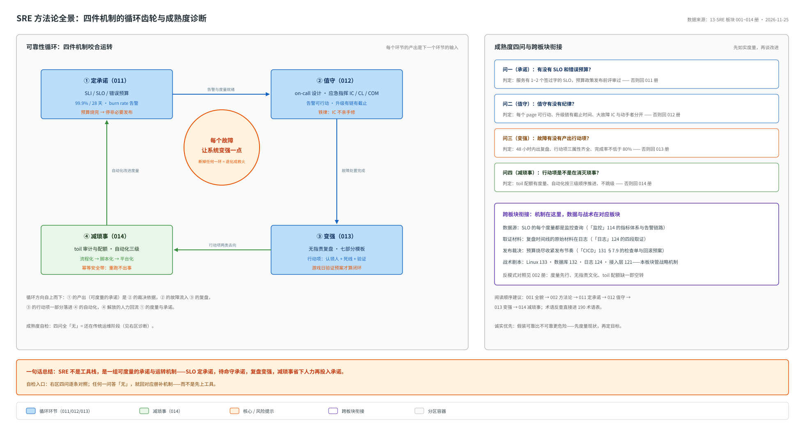

# SRE 全景图

> **这一册回答**：SRE 板块 4 册在可靠性循环上的位置，一张图看清。
> **怎么用**：看图定环，再回 [001-SRE全貌](001-SRE全貌.md) 选册。

## 体系一张图

## 图例说明

| 环节 | 册 | 可靠性循环段 |
| --- | --- | --- |
| 总览三件套 | 001 / 002 / 003 | 全貌 · 方法论 · 本图 |
| 定承诺 | 011 | SLI/SLO/错误预算——把「挺稳的」变成数字 |
| 值守 | 012 | on-call 与应急响应——故障时按纪律行动 |
| 变强 | 013 | 无指责复盘与游戏日——把故障变成改进 |
| 治琐事 | 014 | toil 配额与自动化——把人力还给前三个环节 |
| 附录 | 190 | 术语 · 缩写 · 易混对 · 症状反查 |

图中齿轮自上而下是**循环方向**：每个环节的产出是下一个环节的输入，治琐事解放的人力回流到定承诺——断掉任何一环，可靠性都会退化成救火循环。

---

**上一篇**：[002-SRE方法论](002-SRE方法论.md)　**下一篇**：正文 [011-SLO与错误预算](011-SLO与错误预算.md)
