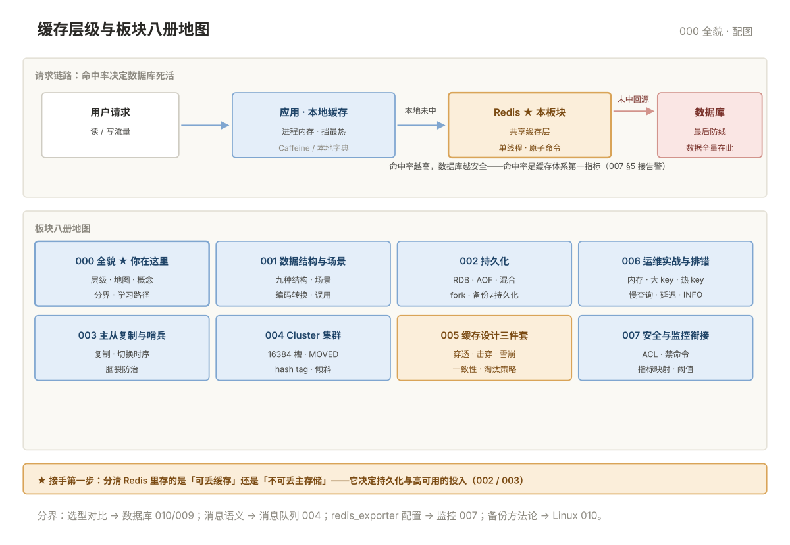

# 000 Redis 全貌

> **这一册回答**：Redis 板块管什么、缓存层级在哪、八册怎么分工、什么问题不归 Redis 管。10 分钟读完装进一张地图。  
> **给谁读**：要上缓存、接手 Redis、响应 Redis 告警的运维/SRE。位于五阶段第四段（中间件与观测）。

## 板块地图

七册一条主线：**先用对（001）→ 存得住（002）→ 挂了有人顶（003/004）→ 用得稳（005）→ 出事救得回（006/007）**。

| 册 | 一句话 | 回答的问题 |
|---|---|---|
| [001 数据结构与场景](001-数据结构与场景.md) | 九种结构各管什么 | String/List/Hash/Set/ZSet/Bitmap/HLL/GEO/Stream 的场景与误用 |
| [002 持久化](002-持久化.md) | 重启后数据还在不在 | RDB/AOF/混合、fork 代价、备份≠持久化 |
| [003 主从复制与哨兵](003-主从复制与哨兵.md) | 一台挂了谁顶上 | 复制原理、哨兵切换、脑裂防治 |
| [004 Cluster 集群](004-Cluster集群.md) | 数据超单机容量怎么分 | 16384 槽、MOVED/ASK、数据倾斜 |
| [005 缓存设计三件套](005-缓存设计三件套.md) | 缓存怎么用不拖垮数据库 | 穿透/击穿/雪崩、一致性、淘汰策略 |
| [006 运维实战与排错](006-运维实战与排错.md) | 出事怎么救 | 内存/大 key/热 key/慢查询/延迟/INFO |
| [007 安全与监控衔接](007-安全与监控衔接.md) | 怎么不裸奔、指标进哪 | ACL/禁命令、redis_exporter 与告警阈值 |
| [00 术语表](00-术语表.md) | 词汇 · 缩写 · 易混对 · 症状反查 | 按主题分组 |

缓存层级与八册位置：

## 核心概念速览

- **缓存层级**：请求先打应用本地缓存 → Redis → 数据库——Redis 挡在数据库前面，命中率决定数据库死活。
- **Redis 不是只能当缓存**：大量系统拿它当会话/锁/排行榜的主存储——接手第一步是分清"可丢"与"不可丢"（002 决定持久化投入）。
- **单线程是双刃剑**：命令执行单线程（6.0 后 IO 多线程）所以原子性好，但一个慢命令/大 key 就能卡住整个实例（006）。
- **三种高可用形态**：主从（复制不切换）→ 哨兵（自动切换不解决容量）→ Cluster（切换+分片容量）——规模决定选型（003/004）。
- **三件套是缓存的第一课**：穿透（查不存在）、击穿（热点过期瞬间）、雪崩（大批失效）——防法各不同（005）。

## 与相邻板块的分界

| 问题 | 去哪 |
|---|---|
| 选型对比（Redis vs MongoDB vs 关系型） | 「数据库」010 §3 · 009 运维差异 |
| Redis Stream 当消息队列合不合适 | 「消息队列」000/004 |
| 备份方法论（RPO/RTO、3-2-1、演练） | 「Linux」010 · 「数据库」005——本板块 002 只讲 Redis 工具 |
| redis_exporter 配置与告警规则 | 「监控」007 · 本板块 007 §5 给指标映射 |
| 客户端连接池的代码实现 | 「Go」/「Python」对应册 |

## 学习路径

- **顺序读**：000 → 001 → 002 → 003 → 005 → 006；上 Cluster 的环境插 004；最后 007。
- **最快救火线**：006 排错路径 → 按现象回查 002~005。
- **按症状进**：内存告警 → 006 §1；卡顿 → 002 §3 / 006 §5；主从切换 → 003；MOVED 报错 → 004 §3。

## 误解澄清

| # | 误解 | 事实 |
|---|---|---|
| 1 | Redis 数据丢了没关系 | 大量系统拿它当主存储——先分清可丢/不可丢再谈策略 |
| 2 | 有持久化就不用备份 | RDB/AOF 都在本机，磁盘坏了全没——异地备份与演练另算 |
| 3 | 加了缓存一定更快 | 缓存穿透会把数据库打得更惨；三件套是上线前置项 |
| 4 | 哨兵能解决容量问题 | 哨兵只管切换；容量不够上 Cluster |
| 5 | Cluster 是高级版，直接上 | 多 key 操作/Lua 受槽限制——单机能扛就别分片 |
| 6 | 内存满了 Redis 会自己删 | 默认 noeviction 是**拒绝写入**——策略必须显式设 |

---

**下一篇**：[001 数据结构与场景](001-数据结构与场景.md) —— 九种结构各管什么。
